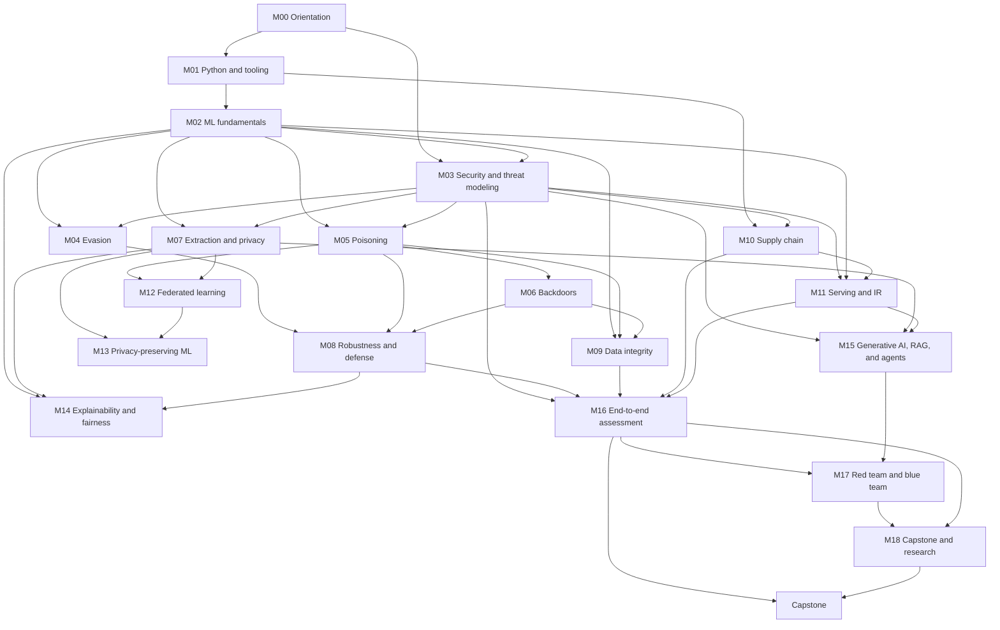

# ML-Sec Module Map

| Field | Value |
|---|---|
| Document | Module-by-module inventory of lessons and labs |
| Version | 0.6 (Level 5 implemented) |
| Date | 2026-10-28 |
| Status | **M00–M18 published**; capstone brief published |
| Companion documents | [Course blueprint](course-blueprint.md) · [Lab catalog](lab-catalog.md) · [Project catalog](project-catalog.md) · [Learning outcomes](learning-outcomes.md) · [Implementation roadmap](implementation-roadmap.md) |

This map is the build order and the navigation contract. A lesson is added to the site only when it has real content. Published entries describe pages that exist; later entries are planned units, not empty files. Project scenarios have their own inventory in the [project catalog](project-catalog.md); this map records the modules that consume them.

## How to read this map

| Prefix | Meaning |
|---|---|
| `Mxx` | Module |
| `Mxx.Ly` | Lesson within a module |
| `LAB-xx` | Lab |
| `QZ-xx` | Knowledge check |
| `MP-xx` | Mini-project |
| `PRJ-xx` | Applied project |
| `RT-xx` | Red-team/blue-team exercise |
| `CAP-x` | Capstone option |
| `LO-xx` | Learning outcome (see [learning-outcomes.md](learning-outcomes.md)) |

Each module has the same anatomy: **scenario → objectives → lessons → lab → quiz → reflection → artifact**.

## 1. Inventory summary

| Module | Lessons | Lab(s) | Quiz | Project | Hours | Status |
|---|---:|---|---|---|---:|---|
| M00 How to Use This Self-Study Course | 3 | LAB-01 (shared) | QZ-00 | — | 4 | **Published** |
| M01 Python, NumPy, pandas, and scikit-learn Refresher | 5 | LAB-01 | QZ-01 | — | 12 | **Published** |
| M02 Machine Learning Fundamentals and Evaluation | 4 | LAB-01B | QZ-02 | — | 12 | **Published** |
| M03 Cybersecurity Fundamentals and ML Threat Modeling | 5 | LAB-02 | QZ-03 | — | 11 | **Published** |
| M04 Adversarial Examples and Evasion Attacks | 5 | LAB-03, LAB-04 | QZ-04 | — | 14 | **Published** |
| M05 Training Data Poisoning and Label Manipulation | 4 | LAB-05, LAB-06 | QZ-05 | MP-01 | 13 | **Published** |
| M06 Backdoor Attacks, Trojan Models, and Trigger-Based Behavior | 4 | LAB-07, LAB-08 | QZ-06 | MP-01 | 14 | **Published** |
| M07 Model Extraction, Membership Inference, and Model Inversion | 5 | LAB-09, LAB-10 | QZ-07 | MP-03 | 14 | **Published** |
| M08 Robustness Evaluation and Adversarial Defense | 6 | LAB-11 | QZ-08 | MP-02 | 16 | **Published** |
| M09 Data Integrity, Dataset Governance, and Secure Training Pipelines | 5 | LAB-12 | QZ-09 | — | 12 | **Published** |
| M10 Model Serialization, Dependencies, and ML Supply-Chain Security | 4 | LAB-13 | QZ-10 | — | 10 | **Published** |
| M11 Secure Model Serving, API Security, Monitoring, and Incident Response | 6 | LAB-14, LAB-15 | QZ-11 | — | 16 | **Published** |
| M12 Federated Learning Security and Distributed ML Threats | 5 | LAB-16 | QZ-12 | — | 14 | **Published** |
| M13 Privacy-Preserving Machine Learning | 5 | LAB-17 | QZ-13 | MP-03 | 12 | **Published** |
| M14 Explainability, Fairness, and Security Trade-offs | 4 | LAB-18 | QZ-14 | — | 10 | **Published** |
| M15 Generative AI, LLM, RAG, and AI Agent Security | 6 | LAB-19, LAB-20 | QZ-15 | MP-04 | 18 | **Published** |
| M16 End-to-End ML Security Assessment | 4 | — | QZ-16 | One of PRJ-01…PRJ-06 | 16 | **Published** |
| M17 ML Red-Team and Blue-Team Simulation | 4 | — | QZ-17 | RT-01 | 14 | **Published** |
| M18 Capstone Projects and Research Extensions | 4 | — | QZ-18 | CAP-A…F | 4 | **Published** |
| CAP Capstone | 1 guide | — | — | CAP-A…F | 40 | **Published (brief)** |
| **Total** | **88** | **21** | **19** | **4 MP + 6 PRJ + RT-01** | **276** | |

Lab count: 20 numbered labs plus the LAB-01 variant, LAB-01B. Guided time is 236 hours, including 84 lab hours; applied projects and RT-01 add 34 hours of project work, and the capstone adds 40 hours. Project scenarios are inventoried separately: six 11-hour projects and the 9-hour RT-01.

## 2. Stage structure

| Stage | Modules | Hours | Focus |
|---|---|---:|---|
| 1 — Foundations | M00–M03 | 39 | Tooling, evaluation, threat modeling |
| 2 — Core attacks | M04–M07 | 55 | Evasion, poisoning, backdoors, extraction and privacy |
| 3 — Defenses and data integrity | M08–M09 | 28 | Robustness audits, defense limits, dataset validation and governance |
| 4 — Secure engineering and operations | M10–M11 | 26 | Supply chain, serving, monitoring and response |
| 5 — Distributed, private, and frontier systems | M12–M15 | 54 | Federated learning, privacy engineering, explainability and fairness, generative AI and agents |
| 6 — Applied projects and synthesis | M16–M18, CAP | 74 | Integrated assessment, red/blue exercise, capstone |
| **Total** | | **276** | |

## 3. Dependency graph

Practical rule: M04–M07 each require M02 and benefit from M03. Learners who skip M03 will struggle to justify threat models in the labs. M08 assumes the attack vocabulary from M04–M06; M09 assumes data-handling skills from M01–M02 and the poisoning perspective from M05–M06; M10–M11 build on the artifact and threat-model discipline of M01–M03; M12 assumes poisoning from M05 and privacy attacks from M07; M13 assumes the privacy attacks from M07 and benefits from M12's distributed-data perspective; M14 assumes evaluation from M02, leakage analysis from M07, and robustness evaluation from M08; M15 assumes threat modeling from M03, privacy attacks from M07, and serving controls from M11, and benefits from M14's treatment of explanation and trust.

M16 is the integration point: it assumes the threat-model discipline of M03, the defense-evaluation method of M08, the data controls of M09, and the artifact and serving controls of M10–M11, and it can be taken with only one project if the learner's time is bounded. M17 assumes the incident-response vocabulary of M11 and the generative-application boundaries of M15, and it is the only module where students attack and defend the same system under written rules of engagement. M18 assumes a completed assessment or project; the capstone is gated on M16 because the proposal must cite a test plan and a baseline, not an intention to produce one later.

## 4. Module detail

### M00 — How to Use This Self-Study Course (4 h)
| ID | Lesson | Scope | Outcome |
|---|---|---|---|
| M00.L1 | What ML security is — and is not | Adversarial ML vs application security vs AI safety; attacker/defender/auditor roles; course map and evidence standard | LO-01, LO-29 |
| M00.L2 | Your lab and your evidence | Environment setup, CPU-first choices, repository layout, artifact manifests, notebook and Git hygiene | LO-01, LO-28 |
| M00.L3 | Rules of engagement | Authorized targets, sandboxing, data ethics, responsible disclosure, AI-assistant policy, local law | LO-29 |
| — | Lab | **LAB-01** environment verification and reproducible baseline (shared with M01) | LO-01, LO-28 |
| — | Quiz | **QZ-00** (10 items) | — |
| — | Artifact | Environment report, ethics statement, 12-week study plan | — |

### M01 — Python, NumPy, pandas, and scikit-learn Refresher (12 h)
| ID | Lesson | Scope | Outcome |
|---|---|---|---|
| M01.L1 | Python for security work | Values and types, mutable defaults, input validation, exceptions, script structure | LO-01, LO-28 |
| M01.L2 | NumPy: arrays, shapes, and reproducibility | Shape, dtype, broadcasting, axis reductions, seeded randomness, perturbation clipping | LO-01 |
| M01.L3 | pandas: cleaning without lying | Selection, missing data, duplicates, joins and row multiplication, index alignment, audit trail | LO-01, LO-28 |
| M01.L4 | scikit-learn: pipelines and honest evaluation | Estimators, `Pipeline`, cross-validation, metrics, thresholding | LO-01, LO-05 |
| M01.L5 | Reproducibility and experiment hygiene | Seeds, determinism, pinned versions, saved splits, manifests | LO-28 |
| — | Lab | **LAB-01** reproducible baseline artifact | LO-01, LO-28 |
| — | Quiz | **QZ-01** | — |
| — | Artifact | Baseline model, metrics, manifest, reproduction recipe | — |

### M02 — Machine Learning Fundamentals and Evaluation (12 h)
| ID | Lesson | Scope | Outcome |
|---|---|---|---|
| M02.L1 | Learning problems and the ML lifecycle | Unit of prediction, labels, label window, inference-time features, lifecycle stages | LO-01 |
| M02.L2 | Loss, gradients, and optimization | Cross-entropy, gradient descent, learning rate, epochs, batch size; one step by hand and in NumPy | LO-05 |
| M02.L3 | Generalization and honest evaluation | Confusion matrix, precision/recall/F1, ROC-AUC vs PR-AUC, calibration, baselines, uncertainty | LO-01, LO-28 |
| M02.L4 | Leakage, error analysis, and reporting | Pipeline, target, duplicate/group, and temporal leakage; slices; confidence intervals; reproduction command | LO-01, LO-28 |
| — | Lab | **LAB-01B** evaluation audit of a leaky baseline | LO-01, LO-28 |
| — | Quiz | **QZ-02** | — |
| — | Artifact | Metric table, gradient step, repaired pipeline, audit report | — |

### M03 — Cybersecurity Fundamentals and ML Threat Modeling (11 h)
| ID | Lesson | Scope | Outcome |
|---|---|---|---|
| M03.L1 | Security fundamentals for ML systems | CIA + privacy, assets, trust boundaries, attack surfaces, least privilege, defense in depth | LO-02, LO-04 |
| M03.L2 | Adversaries and the NIST taxonomy | Goals, knowledge, capability, budget; impact dimensions; adversary profiles | LO-02 |
| M03.L3 | Attack surfaces, lifecycle, and ATLAS | Lifecycle stages, data-flow diagrams, MITRE ATLAS technique mapping | LO-03 |
| M03.L4 | Risk frameworks and crosswalks | NIST AI RMF functions, OWASP ML and LLM lists, ISO/IEC 42001 and 23894 concepts | LO-03, LO-30 |
| M03.L5 | Building, scoring, and communicating | Impact and likelihood anchors, risk bands, attack trees, controls, detection hypotheses, rejection | LO-03 |
| — | Lab | **LAB-02** threat model of a fictional clinical ML system | LO-03 |
| — | Quiz | **QZ-03** | — |
| — | Artifact | Prioritized threat model, register, controls, report | — |

### M04 — Adversarial Examples and Evasion Attacks (14 h)
| ID | Lesson | Scope | Outcome |
|---|---|---|---|
| M04.L1 | Evasion threat models and the geometry of perturbation | Lp norms, budgets, targeted vs untargeted, base sets, five-part evasion claim | LO-05 |
| M04.L2 | The gradient attack: FGSM | First-order derivation, sign step, ε sweep, clipping, failure cases | LO-05 |
| M04.L3 | PGD: iteration, projection, and restarts | Step size, projection order, random starts, restarts, targeted PGD | LO-05 |
| M04.L4 | Black-box, transfer, and the limits of evasion | Surrogates, transfer measurement, source vs target success, query and physical constraints | LO-06, LO-07 |
| M04.L5 | Measuring and reporting evasion honestly | Base sets, ASR vs robust accuracy, valid-domain checks, zero-budget tests, reporting checklist | LO-07, LO-28 |
| — | Labs | **LAB-03**, **LAB-04** | LO-05, LO-06 |
| — | Quiz | **QZ-04** | — |
| — | Artifact | ε-sweep report and transfer report with threat-model justification | — |

### M05 — Training Data Poisoning and Label Manipulation (13 h)
| ID | Lesson | Scope | Outcome |
|---|---|---|---|
| M05.L1 | Poisoning threat models | Data control, collection channel, targeted vs indiscriminate, denominators | LO-08 |
| M05.L2 | Label flipping and the poisoning curve | Controlled rates, fresh sampling per rate, accuracy and macro F1, low-rate plateau | LO-08 |
| M05.L3 | Targeted poisoning | Feature-space placement, one-decision flips, global metrics hiding local harm | LO-08 |
| M05.L4 | Defenses and limits | Reference-set screening, robust training, provenance, false positives, trust assumptions | LO-09 |
| — | Labs | **LAB-05**, **LAB-06** | LO-08, LO-09 |
| — | Quiz | **QZ-05** | — |
| — | Artifact | Poisoning curve and targeted-poisoning defense report | — |

### M06 — Backdoor Attacks, Trojan Models, and Trigger-Based Behavior (14 h)
| ID | Lesson | Scope | Outcome |
|---|---|---|---|
| M06.L1 | Backdoor anatomy | Triggers, target behavior, ASR vs clean accuracy, false-trigger rate, supply chain | LO-10 |
| M06.L2 | Building a tabular backdoor | Trigger definition, poison budget, baseline behavior, stealth | LO-10 |
| M06.L3 | Trigger search | Scanning candidate patches, anomaly scores, shape and location assumptions | LO-11 |
| M06.L4 | Detection and mitigation | STRIP and input filtering, spectral signatures, fine-pruning, adaptive attackers, reporting | LO-11 |
| — | Labs | **LAB-07**, **LAB-08** | LO-10, LO-11 |
| — | Quiz | **QZ-06** | — |
| — | Artifact | Backdoor red-team and defense dossier | — |

### M07 — Model Extraction, Membership Inference, and Model Inversion (14 h)
| ID | Lesson | Scope | Outcome |
|---|---|---|---|
| M07.L1 | Prediction APIs as an attack surface | Hard labels, top-k, probabilities, logits, explanations; three attacks compared | LO-12 |
| M07.L2 | Model extraction | Fidelity vs accuracy, query budgets, cold start, active selection, defenses | LO-13 |
| M07.L3 | Membership inference | Confidence gaps, thresholds, ROC-AUC vs TPR at low FPR, shadow models, LiRA | LO-14 |
| M07.L4 | Inversion and attribute inference | Optimization inversion, priors, representative vs record, attribute inference | LO-15 |
| M07.L5 | Privacy risk and governance | Base rates, precision, operating points, reporting to decision-makers, DP overview | LO-15, LO-28 |
| — | Labs | **LAB-09**, **LAB-10** | LO-13, LO-14 |
| — | Quiz | **QZ-07** | — |
| — | Artifact | Extraction study and privacy risk memo | — |

### M08 — Robustness Evaluation and Adversarial Defense (16 h)
| ID | Lesson | Scope | Outcome |
|---|---|---|---|
| M08.L1 | What robustness claims mean | Clean vs robust accuracy, threat-model dependence, metrics, base sets | LO-16 |
| M08.L2 | Adversarial training | PGD adversarial training, budgets, clean-accuracy cost, overfitting to a fixed attack | LO-17 |
| M08.L3 | Input preprocessing and detection defenses | Squeezing, quantization, feature transforms, detectors; utility and false-positive costs | LO-18 |
| M08.L4 | Adaptive attacks and evaluation pitfalls | Gradient masking, shattered gradients, BPDA, attack design against a named defense | LO-16, LO-18 |
| M08.L5 | Standardized evaluation and reproducibility | AutoAttack, RobustBench, restarts, seeds, confidence intervals | LO-16 |
| M08.L6 | Reporting robustness and defense limits | Checklists, negative results, residual risk, reproducibility package | LO-16, LO-28 |
| — | Lab | **LAB-11** defense evaluation: undefended, adversarial training, squeezing, adaptive attack | LO-16, LO-17, LO-18 |
| — | Quiz | **QZ-08** | — |
| — | Artifact | Robustness audit (undefended vs defended + adaptive attempt) | — |

### M09 — Data Integrity, Dataset Governance, and Secure Training Pipelines (12 h)
| ID | Lesson | Scope | Outcome |
|---|---|---|---|
| M09.L1 | Provenance and lineage | Source registration, collection context, lineage graphs, manifests, chain of custody | LO-20, LO-30 |
| M09.L2 | Data quality and integrity controls | Schema, missing values, duplicates, label quality, quarantine, false positives | LO-20 |
| M09.L3 | Splits, leakage, and evaluation integrity | Grouped and temporal splits, deduplication, target and pipeline leakage | LO-20 |
| M09.L4 | Reproducible training and experiment tracking | Seeds, config capture, dataset versioning, run records, environment pinning | LO-20, LO-28 |
| M09.L5 | Dataset governance and audit | Access control, retention, licensing, audit trails, AI RMF GOVERN and MAP | LO-20, LO-30 |
| — | Lab | **LAB-12** dataset validation and quarantine pipeline | LO-20 |
| — | Quiz | **QZ-09** | — |
| — | Artifact | Validation pipeline, defect report, governance memo | — |

### M10 — Model Serialization, Dependencies, and ML Supply-Chain Security (10 h)
| ID | Lesson | Scope | Outcome |
|---|---|---|---|
| M10.L1 | The ML supply chain and artifact trust | Data, code, dependencies, models, registries, people; trust boundaries | LO-21, LO-30 |
| M10.L2 | Unsafe serialization and safe formats | Pickle opcode risk, static inspection, safetensors, ONNX caveats, integrity checks | LO-21 |
| M10.L3 | Dependency and artifact scanning in CI | Pinning, hashes, vulnerability audit, scanner limits, failing closed | LO-21 |
| M10.L4 | Provenance, signing, SBOM, and promotion gates | Sigstore/cosign, in-toto, SLSA, CycloneDX ML-BOM, SPDX, registry policy | LO-21, LO-30 |
| — | Lab | **LAB-13** audit and harden a toy ML artifact pipeline | LO-21 |
| — | Quiz | **QZ-10** | — |
| — | Artifact | Verified artifact, SBOM, signing and promotion record | — |

### M11 — Secure Model Serving, API Security, Monitoring, and Incident Response (16 h)
| ID | Lesson | Scope | Outcome |
|---|---|---|---|
| M11.L1 | Serving architecture and attack surface | Endpoints, batch jobs, feature stores, dependencies, trust boundaries | LO-22, LO-04 |
| M11.L2 | Authentication and authorization | API keys, OIDC, mTLS, RBAC/ABAC, object-level authorization, tenancy | LO-22, LO-04 |
| M11.L3 | Request bounds, validation, and safe output | Body and batch caps, type and range checks, quotas, safe error handling | LO-22 |
| M11.L4 | Monitoring and drift/attack indicators | Telemetry, drift vs attack, windowed detectors, alert design, calibration | LO-23 |
| M11.L5 | Incident response, rollback, and evidence | Triage, containment, rollback verification, evidence handling, postmortems | LO-23, LO-30 |
| M11.L6 | Secure configuration, secrets, and least privilege | Runtime hardening, secret handling, network policy, kill switches, safe failure | LO-22, LO-04 |
| — | Labs | **LAB-14** secure prediction API; **LAB-15** monitoring and incident response | LO-22, LO-23 |
| — | Quiz | **QZ-11** | — |
| — | Artifact | Hardened service, security test suite, detection and IR package | — |

### M12 — Federated Learning Security and Distributed ML Threats (14 h)
| ID | Lesson | Scope | Outcome |
|---|---|---|---|
| M12.L1 | Federated architecture and trust assumptions | Clients, coordinator, rounds, FedAvg, cross-device versus cross-silo, non-IID data | LO-24 |
| M12.L2 | Malicious clients and update poisoning | Data poisoning versus update manipulation, scaling, backdoors, Sybil clients | LO-24 |
| M12.L3 | Aggregation and its limits | Mean, trimmed mean, coordinate median, Krum; assumptions, breakdown points, failure modes | LO-24 |
| M12.L4 | Client validation, monitoring, and privacy | Norm clipping, update inspection, provenance, secure aggregation and DP-FL concepts | LO-24, LO-19 |
| M12.L5 | Evaluating distributed defenses | Equal-round comparison, clean accuracy versus attack success, residual risk, reporting | LO-24, LO-28 |
| — | Lab | **LAB-16** federated learning attack and defense simulation | LO-24 |
| — | Quiz | **QZ-12** | — |
| — | Artifact | Benign/malicious/defended FL comparison and residual-risk memo | — |

### M13 — Privacy-Preserving Machine Learning (12 h)
| ID | Lesson | Scope | Outcome |
|---|---|---|---|
| M13.L1 | Privacy threat models and why anonymization fails | Membership, reconstruction, linkage; formal versus empirical claims | LO-19 |
| M13.L2 | Differential privacy from first principles | Neighboring datasets, sensitivity, Laplace and Gaussian mechanisms, epsilon/delta | LO-19 |
| M13.L3 | Composition, budgets, and noisy releases | Sequential and parallel composition, budget accounting, per-example clipping | LO-19 |
| M13.L4 | Private training and secure computation | DP-SGD, local versus central DP, secure aggregation, cryptographic approaches at a conceptual level | LO-19 |
| M13.L5 | Privacy-utility evaluation and limitations | Utility measurement, membership-inference signal, synthetic data limits, documentation | LO-19, LO-28 |
| — | Lab | **LAB-17** privacy budget and utility experiment | LO-19 |
| — | Quiz | **QZ-13** | — |
| — | Artifact | Accounting worksheet, utility comparison, empirical leakage signal, limitations | — |

### M14 — Explainability, Fairness, and Security Trade-offs (10 h)
| ID | Lesson | Scope | Outcome |
|---|---|---|---|
| M14.L1 | Explanation methods and their assumptions | Coefficients, gradient×input, occlusion, surrogates; fidelity versus plausibility | LO-31 |
| M14.L2 | Explanation leakage and manipulation | Training-data hints, model internals, adversarial explanation manipulation | LO-31 |
| M14.L3 | Fairness metrics and subgroup evaluation | Demographic parity, equalized odds, calibration; confidence intervals and small groups | LO-32 |
| M14.L4 | Security trade-offs and audit reporting | Fairness-aware training costs, stability under perturbation, privacy and robustness interactions | LO-31, LO-32, LO-28 |
| — | Lab | **LAB-18** explanation stability and subgroup audit | LO-31, LO-32 |
| — | Quiz | **QZ-14** | — |
| — | Artifact | Baseline versus reweighted model comparison with stability and subgroup analysis | — |

### M15 — Generative AI, LLM, RAG, and AI Agent Security (18 h)
| ID | Lesson | Scope | Outcome |
|---|---|---|---|
| M15.L1 | From predictive ML to LLM application security | Model, prompt, context, retrieval, output, tools; what transfers and what does not | LO-25 |
| M15.L2 | Prompt injection and instruction hierarchy | Direct and indirect injection, trust boundaries, system versus retrieved content | LO-25 |
| M15.L3 | Retrieval, provenance, and RAG boundaries | Retrieval poisoning, tenant isolation, source trust labels, data-versus-authority | LO-26 |
| M15.L4 | Sensitive-data exposure and insecure output handling | Memorization, system-prompt leakage, output as code or query, validation | LO-26 |
| M15.L5 | Agent authority, tools, and delegated trust | Excessive agency, tool permissions, approval gates, untrusted tool output, egress | LO-27 |
| M15.L6 | Layered defense, taxonomies, and evaluation | OWASP LLM/Agentic guidance, MITRE ATLAS, NIST AI 100-2, false positives, monitoring, response | LO-25, LO-27, LO-28 |
| — | Labs | **LAB-19** RAG boundary; **LAB-20** agent containment | LO-26, LO-27 |
| — | Quiz | **QZ-15** | — |
| — | Artifact | RAG canary/injection evaluation and constrained-agent test log | — |

### M16 — End-to-End ML Security Assessment (16 h)
| ID | Lesson | Scope | Outcome |
|---|---|---|---|
| M16.L1 | Scoping and system documentation | Business objective, authorization, system diagram, data classification, assets, trust boundaries, explicit non-goals | LO-33 |
| M16.L2 | From threat model to test plan | Register entries as tests, budgets, oracles, stop conditions, traceability and coverage gaps | LO-33 |
| M16.L3 | Measurement, baselines, and evidence | Baseline discipline, negative and zero-effect controls, run records, clean-room reproduction | LO-33, LO-28 |
| M16.L4 | Findings, severity, and remediation | Calibrated severity, evidence links, mapped controls, costed remediation, residual risk, briefing | LO-33, LO-30 |
| — | Project | **One of PRJ-01…PRJ-06** — a complete integrated assessment (11 h) | LO-33 |
| — | Quiz | **QZ-16** (10 items) | — |
| — | Artifact | Assessment dossier: scope, system diagram, test matrix, baseline, findings, remediation plan | — |

### M17 — ML Red-Team and Blue-Team Simulation (14 h)
| ID | Lesson | Scope | Outcome |
|---|---|---|---|
| M17.L1 | Rules of engagement and threat model | Authorization, scope, target boundaries, constraints, contacts, stop conditions, evidence handling | LO-34, LO-29 |
| M17.L2 | Red-team planning and execution | Objectives, attack paths, query and time budgets, logging, attack-success definitions | LO-34 |
| M17.L3 | Blue-team detection and response | Quiet-traffic baselines, detector calibration, triage, containment, recovery, timeline reconstruction | LO-34, LO-23 |
| M17.L4 | Purple-team synthesis and adaptation | Replay, adaptive variants, mitigation retest, residual risk, joint report and debrief | LO-34, LO-28 |
| — | Exercise | **RT-01** Pinewood Logistics red/blue simulation (9 h) | LO-34 |
| — | Quiz | **QZ-17** (10 items) | — |
| — | Artifact | Rules of engagement, threat model, red-team log, detection calibration, containment evidence, purple-team report | — |

### M18 — Capstone Projects and Research Extensions (4 h + 40 h capstone)
| ID | Lesson | Scope | Outcome |
|---|---|---|---|
| M18.L1 | Choosing and scoping a capstone | Option selection, problem statement, system boundary, budget, supervisor agreement | LO-33 |
| M18.L2 | Milestones, reproducibility, and project management | Six milestones with exit criteria, evidence contract, clean-checkout rerun, stop rules | LO-33, LO-28 |
| M18.L3 | Results, visualization, and limitations | Tables and figures that answer a question, denominators and uncertainty, threats to validity | LO-33 |
| M18.L4 | From project to research question | Contribution types, related-work positioning, validity threats, ethics, feasible next study | LO-35 |
| — | Capstone | **CAP-A…CAP-F** — detailed in the CAP section below (40 h) | LO-33, LO-35 |
| — | Quiz | **QZ-18** (10 items) | — |
| — | Artifact | Capstone proposal, milestone plan, results tables, limitations section, research-question memo | — |

### CAP — Capstone (40 h)
Single guide page plus six option briefs (CAP-A…CAP-F). Required sections: proposal, authorized-use statement, threat model, implementation, evaluation (including adaptive attempts), mitigations, limitations, reproducibility package, report, briefing. The capstone assesses LO-33 and LO-35 as terminal outcomes and carries LO-28, LO-29, and LO-30. It is gated on M16: a proposal must cite a scoped system, a test plan, and a baseline rather than promise them later.

## 5. Cross-cutting threads

| Thread | Modules | Why it matters |
|---|---|---|
| Threat modeling | M02 → M03 → every lab → CAP | Prevents technique-first thinking |
| Measurement and uncertainty | M01 → M04 → M05 → M07 → M08 → every lab | Distinguishes evidence from anecdote |
| Baselines and false positives | M05 → M06 → M07 → M08 | An attack or detector number is meaningless without a baseline |
| Adaptive adversary | M06 → M08 → M12 → M14 → M15 | Defenses fail when attackers adapt, including aggregation and explanation defenses |
| Data integrity | M01 → M05 → M06 → M09 → M10 → M12 | Validation, provenance, and versioning stop defects before training; clients are data sources |
| Supply chain | M06 → M10 → M15 | Models, data, packages, tools, retrieval corpora, and MCP servers are all artifacts |
| Privacy | M07 → M12 → M13 | Attack, distributed training, formal protection, and empirical evaluation |
| Fairness and explanation | M02 → M07 → M14 | Subgroup evaluation inherits metric discipline and leakage analysis |
| Defense in depth | M02 → M11 → M15 | No single guardrail, filter, or retrieval rule is sufficient |
| Incident response | M03 → M11 → M15 → M17 | Detection without response is incomplete, including agent action logs and red/blue timelines |
| Governance | M03 → M09 → M10 → M11 → M13 → M16 → CAP | Technical controls must map to risk frameworks and privacy obligations |
| Integrated assessment | M02 → M03 → M08 → M11 → M16 → PRJ → CAP | A finding is a claim with a scope, a baseline, an owner, and a reproduction path |
| Adversarial contest | M11 → M15 → M17 → RT-01 | Controls are only measured when someone actively tries to defeat them |
| Research translation | M08 → M16 → M18 → CAP | A completed assessment becomes a bounded question with a stated contribution |
| Challenge exercises | One per module (CH-00…CH-18) | Optional open tasks for retrieval and portfolio depth; see blueprint §12.1 |

## 6. Build order

Content is produced in vertical slices, not module-by-module in numeric order alone:

1. **Slice 1 (foundation):** M00 + M01 + LAB-01. *Published.*
2. **Slice 2 (evaluation and threat modeling):** M02 + M03 + LAB-01B + LAB-02. *Published.*
3. **Slice 3 (evasion):** M04 + LAB-03 + LAB-04. *Published.*
4. **Slice 4 (integrity):** M05 + M06 + LAB-05…LAB-08 + MP-01. *Published.*
5. **Slice 5 (extraction and privacy):** M07 + LAB-09 + LAB-10 + MP-03 (part 1). *Published.*
6. **Slice 6 (defenses and data integrity):** M08 + M09 + LAB-11 + LAB-12 + MP-02. *Published.*
7. **Slice 7 (secure engineering and operations):** M10 + M11 + LAB-13…LAB-15. *Published.*
8. **Slice 8 (distributed, private, and frontier):** M12 + M13 + M14 + M15 + LAB-16…LAB-20 + MP-03 (part 2) + MP-04. *Published.*
9. **Slice 9 (applied projects):** M16 + M17 + M18 + PRJ-01…PRJ-06 + RT-01 + QZ-16…QZ-18. *Published.*
10. **Slice 10 (synthesis and evaluation):** capstone brief (CAP-A…CAP-F), evaluator guide, project catalog, cross-document QA and build. *Published.*

Each slice ends with a site build, link check, and a reproducibility test on a clean environment. Detailed gates are in the [implementation roadmap](implementation-roadmap.md).

## 7. Navigation map

| Site section | Path | In nav |
|---|---|---|
| Home | `docs/index.md` | Yes |
| Student guide | `docs/student-guide.md` | Yes |
| Course roadmap | `docs/modules/index.md` | Yes |
| Modules M00–M18 | `docs/modules/…` | Yes |
| Labs LAB-01…LAB-20 | `docs/labs/…` | Yes |
| Applied projects and RT-01 | `docs/projects/…` | Yes |
| Capstone | `docs/projects/capstone.md` | Yes |
| References | `docs/references.md` | Yes |
| Project catalog | `docs/project-catalog.md` | **No** (`not_in_nav`; linked from the projects index) |
| Evaluator guide | `docs/projects/evaluator-guide.md` | **No** (`not_in_nav`; instructor-only) |
| Planning artifacts | `docs/course-blueprint.md` etc. | **No** (`not_in_nav`) |
| Answer keys and exercise solutions | `docs/modules/*/quiz-answers.md`, `exercise-solutions.md` | **No** (`not_in_nav`) |
| Maintainer guide | `docs/maintainer-guide.md` | **No** (`not_in_nav`) |
