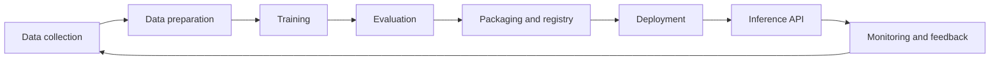

# Lesson 00.1 — What ML Security Is, and Is Not

**Module 00 · 45 minutes · No prerequisites**

## Scenario

A hospital's triage model starts marking a small number of chest X-rays as "low priority" even though a radiologist would call them urgent. The images look normal to the radiologist. The model has not crashed, the server is healthy, and overall accuracy has barely moved.

Two explanations are possible. An attacker may have added a nearly invisible pattern to the images so the model suppresses them. Or the model may simply be worse on a subgroup of patients because the training data under-represented them. The first is a security incident. The second is a quality and safety failure. They require different evidence, different owners, and different fixes — and telling them apart is the first skill of this course.

## Learning objectives

By the end of this lesson you will be able to:

1. Explain what adversarial ML covers and how it differs from application security and AI safety.
2. Identify the asset, adversary, and lifecycle stage in a short incident description.
3. Name the four roles in an ML security engagement and what each produces.

## Three disciplines that are easy to confuse

| Question | Adversarial ML (this course) | Application security | AI safety |
|---|---|---|---|
| What is the cause of failure? | A deliberate adversary manipulating data, model, or API | A software weakness: injection, broken auth, unsafe deserialization | Unintended model behaviour: bias, hallucination, misuse, accidents |
| Typical example | A stop sign with a sticker is read as a speed limit | An API accepts an unsigned model file and executes it | A chatbot gives harmful advice because of a training gap |
| Who usually leads? | ML security engineer | Product security / AppSec | Safety, alignment, or responsible-AI team |
| What is the evidence? | Attack success rate at a stated budget, robust accuracy, privacy metrics | Reproducible exploit against a test instance | Evaluation results, red-team findings, harm analysis |
| Does this course cover it? | Yes, as the core | Yes, where ML systems create the weakness | Only where it overlaps with adversarial behaviour |

The boundaries are porous. A prompt injection is an application-security failure (untrusted input is treated as instructions) *and* an adversarial ML problem (the model's behaviour is manipulated). A poisoned training set is a data-integrity problem *and* a supply-chain problem. The labels help you choose the right evidence; they do not decide which team owns the fix.

## The ML lifecycle is the attack surface



Every arrow is a place where an adversary can intervene, and every box is an asset:

| Stage | What can be attacked | Typical adversary goal |
|---|---|---|
| Data collection | Labels, sources, scraping pipeline | Integrity: poison or backdoor |
| Data preparation | Preprocessing code, feature store, joins | Integrity, privacy |
| Training | Code, hyperparameters, compute, third-party checkpoints | Integrity, availability |
| Evaluation | Test set, metric code, reported claims | Deception: hide a weakness |
| Packaging | Weights, config, serialization format, registry | Integrity: trojan or malware |
| Deployment | Container, dependencies, keys, network | Availability, integrity |
| Inference | Queries, confidence output, rate limits | Privacy, IP theft, evasion |
| Monitoring | Logs, alerts, feedback loop | Concealment |

This table is the reason ML security cannot be reduced to "test the model." The model may be correct and the system still compromised through its data, its artifact, or its API.

## Four roles

| Role | Primary goal | Typical output |
|---|---|---|
| **Attacker (red team)** | Cause a defined failure within a budget | Attack script, success rate, cost |
| **Defender** | Prevent, detect, or limit the failure | Control, detection rule, incident playbook |
| **Auditor** | Independently check whether claims are true | Reproduction report, gap list |
| **System owner** | Accept, transfer, or mitigate residual risk | Risk decision with an owner and date |

A single learner plays all four roles in this course, but not at the same time. When you attack your own model, you are the red team. When you evaluate a defense, you are the auditor. When you decide that a residual risk is acceptable, you are the owner. Mixing roles without saying which hat you are wearing produces confused reports.

## Worked example: a spam filter

A spam classifier reads an email and outputs `spam` or `ham`.

| Attack | When | What the adversary does | What the user observes | Asset |
|---|---|---|---|---|
| Evasion | Inference | Adds innocuous words or characters until the message is classified `ham` | Spam in the inbox | Integrity of output |
| Poisoning | Training | Supplies many spam messages labelled `ham` | Filter gets worse over time | Integrity of the model |
| Backdoor | Training + inference | Adds a rare trigger that forces `ham` | Filter works until the trigger appears | Integrity, trust |
| Extraction | Inference | Queries the API to train a copy | A competing filter appears | Intellectual property |
| Membership inference | Inference | Probes confidence to infer whether an address was in training data | Privacy harm to users | Privacy |
| Denial of service | Inference | Sends inputs that maximize computation | Slow or expensive service | Availability |

The same system, six different adversary goals. A defensible security report names which row it is testing.

## What ML security is not

- **Not only deep learning.** Logistic regression, gradient boosting, and recommender systems are attacked too. Several labs use scikit-learn precisely because the concepts are clearer without a neural network.
- **Not only prompt injection.** Generative AI is one stage of the course, not the whole subject.
- **Not a bag of tricks.** A technique without a threat model is a demonstration. The course grades the threat model and the measurement.
- **Not permission to test other people's systems.** Every lab uses local, synthetic, or explicitly public targets.
- **Not a guarantee.** A defense that survives one attack is a hypothesis. The course repeatedly asks you to attack your own defenses.

## Python example: classify an incident

The function below uses only the standard library. It encodes the decision table above so you can test your own descriptions. It is deliberately simple; the point is to make your reasoning explicit, not to automate judgment.

```python
def classify(stage: str, goal: str, deliberate: bool) -> str:
    if not deliberate:
        return "quality or safety failure, not a security incident"
    table = {
        ("inference", "integrity"): "evasion or backdoor activation",
        ("training", "integrity"): "poisoning or backdoor injection",
        ("inference", "privacy"): "membership inference or extraction",
        ("inference", "availability"): "denial of service",
        ("packaging", "integrity"): "artifact or supply-chain compromise",
    }
    return table.get((stage, goal), "requires further analysis")


cases = [
    ("inference", "integrity", True),
    ("inference", "privacy", True),
    ("training", "integrity", False),
]
for case in cases:
    print(case, "->", classify(*case))
```

Expected output:

```text
('inference', 'integrity', True) -> evasion or backdoor activation
('inference', 'privacy', True) -> membership inference or extraction
('training', 'integrity', False) -> quality or safety failure, not a security incident
```

Change one value at a time. What happens if you set `deliberate=False` for the first case? The function returns the safety category, which is the correct behaviour: without an adversary, you have a quality problem, even if the symptom looks the same.

## Common mistakes

| Mistake | Why it is wrong | Better habit |
|---|---|---|
| Calling every model error an "attack" | No adversary, no security incident | First ask: was the failure deliberate? |
| Assuming the attacker has gradients | Most real attackers do not | State the attacker's knowledge explicitly |
| Treating the API as "just an interface" | The API is the oracle and the billing surface | Include it in the attack surface |
| Equating accuracy with security | Accuracy on a clean test set says nothing about adversarial behaviour | Report threat-model-specific metrics |
| Reporting a technique without a goal | You cannot prioritize or defend it | Name the goal, asset, and success metric |

## Troubleshooting

| Symptom | Likely cause | Fix |
|---|---|---|
| You cannot decide whether an incident is security | The description omits intent | Ask who benefits and whether the input was manipulated |
| Every incident looks like "poisoning" | You are pattern-matching on data | Identify the lifecycle stage and the goal separately |
| You cannot name the asset | The scenario is too abstract | Write down what a user or owner would lose |

## Key terms

**Adversarial ML**, **evasion**, **poisoning**, **backdoor**, **extraction**, **membership inference**, **availability attack**, **attack surface**, **asset**, **adversary goal**.

## Summary

- ML security studies **deliberate** manipulation of data, models, or APIs; safety studies unintended failure.
- The lifecycle, not just the model, is the attack surface.
- Every attack has a **stage**, a **goal**, and an **asset**. Name all three before choosing a technique.
- Red team, defender, auditor, and owner produce different evidence; do not blur the roles.
- A technique without a threat model is a demo.

## References

| Reference | Use in this lesson |
|---|---|
| [NIST AI 100-2e2025](https://doi.org/10.6028/NIST.AI.100-2e2025) | Definitions of adversary goals, knowledge, and capabilities |
| [MITRE ATLAS](https://atlas.mitre.org/) | Technique catalogue used in Module 03 |
| [OWASP AI Exchange](https://owaspai.org/) | Application-facing view of AI threats |
| [CISA/NCSC secure AI guidelines](https://www.ncsc.gov.uk/collection/guidelines-secure-ai-system-development) | Lifecycle security practices |

Next: [Lesson 00.2 — Your lab, your evidence](lesson-2-lab-and-evidence.md).
