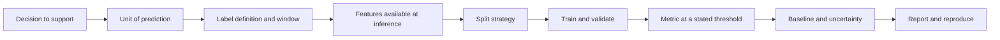

# Module 02 — Machine Learning Fundamentals and Evaluation

**Level 1 · Foundations · 12 hours · Module 01 or equivalent**

## Why this module exists

Every security claim about a model is a claim about measurement. "The attack drops accuracy by 40 points." "The defense recovers most of the loss." "The model is 99% accurate, so the risk is low." Each sentence depends on a learning problem that was framed correctly, a metric that measures what the speaker thinks it measures, and an evaluation that a second person can reproduce.

This module builds that foundation. You will frame a supervised problem, train a model by hand to see what a gradient does, evaluate a classifier with metrics that survive class imbalance, and detect the leakage that makes reported results too good to be true. Module 03 then turns these measurements into a threat model, and Module 04 attacks them.

If you have trained models before, the lessons will still be useful: the emphasis is on the failure modes that make a security experiment invalid, not on API recall.

## Real-world motivation

A team reports a churn model with 90% accuracy and proposes it as the baseline for a security review of the retention system. The dataset is 11% churn. A model that predicts "no churn" for every customer scores 88.8%. The reported model catches 12.5% of the customers who actually leave. Its precision is high only because it rarely predicts churn at all.

Nothing in that paragraph is an attack. It is an ordinary evaluation failure, and it is enough to make every downstream security conclusion wrong: an evasion attack measured against this baseline will look devastating or harmless depending on which metric is printed, and a defense will be tuned to a threshold nobody stated.

The same pattern appears in security data. Fraud, intrusion, malware, and account takeover are all rare-event problems. Accuracy is dominated by the negative class, a single random split can move the number by points, and a field recorded after the outcome can leak the label. Learning to see these problems is the prerequisite for measuring an adversary.

## Measurable learning objectives

By the end of this module you will be able to:

1. **Frame** a supervised learning problem by stating the unit of prediction, label definition, label window, features available at inference time, decision cost, and primary metric (Bloom 3).
2. **Explain** loss, gradients, learning rate, epochs, and batch size, and compute one logistic-regression gradient step by hand and in NumPy (Bloom 2–3).
3. **Evaluate** a classifier with a confusion matrix, precision, recall, F1, ROC-AUC, PR-AUC, calibration, a majority-class baseline, and cross-validation with uncertainty (Bloom 3–4).
4. **Diagnose** pipeline, target, duplicate/group, and temporal leakage, and repair each with a pipeline, feature removal, group-aware splitting, or a time-ordered split (Bloom 4).
5. **Report** a result with slices, confidence intervals, limitations, and a reproduction command, and reject a claim that cannot be reproduced (Bloom 4–5).

## Prerequisite checklist

| Skill | Check | If not |
|---|---|---|
| Python functions and imports | Write a function that returns a dict | [M01 Lesson 1](../m01-python-refresher/lesson-1-python-for-security-work.md) |
| NumPy shapes and reductions | Compute a mean along `axis=0` and explain the result shape | [M01 Lesson 2](../m01-python-refresher/lesson-2-numpy.md) |
| pandas filtering and joins | Count missing values and duplicates | [M01 Lesson 3](../m01-python-refresher/lesson-3-pandas.md) |
| scikit-learn `Pipeline` and `cross_val_score` | Fit a scaler and a classifier without leakage | [M01 Lesson 4](../m01-python-refresher/lesson-4-scikit-learn.md) |
| Seeds and saved splits | Reproduce a run from a clean process | [M01 Lesson 5](../m01-python-refresher/lesson-5-reproducibility.md) |
| Basic probability | Marginal, conditional, expected value | Any introductory resource |
| No GPU or paid account | — | You are in the right place |

### Five-minute diagnostic

1. What is the unit of prediction in a model that scores *customers* but is trained on *sessions*?
2. A dataset has 2% positives. What accuracy does an all-negative classifier achieve?
3. What is the difference between a parameter gradient and an input gradient?
4. Why can 5-fold cross-validation still be optimistic?
5. What does a calibration curve show that ROC-AUC does not?

If you can answer four of five, skim Lessons 02.1–02.4 and spend the time on LAB-01B. If not, work through the module in order.

## Module map

| Unit | Title | Time | What you produce |
|---|---|---:|---|
| [02.1](lesson-1-learning-problems.md) | Learning problems and the ML lifecycle | 1.5 h | A one-page problem framing |
| [02.2](lesson-2-loss-and-gradients.md) | Loss, gradients, and optimization | 1.5 h | A hand-written gradient step and a NumPy training loop |
| [02.3](lesson-3-evaluation.md) | Generalization and honest evaluation | 1.5 h | A metric table with a baseline and a stated threshold |
| [02.4](lesson-4-leakage-and-reporting.md) | Leakage, error analysis, and trustworthy reporting | 1.5 h | A leakage audit and a reporting template |
| [LAB-01B](../../labs/lab-01b.md) | Evaluation audit of a leaky churn baseline | 4 h | Repaired pipeline, metrics, report, manifest |
| [Knowledge check](quiz.md) | QZ-02, 10 items | 20 min | Score and explanations |
| [Exercises](exercises.md) | Four exercises, one scenario | 60 min | Portfolio evidence |

Module effort includes the lab; lesson times are reading and guided practice. Sum: 6 h lessons + 4 h lab + 1 h quiz and exercises ≈ 12 h.

## The one diagram to remember

Every arrow is a place where a project can become invalid. A model trained on the wrong unit, a label that includes the future, a feature recorded after the outcome, or a split that ignores groups will produce a number that looks like evidence and is not.

## Framing checklist

Before you train anything, write these seven lines:

| Line | Example (churn) | Why it matters |
|---|---|---|
| Decision | Which customers get a retention call | A model without a decision has no cost model |
| Unit | One customer per scoring date | Rows are not automatically the unit |
| Label | Cancelled within 60 days of the scoring date | Defines the positive class and the window |
| Features | Account activity before the scoring date | Anything after is leakage |
| Split | By customer, time-ordered | Prevents memorization and future information |
| Metric | Recall at 20% precision, plus PR-AUC | Encodes the cost of misses and false alarms |
| Baseline | Majority class and logistic regression | A number without a reference is not a result |

If you cannot fill a line, you are not ready to train. This is the same discipline Module 03 applies to threats: state the assumptions before you measure.

## Common mistakes across the module

| Mistake | Symptom | Consequence |
|---|---|---|
| Choosing accuracy for a rare event | 90%+ score with near-zero recall | The model looks good and is useless |
| Reporting a metric without a threshold | Precision and recall that nobody can reproduce | The claim is not testable |
| Splitting randomly when rows share a customer or a device | Test score much higher than production | Memorization is mistaken for generalization |
| Fitting preprocessing before the split | Small, suspiciously stable gains | Leakage inflates every downstream comparison |
| Keeping a feature recorded after the label | One feature with near-perfect univariate AUC | Target leakage; the model cannot work at inference |
| Comparing two models on different splits | A winner with no uncertainty | The difference may be noise |
| Treating cross-validation as a guarantee | Tight scores on one dataset | The estimate is still conditional on the data and the protocol |

## Troubleshooting

| Symptom | Likely cause | Fix |
|---|---|---|
| 90% accuracy but near-zero recall | Class imbalance; accuracy is dominated by the negative class | Report PR-AUC, recall, and a majority-class baseline |
| Cross-validation scores swing by many points | Folds are too small, or entities leak across folds | Use a group-aware split, more folds, and report an interval |
| `NotFittedError` at prediction time | Preprocessing was not saved with the model | Save the fitted `Pipeline`, not the bare estimator |
| Test metrics collapse after fixing the split | Temporal or group structure was hiding in a random split | Use time-ordered or grouped splits and document the choice |
| Two metrics tell opposite stories | Different definitions or thresholds | Write the formula and threshold beside each number |
| A result looks too good | Target or pipeline leakage | Remove post-outcome features and re-run the audit |

Metric and leakage fixes are in [Lesson 02.3](lesson-3-evaluation.md#troubleshooting) and [Lesson 02.4](lesson-4-leakage-and-reporting.md#troubleshooting).

## Glossary

| Term | Definition |
|---|---|
| **Supervised learning** | Learning a mapping from features to labels using labeled examples |
| **Feature** | An input variable available at prediction time |
| **Label** | The target outcome the model predicts |
| **Positive class** | The class of interest, usually the rarer and costlier one |
| **Unit of prediction** | The entity a single prediction is about (customer, session, device) |
| **Label window** | The time period over which the label is observed |
| **Train / validation / test** | Data used to fit, to tune, and to report an unbiased estimate |
| **Loss** | A scalar measuring how wrong the model's outputs are |
| **Gradient** | The vector of partial derivatives of the loss with respect to parameters or inputs |
| **Learning rate** | The step size applied along the negative gradient |
| **Epoch** | One pass over the training data |
| **Batch** | A subset of training examples used for one update |
| **Generalization** | Performance on data not used for training |
| **Overfitting** | Fitting training noise; training performance exceeds held-out performance |
| **Underfitting** | The model is too simple or undertrained to capture the signal |
| **Confusion matrix** | Counts of true positives, false positives, true negatives, false negatives |
| **Precision** | Of predicted positives, the fraction that are true positives |
| **Recall** | Of actual positives, the fraction that are found |
| **F1** | The harmonic mean of precision and recall |
| **ROC-AUC** | Probability that a random positive scores above a random negative |
| **PR-AUC** | Area under the precision-recall curve; sensitive to the positive base rate |
| **Calibration** | Agreement between predicted probabilities and observed frequencies |
| **Brier score** | Mean squared error of predicted probabilities |
| **Leakage** | Information in training that would not be available at prediction time, or that crosses the evaluation boundary |
| **Bootstrap** | Resampling with replacement to estimate the uncertainty of a statistic |

## Summary and key takeaways

- A model is only as meaningful as the decision, unit, label, and features it was built around.
- Gradients are both the mechanism of learning and, later, the mechanism of white-box attacks.
- Accuracy is a poor headline metric for rare events; report the confusion matrix, precision, recall, PR-AUC, and a baseline.
- A threshold is part of the result. Without it, precision and recall are undefined.
- Leakage comes in families: pipeline, target, duplicate/group, and temporal. Each has a specific repair.
- Cross-validation reduces variance but does not remove bias from a bad protocol.
- Report uncertainty and slices; a point estimate alone invites overclaiming.

## References and further reading

All links checked on 2026-10-28.

| Reference | Use |
|---|---|
| [scikit-learn user guide](https://scikit-learn.org/stable/user_guide.html) | Estimators, preprocessing, model selection |
| [scikit-learn model evaluation](https://scikit-learn.org/stable/modules/model_evaluation.html) | Metric definitions and scoring |
| [scikit-learn cross-validation](https://scikit-learn.org/stable/modules/cross_validation.html) | Splitters, groups, stratification |
| [scikit-learn calibration](https://scikit-learn.org/stable/modules/calibration.html) | Reliability curves and probability calibration |
| [scikit-learn dummy estimators](https://scikit-learn.org/stable/modules/model_evaluation.html#dummy-estimators) | Majority-class and stratified baselines |
| [NIST AI 100-2e2025](https://doi.org/10.6028/NIST.AI.100-2e2025) | Vocabulary for adversarial goals used in Module 03 |

## Next step

Start with [Lesson 02.1 — Learning problems and the ML lifecycle](lesson-1-learning-problems.md). If you already evaluate models comfortably, take the diagnostic and go to [LAB-01B](../../labs/lab-01b.md).
