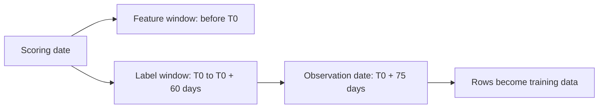
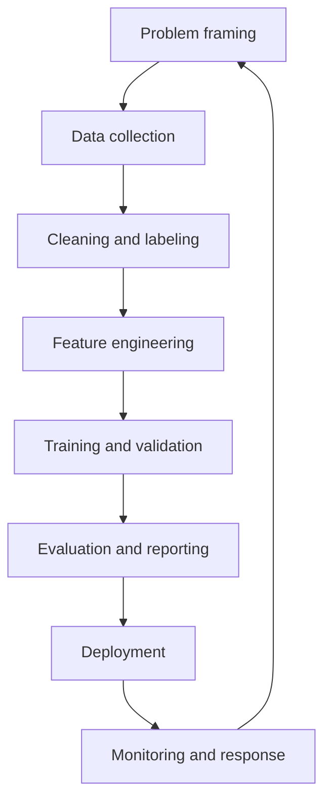

# Lesson 02.1 — Learning Problems and the ML Lifecycle

**2 hours · Lesson 1 of 4 · Prerequisite: Module 01**

## Scenario

A subscription company wants to reduce churn. The data team has a table of 2400 support sessions, each with a customer ID, a session length, and a churn flag. Someone proposes: "Train a classifier on the sessions, split 75/25, and report accuracy."

Three questions expose the problem before any code runs:

1. **What is a row?** A session. But churn is a property of a customer, not a session.
2. **What is the label?** It is copied onto every session of the customer, so the same label appears four times.
3. **When is the prediction made?** If the churn flag is recorded after the customer leaves, every session used as a feature may already contain the outcome.

A model can be trained on this table and score well. It will still be answering the wrong question, and a security review built on it will measure the wrong thing. This lesson gives you the framing discipline that prevents that.

## What you will be able to do

- Distinguish supervised, unsupervised, and self-supervised learning, and classification from regression.
- State the unit of prediction, label definition, label window, and inference-time feature set for a proposed model.
- Choose a split strategy that matches the unit and the data-generating process.
- Identify the six stages of the ML lifecycle and the security-relevant decisions in each.

## 1. Three kinds of learning

| Type | Data | Goal | Example | Course use |
|---|---|---|---|---|
| **Supervised** | Features plus labels | Predict a label for new rows | Churn, fraud, malware family | Most attack labs |
| **Unsupervised** | Features only | Find structure | Clustering, anomaly detection, embeddings | Anomaly baselines, drift |
| **Self-supervised** | Raw data, labels derived from the data itself | Learn representations | Masked language modeling, contrastive pretraining | Generative and agent modules |

This module focuses on supervised classification because it is the clearest setting for measurement. The vocabulary transfers: an anomaly detector still has a unit, a score, a threshold, and a decision cost.

### Classification and regression

| | Classification | Regression |
|---|---|---|
| Output | A class or a probability | A real number |
| Loss | Cross-entropy (probabilities) | Squared error, absolute error |
| Typical metric | Precision, recall, F1, ROC-AUC | MAE, RMSE, R² |
| Security example | Is this login fraudulent? | How much will this account spend? |

A regression model can be turned into a classifier by thresholding, and a classifier can produce a score. The metric must match the decision, not the model's output type.

## 2. The unit of prediction

The **unit of prediction** is the entity a single prediction is about. It is the most important sentence in a problem framing and the one most often left implicit.

Common units:

| Domain | Unit | Labels that belong to the unit |
|---|---|---|
| Churn | Customer at a scoring date | Churned within 60 days |
| Fraud | Card transaction | Confirmed fraud |
| Intrusion | Network flow or host | Malicious or benign |
| Malware | File | Malware family |
| Medical triage | Study (patient image) | Priority or finding |

When the training table's rows are not the unit, you must aggregate or split by the unit. Otherwise the same entity appears in training and test, and the model is evaluated on memorization.

### Worked example: sessions are not customers

```python
import numpy as np
import pandas as pd
from sklearn.model_selection import GroupShuffleSplit, train_test_split

rng = np.random.default_rng(11)
n_customers = 600

customers = pd.DataFrame({
    "customer_id": np.arange(n_customers),
    "tenure_months": rng.integers(1, 49, n_customers),
    "monthly_logins": rng.poisson(12, n_customers),
    "support_tickets": rng.poisson(0.8, n_customers),
})
z = (0.4
     - 0.06 * customers["tenure_months"]
     + 0.35 * customers["support_tickets"]
     - 0.04 * customers["monthly_logins"])
customers["churned"] = (rng.random(n_customers) < 1 / (1 + np.exp(-z))).astype(int)

sessions = customers.loc[customers.index.repeat(4), ["customer_id"]].reset_index(drop=True)
sessions["session_id"] = np.arange(len(sessions))
sessions["minutes"] = np.round(rng.gamma(2.0, 6.0, len(sessions)), 1)

print("customers:", customers.shape, "churn rate:", round(customers["churned"].mean(), 4))
print("sessions:", sessions.shape)
print(sessions.head(4).to_string(index=False))

idx_tr, idx_te = train_test_split(np.arange(len(sessions)), test_size=0.25, random_state=42)
shared = set(sessions.loc[idx_tr, "customer_id"]) & set(sessions.loc[idx_te, "customer_id"])
print("customers in both train and test:", len(shared))

gss = GroupShuffleSplit(n_splits=1, test_size=0.25, random_state=42)
tr, te = next(gss.split(sessions, groups=sessions["customer_id"]))
shared_group = set(sessions.loc[tr, "customer_id"]) & set(sessions.loc[te, "customer_id"])
print("customers in both after group split:", len(shared_group))
```

Expected output:

```text
customers: (600, 5) churn rate: 0.2617
sessions: (2400, 3)
 customer_id  session_id  minutes
           0           0      3.5
           0           1      5.5
           0           2     21.4
           0           3     12.9
customers in both train and test: 408
customers in both after group split: 0
```

A random row split puts **408 of 600 customers** on both sides of the evaluation. A group split by `customer_id` puts none. The label is constant per customer in this dataset, so a model can memorize a customer's label from one session and reproduce it on another. The score would measure memory, not generalization.

The correct table for a customer-level decision aggregates sessions first:

```python
per_customer = (
    sessions.groupby("customer_id")
    .agg(sessions=("session_id", "count"), avg_minutes=("minutes", "mean"))
    .reset_index()
    .merge(customers[["customer_id", "churned"]], on="customer_id")
)
print(per_customer.shape)
print(per_customer.head(3).to_string(index=False))
```

```text
(600, 4)
 customer_id  sessions  avg_minutes  churned
           0         4       10.825        0
           1         4       12.200        0
           2         4       10.425        0
```

Now one row is one customer, and a random split is defensible because customers are independent.

## 3. Labels: definition and window

A label is not a column name. It is a definition with a time window and a collection process.

| Component | Bad | Better |
|---|---|---|
| Event | `churned` | Cancelled the subscription |
| Window | "eventually" | Within 60 days of the scoring date |
| Observation | "we think so" | Confirmed in the billing system by day 75 |
| Negative class | "not churned yet" | Active at day 60 with at least one login in the last 30 days |
| Ambiguous cases | Ignored | Defined, excluded, or assigned a rule |

Ambiguity in the label becomes noise the model cannot learn, and it becomes a disagreement between your metric and the business outcome. Write the definition down before training.

### Label window and feature window



Features must end at or before the scoring date. Labels are observed after it. Any feature that uses information from the label window is **target leakage**, even if it is technically a column in the table.

## 4. Splits: train, validation, test

| Split | Purpose | Rule |
|---|---|---|
| Train | Fit parameters | Never used to choose the model or threshold |
| Validation | Choose hyperparameters and threshold | May be cross-validated |
| Test | Report the final estimate | Touched once, after all decisions |

If you tune on the test set, it becomes a validation set and its score is no longer an unbiased estimate. This is **data snooping**, and it is common in security papers where an attack or defense is tuned until the test number looks good.

Split strategies:

| Data structure | Splitter | Why |
|---|---|---|
| Independent rows | `train_test_split`, `StratifiedKFold` | IID assumption is plausible |
| Repeated entities (customers, devices) | `GroupShuffleSplit`, `GroupKFold` | No entity in both sides |
| Time-ordered events | `TimeSeriesSplit` or a cutoff date | Never train on the future |
| Rare positives | Stratified splits | Preserve the positive rate in each fold |
| Very small data | Leave-one-out or repeated CV | Reduce variance, report the spread |

A split is a claim about independence. State it, and test it: count overlapping entities and compare date ranges.

## 5. From batch to inference

| Mode | When the prediction happens | Example | Latency budget |
|---|---|---|---|
| Batch | Periodically, on a schedule | Nightly churn scores | Hours |
| Online | Per request | Fraud check at checkout | Milliseconds to seconds |
| Streaming | Per event | Intrusion alert on a flow | Seconds |
| On-device | Locally | Malware classification on a phone | Milliseconds, no network |

Inference mode determines which features are actually available. A batch model can use a 30-day aggregate computed overnight. An online model cannot wait 30 days; it needs features from a store that are correct at request time. Many "great offline, useless online" failures are a feature-timing mismatch, not a modeling failure.

## 6. Model families and their failure modes

| Family | Strength | Weakness | Security relevance |
|---|---|---|---|
| Logistic regression | Interpretable, calibrated-ish, fast | Linear decision boundary | Easy to attack and to explain; good baseline |
| Decision tree | Interpretable, handles nonlinearity | Unstable, overfits | Tree structure can be extracted |
| Random forest / gradient boosting | Strong tabular performance | Harder to explain, can memorize IDs | Feature importance aids leakage detection |
| k-nearest neighbors | Simple, nonparametric | Sensitive to scaling and duplicates | Duplicate rows cause memorization |
| Neural network | Flexible, scales to raw inputs | Data-hungry, opaque, unstable | Gradient-based attacks are most studied here |

Start with a baseline. A logistic regression or a shallow tree tells you whether the signal is real before a complex model hides the problem. In security work, an unexplainable gain is a finding to investigate, not a result to publish.

## 7. The lifecycle



Each stage has a security decision:

| Stage | Security-relevant question |
|---|---|
| Framing | What decision does the model influence, and who benefits from manipulating it? |
| Collection | Who can influence the training data, and how would we know? |
| Labeling | Can an attacker cause a mislabel, and is the label audited? |
| Features | Which features are attacker-controlled at inference time? |
| Training | Are artifacts, dependencies, and code trusted? |
| Evaluation | Does the metric match the adversary's goal? |
| Deployment | Who can query the model, how often, and with what authorization? |
| Monitoring | What would an attack look like in telemetry, and who responds? |

Module 03 turns these questions into a formal threat model. For now, notice that every stage is also a place where an evaluation can become invalid.

## Worked framing: a churn model

| Line | Decision |
|---|---|
| Decision | Offer a retention discount or a call to at-risk customers |
| Unit | One customer per monthly scoring date |
| Label | Cancelled within 60 days of the scoring date, confirmed in billing by day 75 |
| Features | Tenure, logins, support tickets, plan, payment failures, all measured before the scoring date |
| Excluded | Cancellation reason, refund flag, any field recorded after cancellation |
| Split | Group by customer, time-ordered by scoring month |
| Metric | Recall at a precision of at least 0.30; secondary PR-AUC and calibration |
| Baseline | Majority class and logistic regression |
| Cost | A false negative loses a customer; a false positive costs a discount |
| Risk | A leaked post-cancellation field would make the model useless in production |

This table is the deliverable for the lesson. It is short, and it prevents most of the mistakes in the rest of the course.

## Common mistakes

| Mistake | Why it happens | Fix |
|---|---|---|
| Training on sessions, scoring customers | The table was easy to load | Define the unit first, then aggregate |
| Copying a customer label onto every row and splitting randomly | pandas makes it easy | Group split, or aggregate to one row per customer |
| Using a feature recorded after the outcome | It correlates strongly and looks useful | Build a feature-availability table with timestamps |
| Random split on time-ordered data | The default splitter is random | Use a date cutoff or `TimeSeriesSplit` |
| Defining the label as "not active" | Convenient proxy | State the observation window and the negative definition |
| Tuning on the test set | It is the only labeled data left | Keep a validation set or cross-validate |
| Reporting one number | A single run is easy | Add a baseline and an uncertainty estimate |

## Troubleshooting

| Symptom | Likely cause | Check |
|---|---|---|
| Test score far above validation | Group or duplicate leakage | Count entities shared across splits |
| Model performs well offline, poorly online | Feature timing mismatch | Compare feature timestamps with the request time |
| Positive rate differs across folds | Unstratified split | Use `StratifiedKFold` or stratified `train_test_split` |
| Label distribution looks impossible | Label copied or joined incorrectly | Check label uniqueness per unit |
| Same customer appears on both sides | Row-level split | Split on the unit, not the row |
| Metric improves when a feature is removed | The feature was leakage or noise | Run an ablation and inspect univariate AUC |

## Glossary

| Term | Definition |
|---|---|
| **Unit of prediction** | The entity a prediction is about |
| **Label window** | The period over which the outcome is observed |
| **Feature window** | The period over which inputs are measured |
| **IID** | Independent and identically distributed; a strong assumption behind random splits |
| **Group split** | A split that keeps all rows of an entity on one side |
| **Temporal split** | A split by time, training on the past and testing on the future |
| **Data snooping** | Using the test set to make modeling decisions |
| **Batch inference** | Predictions computed on a schedule for many rows |
| **Online inference** | Predictions computed per request |
| **Baseline** | A simple reference model or rule used to judge whether a result is meaningful |

## Summary and key takeaways

- The unit of prediction, label definition, and feature timing are part of the model, not paperwork around it.
- Rows are not automatically independent; group and temporal structure determines the split.
- Random splits on repeated entities leak identity and inflate scores. Count the overlap to prove it.
- Features must be available at inference time; anything recorded after the outcome is target leakage.
- Start with a baseline, keep a validation set, and touch the test set once.
- Every lifecycle stage is both an engineering decision and a potential attack surface.

## References and further reading

All links checked on 2026-10-28.

| Reference | Use |
|---|---|
| [scikit-learn cross-validation](https://scikit-learn.org/stable/modules/cross_validation.html) | Splitters, groups, stratification |
| [scikit-learn `GroupShuffleSplit`](https://scikit-learn.org/stable/modules/generated/sklearn.model_selection.GroupShuffleSplit.html) | Group-aware splitting |
| [scikit-learn `TimeSeriesSplit`](https://scikit-learn.org/stable/modules/generated/sklearn.model_selection.TimeSeriesSplit.html) | Time-ordered evaluation |
| [scikit-learn supervised learning](https://scikit-learn.org/stable/supervised_learning.html) | Model families and assumptions |

## Next step

Continue to [Lesson 02.2 — Loss, gradients, and optimization](lesson-2-loss-and-gradients.md), where you will compute the gradient that makes the model learn and see why the same object becomes an attack surface in Module 04.
