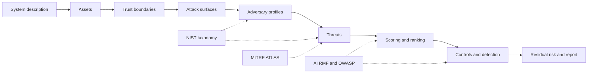

# Module 03 — Cybersecurity Fundamentals and ML Threat Modeling

<a id="m03-start"></a>

**Level 1 · Foundations · 11 hours · Modules 00–02 recommended**

## Why this module exists

A model that is 96% accurate on a clean test set can still be the easiest way into a hospital, a bank, or a hiring pipeline. The accuracy number says nothing about who can reach the model, what they can change, what they gain, or what tells you it happened.

Security work begins with a model of the system, not a model of the attacker's favorite algorithm. You list what must not be lost. You draw where trust changes. You name who can reach each surface, what they know, and what they can do. Then, and only then, does a technique become relevant.

This module builds that discipline. It teaches the vocabulary of cybersecurity as it applies to machine learning, the NIST adversarial-ML taxonomy, the MITRE ATLAS technique catalog, the major risk frameworks, and the mechanics of building and scoring a threat model. LAB-02 turns the method into a complete artifact for a fictional clinical system.

## Real-world motivation

In 2020, a hospital system in Germany reportedly delayed care during a ransomware incident. In 2023, a widely used image classifier was shown to change predictions under small, printable perturbations. In 2024, an LLM application leaked its system prompt through an indirect instruction in a retrieved document. In each case, the technical bug was real, but the harm depended on a larger question: *who could reach that component, with what authority, and what else did it touch?*

Threat modeling is how teams answer that question before an incident, not after. It is also how you avoid the opposite failure: treating every possible attack as equally urgent, buying controls that do not address the path an actual adversary would take.

## Measurable learning objectives

By the end of this module you will be able to:

1. **Classify** system elements as assets, trust boundaries, attack surfaces, actors, and controls, and explain confidentiality, integrity, availability, and privacy for an ML system (Bloom 2–3).
2. **Describe** an adversary by goal, knowledge, capability, assumptions, and impact, using the NIST AI 100-2e2025 taxonomy (Bloom 2–3).
3. **Build** a data-flow diagram with explicit trust boundaries and identify the lifecycle stage of each threat (Bloom 3).
4. **Map** threats to MITRE ATLAS techniques, NIST AI RMF functions, and OWASP ML/LLM categories, and explain where the frameworks disagree (Bloom 3–4).
5. **Produce** a prioritized, testable threat model with scored risks, preventive/detective/corrective controls, detection hypotheses, and at least one reasoned rejection (Bloom 4–5).

## Prerequisite checklist

| Skill | Check | If not |
|---|---|---|
| Read a Python dictionary and a YAML file | You can modify a nested mapping without breaking indentation | M01 Lesson 1 |
| Explain train/test split and leakage | You can say which rows a scaler saw | M01 Lesson 4, M02 Lesson 4 |
| Compute precision and recall | You can derive both from a confusion matrix | M02 Lesson 3 |
| Draw a box-and-arrow diagram | You can show data moving between two systems | Any diagram tool; Mermaid is introduced here |
| No cloud account or GPU | — | You are in the right place |

<a id="diagnostic"></a>

### Five-minute diagnostic

Can you:

1. Name three assets in a model-serving system besides the model weights?
2. Explain the difference between an attack surface and a vulnerability?
3. Say what "black-box access" means for an attacker?
4. Name the four attack goals in the NIST adversarial-ML taxonomy?
5. Explain why a threat with high impact can still be ranked below one with lower impact?

If all five are comfortable, skim Lessons 1 and 2 and spend the time on Lessons 3–5 and LAB-02.

## Module map

| Unit | Title | Time | What you produce |
|---|---|---:|---|
| [03.1](lesson-1-security-fundamentals.md) | Security fundamentals for ML systems | 1 h | An asset and boundary register |
| [03.2](lesson-2-adversaries-and-taxonomy.md) | Adversaries and the NIST taxonomy | 1 h | An adversary profile |
| [03.3](lesson-3-surfaces-lifecycle-atlas.md) | Attack surfaces, lifecycle, and ATLAS | 1.5 h | A data-flow diagram and technique map |
| [03.4](lesson-4-frameworks-and-crosswalks.md) | Risk frameworks and crosswalks | 1 h | A framework coverage check |
| [03.5](lesson-5-building-the-model.md) | Building, scoring, and communicating | 1.5 h | A scored risk register |
| [LAB-02](../../labs/lab-02.md) | Threat model an ML system | 4 h | Threat model and report |
| [Knowledge check](quiz.md) | QZ-03, 10 items | 20 min | Score and explanations |
| [Exercises](exercises.md) | Four exercises, one scenario | 60 min | Portfolio evidence |

Module effort includes the lab. Lesson times are reading and guided practice. Sum: 6 h lessons + 4 h lab + 1 h quiz and exercises ≈ 11 h.

## How the pieces fit



The system description drives everything. Framework names enter at the points where they add precision, not as a checklist at the end.

## Common mistakes across the module

| Mistake | Symptom | Consequence |
|---|---|---|
| Starting from a technique | The report lists FGSM, poisoning, and prompt injection before naming an asset | Controls address attacks no one can reach |
| Treating the model as the only asset | Data, credentials, availability, and audit records are missing | The biggest harm path is invisible |
| Drawing boxes without boundaries | "Cloud" and "on-prem" are the only divisions | Privilege changes inside a zone go unmodeled |
| Confusing an attack surface with a vulnerability | Every endpoint is called "vulnerable" | No prioritization; everything is critical |
| Assigning severity by feel | 5×2 is called "critical" | Ranking is arbitrary and cannot be defended |
| Writing "use best practices" as a control | No owner, no mechanism, no test | The control cannot be implemented or checked |
| No rejection | Every threat is accepted | The model is a wish list, not a decision |
| No detection hypothesis | "Monitor for attacks" | No one knows what to alert on |
| Inventing framework IDs | ATLAS or OWASP IDs that do not exist | The report loses credibility |

## Troubleshooting

| Symptom | Likely cause | Fix |
|---|---|---|
| The checker rejects an ATLAS ID | The ID is mistyped or not in the verified allowlist | Use a verified technique ID from ATLAS; leave the mapping empty if none fits |
| Severity arithmetic fails | Severity is not the product of impact and likelihood | Compute `impact × likelihood` and state both anchors |
| An asset or surface is reported unreferenced | Coverage gap | Add the surface or threat that reaches it, or remove the unused element |
| Mermaid renders as plain text | The fence is not `mermaid`, or the block is indented | Use a top-level ` ```mermaid ` fence in the report |
| YAML fails to parse | Tabs or inconsistent indentation | Use spaces and run the checker to locate the first bad line |
| The control rule fails on a high or critical threat | Fewer than two preventive controls | Add an independent control, or lower the severity with evidence |

Model-building fixes are in [Lesson 03.1](lesson-1-security-fundamentals.md#common-mistakes-and-troubleshooting) and [Lesson 03.5](lesson-5-building-the-model.md#common-mistakes-and-troubleshooting).

## Glossary

| Term | Definition |
|---|---|
| **Asset** | Something of value that can be harmed: data, model, credentials, availability, trust |
| **Trust boundary** | A line where data or authority crosses between parties with different privilege or assumptions |
| **Attack surface** | A point where an adversary can interact with the system |
| **Threat** | A potential adversary action that harms an asset |
| **Vulnerability** | A weakness that makes a threat feasible |
| **Adversary goal** | What the attacker wants: integrity, availability, privacy, or abuse |
| **Knowledge** | What the attacker knows: white-box, black-box, or partial |
| **Capability** | What the attacker can do: query, upload, train, persist, or act |
| **Impact** | The harm if the threat succeeds, in clinical, financial, legal, or safety terms |
| **Likelihood** | A judgment that the threat will be attempted and succeed under stated assumptions |
| **Risk** | The combination of impact and likelihood, scored under a stated method |
| **Control** | A preventive, detective, or corrective measure that changes likelihood or impact |
| **Residual risk** | The risk that remains after controls |
| **Detection hypothesis** | A measurable statement that would indicate the threat occurred |
| **Data-flow diagram (DFD)** | A diagram of processes, stores, actors, and flows with trust boundaries |
| **Attack tree** | A tree of steps an adversary must complete to reach a goal |
| **AI RMF** | NIST's AI Risk Management Framework: GOVERN, MAP, MEASURE, MANAGE |
| **ATLAS** | MITRE's Adversarial Threat Landscape for AI Systems technique catalog |
| **NIST AI 100-2** | The NIST taxonomy and terminology for adversarial machine learning |

## Summary and key takeaways

- Security starts with the system: assets, boundaries, surfaces, actors, and impact.
- The model is one asset among several; data, credentials, availability, and audit records often matter more.
- A threat is an adversary with a goal, knowledge, capability, and assumptions — not a technique name.
- NIST AI 100-2e2025 gives four goals (integrity, availability, privacy, abuse) that keep the register balanced.
- MITRE ATLAS and the OWASP lists are indexes, not checklists; map only techniques that fit the system.
- Severity must be computed from stated impact and likelihood, with ties explained.
- A threat model without a rejection and a detection hypothesis is a wish list.
- Frameworks disagree; record the disagreement instead of forcing a single label.

## References and further reading

All links checked on 2026-10-28.

| Reference | Use |
|---|---|
| [NIST AI 100-2e2025](https://nvlpubs.nist.gov/nistpubs/ai/NIST.AI.100-2e2025.pdf) | Adversarial-ML taxonomy: goals, knowledge, capabilities, attack classes |
| [NIST AI Risk Management Framework](https://www.nist.gov/itl/ai-risk-management-framework) | GOVERN, MAP, MEASURE, MANAGE functions |
| [MITRE ATLAS](https://atlas.mitre.org/) | Adversary tactics and techniques for AI systems |
| [OWASP Machine Learning Security Top 10](https://owasp.org/projects/machine-learning-security-top-ten) | ML-specific application risks |
| [OWASP Top 10 for LLM Applications](https://genai.owasp.org/llm-top-10/) | Risks for generative and agentic applications |
| [OWASP AI Exchange](https://owaspai.org/) | Cross-framework AI security guidance |
| [CISA Secure by Design](https://www.cisa.gov/securebydesign) | Security ownership and design principles |

ISO/IEC 42001 (AI management systems) and ISO/IEC 23894 (AI risk management) are referenced by name in Lesson 4. They are paid standards; this course does not reproduce their text.

## Next step

Start with [Lesson 03.1 — Security fundamentals for ML systems](lesson-1-security-fundamentals.md). If you already work in security, take the diagnostic, read Lessons 2 and 3 for the ML-specific vocabulary, and go to [LAB-02](../../labs/lab-02.md).
