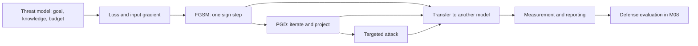

# Module 04 — Adversarial Examples and Evasion Attacks

**Level 2 · Core attacks · 14 hours · Module 02; Module 03 recommended**

## Why this module exists

A model can be accurate and still be easy to redirect. Change a few pixels that no person would notice, and a confident prediction becomes a different confident prediction. The failure is not a bug in the code. It follows from the model's geometry: a decision boundary drawn through a high-dimensional space can be crossed with a short step.

Evasion is the reference case for adversarial machine learning. It teaches the vocabulary — budget, norm, base set, success rate — that every later attack and defense uses. It is also the first place where a measurement can look impressive and mean little: "95% attack success" is not a security result until you state ε, the base set, and what the attacker knew.

This module builds evasion from the gradient up. You will derive FGSM, implement PGD from scratch, remove the white-box assumption with a transfer attack, and learn to report the result so that another person can reproduce and challenge it. LAB-03 and LAB-04 turn the math into artifacts.

## Real-world motivation

In 2013, Szegedy and colleagues showed that small, often imperceptible changes to images could change a classifier's prediction. In 2014, Goodfellow, Shlens, and Szegedy explained the effect with a linear approximation and proposed the fast gradient sign method. In 2016, Kurakin, Goodfellow, and Bengio demonstrated adversarial examples photographed in the physical world, and Carlini and Wagner showed that stronger optimization attacks could defeat many proposed defenses of the period.

Those results matter because they changed the burden of proof. A robust system cannot be demonstrated by a single failed attack. It needs a stated threat model, a strong evaluation, and evidence that the defense survives an adversary who knows how it works. This module does not claim that any particular deployed system is vulnerable. It teaches you how to measure a model you own, under assumptions you state.

## Measurable learning objectives

By the end of this module you will be able to:

1. **Implement** FGSM, PGD, and a targeted gradient attack on a local classifier, and reproduce reference attack success rates at stated budgets (Bloom 3).
2. **Execute** a transfer attack against a black-box model at three perturbation budgets and report success as a function of the budget (Bloom 3).
3. **Assess** when a white-box or transfer result does and does not generalize to a deployed system, including physical and query-based constraints (Bloom 4).
4. **Report** evasion results with an explicit base set, perturbation norm, valid-domain checks, and limitations (Bloom 4–5).

These objectives assess LO-05, LO-06, LO-07, and LO-28.

## Prerequisite checklist

| Skill | Check | If not |
|---|---|---|
| Train and evaluate a classifier | You can fit logistic regression and report test accuracy | M01 Lesson 4, M02 Lesson 3 |
| Read a gradient | You can explain what `dL/dx` means for a fixed model | M02 Lesson 2 |
| Use NumPy shapes and broadcasting | You can compute `X + eps * sign(G)` for a batch | M01 Lesson 2 |
| State an adversary's knowledge | You can distinguish white-box from black-box | M03 Lesson 2 |
| No GPU or cloud account | — | You are in the right place |

### Five-minute diagnostic

Can you answer these without notes?

1. What does an L∞ budget of ε = 0.1 mean for pixels scaled to [0, 1]?
2. Why does FGSM use the *sign* of the gradient rather than the gradient itself?
3. What is the difference between attack success rate and robust accuracy?
4. Why is a random forest harder to attack with gradients than logistic regression?
5. Why is "the attack failed" weaker evidence than "the attack succeeded"?

If four or five are comfortable, skim Lessons 1–2 and spend the time on Lessons 3–5 and the two labs. If fewer than three, read all five lessons in order.

## Module map

| Unit | Title | Time | What you produce |
|---|---|---:|---|
| [04.1](lesson-1-threat-models-and-geometry.md) | Evasion threat models and the geometry of perturbation | 1 h | A five-part evasion claim |
| [04.2](lesson-2-fgsm.md) | The gradient attack: FGSM | 1.25 h | A working FGSM and an ε table |
| [04.3](lesson-3-pgd.md) | PGD: iteration, projection, and restarts | 1.25 h | A PGD implementation with sanity checks |
| [04.4](lesson-4-black-box-and-transfer.md) | Black-box, transfer, and the limits of evasion | 1 h | A threat-model comparison |
| [04.5](lesson-5-measuring-honestly.md) | Measuring and reporting evasion honestly | 0.5 h | A result checklist |
| [LAB-03](../../labs/lab-03.md) | Evasion versus perturbation budget | 4 h | ε-sweep report |
| [LAB-04](../../labs/lab-04.md) | Targeted evasion and transfer | 4 h | Targeted and transfer report |
| [Knowledge check](quiz.md) | QZ-04, 10 items | 20 min | Score and explanations |
| [Exercises](exercises.md) | Four exercises, one scenario | 60–90 min | Portfolio evidence |

Module effort is approximate: 5 hours of lessons, 8 hours of labs, and 1 hour of quiz and exercises. The labs are the main event; the lessons exist to make them interpretable.

## How the pieces fit

The threat model comes first. The gradient is a tool; the budget and base set decide what the tool's output means.

## Common mistakes across the module

| Mistake | Symptom | Consequence |
|---|---|---|
| Reporting ASR without a base set | "95% success" with no denominator | The number cannot be compared or reproduced |
| Attacking the whole test set | ASR includes rows already wrong | The attack looks weaker than it is, or the denominator hides failures |
| Forgetting clipping | Perturbed pixels outside [0, 1] | The example is not a valid input |
| Measuring perturbation after normalization | L∞ claim in the wrong units | The budget is misstated |
| Using the raw gradient | Every pixel moves by ε | The attack is unnormalized and often weaker |
| Assuming transfer | Reporting source ASR as black-box success | The threat model is wrong |
| One run, no restarts | "Robust" after a failed PGD | The attack was underpowered |
| Generalizing from digits | "All image models are vulnerable" | The claim exceeds the evidence |

## Troubleshooting

| Symptom | Likely cause | Fix |
|---|---|---|
| ASR is 0 at every ε | Gradient sign wrong, or predictions computed on clean inputs | Use `x + ε·sign(g)` and predict on the perturbed array |
| ASR is 1.0 at tiny ε | Labels or inputs mixed up | Check that `y` is unchanged and `x` is perturbed |
| L∞ bound violated | Projection order wrong | Project to `[x−ε, x+ε]`, then to [0, 1] |
| PGD worse than FGSM | Step size too large or restarts reset wrongly | Use `α ≈ ε/10` and keep the best attack per row |
| Results differ from the lab | Different split, seed, or model settings | Use the exact protocol in the lab brief |
| Targeted attack moves away from target | Maximizing instead of minimizing target loss | Use `x − α·sign(∇ loss for target)` |

Lesson-specific fixes appear at the end of each lesson.

## Glossary

| Term | Definition |
|---|---|
| **Adversarial example** | An input changed slightly so the model's output changes |
| **Evasion** | An attack at inference time, after training |
| **Perturbation** | The difference between the adversarial and original input |
| **Lp norm** | A way to measure the size of a perturbation; L∞ is the largest coordinate change |
| **Budget (ε)** | The maximum allowed perturbation under a stated norm |
| **FGSM** | Fast Gradient Sign Method: one step of size ε in the sign of the input gradient |
| **PGD** | Projected Gradient Descent: iterative FGSM with projection back into the budget |
| **Projection** | Mapping a point back into the allowed set (the ε-ball and valid input range) |
| **Targeted attack** | An attack that aims for a specific wrong class |
| **Untargeted attack** | An attack that aims for any wrong class |
| **Attack success rate (ASR)** | Fraction of the chosen base set whose prediction changed as intended |
| **Base set** | The rows on which success is measured, usually clean-correct rows |
| **Robust accuracy** | Accuracy on adversarial inputs at a stated budget |
| **White-box** | Attacker knows the model and can compute gradients |
| **Black-box** | Attacker can query the model but not differentiate it |
| **Transferability** | The property that an example built for one model also fools another |
| **Surrogate model** | A model the attacker trains to approximate the target |
| **EOT** | Expectation over transformation: averaging an attack over plausible input transformations |

## Summary and key takeaways

- An evasion claim needs five parts: goal, knowledge, budget, base set, and metric.
- L∞ bounds the largest single-pixel change; it is not the same as L2 or L0.
- FGSM is a first-order attack: it moves every pixel by ε in the direction that increases loss.
- PGD iterates and projects; iteration matters more as the budget grows.
- Targeted attacks minimize the loss for a chosen class, not maximize the true-class loss.
- Transfer is a measurement, not an assumption; a source result is not a black-box result.
- Clipping, valid-domain checks, and zero-budget tests catch most silent bugs.
- A successful attack on a toy model does not establish that a deployed system is vulnerable.
- The defense question — does robustness survive an adaptive attack? — is Module 08.

## References and further reading

All links checked on 2026-10-28. arXiv identifiers are stable; venue citations are given without inventing DOIs.

| Reference | Use |
|---|---|
| [Szegedy et al., *Intriguing properties of neural networks* (arXiv:1312.6199)](https://arxiv.org/abs/1312.6199) | First widely cited demonstration of adversarial examples |
| [Goodfellow, Shlens & Szegedy, *Explaining and Harnessing Adversarial Examples* (arXiv:1412.6572)](https://arxiv.org/abs/1412.6572) | Linear explanation and FGSM |
| [Kurakin, Goodfellow & Bengio, *Adversarial examples in the physical world* (arXiv:1607.02533)](https://arxiv.org/abs/1607.02533) | Physical-world demonstration |
| [Madry et al., *Towards Deep Learning Models Resistant to Adversarial Attacks* (arXiv:1706.06083)](https://arxiv.org/abs/1706.06083) | PGD as an attack and as a training method |
| [Carlini & Wagner, *Towards Evaluating the Robustness of Neural Networks* (arXiv:1608.04644)](https://arxiv.org/abs/1608.04644) | Optimization attacks and evaluation pitfalls |
| [Moosavi-Dezfooli et al., *DeepFool* (arXiv:1511.04599)](https://arxiv.org/abs/1511.04599) | Minimal-distance attack |
| [Papernot et al., *The Limitations of Deep Learning in Adversarial Settings* (arXiv:1511.07528)](https://arxiv.org/abs/1511.07528) | JSMA and saliency-based attacks |
| [Carlini et al., *On Evaluating Adversarial Robustness* (arXiv:1902.06705)](https://arxiv.org/abs/1902.06705) | Evaluation checklist |
| [Athalye, Carlini & Wagner, *Obfuscated Gradients Give a False Sense of Security* (arXiv:1802.00420)](https://arxiv.org/abs/1802.00420) | Why failed gradient attacks are weak evidence |
| [Biggio & Roli, *Wild Patterns* (arXiv:1712.03141)](https://arxiv.org/abs/1712.03141) | Survey and threat-model vocabulary |
| [NIST AI 100-2e2025](https://doi.org/10.6028/NIST.AI.100-2e2025) | Taxonomy: evasion as an integrity attack at inference |
| [MITRE ATLAS](https://atlas.mitre.org/) | Technique catalog (for example, AML.T0015 Evade AI Model) |

For the optimization view of adversarial examples, the Carlini–Wagner paper is the most useful next read after this module. For evaluation discipline, read Carlini et al. (2019) before you evaluate any defense.

## Next step

Start with [Lesson 04.1 — Evasion threat models and the geometry of perturbation](lesson-1-threat-models-and-geometry.md). If you already implement FGSM, take the diagnostic and go directly to Lesson 3 and LAB-03.
