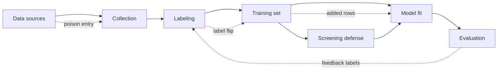

# Module 05 — Training Data Poisoning and Label Manipulation

**Level 2 · Core attacks · 13 hours · Module 02; Module 03 recommended**

## Why this module exists

Every supervised model is an argument built from examples. Poisoning attacks the argument at its source: if an adversary can add rows, change labels, or influence collection, the model can learn something the defender never intended. Unlike evasion, poisoning happens **before** deployment, and its effects persist in the artifact.

The uncomfortable property of poisoning is that it can be quiet. A 5% label flip may cost almost nothing in test accuracy. A small cluster of crafted rows can flip one decision while global accuracy *improves*. A defender who monitors only the headline metric will see nothing. This module teaches you to measure poisoning with a budget curve, to build a targeted attack whose effect is invisible in aggregate, and to evaluate a defense by its false positives as well as its catches.

LAB-05 measures the label-flip curve. LAB-06 builds a targeted feature-space attack and screens it with a trusted reference set. The two labs are deliberately different: one is broad and noisy, the other is narrow and surgical.

## Real-world motivation

Poisoning research began with classical learners. Biggio, Nelson, and Laskov showed in 2012 that support vector machines could be degraded by crafted training points, and that the attack could be optimized rather than guessed. Later work extended optimization to deep networks, where the attacker must account for the training procedure itself.

Two results shape how the problem is taught today. Steinhardt, Koh, and Liang (2017) framed poisoning defenses as a certified trade-off between the fraction of corrupted data and the degradation a defender must accept. Shafahi and colleagues (2018) showed that **clean-label** poisoning is possible: an attacker can add correctly labelled points that look benign and still shift a targeted decision. Neither result says that every system is poisoned. They say that "the data looks fine" is not an argument.

The practical surface is the data supply chain: public scrapes, vendor feeds, customer uploads, annotation contractors, and the feedback loop that turns deploy-time decisions into future labels. Each is a place where the training set can change without a code review.

## Measurable learning objectives

By the end of this module you will be able to:

1. **Construct** an indiscriminate label-flip attack at controlled poison rates and report its effect as a curve against a stated denominator (Bloom 3).
2. **Construct** a targeted feature-space poisoning attack that changes one chosen prediction, and explain why global accuracy can hide it (Bloom 3–4).
3. **Evaluate** a data-screening defense with catches, false positives, threshold sensitivity, and an explicit trust assumption (Bloom 4–5).
4. **Assess** whether a poisoning result supports a claim about a deployed pipeline, including where the attacker would need access (Bloom 4–5).

These objectives assess LO-08, LO-09, and LO-28.

## Prerequisite checklist

| Skill | Check | If not |
|---|---|---|
| Train and evaluate a classifier | You can fit logistic regression and report test accuracy and macro F1 | M01 Lesson 4, M02 Lesson 3 |
| Explain a train/test split | You can say why the test set must never be poisoned | M02 Lesson 3 |
| Read a 2-D decision boundary | You can describe what a linear classifier does in two features | M02 Lesson 2 |
| State an adversary's data access | You can distinguish label access from feature access | M03 Lesson 2 |
| Measure a k-NN classifier | You can explain what `predict_proba` means for k-NN | M01 Lesson 4 |

### Five-minute diagnostic

1. If an attacker flips 10% of training labels, should test accuracy fall by 10 points? Why not?
2. What is the denominator of a poison rate, and why does it matter?
3. Why can a targeted poisoning attack leave global accuracy unchanged — or raise it?
4. What does a data-screening defense need in order to work at all?
5. Why is a test set that was also poisoned an invalid evaluation?

If four or five are comfortable, skim Lessons 1–2 and spend the time on Lessons 3–4 and LAB-06. If fewer than three, read the lessons in order.

## Module map

| Unit | Title | Time | What you produce |
|---|---|---:|---|
| [05.1](lesson-1-poisoning-threat-models.md) | Poisoning threat models and the data supply chain | 1 h | A data-access threat model |
| [05.2](lesson-2-label-flipping.md) | Label flipping and the poisoning curve | 1 h | A poison-rate table |
| [05.3](lesson-3-targeted-poisoning.md) | Targeted poisoning: flipping one decision | 1.25 h | A targeted attack with a measured effect |
| [05.4](lesson-4-defenses-and-limits.md) | Screening, robustness, and the limits of defense | 1 h | A defense evaluation with false positives |
| [LAB-05](../../labs/lab-05.md) | Label-flip poisoning curve | 4 h | Five-rate curve and report |
| [LAB-06](../../labs/lab-06.md) | Targeted poisoning and reference-set screening | 4 h | Three-state comparison and screen costs |
| [Knowledge check](quiz.md) | QZ-05, 10 items | 20 min | Score and explanations |
| [Exercises](exercises.md) | Four exercises, one scenario | 45 min | Portfolio evidence |

Module effort is approximate: 4.25 hours of lessons, 8 hours of labs, and about 45 minutes of quiz and exercises.

## How the pieces fit

The dashed paths are attack opportunities; the solid path through screening is one defense placement. A defense placed after training can only detect behavior, not intent; a defense placed before training can remove data but may also remove clean rows.

## Common mistakes across the module

| Mistake | Symptom | Consequence |
|---|---|---|
| Poisoning the test set | Accuracy collapses in a way no attack could cause | The experiment measures label noise at evaluation, not poisoning |
| Using the wrong denominator | Poison rate computed against all data or the test set | The budget is misstated and the curve cannot be compared |
| Reporting one poison rate | "Poisoning works" from a single point | No dose-response, no idea where the effect begins |
| Treating accuracy as the only metric | Targeted attack invisible | The attack succeeded while the dashboard stayed green |
| Ignoring class balance | Flips concentrate in one class | Accuracy hides a collapsed class; macro F1 does not |
| Assuming the screen is free | Only catches reported | False positives and their cost are hidden |
| Trusting the reference set without argument | "The screen works" | An attacker who can poison the reference set defeats it |
| Generalizing from a toy model | "All models are poisonable at 5%" | The claim exceeds the evidence |

## Troubleshooting

| Symptom | Likely cause | Fix |
|---|---|---|
| Accuracy identical at every rate | Fitting on the original labels | Fit on the poisoned labels |
| Accuracy worse than the reference at rate 0 | Different split or model settings | Match the lab protocol exactly |
| Poison counts off by one | Integer truncation | Use `round(rate × n_train)` |
| Curve not reproducible | One RNG carried across rates | Fresh `default_rng(seed)` per rate |
| Target does not flip in LAB-06 | Too few poisons or too wide a spread | Use 30 rows at σ = 0.05 near the target |
| Screen catches nothing | k-NN fitted on the training data | Fit on the trusted reference rows only |
| All rows flagged | Threshold comparison inverted | Flag when the probability of the given label is below the threshold |

Lesson-specific fixes appear at the end of each lesson.

## Glossary

| Term | Definition |
|---|---|
| **Poisoning** | An attack that changes training data or the training process so the learned model is worse or wrong |
| **Label flipping** | Changing the label of a training row without changing its features |
| **Clean-label attack** | A poisoning attack in which added rows carry correct labels and plausible features |
| **Feature-space poisoning** | Adding or modifying rows in feature space, not only their labels |
| **Indiscriminate attack** | An attack that degrades overall performance without choosing a victim |
| **Targeted attack** | An attack that changes a specific prediction or class |
| **Availability attack** | A poisoning attack whose goal is to degrade overall model usefulness |
| **Integrity attack** | A poisoning attack whose goal is a specific wrong behavior |
| **Poison rate** | Corrupted rows divided by a stated clean training-set size |
| **Clean-label rate** | The fraction of the training set that is attacker-controlled, even if labels are valid |
| **Data supply chain** | Every source and transformation that produces training data |
| **Reference set** | A small trusted sample used to check whether training rows are plausible |
| **Data sanitization** | Removing or relabelling suspicious rows before training |
| **Influence function** | An estimate of how one training row changes a model's prediction or loss |
| **Certified defense** | A defense with a proven bound, usually trading robustness for a guaranteed corruption budget |
| **Feedback loop** | The path from deployed predictions or user actions back into future training labels |

## Summary and key takeaways

- Poisoning attacks the training process; its effects are baked into the model, not applied per input.
- The poison rate needs a denominator: corrupted rows over the clean training-set size.
- Label flipping is a dose-response experiment, not a single number; low rates can be nearly free.
- A targeted attack can flip one decision while global accuracy stays flat or rises.
- Global metrics are the wrong instrument for targeted integrity attacks.
- Screening works only with trustworthy reference data, and it has false positives.
- Threshold choice is a cost trade-off: more catches usually means more clean rows removed.
- A defense claim needs an adaptive attacker, a false-positive count, and a stated trust assumption.
- A clean-label attack is not detectable by checking whether labels are correct.
- Success on digits or a 2-D toy model does not establish that a deployed pipeline is poisonable.

## References and further reading

All links checked on 2026-10-28. arXiv identifiers are stable; venue citations are given without inventing DOIs.

| Reference | Use |
|---|---|
| [Biggio, Nelson & Laskov, *Poisoning Attacks against Support Vector Machines* (arXiv:1206.6389)](https://arxiv.org/abs/1206.6389) | Optimization-based poisoning of a classical learner |
| [Muñoz-González et al., *Towards Poisoning of Deep Learning Algorithms with Back-gradient Optimization* (arXiv:1708.08689)](https://arxiv.org/abs/1708.08689) | Poisoning that accounts for the training procedure |
| [Steinhardt, Koh & Liang, *Certified Defenses for Data Poisoning Attacks* (arXiv:1706.03691)](https://arxiv.org/abs/1706.03691) | The robustness–corruption trade-off |
| [Koh & Liang, *Understanding Black-box Predictions via Influence Functions* (arXiv:1703.04730)](https://arxiv.org/abs/1703.04730) | Estimating a training row's effect on a prediction |
| [Shafahi et al., *Poison Frogs! Targeted Clean-Label Poisoning Attacks on Neural Networks* (arXiv:1804.00792)](https://arxiv.org/abs/1804.00792) | Clean-label targeted poisoning |
| [Paudice, Muñoz-González & Lupu, *Label Sanitization against Label Flipping Poisoning Attacks* (arXiv:1803.00992)](https://arxiv.org/abs/1803.00992) | Screening and relabelling defenses |
| [NIST AI 100-2e2025](https://doi.org/10.6028/NIST.AI.100-2e2025) | Taxonomy: poisoning as an integrity attack at training time |
| [MITRE ATLAS](https://atlas.mitre.org/) | Technique catalog (for example, AML.T0020 Poison Training Data) |

For the geometry of targeted poisoning, read Poison Frogs after LAB-06. For the defense trade-off, the certified-defense paper is the right next step; Module 08 returns to evaluation discipline.

## Next step

Start with [Lesson 05.1 — Poisoning threat models and the data supply chain](lesson-1-poisoning-threat-models.md). If you have already run LAB-05, take the diagnostic and go directly to Lesson 3 and LAB-06.
