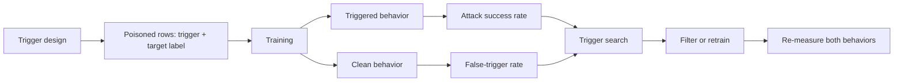

# Module 06 — Backdoor Attacks, Trojan Models, and Trigger-Based Behavior

**Level 2 · Core attacks · 14 hours · Module 05; Module 03 recommended**

## Why this module exists

A backdoor is a conditional failure. The model behaves normally on ordinary inputs and misbehaves when a specific pattern appears. Clean test accuracy can be almost unchanged, the poisoned rows can be a small fraction of the training set, and a user who never produces the trigger never sees the problem.

That combination makes backdoors a supply-chain problem as well as a data problem. A model you download, a fine-tuning set you accept, or a vendor update you deploy can carry behavior its publisher never intended — and clean evaluation will not reveal it.

This module separates the backdoor from ordinary poisoning. LAB-07 builds a tabular backdoor with a known trigger and screens the training data. LAB-08 moves to images, where the defender does not know where the trigger is and must search for it.

## Real-world motivation

Gu, Dolan-Gavitt, and Garg (2017) showed that a model's behavior can be controlled by a small trigger implanted during training, and framed the result as a **supply-chain** risk: the artifact, not just the data, can be malicious. Wang and colleagues (2019) turned the defender's problem into trigger reconstruction: if a model behaves anomalously for some small pattern, search for the pattern that produces it. Gao and colleagues (2019) approached detection at inference time by perturbing inputs and measuring how stable the prediction is; Tran, Li, and Madry (2018) looked for a spectral signature in the representation of poisoned examples.

Those methods matter, and each has assumptions. A trigger scan assumes a shape, size, and search space. A spectral detector assumes the poison leaves a separable direction. An input filter assumes the trigger is visible in the input. This module teaches the attack and then asks what each defense actually assumes.

## Measurable learning objectives

By the end of this module you will be able to:

1. **Construct** a backdoor at a controlled poison rate and measure clean accuracy, attack success rate, and false-trigger behavior separately (Bloom 3).
2. **Explain** why a backdoor can leave clean accuracy nearly unchanged and why ASR needs a baseline (Bloom 2–4).
3. **Perform** a trigger search on a model you trained, interpret the score, and state the search-space assumption (Bloom 3–4).
4. **Evaluate** a backdoor defense with catches, false positives, the protected behavior, and an adaptive-attacker caveat (Bloom 4–5).

These objectives assess LO-10, LO-11, and LO-28.

## Prerequisite checklist

| Skill | Check | If not |
|---|---|---|
| Train and evaluate a classifier | You can report accuracy and per-class behavior | M01 Lesson 4, M02 Lesson 3 |
| Explain poisoning | You can state the difference between label flipping and a targeted attack | M05 Lessons 1–3 |
| Read probabilities | You can interpret `predict_proba(...)[:, 1]` | M02 Lesson 3 |
| Reshape arrays | You can turn a 64-vector into an 8×8 image and back | M01 Lesson 2 |
| Measure a baseline | You can say what a clean model does before an attack | LAB-05 or LAB-06 |

### Five-minute diagnostic

1. What are the two parts of a backdoor, and which one is present at training time?
2. Why can clean test accuracy stay high after a backdoor is implanted?
3. What does attack success rate (ASR) measure, and why does it need a baseline?
4. If a defender knows the trigger is a 2×2 white patch, what is the search space in an 8×8 image?
5. Why is "the model passes all clean tests" not evidence that there is no backdoor?

If four or five are comfortable, skim Lessons 1–2 and spend the time on LAB-08 and Lesson 4. If fewer than three, read the lessons in order.

## Module map

| Unit | Title | Time | What you produce |
|---|---|---:|---|
| [06.1](lesson-1-backdoor-anatomy.md) | Backdoor anatomy and the supply chain | 1.25 h | A backdoor threat model |
| [06.2](lesson-2-tabular-backdoor.md) | Building a tabular backdoor | 1.25 h | A three-state comparison |
| [06.3](lesson-3-trigger-search.md) | Trigger search in images | 1.25 h | A trigger-scan table |
| [06.4](lesson-4-detection-and-mitigation.md) | Detection, mitigation, and the arms race | 1.25 h | A defense evaluation |
| [LAB-07](../../labs/lab-07.md) | Tabular backdoor with a known trigger | 4 h | Clean/backdoored/defended report |
| [LAB-08](../../labs/lab-08.md) | Image backdoor and trigger search | 4 h | Scan and mitigation report |
| [Knowledge check](quiz.md) | QZ-06, 10 items | 20 min | Score and explanations |
| [Exercises](exercises.md) | Four exercises, one scenario | 40 min | Portfolio evidence |

Module effort is approximate: 5 hours of lessons, 8 hours of labs, and 1 hour of quiz and exercises.

## How the pieces fit

A backdoor claim needs both sides of the fork: what happens on clean inputs and what happens on triggered inputs. A defense claim needs both after mitigation as well.

## Common mistakes across the module

| Mistake | Symptom | Consequence |
|---|---|---|
| Reporting ASR with no clean baseline | "98% attack success" | The model may already fail on those inputs |
| Measuring ASR on training rows | ASR near 1.0 trivially | The test set is not being tested |
| Reporting clean accuracy only | "Accuracy is unchanged" | The conditional behavior is invisible |
| Forgetting false triggers | A clean model reacts to the pattern | The attack effect is overstated |
| Using one poison rate | "Backdoors need 8%" | No dose-response, no idea of the budget |
| Assuming the trigger is known | "The scan found it" | The defender guessed shape and size |
| Treating a filter as a repair | ASR falls to zero on the test set | Other triggers or adaptive attacks remain |
| Generalizing from 3 vs 8 | "All image models are backdoorable" | The claim exceeds the evidence |

## Troubleshooting

| Symptom | Likely cause | Fix |
|---|---|---|
| ASR near zero | Trigger applied to labels but not to inputs | Apply the trigger to the input array |
| ASR is 1.0 on triggered inputs | Evaluating on training rows or copying labels | Use triggered **test** inputs |
| Clean accuracy collapses | Too many poisons or wrong labels | Use 8% and append, do not overwrite |
| Screening flags everything | Threshold on raw scale confused with the trigger value | Compare against the stated trigger value |
| Scan picks the wrong patch | Scoring the wrong class probability | Average `predict_proba(...)[:, 1]` |
| Filtering removes all rows | `any` instead of `all` | Require every pixel in the patch to match |

Lesson-specific fixes appear at the end of each lesson.

## Glossary

| Term | Definition |
|---|---|
| **Backdoor** | A learned conditional behavior: normal on clean inputs, wrong when a trigger is present |
| **Trojan** | A backdoored model or artifact; often used interchangeably with backdoor |
| **Trigger** | The input pattern that activates the backdoor |
| **Target behavior** | What the model does when the trigger is present, usually a chosen class |
| **Attack success rate (ASR)** | Fraction of triggered source inputs classified as the target |
| **Clean accuracy** | Accuracy on unmodified inputs |
| **Clean-source target rate** | How often the model predicts the target on untriggered source-class inputs |
| **False-trigger rate** | How often a clean input that happens to contain the pattern activates the behavior |
| **Poison rate** | Poisoned rows divided by a stated clean training-set size |
| **Trigger reverse engineering** | Searching for an input pattern that produces the backdoor behavior |
| **Anomaly score** | A number that measures how strongly a candidate trigger shifts predictions |
| **Spectral signature** | A separable direction in representations of poisoned examples |
| **Fine-pruning** | Removing neurons or weights that are inactive on clean data, then fine-tuning |
| **Input filtering** | Rejecting or sanitizing inputs that match a suspected trigger |
| **Adaptive attacker** | An attacker who knows the defense and designs around it |
| **Supply chain** | The path from data and dependencies to a deployed model artifact |

## Summary and key takeaways

- A backdoor has a trigger and a target behavior; both must be measured.
- Clean accuracy can stay high because the backdoor is conditional.
- ASR is an increase over a clean baseline, not an absolute.
- A small poison budget can create a large conditional effect; placement and trigger design matter.
- Trigger search works when the defender can guess the trigger's shape, size, and value; that is a strong assumption.
- Filtering rows or inputs can remove a known trigger without repairing the model in general.
- A defense needs false positives, a protected outcome, and an adaptive attacker.
- Clean evaluation is necessary but not sufficient evidence of integrity.
- Supply-chain controls — provenance, signing, reproducible training, artifact inspection — act before behavior is measured.
- A result on digits or synthetic tables does not establish that a deployed model is backdoored.

## References and further reading

All links checked on 2026-10-28. arXiv identifiers are stable; venue citations are given without inventing DOIs.

| Reference | Use |
|---|---|
| [Gu, Dolan-Gavitt & Garg, *BadNets: Identifying Vulnerabilities in the Machine Learning Model Supply Chain* (arXiv:1708.06733)](https://arxiv.org/abs/1708.06733) | Foundational trigger attack and supply-chain framing |
| [Wang et al., *Neural Cleanse: Identifying and Mitigating Backdoor Attacks in Neural Networks* (IEEE S&P 2019)](https://www.computer.org/csdl/proceedings-article/sp/2019/666000a707/1dlwir1mwFi) | Trigger reconstruction and mitigation |
| [Gao et al., *STRIP: A Defence Against Trojan Attacks on Deep Neural Networks* (arXiv:1902.06531)](https://arxiv.org/abs/1902.06531) | Input-perturbation detection at inference |
| [Tran, Li & Madry, *Spectral Signatures in Backdoor Attacks* (arXiv:1811.00636)](https://arxiv.org/abs/1811.00636) | Representation-based poison detection |
| [Liu, Dolan-Gavitt & Garg, *Fine-Pruning: Defending Against Backdooring Attacks on Deep Neural Networks* (arXiv:1805.12185)](https://arxiv.org/abs/1805.12185) | Pruning-based mitigation |
| [NIST AI 100-2e2025](https://doi.org/10.6028/NIST.AI.100-2e2025) | Taxonomy of backdoor poisoning and supply-chain risk |
| [MITRE ATLAS](https://atlas.mitre.org/) | Technique catalog; poisoning maps to AML.T0020, and model/supply-chain techniques are catalogued separately |

For the defender's side, read Neural Cleanse after LAB-08 and compare its optimization with the lab's position scan. For the attack side, BadNets is still the clearest statement of the threat model.

## Next step

Start with [Lesson 06.1 — Backdoor anatomy and the supply chain](lesson-1-backdoor-anatomy.md). If you have already run LAB-07, take the diagnostic and go directly to Lesson 3 and LAB-08.
