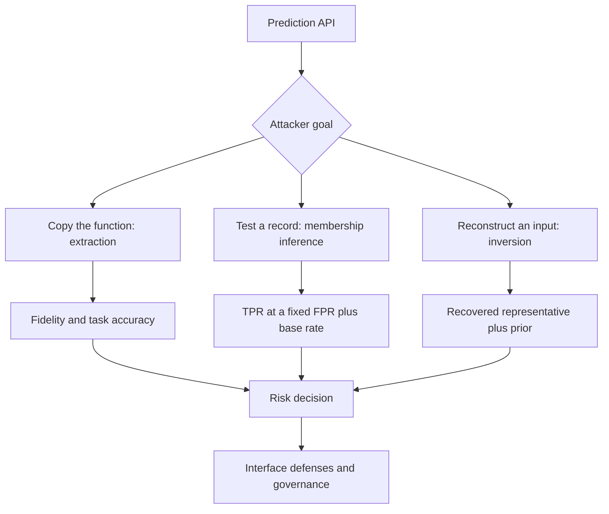

# Module 07 — Model Extraction, Membership Inference, and Model Inversion

**Level 2 · Core attacks · 14 hours · Module 06; Module 03 recommended**

## Why this module exists

Every deployed model answers questions. A user sends an input and receives a label, a probability, or a ranked list. That answer exists to serve the user, but it is also information about the model and about the data the model was trained on.

This module studies three attacks that exploit that information, each asking a different question:

| Attack | Attacker's question | What is at risk |
|---|---|---|
| **Model extraction** | Can I build a copy that behaves like this model? | Intellectual property, paid functionality, competitive advantage |
| **Membership inference** | Was this specific record in the training set? | Privacy of the people or entities in the data |
| **Model inversion** | What input does this model associate with a class or a confidence level? | Sensitive attributes and, in some settings, identifiable features |

The three are often discussed together because they share an interface, not because they share a method. Extraction measures *agreement between models*. Membership inference measures *separation between two groups of records*. Inversion measures *what an optimization recovers*. Mixing up the metrics produces confident, wrong conclusions.

LAB-09 builds a local prediction API with a hard query budget and asks how good a surrogate becomes at 50, 100, 200, and 500 queries. LAB-10 trains a small random forest and asks whether an attacker can tell its training images from images it never saw. Both labs produce numbers that sound stronger than they are, and interpreting them honestly is the main skill.

## Real-world motivation

Tramèr and colleagues (2016) showed that a prediction API can be queried to reconstruct a model that agrees with the target on a large fraction of inputs, and that the copy can then be used to mount further attacks. Papernot and colleagues (2016) demonstrated the same idea as a stepping stone to black-box adversarial examples: train a substitute on query answers, then transfer perturbations to the target. Jagielski and colleagues (2020) separated *accuracy* from *fidelity* and showed that high-fidelity extraction is possible under realistic query access.

Shokri and colleagues (2017) showed that a model's confidence can reveal whether a record was used in training, and that shadow models can turn this into a trained attack. Yeom and colleagues (2018) analyzed the link between overfitting and membership risk and found it informative but incomplete. Carlini and colleagues (2022) showed that with many reference models, membership inference can be far stronger than a single threshold suggests — and that low false-positive rates are where the real privacy question lives.

Fredrikson, Jha, and Ristenpart (2015) showed that confidence values can be optimized to reconstruct representative inputs, including faces, and that hiding confidence reduces but does not eliminate the attack. Each result comes with assumptions: query access, auxiliary data, a candidate pool, a base rate, a model family. A laboratory demonstration on digits or synthetic data does not establish what a particular deployed system leaks.

## Measurable learning objectives

By the end of this module you will be able to:

1. **Classify** extraction, membership inference, and inversion by attacker goal, required access, and metric, and explain what a prediction API reveals beyond its label (Bloom 2).
2. **Measure** extraction fidelity and task accuracy across query budgets, explain the cold-start failure of active selection, and state what high fidelity does not prove (Bloom 3–4).
3. **Compute** TPR at a fixed false-positive budget, compare it with ROC-AUC, and explain why a confidence gap is not proof of membership (Bloom 4–5).
4. **Explain** model inversion and attribute inference, including why a recovered representative is not a recovered record (Bloom 2–4).
5. **Evaluate** interface defenses — rate limits, output rounding, top-k responses, monitoring, watermarking — with their costs and residual risk (Bloom 5).
6. **Report** extraction and privacy risk to a decision-maker with the metric, the base rate, the assumptions, and the limits stated (Bloom 5).

Objectives 1–3 assess LO-12, LO-13, and LO-14; objective 4 assesses LO-15; objective 6 assesses LO-28.

## Prerequisite checklist

| Skill | Check | If not |
|---|---|---|
| Train and evaluate a classifier | You can report accuracy and per-class behavior | M02 Lesson 3 |
| Read predicted probabilities | You can explain what `predict_proba` returns and why rows sum to one | M02 Lesson 3 |
| Read an ROC curve | You can find the point at a given false-positive rate | LAB-01B |
| Build a query-based attack | You can explain black-box access and transfer | M04 Lesson 4 |
| Treat a model as an artifact | You can describe how a model is trained, stored, and served | M06 Lesson 1 |
| Write a threat model | You can state assets, capabilities, assumptions, and impact | M03 Lesson 5 |

### Five-minute diagnostic

1. What is the difference between a surrogate's **fidelity** and its **task accuracy**?
2. ROC-AUC summarizes performance across all thresholds. What does it hide about a real deployment?
3. If an attack has TPR 7.4% at FPR 1%, how many false positives arrive per true positive when half the candidates are members? What if 1% are members?
4. Name three things an attacker can learn from a prediction API besides the correct label.
5. Why does a very confident prediction not prove that the input was in the training set?

If four or five are comfortable, skim Lessons 1–3 and spend the time on LAB-09, LAB-10, and Lesson 4. If fewer than three, read the lessons in order.

## Module map

| Unit | Title | Time | What you produce |
|---|---|---:|---|
| [07.1](lesson-1-prediction-apis-as-attack-surface.md) | Prediction APIs as an attack surface | 1 h | A three-attack threat model |
| [07.2](lesson-2-model-extraction.md) | Model extraction | 1.25 h | A fidelity/accuracy table |
| [07.3](lesson-3-membership-inference.md) | Membership inference | 1.25 h | A low-FPR privacy assessment |
| [07.4](lesson-4-inversion-and-attribute-inference.md) | Model inversion and attribute inference | 1.25 h | An inversion worked example |
| [07.5](lesson-5-privacy-risk-and-governance.md) | Privacy risk, governance, and reporting | 1.25 h | A decision-ready risk memo |
| [LAB-09](../../labs/lab-09.md) | Model extraction with a query budget | 4 h | Extraction curve and report |
| [LAB-10](../../labs/lab-10.md) | Membership inference on a local model | 3 h | Metrics and honest interpretation |
| [Knowledge check](quiz.md) | QZ-07, 10 items | 20 min | Score and explanations |
| [Exercises](exercises.md) | Four exercises, one scenario | 40 min | Portfolio evidence |

Module effort is approximate: 6 hours of lessons, 7 hours of labs, and 1 hour of quiz and exercises.

## How the pieces fit

The fork matters. Each branch needs a different experiment, a different metric, and a different limitation statement. A single number such as "the model is 82% accurate" says nothing about any of the three.

## Common mistakes across the module

| Mistake | Symptom | Consequence |
|---|---|---|
| Reporting AUC as if it were attack success | "The attack works 82% of the time" | Overstates risk at realistic false-positive budgets |
| Ignoring the base rate | High TPR quoted with no prevalence | Precision, and therefore harm, is misjudged |
| Calling a recovered representative "the person" | A blurry face labelled as a victim | The optimization recovered a class pattern, not a record |
| Comparing fidelity with true-label accuracy | "The copy is 0.92 accurate" when it agrees 0.48 | Two different questions are merged |
| Treating a low-fidelity copy as harmless | "Only 48% fidelity" | The copy may still be useful for transfer attacks |
| Forgetting the query budget | "Extraction is easy" after unlimited queries | Cost and detectability are ignored |
| Testing on real endpoints | Probing a production API | Unauthorized use and legal exposure |
| One split, one seed | A single number with no variation | Noise is reported as a finding |
| Treating output rounding as privacy | "We round to two decimals" | The residual signal is not measured |
| Using test data in training | Suspiciously high member confidence | The experiment answers a different question |

## Troubleshooting

| Symptom | Likely cause | Fix |
|---|---|---|
| AUC near 0.5 | Scores computed on the wrong rows | Score members and nonmembers separately |
| TPR at 1% exceeds TPR at 5% | ROC points read in reverse order | Take the last eligible point as FPR increases |
| Threshold TPR differs from TPR at 5% | Quantile computed on member scores | Use the nonmember 95th percentile |
| Fidelity equals accuracy | Comparing to the wrong labels | Fidelity uses teacher predictions; accuracy uses true labels |
| `RuntimeError: query budget exceeded` | Querying before reserving | Enforce `used + len(X) <= budget` |
| Active selection loses at every budget | Cold start never resolved | Seed with more random points and report the trade-off |
| Inversion lands on a box corner | Linear model, unconstrained maximization | Add a prior or a confidence target, and say so |
| Precision is far below TPR | Base rate was ignored | Report precision at the deployment prevalence |

Lesson-specific fixes appear at the end of each lesson.

## Glossary

| Term | Definition |
|---|---|
| **Prediction API** | An interface that accepts inputs and returns labels, probabilities, or scores |
| **Hard label** | A class index with no confidence information |
| **Soft label** | A probability vector or score vector over classes |
| **Query budget** | The maximum number of inputs an attacker may submit |
| **Model extraction** | Training a substitute model from a target model's outputs |
| **Surrogate / substitute** | The attacker's copy, trained on query answers |
| **Fidelity** | Fraction of inputs where the surrogate agrees with the target |
| **Task accuracy** | Fraction of inputs where the surrogate matches the true labels |
| **Active selection** | Choosing queries to maximize information, for example by entropy |
| **Cold start** | The phase where too few queries exist for active selection to be informative |
| **Membership inference** | Deciding whether a record was in a model's training set |
| **Member / nonmember** | A record that was / was not used in training |
| **Shadow model** | An auxiliary model trained by the attacker to imitate the target's confidence behavior |
| **Membership score** | A number computed from model output; larger means "more likely a member" |
| **TPR at FPR ≤ x** | The fraction of members detected while allowing at most x false positives among nonmembers |
| **Base rate / prevalence** | The fraction of candidates that are actually members |
| **Likelihood ratio** | TPR divided by FPR at a threshold; converts prior odds into posterior odds |
| **Model inversion** | Optimizing an input to produce a target output or confidence |
| **Attribute inference** | Inferring a hidden sensitive attribute from other features and model output |
| **Representative** | An input that produces a class's typical output; not necessarily a training record |
| **Auxiliary data** | Extra data or models the attacker uses to improve an attack |
| **Differential privacy** | A training guarantee that bounds any one record's influence on the output |
| **Output perturbation** | Adding noise to or coarsening a model's responses |
| **Query monitoring** | Detecting unusual query patterns at the API |
| **Watermarking** | Embedding detectable behavior in a model to support ownership claims |
| **Model stealing** | The legal and business term for extraction; not identical to copying code |

## Summary and key takeaways

- A prediction API is an information channel: labels reveal function, probabilities reveal more, and repeated queries reveal a lot.
- Extraction is measured by fidelity and task accuracy at a stated query budget; high fidelity does not prove that weights or training data were stolen.
- Active query selection can lose badly during cold start; the random baseline is mandatory.
- Membership inference is a detection problem with two overlapping distributions; AUC hides the low-FPR operating point.
- A confidence gap is evidence of a statistical difference, not proof that a particular record was in training.
- Precision depends on the base rate. At a 1% member prevalence, even a strong likelihood ratio flags mostly nonmembers.
- Model inversion recovers a representative selected by a prior and an objective; it is not a database lookup.
- Attribute inference exploits correlations between visible features, model output, and a hidden sensitive attribute.
- Defenses act at the interface (rate limits, rounding, top-k, monitoring) or in training (regularization, differential privacy); each has a cost and a residual attack.
- A result on digits or synthetic data is a demonstration under assumptions, not a measurement of a deployed system.

## References and further reading

All links checked on 2026-10-28. arXiv identifiers are stable; venue citations are given without inventing DOIs.

| Reference | Use |
|---|---|
| [Tramèr et al., *Stealing Machine Learning Models via Prediction APIs* (arXiv:1609.02943)](https://arxiv.org/abs/1609.02943) | Extraction from confidence and label responses |
| [Papernot et al., *Practical Black-Box Attacks against Machine Learning* (arXiv:1602.02697)](https://arxiv.org/abs/1602.02697) | Substitute models as a path to transfer attacks |
| [Jagielski et al., *High Accuracy and High Fidelity Extraction of Neural Networks* (arXiv:1909.01838)](https://arxiv.org/abs/1909.01838) | Accuracy versus fidelity, and realistic extraction |
| [Shokri et al., *Membership Inference Attacks against Machine Learning Models* (arXiv:1610.05820)](https://arxiv.org/abs/1610.05820) | Shadow-model membership inference |
| [Yeom et al., *Privacy Risk in Machine Learning: Analyzing the Connection to Overfitting* (arXiv:1709.01604)](https://arxiv.org/abs/1709.01604) | Overfitting and membership risk |
| [Carlini et al., *Membership Inference Attacks From First Principles* (arXiv:2112.03570)](https://arxiv.org/abs/2112.03570) | Likelihood-ratio attacks and low-FPR evaluation |
| [Salem et al., *ML-Leaks: Model and Data Independent Membership Inference Attacks and Defenses* (arXiv:1806.01246)](https://arxiv.org/abs/1806.01246) | Attacks with limited auxiliary knowledge |
| [Fredrikson, Jha & Ristenpart, *Model Inversion Attacks that Exploit Confidence Information and Basic Countermeasures* (ACM CCS 2015)](https://doi.org/10.1145/2810103.2813677) | Confidence-based inversion and countermeasures |
| [NIST AI 100-2e2025](https://doi.org/10.6028/NIST.AI.100-2e2025) | Taxonomy of privacy and model-extraction threats |
| [MITRE ATLAS](https://atlas.mitre.org/) | Technique catalog for inference-API exfiltration |

For the attack side, read Tramèr et al. first and Shokri et al. second. For the evaluation side, read Carlini et al. (2022) after LAB-10 and compare its low-FPR framing with the single-threshold attack you ran.

## Next step

Start with [Lesson 07.1 — Prediction APIs as an attack surface](lesson-1-prediction-apis-as-attack-surface.md). If you have already run LAB-09, take the diagnostic and go directly to Lesson 3 and LAB-10.
