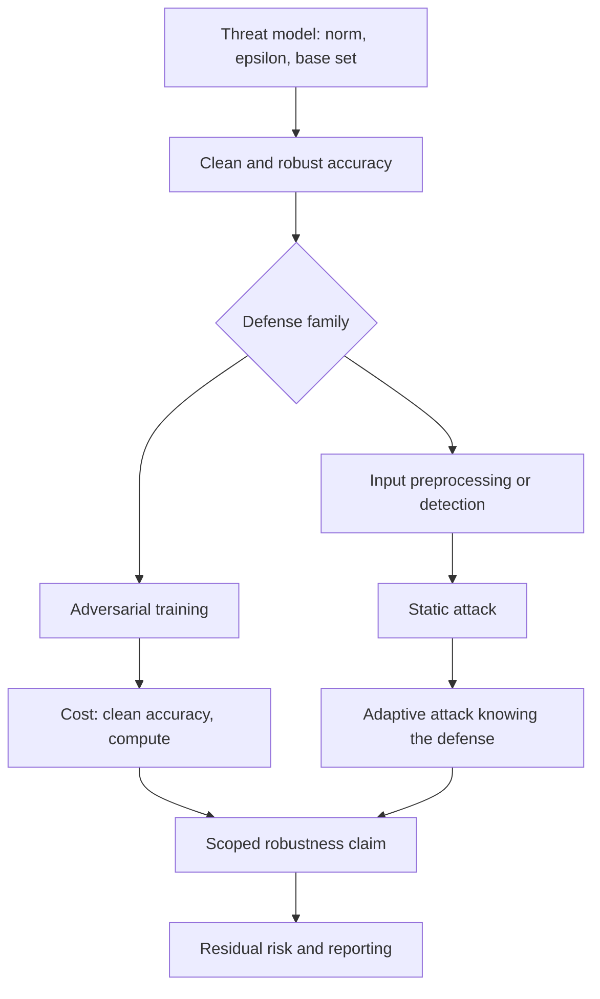

# Module 08 — Robustness Evaluation and Adversarial Defense

**Level 3 · Practical defenses · 16 hours · Module 04, Module 05, and Module 06**

## Why this module exists

A robustness claim sounds simple: "the model is robust." It is not a property a model has in general. It is a statement about a model, an adversary, a perturbation budget, a base set, and an attack procedure. Change any one of them and the number changes.

This module teaches you to make that statement precisely, defend it with a measurement, and attack it. You will compare three systems under the same conditions:

- an undefended logistic-regression classifier;
- the same classifier trained with projected-gradient adversarial training;
- the same classifier protected by an input-squeezing preprocessing step.

The results are deliberately inconvenient. Adversarial training buys robust accuracy by spending clean accuracy. Squeezing looks excellent at one budget and collapses at a larger one. An adaptive attack must be attempted before any defense is believed. And every number depends on a base set that must be named.

The module's thesis is blunt: **no defense is universally effective, and a test that passes is evidence for one threat model, not proof of security.**

## Real-world motivation

Goodfellow, Shlens, and Szegedy (2014) showed that a small, deliberately chosen perturbation could change a classifier's prediction, and proposed the fast gradient sign method as a one-step explanation. Madry and colleagues (2017) reframed robustness as a min-max problem and showed that iterative adversarial training can produce models that resist a strong attack at a stated L∞ budget — at a measurable cost in clean accuracy.

That cost is not a detail. A model that is 99% accurate on ordinary inputs and 45% accurate under a realistic attack may be less useful than a model that is 93% accurate and 70% robust, depending on the deployment. The choice is an engineering decision that requires both numbers.

Defenses have a long history of failing evaluation. Athalye, Carlini, and Wagner (2018) showed that many published defenses produced *obfuscated gradients*: the attack failed because it could not compute a useful gradient, not because the model was robust. Carlini and Wagner (2017) showed that detecting adversarial examples is harder than it looks, and that a detector which works against one attack often fails against an adaptive one. Croce and Hein (2020) built AutoAttack after finding that single-attack evaluations overstated robustness across a large model zoo.

The lesson is methodological: **evaluate with the strongest attack you can build, assume the attacker knows your defense, and report what you did not test.**

## Measurable learning objectives

By the end of this module you will be able to:

1. **Define** a robustness claim with its norm, budget, base set, attack, and metric, and distinguish clean accuracy, robust accuracy, and attack success rate (Bloom 2–3).
2. **Train** an adversarially robust classifier and quantify the clean-accuracy cost at a stated threat model (Bloom 3).
3. **Evaluate** an input-processing or detection defense with a static attack and an adaptive attack, and report its bypass rate, utility cost, and false positives (Bloom 4–5).
4. **Identify** at least one invalid-evaluation pitfall — gradient masking, an underpowered attack, a base-set error, or an unscoped claim — in a published or self-produced result (Bloom 5).
5. **Reproduce** a robustness comparison with fixed seeds, versions, and a documented command, and report uncertainty or run-to-run variation (Bloom 5).
6. **Report** a robustness result with limitations, residual risk, and an explicit statement that the defense is not universal (Bloom 5).

Objectives 1 and 4 assess LO-16; objective 2 assesses LO-17; objective 3 assesses LO-18; objectives 5–6 assess LO-28 and support the communication rubric.

## Prerequisite checklist

| Skill | Check | If not |
|---|---|---|
| Implement FGSM and PGD | You can write the sign step and projection without copying code | M04 Lessons 2–3 |
| Explain an L∞ budget | You can state what ε = 0.10 means for pixel values in [0, 1] | M04 Lesson 1 |
| Measure ASR correctly | You know why the base set is the clean-correct rows | M04 Lesson 5 |
| Train a scikit-learn model | You can fit a pipeline and report accuracy | M01–M02 |
| Read a confidence interval | You can explain what a bootstrap interval estimates | M02 Lesson 4 |
| Write a threat model | You can name attacker goal, knowledge, capability, and budget | M03 Lesson 5 |

### Five-minute diagnostic

1. A model has 96% clean accuracy and 62% accuracy under PGD at ε = 0.10. Is it "robust"?
2. Why is attack success rate usually computed only on rows the model classified correctly before the attack?
3. What is the difference between an empirical robustness result and a certified guarantee?
4. A defense reports 0% attack success against PGD with a fixed step size and no restarts. Give two reasons this is weak evidence.
5. Squeezing inputs to 4 bit levels cuts attack success sharply at ε = 0.10. What test would you run next?

If you can answer four or five, skim Lessons 1–3 and spend the time on Lesson 4, LAB-11, and MP-02. If fewer than three, read in order.

## Module map

| Unit | Title | Time | What you produce |
|---|---|---:|---|
| [08.1](lesson-1-what-robustness-claims-mean.md) | What robustness claims mean | 1.5 h | A five-part robustness claim |
| [08.2](lesson-2-adversarial-training.md) | Adversarial training | 1.5 h | A clean-cost/robust-gain table |
| [08.3](lesson-3-input-preprocessing-and-detection.md) | Input preprocessing and detection defenses | 1.5 h | A defense evaluation plan |
| [08.4](lesson-4-adaptive-attacks-and-pitfalls.md) | Adaptive attacks and evaluation pitfalls | 1.5 h | An adaptive-attack log |
| [08.5](lesson-5-standardized-evaluation.md) | Standardized evaluation and reproducibility | 1.5 h | A reproducible evaluation record |
| [08.6](lesson-6-reporting-robustness.md) | Reporting robustness and defense limits | 1 h | A robustness report with residual risk |
| [LAB-11](../../labs/lab-11.md) | Defense evaluation: adversarial training, squeezing, adaptive attack | 6 h | Comparison, stress test, scoped claim |
| [Knowledge check](quiz.md) | QZ-08, 10 items | 20 min | Score and explanations |
| [Exercises](exercises.md) | Four exercises, one scenario | 50 min | Portfolio evidence |

Module effort is approximate: 8.5 hours of lessons, 6 hours of lab, and 1.5 hours of quiz and exercises.

## How the pieces fit

The adaptive branch is not optional. A defense evaluated only against the attack it was designed for is a hypothesis, not a result.

## Common mistakes across the module

| Mistake | Symptom | Consequence |
|---|---|---|
| Treating "robust" as a property without a budget | "The model is robust" | The claim cannot be tested or compared |
| Using clean accuracy as the base set | ASR computed over all test rows | Success rate is diluted by rows the model already got wrong |
| Evaluating at one ε | A single impressive number | The defense's failure boundary is hidden |
| Comparing models trained on different rows | Small accuracy differences | Confounded comparison |
| Calling a preprocessing transform a security boundary | "We squeeze inputs, so we are safe" | The transform is part of the attack surface |
| Skipping the adaptive attack | Naive ASR looks low | Gradient masking or a weak attack is misread as robustness |
| Reporting robust accuracy without clean accuracy | Only the good number | The utility cost is invisible |
| One seed, one run | No variation reported | Noise is presented as an effect |
| Citing a leaderboard as a deployment guarantee | "RobustBench says 70%" | Different threat model, data, and training budget |
| Claiming a defense is secure because tests pass | "All checks passed" | Tests cover named cases, not the adversary's creativity |

## Troubleshooting

| Symptom | Likely cause | Fix |
|---|---|---|
| Robust accuracy exceeds clean accuracy | Base-set or label bug | Recompute both on the full test set and on the clean-correct subset |
| ASR moves in the wrong direction when ε grows | Attack sign or projection error | Verify `x + ε·sign(grad)` increases loss and stays in the ball |
| Adversarial training does not improve robustness | ε_train too small or training too short | Match the training budget to the evaluation budget and report both |
| Squeezing gives 0% ASR at ε = 0 | Inputs or labels changed accidentally | Compare unperturbed predictions before and after the transform |
| Adaptive attack is weaker than the naive attack | BPDA approximation or step size is poor | Tune the attack, use restarts, and report the strongest result |
| Results change between runs | Non-determinism in training or sampling | Fix seeds, use deterministic solvers, document library versions |
| Clean accuracy collapses after adversarial training | Capacity too small or ε_train too large | Report the trade-off; do not hide the cost |
| `NaN` in the loss during PGD | Step size or clipping error | Project after every step and check finite inputs |

Lesson-specific fixes appear at the end of each lesson.

## Glossary

| Term | Definition |
|---|---|
| **Adversarial example** | An input changed slightly to cause a wrong prediction |
| **Evasion** | An attack at inference time that changes an input but not the model |
| **Perturbation budget (ε)** | The maximum allowed change under a chosen norm |
| **L∞ norm** | The largest absolute change to any single feature |
| **Base set** | The rows on which attack success is measured, usually the clean-correct rows |
| **Attack success rate (ASR)** | Fraction of the base set whose prediction the attack changes to the attacker's goal |
| **Robust accuracy** | Accuracy on adversarially perturbed inputs at a stated budget |
| **Clean accuracy** | Accuracy on unperturbed inputs |
| **Adversarial training** | Training on adversarially perturbed examples, usually generated by PGD |
| **Inner maximization** | The attack step inside adversarial training that finds a high-loss input |
| **Gradient masking** | A defense that makes gradients uninformative rather than removing the vulnerability |
| **Shattered gradients** | A defense whose gradients are nonexistent, wrong, or numerically unstable |
| **BPDA** | Backward pass differentiable approximation; substitutes a differentiable function for a non-differentiable transform |
| **EOT** | Expectation over transformation; averages gradients over randomized transforms |
| **Adaptive attack** | An attack designed with knowledge of the defense |
| **Certified robustness** | A guarantee that no input within a stated ball can change the prediction |
| **Empirical robustness** | A measured result against a specific attack at a specific budget |
| **AutoAttack** | A standardized ensemble of attacks used to reduce evaluation variance |
| **RobustBench** | A public benchmark of robustness results and models |
| **Input squeezing** | Reducing input precision or resolution to remove small perturbations |
| **False positive (detector)** | A benign input flagged as adversarial |
| **Utility cost** | The loss of clean accuracy, latency, or usability caused by a defense |
| **Residual risk** | The risk that remains after controls, including adaptive bypasses |

## Summary and key takeaways

- A robustness claim needs five parts: model, adversary, norm, budget, and base set. Without them, "robust" is marketing.
- Clean accuracy and robust accuracy are different measurements. Report both, and report the base-set size.
- Adversarial training is the strongest general-purpose empirical defense in this course, and it still costs clean accuracy and compute.
- Input squeezing and detection can remove some perturbations, but they are preprocessing, not a security boundary; they require their own threat model and false-positive accounting.
- A defense must be evaluated with an adaptive attack that knows how it works. Naive-attack success is an upper bound on the defense's quality, not a measurement of it.
- A stress budget is a diagnostic. A defense that holds at ε = 0.10 and collapses at ε = 0.20 has a boundary, not a guarantee.
- Standardized attacks and multiple restarts reduce the chance that a weak evaluation is mistaken for robustness.
- Passing a test is evidence for the tested cases. It is not proof that the system is secure.
- Report negative results and residual risk. A defense that fails honestly is more useful than a claim that cannot be reproduced.

## References and further reading

All links checked on 2026-10-28. arXiv identifiers are stable; venue citations are given without inventing DOIs.

| Reference | Use |
|---|---|
| [Goodfellow, Shlens & Szegedy, *Explaining and Harnessing Adversarial Examples* (arXiv:1412.6572)](https://arxiv.org/abs/1412.6572) | FGSM and the linear explanation |
| [Madry et al., *Towards Deep Learning Models Resistant to Adversarial Attacks* (arXiv:1706.06083)](https://arxiv.org/abs/1706.06083) | PGD attacks and adversarial training |
| [Carlini & Wagner, *Towards Evaluating the Robustness of Neural Networks* (arXiv:1608.04644)](https://arxiv.org/abs/1608.04644) | Stronger attacks and evaluation pitfalls |
| [Athalye, Carlini & Wagner, *Obfuscated Gradients Give a False Sense of Security* (arXiv:1802.00420)](https://arxiv.org/abs/1802.00420) | Gradient masking and adaptive evaluation |
| [Croce & Hein, *Reliable Evaluation of Adversarial Robustness with an Ensemble of Diverse Parameter-free Attacks* (arXiv:2003.01690)](https://arxiv.org/abs/2003.01690) | AutoAttack |
| [Croce et al., *RobustBench: a Standardized Adversarial Robustness Benchmark* (arXiv:2010.09670)](https://arxiv.org/abs/2010.09670) | Standardized comparison |
| [Zhang et al., *Theoretically Principled Trade-off between Robustness and Accuracy* (arXiv:1901.08573)](https://arxiv.org/abs/1901.08573) | TRADES and the trade-off |
| [Wong, Rice & Kolter, *Fast is Better than Free: Revisiting Adversarial Training* (arXiv:2001.03994)](https://arxiv.org/abs/2001.03994) | Cheaper adversarial training |
| [Xu, Evans & Qi, *Feature Squeezing: Detecting Adversarial Examples in Deep Neural Networks* (arXiv:1704.01155)](https://arxiv.org/abs/1704.01155) | Squeezing and detection |
| [Carlini & Wagner, *Adversarial Examples Are Not Easily Detected* (arXiv:1705.07263)](https://arxiv.org/abs/1705.07263) | Limits of detection defenses |
| [Cohen, Rosenfeld & Kolter, *Certified Adversarial Robustness via Randomized Smoothing* (arXiv:1902.02918)](https://arxiv.org/abs/1902.02918) | What a certified guarantee looks like |
| [NIST AI 100-2e2025](https://doi.org/10.6028/NIST.AI.100-2e2025) | Evasion taxonomy and evaluation vocabulary |
| [MITRE ATLAS](https://atlas.mitre.org/) | Technique context for evasion |

Read Madry et al. before LAB-11. Read Athalye et al. after Lesson 4 and compare its checklist with the adaptive attempt you ran.

## Next step

Start with [Lesson 08.1 — What robustness claims mean](lesson-1-what-robustness-claims-mean.md). If you have already completed LAB-03 and LAB-04, take the diagnostic and go directly to Lesson 4 and LAB-11.
