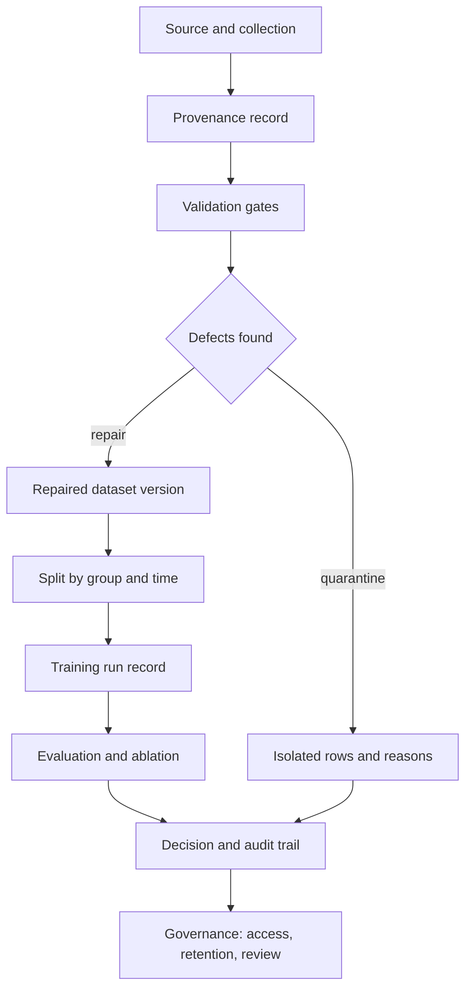

# Module 09 — Data Integrity, Dataset Governance, and Secure Training Pipelines

**Level 3 · Practical defenses · 12 hours · Module 02 recommended**

## Why this module exists

Most ML incidents that look like model failures are data failures. A negative account age, a duplicated customer, a label entered after the outcome, a column that exists only at training time — each is small, each is plausible in a spreadsheet, and each can invalidate an evaluation or a deployment decision.

Security adds a second layer. Some data defects are accidents. Some are adversarially placed: a poisoned label, a backdoored sample, a tampered extract. The controls overlap — schema checks catch both accidents and crude attacks — but the threat models differ, and a pipeline that only checks for accidents will miss a patient attacker.

This module builds the layer between raw data and a trained model:

- **Provenance and lineage:** where did this row come from, and what happened to it?
- **Validation:** does it satisfy the schema, the ranges, the label rules, and the uniqueness constraints?
- **Split integrity:** are evaluation rows genuinely unseen, or did a customer, a duplicate, or a future column cross the boundary?
- **Reproducibility:** can another person rebuild the exact dataset and run?
- **Governance:** who may read, change, retain, or delete it, and what evidence remains?

LAB-12 gives you a defective synthetic customer extract, a validation report, a repair pipeline, and a leakage experiment. The measured result is uncomfortable: a leaky evaluation reaches ROC-AUC 0.9584, the same rows without the leaky column reach 0.7507, and the repaired dataset reaches 0.8485. Only the middle comparison isolates the leak. The repaired number answers a different question.

The module's thesis: **a dataset that passes validation is not proven clean; it is proven to satisfy the rules you wrote.**

## Real-world motivation

Gebru et al. (2018) proposed *datasheets for datasets* so that a dataset's motivation, composition, collection process, and recommended uses travel with it. Mitchell et al. (2019) proposed *model cards* for the model side. Both respond to the same problem: documentation that exists only in the collector's memory does not survive a handoff.

Sambasivan et al. (2021) studied high-stakes AI projects and described *data cascades*: small, unresolved data issues that compound into downstream failures and erode trust. The pattern is not a single bad row. It is a missing check at ingestion, an undocumented transformation, an evaluation that quietly measured the wrong thing.

Regulation and standards have moved in the same direction. NIST AI RMF 1.0 treats data as a risk source across its GOVERN, MAP, MEASURE, and MANAGE functions. ISO/IEC 42001 addresses AI management systems, including data resources and documentation, though the standard is paid and this course discusses its concepts rather than reproducing its text.

Security adds adversarial data integrity to this picture. Module 05 and Module 06 covered poisoning and backdoors as attacks. This module covers the pipeline controls that make those attacks harder to introduce silently and easier to detect after the fact.

## Measurable learning objectives

By the end of this module you will be able to:

1. **Trace** a dataset through source, transformation, split, and training with a lineage record that another person can follow (Bloom 2–3).
2. **Build** validation rules for schema, ranges, categories, missingness, duplicates, label plausibility, and split overlap, and report defects by class with counts and examples (Bloom 3–4).
3. **Distinguish** a controlled ablation from a repaired re-evaluation, and explain why cleaning can change the metric for reasons unrelated to the defect under study (Bloom 4–5).
4. **Design** a reproducible training run with dataset version, configuration, seeds, environment, and artifact hashes (Bloom 3–4).
5. **Justify** governance controls — access, retention, licensing, audit — with trust assumptions, residual risk, and framework mapping (Bloom 5).
6. **Report** a data-integrity finding with the defect count, the false-positive cost, and the limits of the validation (Bloom 5).

Objectives 1–3 and 6 assess LO-20; objectives 1, 5, and 6 assess LO-30; objective 4 assesses LO-28.

## Prerequisite checklist

| Skill | Check | If not |
|---|---|---|
| Load and clean a table | You can group, de-duplicate, and impute with pandas | M01 Lesson 3 |
| Explain leakage | You can name target, pipeline, duplicate, and temporal leakage | M02 Lesson 4 |
| Read ROC-AUC | You can explain what it ranks and what it hides | LAB-01B |
| Explain a poisoning attack | You can state attacker control and poison rate | M05 Lesson 1 |
| Write a threat model | You can name assets, boundaries, and impact | M03 Lesson 5 |
| Run a pinned Python environment | You can install from `requirements.txt` and record versions | LAB-01 |

### Five-minute diagnostic

1. What is the difference between provenance and lineage?
2. Why is "AUC dropped after cleaning" not proof that a specific column leaked?
3. A customer appears in both training and test rows. Which evaluation property is broken, and what split fixes it?
4. Name three fields a training run should record besides the model hyperparameters.
5. Why is a dataset hash not evidence that the dataset is correct?

If four or five are comfortable, skim Lessons 1–2 and spend the time on Lesson 3, LAB-12, and the governance memo. If fewer than three, read in order.

## Module map

| Unit | Title | Time | What you produce |
|---|---|---:|---|
| [09.1](lesson-1-provenance-and-lineage.md) | Provenance and lineage | 1.5 h | A lineage record for one dataset |
| [09.2](lesson-2-data-quality-and-integrity.md) | Data quality and integrity controls | 1.5 h | A validation rule set with counts |
| [09.3](lesson-3-splits-leakage-and-evaluation-integrity.md) | Splits, leakage, and evaluation integrity | 1.5 h | A split audit and ablation plan |
| [09.4](lesson-4-reproducible-training.md) | Reproducible training and experiment tracking | 1.5 h | A run record and reproduction command |
| [09.5](lesson-5-dataset-governance-and-audit.md) | Dataset governance and audit | 1.5 h | A governance memo with owners |
| [LAB-12](../../labs/lab-12.md) | Dataset validation and leakage audit | 4 h | Validation report, repaired data, ablation |
| [Knowledge check](quiz.md) | QZ-09, 10 items | 20 min | Score and explanations |
| [Exercises](exercises.md) | Four exercises, one scenario | 40 min | Portfolio evidence |

Module effort is approximate: 7.5 hours of lessons, 4 hours of lab, and 1 hour of quiz and exercises.

## How the pieces fit

The feedback loop matters. Validation is not a one-time gate before training; it produces a quarantined set that must be reviewed, and a repaired version that must be reproducible. A pipeline that silently drops rows has no audit trail.

## Common mistakes across the module

| Mistake | Symptom | Consequence |
|---|---|---|
| Treating validation as proof of cleanliness | "All checks passed" | Unknown defect classes are assumed absent |
| Counting defects as if they were rows | Totals exceed the row count | Overlapping issues are double-counted |
| Repairing before measuring | Clean metrics with no baseline | The effect of the defect cannot be estimated |
| Attributing a metric change to one cause after several repairs | "Dropping the column caused the drop" | Confounded by de-duplication, imputation, and filtering |
| Splitting rows instead of entities | High test AUC, suspiciously stable | Group leakage inflates evaluation |
| Recording hyperparameters but not the dataset | A run that cannot be rebuilt | Reproduction fails months later |
| Keeping the leaky column "for analysis" | The model still sees it | The leak persists in a different code path |
| Quarantining without review | Rows disappear | False positives are invisible and unexplained |
| Hashing a dataset and calling it verified | A valid hash | The content may still be wrong or poisoned |
| Assigning governance to "the team" | No name, no date | Controls decay silently |

## Troubleshooting

| Symptom | Likely cause | Fix |
|---|---|---|
| Repaired row count differs from reference | Repair order changed which rows survive overlaps | Apply filters in the documented order |
| Label-conflict count is zero | Grouping omitted a feature or dropped nulls | Group on all features with `dropna=False` |
| Leak gap disappears after cleaning | The ablation was run on repaired rows | Run the with/without comparison on identical rows |
| Grouped split fails | Missing group column or null groups | Use `customer_id`; check for nulls |
| AUC varies between runs | Random split or solver variation | Fix `random_state`; record versions |
| Imputation changes class balance | Missing values are not missing at random | Report missingness by label; consider a missing indicator |
| Validation flags many benign rows | Rule threshold too tight | Measure false positives on a reviewed sample |
| Manifest changes without a code change | Input data or timestamp in the artifact | Separate deterministic outputs from run metadata |

Lesson-specific fixes appear at the end of each lesson.

## Glossary

| Term | Definition |
|---|---|
| **Provenance** | The origin and history of a dataset: who collected it, how, when, and under what terms |
| **Lineage** | The graph of transformations from source to the dataset or model used |
| **Data contract** | An explicit agreement on schema, types, ranges, and semantics between producer and consumer |
| **Validation gate** | An automated check that blocks or quarantines data failing a rule |
| **Quarantine** | Isolation of suspicious rows with a reason, rather than silent deletion |
| **Data cascade** | A small unresolved data issue that compounds into downstream failure |
| **Leakage** | Information in training that would not be available at prediction time |
| **Group leakage** | The same entity appears in both training and evaluation |
| **Temporal leakage** | Future information is used to predict the past |
| **Pipeline leakage** | Preprocessing is fit on data that includes evaluation rows |
| **Ablation** | Removing one factor while holding everything else fixed to isolate its effect |
| **Dataset version** | An immutable identifier for a specific content state |
| **Manifest** | A file listing artifacts and their hashes |
| **Experiment tracking** | Recording parameters, data, code, environment, and results for a run |
| **Audit trail** | Evidence of who did what, when, and why |
| **Retention policy** | Rules for how long data is kept and when it is deleted |
| **Data minimization** | Collecting and retaining only what is needed |
| **Licensing** | The legal terms under which data may be used and redistributed |
| **FAIR** | Findable, Accessible, Interoperable, Reusable data principles |
| **False positive (validation)** | A legitimate row flagged by a rule |
| **Residual risk** | Risk remaining after controls, including unknown defect classes |

## Summary and key takeaways

- Data integrity is a security property: defects can be accidental, structural, or adversarial.
- Provenance and lineage make a dataset reviewable; without them, every later claim rests on memory.
- Validation rules are hypotheses. Each has false positives, false negatives, and a scope.
- LAB-12 detects 18 missing cells, 10 schema violations, 8 duplicate rows, 4 label-conflict groups (8 rows), 6 implausible labels, 28 duplicate customer records, 12 customers leaked across a naive split, and 1 post-outcome column.
- Repair changes the dataset, so a before/after metric difference is confounded. The same-rows ablation isolates the leaky column: 0.9584 with it, 0.7507 without it.
- The repaired pipeline reaches 0.8485 on a different row set. That number is useful and not a substitute for the ablation.
- Grouped splits protect against entity leakage; temporal splits protect against future leakage; pipelines protect against preprocessing leakage.
- A reproducible run records the dataset version, code, configuration, seeds, environment, and output hashes.
- Governance assigns owners, access, retention, licensing, and review. A control without an owner is a suggestion.
- A hash proves integrity, not correctness. Validation proves rule conformance, not cleanliness.

## References and further reading

All links checked on 2026-10-28. arXiv identifiers are stable; standards are cited by identifier.

| Reference | Use |
|---|---|
| [Gebru et al., *Datasheets for Datasets* (arXiv:1803.09010)](https://arxiv.org/abs/1803.09010) | Dataset documentation |
| [Mitchell et al., *Model Cards for Model Reporting* (arXiv:1810.03993)](https://arxiv.org/abs/1810.03993) | Model documentation |
| [W3C, *PROV-O: The PROV Ontology*](https://www.w3.org/TR/prov-o/) | Provenance vocabulary |
| [Wilkinson et al., *The FAIR Guiding Principles for Scientific Data Management and Stewardship* (Scientific Data, 2016)](https://doi.org/10.1038/sdata.2016.18) | Findable, accessible, interoperable, reusable data |
| [NIST AI Risk Management Framework 1.0](https://doi.org/10.6028/NIST.AI.100-1) | GOVERN, MAP, MEASURE, MANAGE |
| [NIST AI 100-2e2025](https://doi.org/10.6028/NIST.AI.100-2e2025) | Data poisoning and integrity threats |
| Sambasivan et al., *"Everyone wants to do the model work, not the data work": Data Cascades in High-Stakes AI* (CHI 2021) | Why unresolved data issues compound |
| ISO/IEC 42001:2023, *AI management systems* (paid standard; concepts only) | Governance and documentation |

Read the datasheets paper before LAB-12. Read the data-cascades paper after the lab and compare its failure pattern with the defects the validator found.

## Next step

Start with [Lesson 09.1 — Provenance and lineage](lesson-1-provenance-and-lineage.md). If you have already completed LAB-01B, take the diagnostic and go directly to Lesson 3 and LAB-12.
