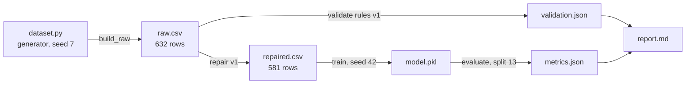

# Lesson 09.1 — Provenance and Lineage

<a id="m09-l1"></a>

**Module 09 · Lesson 1 of 5 · 1.5 hours · LO-20, LO-30**

## Scenario

An incident review begins with a simple question: which data was the production churn model trained on? The team has three candidate extracts, two notebooks, and a shared drive. The filenames contain dates, but two dates are wrong. Nobody can say whether the duplicate-heavy extract or the cleaned one produced the deployed artifact.

The model is not the problem. The pipeline cannot answer a question about its own history. This lesson is about making that question answerable before an incident, not during one.

## Objectives

By the end of this lesson you will be able to:

1. Distinguish provenance from lineage and explain what each is for.
2. Write a dataset record with source, collection context, transformations, version, and constraints.
3. Represent a pipeline as a lineage graph using entity, activity, and agent concepts.
4. Identify trust boundaries where provenance can be lost or forged.
5. State the limits of a provenance record and how hashes and signatures change them.

## 1. Two words that are not synonyms

**Provenance** is the origin and history of an artifact: who created it, from what, when, why, and under which terms. For a dataset, that includes the collection method, the population, the consent or license, and the transformations applied.

**Lineage** is the graph that connects artifacts through activities. A lineage record says: `raw.csv` was produced by `build_raw(seed=7)`, which read `dataset.py`; `repaired.csv` was produced by `repair(raw.csv, rules=v3)`; the model was trained on `repaired.csv` at commit `abc123`.

Provenance is broader and more descriptive. Lineage is narrower and more queryable. You need both.

| Question | Answered by |
|---|---|
| Who collected this data, and under what terms? | Provenance |
| Which rows produced this model? | Lineage |
| What code transformed the extract? | Both |
| May we redistribute this dataset? | Provenance (license) |
| If we delete this customer, which models are affected? | Lineage |
| Is this file the one that was reviewed? | Manifest and hash |
| Was the person who approved this change authorized? | Audit log, not lineage alone |

### Why a filename is not provenance

`churn_clean_final_v2.csv` contains four claims: a domain, a quality state, a finality claim, and a version. None is verifiable. A file can be renamed, copied, and edited without changing its name. A lineage record replaces the claims with references to content.

## 2. The dataset record

A usable record answers questions a future maintainer will ask. The datasheets work of Gebru et al. (2018) is a good model; the fields below are the subset this course needs.

| Field | Question | LAB-12 example |
|---|---|---|
| Identity | What is this dataset called, and what version? | `churn-synthetic`, version `raw-7` |
| Source | Where did it come from? | Local generator `dataset.py`, seed 7 |
| Population | Who or what is represented? | Synthetic customers, no real people |
| Collection | How was it produced? | Deterministic simulation of 600 base customers plus planted defects |
| Schema | What columns, types, and units? | `age`, `account_age_days`, `monthly_spend`, `plan`, `region`, `support_tickets`, `churn`, `customer_id`, `exit_survey` |
| Constraints | What values are allowed? | `age` 18–100, spend ≤ 500, `plan` in an allowed set |
| Label | How is the target defined, and when is it known? | `churn`, observed after a retention window |
| Transformations | What was applied, in what order? | Validate, impute, de-duplicate, quarantine, drop `exit_survey` |
| Split | How are rows divided? | Naive random split seed 13 for the audit; grouped by `customer_id` for the clean evaluation |
| License | What may a consumer do with it? | Synthetic, generated locally for coursework |
| Contacts | Who owns it and who reviews changes? | Dataset owner and reviewer roles |
| Known issues | What is known to be wrong or missing? | Duplicate customers, label conflicts, post-outcome column |

The "known issues" field is the one teams omit most often. It is also the most valuable: it tells a consumer what the dataset cannot support.

### The transformation record

Every transformation needs three things: the code, the parameters, and the input version.

```text
activity: repair
  input: churn-synthetic/raw-7 (sha256: ...)
  code: lab-12-dataset-validation/solution.py @ commit abc123
  params: {impute_spend: median, impute_plan: mode, keep_customer: first,
           drop: [exit_survey], quarantine: [label_conflicts, implausible]}
  output: churn-synthetic/repaired-7 (sha256: ...)
  agent: student@example (role: data-engineer)
  timestamp: 2026-10-28T12:00:00Z
```

Without the parameters, the same code can produce a different dataset. Without the input hash, the same parameters can be applied to a different extract. Without the code reference, the transformation cannot be rerun.

## 3. Lineage as a graph

The W3C PROV model uses three core concepts:

- **Entity:** a thing — a file, a table, a model, a report.
- **Activity:** something that happened — a generation, a transformation, a training run.
- **Agent:** who or what performed it — a person, a service, an automated job.

The graph connects them with `wasGeneratedBy`, `used`, and `wasAttributedTo`. You do not need the full ontology to use the idea. You need to be able to draw the graph.



Three properties make this graph useful.

1. **Direction.** It shows what depends on what. Deleting `repaired.csv` invalidates the model; changing `dataset.py` invalidates everything downstream.
2. **Granularity.** It names files and activities, not "the pipeline." A node you cannot point to is not a node.
3. **Evidence.** Each edge can carry a hash or a run identifier, so the graph is checkable rather than asserted.

### Entity versus row-level lineage

The graph above is at the artifact level. Row-level lineage tracks individual records: this customer's row appeared in extract A, was quarantined by rule R, and is absent from extract B. Row-level lineage is expensive and is usually reserved for regulated data or debugging a specific record. Artifact-level lineage answers most engineering questions at a fraction of the cost.

## 4. Trust boundaries and forged provenance

A provenance record is itself data, and it can be wrong in three ways.

| Failure | Example | Control |
|---|---|---|
| Missing | The transformation was run manually and not recorded | Pipeline-only writes; reject unregistered artifacts |
| Incorrect | The record names the wrong input version | Hash the input at read time; bind the record to the hash |
| Forged | An attacker edits the record to hide a poisoned source | Sign records; restrict write access; keep an append-only log |

Trust boundaries appear wherever the record crosses a system or organization:

- **Collection:** the source system attests to what it sent. You trust the attestation or you verify the content.
- **Ingestion:** the pipeline records what it received. This is the first point you control.
- **Transformation:** the pipeline records code, parameters, and versions.
- **Registry:** the artifact store records who published what, and enforces immutability.
- **Consumption:** the training job records which version it read.
- **Audit:** an independent log records administrative actions, not just data flow.

A provenance chain is only as strong as its weakest attestation. If the source system can rewrite history, downstream hashes prove only that you hashed what you were given.

### Hashes and signatures

A **hash** answers "is this the same bytes?" It detects accidental modification and some tampering. It does not prove the content is correct, and it does not prove who produced it.

A **signature** binds the hash to a key. It answers "who attests to these bytes?" It requires key management, revocation, and a policy about which keys are trusted. Module 10 covers signing in depth; for this lesson, remember the distinction: **integrity is not authenticity, and authenticity is not correctness.**

## 5. A record you can actually maintain

Provenance systems fail when they are more expensive than the work they describe. Keep the record close to the pipeline.

1. **Generate it, do not write it by hand.** The pipeline emits the record as a build artifact, alongside `metrics.json`.
2. **Version the rules, not just the data.** A validation rule change is a transformation change.
3. **Bind records to hashes.** Record the input hash the job actually read, not the hash someone typed into a config.
4. **Use immutable versions.** `raw-7` must never change. A correction creates `raw-8`.
5. **Record the agent.** A job id or a person, with a role. "The team" is not an agent.
6. **Keep it queryable.** A JSON record per artifact is enough for a course; a registry with a query interface is better at scale.
7. **Retain the quarantine.** The rows a rule rejected are evidence. Store them with the reason and the rule version.

LAB-12's `run.json` is a minimal lineage record: lab id, seed, split seed, row counts, and environment. Its `manifest.json` adds hashes. It does not record the transformation parameters in a structured graph, which is one of the limitations you should note when you extend it.

## 6. Limitations

Provenance is attestation, not omniscience.

- **It inherits the source's honesty.** A synthetic generator is trustworthy because you can read it; a vendor extract is trustworthy only as far as the contract and the audit.
- **It records what was declared.** A transformation run outside the pipeline is invisible.
- **It can leak.** Metadata may contain personal data, internal hostnames, or credentials. Treat the record as sensitive.
- **It ages.** Code references rot when repositories are rewritten; keys expire; links break. Retention and review are part of the design.
- **It does not prove fitness.** A perfectly documented dataset can still be unsuitable for the task.

The honest claim is: "We can trace this artifact to a registered source and a reproducible transformation, with the stated trust assumptions." That is a strong claim. It is not "the data is correct."

## Common mistakes

| Mistake | Why it happens | Fix |
|---|---|---|
| Using filenames as versions | It is convenient | Register immutable versions with hashes |
| Recording only the final dataset | Intermediate steps feel transient | Record each transformation and its parameters |
| Hand-writing the lineage record | The pipeline is "obvious" | Emit it from the job |
| Hashing the config instead of the input | The config is easier to find | Hash the bytes actually read |
| Treating a hash as proof of correctness | Integrity and correctness are conflated | State what the hash covers |
| Storing provenance without access control | It is "just metadata" | Apply the same rules as the data |
| One graph for all time | Updating is easier than versioning | Version the graph with the artifacts |
| No agent recorded | Automation has no owner | Record job id and responsible role |

## Troubleshooting

| Symptom | Likely cause | Fix |
|---|---|---|
| Cannot reproduce a dataset | Transformation parameters or code version missing | Add them to the record and re-run |
| Two artifacts claim the same version | Mutable versioning | Enforce immutability in the registry |
| Lineage graph has cycles | A job read its own output or a shared mutable path | Use immutable inputs and explicit output paths |
| Hash mismatch after a copy | Line-ending or encoding change | Copy bytes; verify after transfer |
| Record exists but the run did not happen | Manual entry | Generate records from execution, not from documentation |
| Metadata exposes personal data | Unreviewed free-text fields | Minimize and classify metadata |
| Audit cannot identify who approved a change | Data lineage is not an approval log | Keep a separate administrative audit log |

## Check your understanding

1. Give one question that provenance answers and lineage does not, and one that lineage answers and provenance does not.
2. What three things must a transformation record contain to be reproducible?
3. Why is a hash insufficient to establish that a dataset came from a trusted source?
4. Name two trust boundaries in a pipeline and what is attested at each.
5. A team says "our data is fully traceable." What two follow-up questions test that claim?

Answers are in the [quiz answer key](quiz-answers.md) and discussed in the exercises.

## Summary

- Provenance describes origin and terms; lineage is the graph of artifacts and transformations.
- A dataset record covers identity, source, population, schema, constraints, label timing, transformations, split, license, contacts, and known issues.
- A transformation record needs code, parameters, input version, output version, agent, and time.
- PROV's entity, activity, and agent concepts are enough to draw a useful graph.
- Provenance crosses trust boundaries; hashes detect modification, signatures attest authorship, and neither proves correctness.
- Generate records from the pipeline, version immutably, and retain quarantine evidence.
- Traceability is a scoped claim with stated trust assumptions, not a guarantee of data quality.

## Next

Continue to [Lesson 09.2 — Data quality and integrity controls](lesson-2-data-quality-and-integrity.md), where the record meets the rules and LAB-12's defect counts become the evidence.
