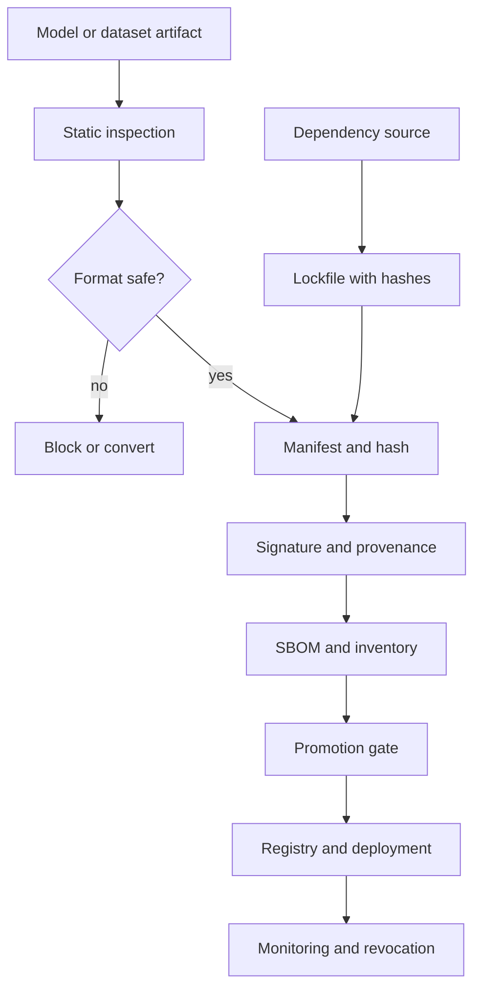

# Module 10 — Model Serialization, Dependencies, and ML Supply-Chain Security

**Level 3 · Practical defenses · 10 hours · Module 01 recommended**

## Why this module exists

A trained model is usually distributed as a file. That file may contain weights. It may also contain a class definition, a function reference, or an instruction to import a module and call something. If the loader can execute what the file describes, then "download the model" is closer to "run a program from a stranger" than to "open a CSV."

This is the core of ML supply-chain security: the artifact you load, the libraries you install, and the build steps you trust are all inputs to your system. Each can be substituted, and each substitution can be made to look normal.

This module teaches you to answer three questions before anything executes:

1. **What is in this artifact?** Inspect it statically, without loading it.
2. **Where did it come from, and has it changed?** Hashes, signatures, provenance.
3. **What else does it depend on?** Pins, hashes, inventories, and known vulnerabilities.

LAB-13 gives you a deliberately weak toy project. It contains unpinned requirements, a `joblib.load` inference path, a manifest whose hash is wrong, no signature, no SBOM, and a benign pickle canary with a callable-construction opcode. The audit finds six findings: one critical, three high, two medium. You then harden the project and prove the gate blocks the vulnerable copy and passes the hardened one.

The module's thesis: **a passing gate means the implemented checks passed on this artifact set. It does not mean the supply chain is secure.**

## Real-world motivation

The software supply chain has been a productive attack surface for years. Dependency confusion, typosquatting, compromised maintainer accounts, and build-system compromise all exploit the same assumption: that a name resolves to the code the developer intended. ML adds new artifact types — datasets, weights, notebooks, model registries — and new loaders, many of which deserialize executable content by default.

Python's `pickle` format is the canonical example. The [Python documentation](https://docs.python.org/3/library/pickle.html) states plainly that pickle is not secure against erroneous or maliciously constructed data and that you should never unpickle data from an untrusted or unauthenticated source. The format supports opcodes that import modules and call callables. That is a feature for serializing objects and a vulnerability for distributing them.

Standards and frameworks respond at the process level: NIST SP 800-218 (Secure Software Development Framework) organizes secure development practices; SLSA defines supply-chain levels for build provenance; CycloneDX and SPDX define bill-of-materials formats; Sigstore provides signing and transparency tooling; in-toto describes supply-chain layouts. None of these is a product you install and forget. They are conventions that make origin and content checkable.

The practical lesson from incident after incident is defense in depth. Pins do not stop a compromised release. Hashes do not stop a replaced manifest. A signature does not stop a leaked key. An SBOM does not list what nobody declared. Each control covers a specific failure and leaves another.

## Measurable learning objectives

By the end of this module you will be able to:

1. **Map** an ML supply chain, its trust boundaries, and the artifact types that cross them (Bloom 2–3).
2. **Inspect** a serialized artifact statically and explain why loading it is an execution decision (Bloom 3–4).
3. **Harden** a project with pinned dependencies, safe loaders, manifests, signatures, and an SBOM, and verify each control with a negative test (Bloom 3–4).
4. **Evaluate** scanner and gate results, including their blind spots, and state what a pass does not prove (Bloom 5).
5. **Report** supply-chain findings by severity with evidence, remediation, residual risk, and framework mapping (Bloom 5).

Objectives 1 and 5 assess LO-21 and LO-30; objectives 2–4 assess LO-21.

## Prerequisite checklist

| Skill | Check | If not |
|---|---|---|
| Work with files and hashes | You can compute a SHA-256 and compare bytes | M01 Lesson 4 |
| Read a Python traceback | You can locate the failing line and exception | M01 Lesson 1 |
| Explain a virtual environment | You can install from a pinned requirements file | LAB-01 |
| Read JSON and YAML | You can inspect a manifest without a library | M01 Lesson 3 |
| Explain a threat model | You can state asset, attacker capability, and impact | M03 Lesson 5 |
| Run a CI-style check | You can run a script and interpret an exit code | LAB-02 |

### Five-minute diagnostic

1. Why is a pickle file described as a program rather than a data file?
2. What does a SHA-256 manifest detect, and what does it not detect?
3. What does a signature add over a hash, and what protects the signature?
4. Name three components an ML bill of materials should list.
5. A CI gate exits 0. What has it proven?

If four or five are comfortable, skim Lessons 1–2 and spend the time on Lesson 3, LAB-13, and the promotion-gate design. If fewer than three, read in order.

## Module map

| Unit | Title | Time | What you produce |
|---|---|---:|---|
| [10.1](lesson-1-ml-supply-chain-and-artifact-trust.md) | The ML supply chain and artifact trust | 1.5 h | A supply-chain trust map |
| [10.2](lesson-2-unsafe-serialization-and-safe-formats.md) | Unsafe serialization and safe formats | 2 h | A static inspection record |
| [10.3](lesson-3-dependency-and-artifact-scanning.md) | Dependency and artifact scanning in CI | 1.5 h | A gate design and finding triage |
| [10.4](lesson-4-provenance-signing-and-promotion.md) | Provenance, signing, SBOM, and promotion gates | 2 h | A signed, inventoried artifact record |
| [LAB-13](../../labs/lab-13.md) | Supply-chain audit and hardening | 4 h | Audit, hardened project, verified gate |
| [Knowledge check](quiz.md) | QZ-10, 10 items | 20 min | Score and explanations |
| [Exercises](exercises.md) | Four exercises, one scenario | 40 min | Portfolio evidence |

Module effort is approximate: 6.5 hours of lessons, 4 hours of lab, and 1 hour of quiz and exercises.

## How the pieces fit

The order matters. Inspecting before loading prevents execution. Hashing before signing binds the signature to content. Inventorying before promotion makes the artifact reviewable. Revocation closes the loop when a control fails later.

## Common mistakes across the module

| Mistake | Symptom | Consequence |
|---|---|---|
| Treating model files as inert data | `joblib.load` on a downloaded file | Arbitrary code execution during load |
| Trusting a file extension | "It ends in `.pkl`, so it is a model" | The format, not the name, determines behavior |
| Pinning versions without hashes | A lockfile with names only | A compromised release satisfies the pin |
| Treating a hash as authenticity | "The hash matches" | An attacker who replaces both file and manifest passes |
| Storing the signing key beside the artifact | Convenience | A leaked key forges signatures |
| A scanner with no negative test | Gate passes everything | The gate is decorative |
| SBOM generated once and never updated | Stale inventory | Unknown components and versions |
| Blocking on findings without triage | Every build fails | Teams disable the gate |
| Claiming "secure supply chain" after a green build | The gate is overinterpreted | Passing checks is mistaken for assurance |
| Ignoring the build system | Focus on the artifact only | A compromised build produces a valid signature |

## Troubleshooting

| Symptom | Likely cause | Fix |
|---|---|---|
| Canary pickle not flagged | Inspecting by loading or by extension | Use `pickletools.genops` and inspect opcodes |
| Benign pickle flagged | Flagging all pickles | Flag callable-construction opcodes, not the extension |
| Manifest hash mismatch | Manifest written before content | Write content, hash bytes, then write manifest |
| Signature invalid | Whitespace changed after signing | Sign exact bytes; store hex; use `compare_digest` |
| Tampered manifest still passes | Comparing with `==` or verifying the wrong file | Verify the manifest bytes that were signed |
| Gate passes the vulnerable project | Gate checks only verification booleans | Fail when the audit has blocking findings |
| Pins not enforced | Requirements edited but not installed fresh | Rebuild in a clean environment |
| SBOM missing a dependency | Generated from a partial environment | Generate from the resolved lockfile |

Lesson-specific fixes appear at the end of each lesson.

## Glossary

| Term | Definition |
|---|---|
| **Supply chain** | The people, systems, and artifacts that produce and deliver software or models |
| **Artifact** | A file or object produced by a build or training process: wheel, weight file, dataset, container image |
| **Serialization** | Converting an object into bytes for storage or transfer |
| **Deserialization** | Reconstructing an object from bytes; may execute code depending on the format |
| **Pickle** | A Python serialization format that can reference and call callables |
| **Opcodes** | Instructions in a pickle stream, such as `GLOBAL`, `STACK_GLOBAL`, `REDUCE` |
| **Safe format** | A format that stores data without executable construction, for example NumPy `.npy` with `allow_pickle=False` or safetensors |
| **Static inspection** | Examining an artifact without executing or fully loading it |
| **Manifest** | A list of files with sizes and hashes |
| **Hash** | A fixed-size digest of bytes; detects modification |
| **Signature** | A cryptographic binding of a hash to a key; supports authenticity |
| **Provenance** | A record of how and where an artifact was built |
| **SBOM** | Software bill of materials: an inventory of components and versions |
| **CycloneDX / SPDX** | Standard SBOM formats |
| **SLSA** | A framework of supply-chain levels and provenance requirements |
| **in-toto** | A framework for attesting supply-chain steps |
| **Sigstore** | Signing, transparency-log, and identity tooling |
| **Dependency confusion** | Publishing a public package with the same name as a private dependency |
| **Typosquatting** | Publishing a package with a name close to a popular one |
| **Lockfile** | A resolved dependency list with exact versions and often hashes |
| **Promotion gate** | An automated check an artifact must pass before entering a registry or environment |
| **Residual risk** | Risk remaining after controls, including controls bypassed or not implemented |

## Summary and key takeaways

- A model artifact is executable input when its loader can deserialize code. Treat downloads as code execution decisions.
- Inspect statically before loading. `pickletools.genops` reads opcodes without executing them.
- LAB-13 finds six issues: one critical (dangerous pickle opcodes), three high (unpinned dependencies, unsafe loader, hash mismatch), and two medium (no signature, no SBOM).
- The hardened project pins five dependencies, removes pickle files, uses `np.load(..., allow_pickle=False)`, regenerates the manifest, signs it with HMAC-SHA256, and emits an SBOM with five components.
- Verification includes a negative test: a tampered manifest must fail the signature check.
- The gate exits 1 on the vulnerable project and 0 on the hardened one. That proves the implemented checks, not supply-chain security.
- Hashes detect modification; signatures attest origin; SBOMs inventory components; provenance records the build. Each has a failure mode the others do not cover.
- Scanner blocklists are bypassable. Stronger controls are format migration, allowlists, reproducible builds, and verification at load time.

## References and further reading

All links checked on 2026-10-28.

| Reference | Use |
|---|---|
| [Python documentation, `pickle` — “Warning: The pickle module is not secure”](https://docs.python.org/3/library/pickle.html) | Deserialization risk |
| [Python documentation, `pickletools`](https://docs.python.org/3/library/pickletools.html) | Static opcode inspection |
| [NumPy documentation, `numpy.load`](https://numpy.org/doc/stable/reference/generated/numpy.load.html) | `allow_pickle` behavior |
| [NIST SP 800-218, Secure Software Development Framework](https://doi.org/10.6028/NIST.SP.800-218) | Secure development practices |
| [SLSA](https://slsa.dev/) | Build provenance and levels |
| [in-toto](https://in-toto.io/) | Supply-chain attestations |
| [Sigstore documentation](https://docs.sigstore.dev/) | Signing and transparency logs |
| [CycloneDX](https://cyclonedx.org/) | SBOM format |
| [SPDX](https://spdx.dev/) | SBOM and license standards |
| [OWASP Top 10:2021 A08 — Software and Data Integrity Failures](https://owasp.org/Top10/A08_2021-Software_and_Data_Integrity_Failures/) | Integrity failure class |
| [NIST AI 100-2e2025](https://doi.org/10.6028/NIST.AI.100-2e2025) | Supply-chain threats in ML |

Read the `pickle` warning before LAB-13. Read the SLSA specification after the lab and compare its provenance requirements with the manifest and HMAC the lab builds.

## Next step

Start with [Lesson 10.1 — The ML supply chain and artifact trust](lesson-1-ml-supply-chain-and-artifact-trust.md). If you have already completed LAB-01, take the diagnostic and go directly to Lesson 2 and LAB-13.
