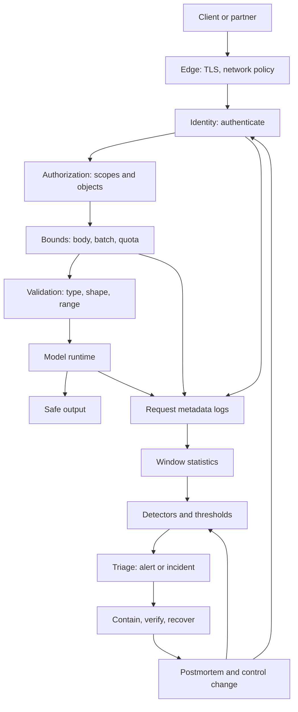

# Module 11 — Secure Model Serving, API Security, Monitoring, and Incident Response

**Level 3 · Practical defenses · 16 hours · Module 03 and Module 10**

## Why this module exists

A model in a notebook has no network, no users, and no logs. A model behind an API has all three. The moment it answers requests, it acquires an identity problem, a resource problem, an input problem, an output problem, and an evidence problem. None of them is solved by the model's accuracy.

This module asks six questions about a served model:

1. **What is exposed, and to whom?** Endpoints, batch jobs, feature stores, artifacts, dependencies, and the trust boundaries between them.
2. **Who is calling, and what may they do?** Authentication, authorization, scopes, object-level access, and tenant isolation.
3. **How much may they send, and what is accepted?** Body caps, batch caps, quotas, schema checks, range checks, and safe error handling.
4. **How would you know something is wrong?** Telemetry, calibration, drift and attack indicators, and alert design.
5. **What do you do when it is wrong?** Triage, containment, rollback verification, evidence handling, and postmortems.
6. **What holds the service together when a layer fails?** Secure configuration, secret handling, least privilege, network policy, kill switches, and safe failure.

Two labs make the answers concrete. LAB-14 builds a loopback-only prediction API and tests 18 security cases: authentication, scopes, size and batch limits, schema and range validation, rate limiting, safe errors, and log redaction. LAB-15 turns the service's logs into a detection layer: five detectors calibrated on quiet traffic, six synthetic scenarios, three alerting episodes, and one confirmed incident. Its most important result is a negative one: rollback to the previous checkpoint does not restore security, because both checkpoints share the same weakness.

The module's thesis: **serving security is layered, detection is not prevention, and a passing test suite is evidence about named cases rather than proof that the service is secure.**

## Real-world motivation

Prediction APIs are attractive targets for ordinary and ML-specific reasons. They accept structured input from untrusted clients, they execute a model whose behavior is hard to explain, they often run with credentials to data stores and registries, and they produce logs that may contain sensitive inputs. An attacker does not need a novel ML technique to cause harm: a missing scope check, an unbounded request body, a token in a log line, or a rate limiter that resets on restart is enough.

The API security community has catalogued these failures for years. The OWASP API Security Top 10 names broken object-level authorization, broken authentication, unrestricted resource consumption, and unrestricted access to sensitive business flows among the most common risks. The OWASP Application Security Verification Standard turns them into testable requirements. NIST's incident-response guidance describes the lifecycle that turns an alert into a contained, documented event. None of these is ML-specific; ML systems inherit all of it and add model behavior on top.

The ML-specific layer is detection. A request can be perfectly authenticated, correctly sized, and schema-valid, and still be an evasion attempt. LAB-15 shows the distinction: a scanner recalibration changes the input distribution with stable confidence, an FGSM campaign changes the distribution and drops confidence while a shadow model disagrees, and a scraper produces volume without changing content. One detector cannot separate them. A signal family can.

That is also the limit. Detection observes behavior, and an adaptive attacker can shape behavior to stay under thresholds. A quiet baseline is not a guarantee. A passing checker is not a security proof. The monitor needs an owner, a response, and a review date.

## Measurable learning objectives

By the end of this module you will be able to:

1. **Map** a serving architecture, its trust boundaries, and the request path from client to model to log (Bloom 2–3).
2. **Implement and test** authentication, authorization, request bounds, input validation, rate limiting, and safe error handling for a local API (Bloom 3).
3. **Evaluate** the controls against bypass, malformed input, and quota exhaustion, and state the residual risks the tests do not cover (Bloom 4–5).
4. **Design** windowed detections for drift, evasion, and volume abuse, calibrate them on quiet traffic, and explain alert triage (Bloom 5–6).
5. **Write** an incident-response playbook with severity, containment, rollback verification, evidence handling, recovery criteria, and corrective actions (Bloom 6).
6. **Harden** a deployment configuration with least privilege, secret management, network policy, and kill switches, and report what remains unverified (Bloom 5).

Objectives 1–3 and 6 assess LO-22 and LO-04; objectives 4–5 assess LO-23 and LO-30.

## Prerequisite checklist

| Skill | Check | If not |
|---|---|---|
| Read and write JSON over HTTP | You can explain a request line, headers, status code, and body | M01 Lesson 5 |
| Run a Python module and a test script | You can execute `python file.py` and read an exit code | LAB-01 |
| Write a threat model | You can name assets, attacker capability, boundaries, and impact | M03 Lesson 5 |
| Explain evasion and robustness | You can state an L∞ budget and why clean accuracy is not robustness | M04, M08 |
| Verify an artifact | You can compare a SHA-256 and explain a manifest | M10, LAB-13 |
| Read a rate or a proportion | You can compute a false-positive rate and a base rate | M02 Lesson 4 |
| Handle secrets safely | You know why a token in a repository is compromised | M01 Lesson 4 |

### Five-minute diagnostic

1. A request carries a valid token without the `stats` scope. Is the correct response 401 or 403, and why?
2. Why should a body-size check run before authentication?
3. A validator accepts every value in `[0, 1]`. Name two dangerous values it may still accept.
4. A drift alert fires on input shift but confidence and shadow agreement are normal. Is that an incident?
5. Rollback to the previous model reduces attack success from 0.35 to 0.33. Is rollback a valid containment step?

If you can answer four or five, skim Lessons 1–3 and spend the time on Lesson 4, LAB-15, and the incident playbook. If fewer than three, read in order.

## Module map

| Unit | Title | Time | What you produce |
|---|---|---:|---|
| [11.1](lesson-1-serving-architecture-and-attack-surface.md) | Serving architecture and attack surface | 1.5 h | A serving trust map and control order |
| [11.2](lesson-2-authentication-and-authorization.md) | Authentication and authorization | 1.5 h | An authorization matrix with 401/403 decisions |
| [11.3](lesson-3-request-bounds-validation-and-safe-output.md) | Request bounds, validation, and safe output | 1.5 h | A validation and safe-error checklist |
| [11.4](lesson-4-monitoring-drift-and-attack-indicators.md) | Monitoring, drift, and attack indicators | 1.5 h | A calibrated detector and triage table |
| [11.5](lesson-5-incident-response-rollback-and-evidence.md) | Incident response, rollback, and evidence | 1 h | An incident timeline and rollback decision |
| [11.6](lesson-6-secure-configuration-secrets-and-least-privilege.md) | Secure configuration, secrets, and least privilege | 1 h | A deployment hardening checklist |
| [LAB-14](../../labs/lab-14.md) | Hardening a local prediction API | 5 h | Hardened service, 18-case suite, report |
| [LAB-15](../../labs/lab-15.md) | Monitoring, drift, and incident response | 3 h | Monitor, incident package, evidence manifest |
| [Knowledge check](quiz.md) | QZ-11, 10 items | 20 min | Score and explanations |
| [Exercises](exercises.md) | Four exercises, one service scenario | 40 min | Portfolio evidence |

Module effort is approximate: 8 hours of lessons, 8 hours of lab, and 1 hour of quiz and exercises.

## How the pieces fit

The two feedback arrows matter. An incident should change a control or a detector; otherwise the same event repeats with the same response. LAB-15's "learn" step adds a robustness evaluation to the release checklist and reviews the thresholds.

## The two labs at a glance

| Dimension | LAB-14 | LAB-15 |
|---|---|---|
| Object | A loopback prediction API | Prediction logs from a served classifier |
| Main question | Can the service reject what it should reject? | Can an operator tell drift, evasion, and abuse apart? |
| Evidence | 18 HTTP cases, 28 log lines, manifest | 3,900 requests, window statistics, episodes |
| Headline result | 18/18 pass; no tokens in logs | 0/6 baseline false positives; 1 confirmed incident |
| Negative result | A pass proves the 18 cases only | Rollback is rejected: 0.3507 vs 0.3299 ASR |
| Residual risk | Demo tokens, in-process limiter, no TLS | Threshold evasion, label lag, log privacy |

Read the two together. LAB-14 is preventive and local: it rejects a request before the model sees it. LAB-15 is detective and statistical: it reasons about traffic after the model has answered. Neither replaces the other, and neither replaces the robustness work in LAB-11 or the artifact checks in LAB-13.

## Common mistakes across the module

| Mistake | Symptom | Consequence |
|---|---|---|
| Treating authentication as authorization | "They have a token, so they can call it" | Any valid token reaches every endpoint |
| Returning 401 for a scope failure | A valid, authenticated caller is told to log in again | Clients retry credentials instead of requesting access |
| Checking body size after reading it | The parser allocates the hostile body | The limit does not protect memory |
| Using `isinstance(x, int)` for numbers | Booleans pass as integers | Shape and type checks accept unintended values |
| Checking range without finiteness | `NaN` comparisons are false | Non-finite values reach the model |
| Logging headers or bodies "for debugging" | Tokens and personal data in plain text | Credential theft and privacy exposure |
| Calibrating detectors on monitored traffic | Thresholds absorb the attack | The attack becomes the new normal |
| Treating every alert as an incident | Alert volume rises | Real incidents are lost in noise |
| Assuming rollback restores security | The old version is deployed | The same weakness remains, now with less evidence |
| Calling a green suite "secure" | 18/18 or 0 alerts | Named tests are mistaken for assurance |
| Hard-coding tokens in source | Reproducible demos | A repository leak becomes a credential leak |
| Running the service as root with egress | Convenience | A loader or dependency flaw inherits full privilege |

## Troubleshooting

| Symptom | Likely cause | Fix |
|---|---|---|
| Every request returns 401 | Comparing the full header to the token | Split `Bearer <token>` and compare the token only |
| Valid viewer token can predict | Scope check missing or attached to the wrong route | Require `predict` on `/predict` |
| Oversized body returns 401 | Authentication runs before size check | Bound the body first; test both orders |
| `NaN` accepted | Range check without `math.isfinite` | Reject non-finite values before range |
| Boolean accepted as a feature | Python treats `bool` as `int` | Reject `bool` explicitly |
| Rate limiter never returns 429 | Keyed per request or reset between calls | Key by role or client; test an 11-request burst |
| Baseline monitoring alerts | Thresholds calibrated on monitored windows | Calibrate on the quiet period only |
| Drift escalates to high severity | Triage escalates any content alert | Require two content signals or content plus volume |
| Recovery windows alert | A mitigation is still applied to recovery traffic | Remove temporary controls before recovery checks |
| Manifest hash mismatch | Artifacts regenerated after the manifest | Write the manifest last |

Lesson-specific fixes appear at the end of each lesson.

## Glossary

| Term | Definition |
|---|---|
| **Serving** | Running a trained model behind an interface that answers requests |
| **Attack surface** | The set of inputs, interfaces, and dependencies an attacker can reach |
| **Trust boundary** | A point where data or control passes between differently trusted components |
| **Authentication (authn)** | Establishing who the caller is |
| **Authorization (authz)** | Deciding what an authenticated caller may do |
| **Bearer token** | A credential presented in the `Authorization` header; possession grants access |
| **Scope** | A named permission attached to a credential |
| **OIDC** | OpenID Connect, an identity layer on OAuth 2.0 |
| **mTLS** | Mutual TLS, where client and server authenticate with certificates |
| **RBAC** | Role-based access control |
| **ABAC** | Attribute-based access control |
| **Object-level authorization** | Checking that the caller may access this specific record or resource |
| **IDOR** | Insecure direct object reference; accessing another user's object by changing an identifier |
| **Tenant isolation** | Preventing one customer's data or actions from affecting another's |
| **Rate limiting** | Restricting how many requests a caller may make in a time window |
| **Quota** | A longer-horizon allowance, often per account or plan |
| **Body cap** | A maximum request size enforced before parsing |
| **Batch cap** | A maximum number of rows or items per request |
| **Schema validation** | Checking structure, types, required fields, and shape |
| **Allowlist** | Accepting only explicitly permitted values or patterns |
| **Safe error** | An error response that is useful to the client and reveals no internals |
| **Telemetry** | Measurements emitted by a system: logs, metrics, traces |
| **Drift** | A change in input or output distribution relative to a reference |
| **Evasion** | A crafted input that causes a wrong prediction at inference time |
| **Shadow model** | A second model used as a comparison signal, not as the served model |
| **Calibration window** | A quiet period used to derive detector thresholds |
| **Alert** | A threshold crossing that deserves attention |
| **Episode** | Consecutive alerting windows grouped under one triage decision |
| **Incident** | A confirmed event that requires a response and a record |
| **Triage** | Classifying and prioritizing an alert by evidence and impact |
| **Playbook** | A predefined sequence of response steps for a scenario |
| **Containment** | Limiting the spread or impact of an incident |
| **Rollback** | Returning to a previous version or checkpoint |
| **Kill switch** | A control that disables a feature or endpoint quickly |
| **Least privilege** | Granting only the permissions needed for the task |
| **Secret** | A credential or key that must not be exposed |
| **Safe failure** | Failing in a way that denies access rather than granting it |
| **Residual risk** | Risk that remains after controls, including controls not implemented |

## Summary and key takeaways

- A served model is an API with a model attached. Its security is a property of the whole path: network, identity, authorization, bounds, validation, runtime, output, and logs.
- Authentication answers who; authorization answers what. Missing or invalid credentials are 401; a valid credential without permission is 403.
- Control order is a security decision. Bound the body before parsing, authenticate before allocating per-caller state, and validate before the model.
- LAB-14 passes 18 cases: 401/403, 400/415/422/413/429/404, valid predictions, and a safe-error check. It logs 28 request records with no token values.
- Validation is not robustness. A value inside `[0, 1]` can still be adversarial; LAB-11 measures that separately.
- LAB-15 calibrates five detectors on 12 quiet windows: input shift 0.1529, low confidence 0.8232, shadow disagreement 0.0823, client concentration 0.60, throughput 5.0 req/s.
- The baseline produces 0/6 false-positive windows. Drift fires input shift only and stays low severity. Evasion fires three content signals and becomes the single high-severity incident. The query burst fires volume signals only and is handled as abuse.
- Detection is not prevention. A monitor observes behavior; an adaptive attacker can shape behavior to stay under thresholds.
- Rollback is a hypothesis. In LAB-15 it is rejected because the previous checkpoint's ASR is 0.3299 against the current 0.3507. Squeezing lowers ASR to 0.1979 but costs clean accuracy (0.9600 to 0.9433) and is bypassable.
- A passing suite, a quiet baseline, and a green checker are evidence about tested cases. They are not proof that the service is secure.
- Every control needs an owner, a failure mode, and a review date; every incident needs an evidence trail and a change.

## References and further reading

All links checked on 2026-10-28.

| Reference | Use |
|---|---|
| [OWASP API Security Top 10 (2023)](https://owasp.org/API-Security/editions/2023/en/0x11-t10/) | API risk taxonomy |
| [OWASP Application Security Verification Standard](https://owasp.org/www-project-application-security-verification-standard/) | Testable application security requirements |
| [OWASP Secrets Management Cheat Sheet](https://cheatsheetseries.owasp.org/cheatsheets/Secrets_Management_Cheat_Sheet.html) | Secret storage and rotation |
| [OWASP Logging Cheat Sheet](https://cheatsheetseries.owasp.org/cheatsheets/Logging_Cheat_Sheet.html) | What to log and what to exclude |
| [RFC 6750 — The OAuth 2.0 Authorization Framework: Bearer Token Usage](https://www.rfc-editor.org/rfc/rfc6750) | Bearer token semantics and the `WWW-Authenticate` response |
| [RFC 9110 — HTTP Semantics](https://www.rfc-editor.org/rfc/rfc9110) | Status code semantics |
| [NIST Cybersecurity Framework 2.0](https://doi.org/10.6028/NIST.CSWP.29) | Govern, identify, protect, detect, respond, recover |
| [NIST AI Risk Management Framework](https://doi.org/10.6028/NIST.AI.100-1) | Risk framing and documentation |
| [NIST AI 100-2e2025](https://doi.org/10.6028/NIST.AI.100-2e2025) | Evasion and abuse taxonomy |
| [NIST SP 800-61r3 — Incident Response Recommendations](https://csrc.nist.gov/pubs/sp/800/61/r3/final) | Incident-response lifecycle |
| [MITRE ATLAS](https://atlas.mitre.org/) | Technique context for ML attacks |
| [Saltzer & Schroeder, *The Protection of Information in Computer Systems* (1975)](https://doi.org/10.1109/PROC.1975.9939) | Least privilege, complete mediation, fail-safe defaults |

Read the OWASP API Security Top 10 before LAB-14. Read NIST SP 800-61r3 before Lesson 5 and compare its lifecycle with the playbook you write in LAB-15.

## Next step

Start with [Lesson 11.1 — Serving architecture and attack surface](lesson-1-serving-architecture-and-attack-surface.md). If you have already completed LAB-13 and M08, take the diagnostic and go directly to Lesson 2 and LAB-14.
