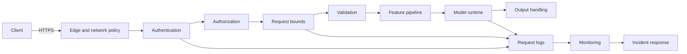

# Lesson 11.1 — Serving Architecture and Attack Surface

**Module 11 · Lesson 1 of 6 · 1.5 hours · LO-22, LO-04**

## Scenario

A digit classifier works in a notebook. A partner wants to call it from their application, so the team wraps it in a small HTTP service and exposes one endpoint. The first design review produces four questions the notebook never raised:

- What happens when the request body is one gigabyte?
- Who is allowed to call the endpoint, and who is allowed to read its statistics?
- What does the service return when the input is malformed?
- Where does the evidence live if someone abuses it?

This lesson maps the service before any of those questions is answered. The map is the attack surface, and the controls you add later are only as good as the boundaries you identified.

## Objectives

By the end of this lesson you will be able to:

1. Draw the request path of a served model from client to model to log, with its trust boundaries.
2. Compare online, batch, streaming, and embedded serving and name the attack surface each adds.
3. Inventory the inputs, interfaces, dependencies, and data stores an attacker can reach.
4. Order the controls on the request path and justify each position.
5. Choose the correct HTTP status family for an authentication, authorization, bounds, media-type, schema, and quota failure.
6. State what a serving test suite does and does not prove.

## 1. From model to service

A model is a function. A service adds everything around it.

| Component | Job | Question it answers | Typical failure |
|---|---|---|---|
| Edge | Terminate TLS, apply network policy | Who can reach the port? | Service exposed beyond its intended network |
| Authentication | Verify a credential | Who is calling? | Missing or forged token accepted |
| Authorization | Check permission for this action | What may they do? | Valid token reaches an admin route |
| Request bounds | Limit size and volume | How much may they send? | Parser allocates an unbounded body |
| Validation | Check structure, type, shape, range | Is this a valid request? | Non-finite or out-of-shape input reaches the model |
| Feature pipeline | Transform input for the model | Is the transformation safe and consistent? | Training-serving skew, unsafe deserialization |
| Model runtime | Run inference | What does the model predict? | Resource exhaustion, model extraction, evasion |
| Output handling | Serialize the response safely | What does the caller learn? | Traceback, internal path, or token echoed |
| Logs and monitoring | Record and interpret behavior | What happened, and is it normal? | Tokens in logs, no detection, alert fatigue |
| Incident response | Contain and learn | What do we do now? | Rollback assumed to work, evidence lost |

The sequence is not a suggestion. Each component protects the next one from a class of input it should never see.

## 2. Four serving patterns, four surfaces

| Pattern | How it works | Added attack surface | Examples |
|---|---|---|---|
| Online synchronous | Client waits for a prediction | Latency, concurrency, request size, quota, evasion | LAB-14 API |
| Batch | Jobs process files or tables on a schedule | Job submission, input file trust, output access, long-running credentials | Nightly scoring |
| Streaming | Events are consumed continuously | Event schema, consumer lag, replay, poison records | Fraud detection pipeline |
| Embedded | Model ships inside a client application | Artifact integrity, device trust, offline extraction | Mobile or edge inference |

The controls differ, but the questions do not. A batch job still needs authentication for its submitter, bounds on the input file, validation of each row, safe output storage, and an audit trail. A streaming consumer still needs a schema, a dead-letter path, and a way to stop a poison record from looping forever.

LAB-14 is the online case because it makes every boundary visible: a request, a credential, a body, a prediction, a log line.

## 3. The trust boundaries

A trust boundary is a place where the assumptions change. Draw them before choosing controls.

| Boundary | What crosses it | Assumption that must be checked |
|---|---|---|
| Internet or partner network → edge | Arbitrary bytes and headers | TLS is terminated correctly; only intended networks reach the port |
| Edge → application | Identity claims, client address, request metadata | The edge strips or overwrites client-supplied identity headers |
| Application → model runtime | Validated features | Validation ran; the model path and version are the approved ones |
| Application → artifact store | Model and configuration reads | The artifact passed integrity and authenticity checks (M10) |
| Application → logs | Request metadata, sometimes features | Logs exclude credentials and personal data; access is restricted |
| Application → downstream services | Calls made with the service's credentials | The service cannot be confused into acting for the caller |
| Operator → admin interface | Configuration and statistics | Admin access is separately authenticated and authorized |

The third row is the one teams skip. A validator that runs in the client library, or a model loaded from a path the caller can influence, moves the boundary without protecting it.

### The confused deputy

A service is a deputy for its callers. If it holds a database credential, a registry token, or network access, a malicious request may inherit that privilege. The defense is not only input validation; it is least privilege for the service itself. Give the inference process read-only access to the artifact it serves, no write access to the model registry, and no egress except to named dependencies.

Lesson 6 returns to this with configuration and network policy.

## 4. LAB-14's threat model

LAB-14 states the model explicitly. Copy the format for your own service.

| Element | Assumption |
|---|---|
| Asset | A local digit-classification endpoint and its request logs |
| Attacker goal | Unauthorized predictions, resource exhaustion, information leakage, or scraping |
| Attacker knowledge | The API shape is public; tokens are not |
| Attacker capability | Send arbitrary HTTP requests to the loopback service |
| Constraints | Bind to `127.0.0.1`; bodies ≤ 8 KB; batches ≤ 32 rows; 10 requests per 60 s per role |
| Base behavior | Valid requests return class predictions; `/health` is public; `/stats` requires an admin scope |
| Metric | HTTP status codes for 18 scripted cases, plus log-redaction checks |
| Out of scope | TLS, internet exposure, identity-provider integration, distributed rate limiting, model evasion |

The out-of-scope row is as important as the others. LAB-14 does not test TLS because the service binds to loopback. It does not test model evasion because that is LAB-11's subject. A report that forgets those exclusions will overstate what the suite establishes.

## 5. The request path and the control order

LAB-14 fixes the order:

1. **Body size** — reject an oversized body before reading it into the application.
2. **Authentication** — identify the caller before allocating per-caller state.
3. **Rate limit** — bound the work an authenticated caller may request.
4. **Content type and JSON parsing** — reject incompatible or malformed bodies.
5. **Schema and range validation** — reject hostile values before the model.
6. **Prediction** — only fully validated requests reach the model.

Why this order?

| If you swap | What goes wrong |
|---|---|
| Authenticate before size check | An anonymous attacker can make the service read and buffer a huge body before being rejected |
| Rate-limit before authentication | Unauthenticated traffic can consume another caller's budget or force per-IP state growth |
| Parse before content-type check | You parse bodies in formats you never intended to support |
| Validate schema before size check | A deeply nested or enormous JSON document is parsed before rejection |
| Predict before range check | The model sees values outside its training domain, and errors may leak internals |

The suite encodes the order. An oversized body with a valid token returns **413**, not 401, because size runs first. An oversized body with no token also returns 413. If your implementation returns 401 in that case, the order is wrong even though both statuses are "rejections."

### Status codes are security semantics

| Status | Meaning in LAB-14 | What the client should do |
|---:|---|---|
| 200 | Request accepted | Use the response |
| 400 | Malformed JSON or invalid length | Fix the request |
| 401 | Missing, malformed, or unknown credential | Obtain a valid credential |
| 403 | Valid credential without the required scope | Request access; do not retry the same credential |
| 404 | Unknown path | Check the endpoint |
| 411 | `Content-Length` missing | Send a bounded body with a length |
| 413 | Body exceeds 8 KB | Reduce the body |
| 415 | Content type is not JSON | Send `application/json` |
| 422 | Shape, type, range, finiteness, or batch size invalid | Fix the payload |
| 429 | Rate limit exhausted | Wait for the window and retry with backoff |
| 500 | Unexpected server error | Report it; the body must not contain a traceback |

Two distinctions carry most of the security value:

- **401 versus 403.** 401 says "I do not know who you are." 403 says "I know who you are, and you may not do this." Returning 401 for a scope failure tells a legitimate client to re-authenticate, which cannot fix a permission problem.
- **413 versus 422.** 413 is about the size of the request; 422 is about its content. An 8 KB cap that returns 422 hides the fact that the parser already accepted the body.

## 6. What the service reveals

Every response is an information channel.

| Observable | Useful to operators | Useful to attackers |
|---|---|---|
| `/health` | Liveness and model version | Confirms the service and version |
| `/stats` | Request, rejection, prediction counts | Reveals traffic volume and control behavior |
| Error code | Tells the client what to fix | Maps validation rules and boundaries |
| Response time | Detects load and failures | Supports timing probes and extraction |
| `Server` header | Inventory | Narrows the exploit set |
| Log fields | Investigation | Credentials or personal data if over-logged |

LAB-14 keeps `/health` public but minimal, protects `/stats` with an admin scope, returns generic messages with stable error codes, sets `Cache-Control: no-store` and `X-Content-Type-Options: nosniff`, and logs only six metadata fields: request id, method, path, status, role, and body size.

That is a deliberate trade-off. Stable error codes help legitimate clients and also help an attacker learn the rules. The alternative — a single "bad request" for every failure — is harder to debug and does not hide the rules for long. The report should state the choice.

## 7. Defense in depth for a served model

| Layer | Control | Evidence in this course | Failure it addresses |
|---|---|---|---|
| Network | Loopback or private bind, policy | LAB-14 | Unintended exposure |
| Identity | Bearer tokens, scopes | LAB-14 | Unauthorized use |
| Volume | Body, batch, rate limits | LAB-14 | Resource exhaustion, scraping |
| Content | Schema, type, shape, range | LAB-14 | Malformed or hostile input |
| Model | Robustness evaluation | LAB-11 | Evasion within valid ranges |
| Artifact | Hash, signature, SBOM | LAB-13 | Substituted or unsafe model |
| Detection | Window statistics, triage | LAB-15 | Abuse that passes preventive controls |
| Response | Playbook, rollback, evidence | LAB-15 | Prolonged impact, repeated failure |

No row makes another redundant. A valid token can send adversarial but in-range features. A rate limit does not validate content. A robust model does not authenticate callers. A monitor does not stop a request.

## Common mistakes

| Mistake | Why it happens | Fix |
|---|---|---|
| Drawing the architecture without trust boundaries | The diagram shows boxes and arrows only | Mark every handoff and the assumption it carries |
| Treating the model as the only asset | The model is the interesting part | Include logs, credentials, artifact store, and availability |
| Assuming the network is trusted | "It is internal" | State the network assumption and test the bind address |
| Leaving `/health` verbose | It is convenient for debugging | Return liveness only; protect version and build detail |
| Using 401 for every rejection | One error path is simpler | Separate 401, 403, 413, 415, 422, 429 |
| Validating in the client | The client is easier to change | Validate at the trust boundary, server-side |
| Forgetting the model artifact | The API is the focus | Include load-time integrity and format checks |
| Testing only the happy path | The demo works | Add negative tests for each control |
| Claiming the API is secure after 18 passes | The suite is visible and green | State the 18 cases and the out-of-scope list |

## Troubleshooting

| Symptom | Likely cause | Fix |
|---|---|---|
| Service reachable from another host | Bound to `0.0.0.0` | Bind to `127.0.0.1` or a private interface with policy |
| Oversized body accepted | Size checked after `rfile.read` | Check `Content-Length` before reading |
| Missing length accepted | Defaulting to zero and reading nothing | Return 411 and require the header |
| Unknown path returns 500 | Router falls through to the model | Return 404 before inference |
| Error body includes a stack trace | Framework debug mode | Disable debug; return a generic error object |
| Logs contain an authorization header | Logging all headers | Log role and metadata only |
| Same status for missing and forbidden | One `except` block | Split authentication and authorization errors |
| Model version leaks in errors | Version included in debug text | Return it only where intended, such as `/health` |

## Check your understanding

1. Draw the request path for `POST /predict` in LAB-14 and mark three trust boundaries.
2. Why does the body-size check run before authentication, and which status code proves it?
3. A caller has a valid token but no `stats` scope and calls `GET /stats`. What status should the service return, and why is 401 wrong?
4. Name three assets in a served-model system besides the model weights.
5. What does LAB-14's 18/18 result prove, and what does it not prove?
6. Which serving pattern would you choose for nightly scoring of a million records, and which new boundary does it add?

Answers are discussed in the [answer key](quiz-answers.md) and the exercises.

## Summary

- A served model is a system: edge, identity, authorization, bounds, validation, feature pipeline, runtime, output, logs, and response.
- Serving patterns differ, but each adds a boundary that must be authenticated, bounded, validated, and observed.
- LAB-14 binds to loopback, caps bodies at 8 KB and batches at 32 rows, validates 64 finite values in `[0, 1]`, limits each role to 10 requests per 60 seconds, and logs metadata only.
- Control order is part of the design: size, authentication, rate limit, content type and parsing, validation, prediction.
- Status codes carry security meaning: 401 versus 403, 413 versus 422, 429 for quota.
- Responses and logs are information channels. Minimize what they reveal and never log credentials.
- Defense in depth combines network, identity, volume, content, model, artifact, detection, and response controls. None is sufficient alone.

## Next

Continue to [Lesson 11.2 — Authentication and authorization](lesson-2-authentication-and-authorization.md), where the first two layers become an authorization matrix and a set of negative tests.
