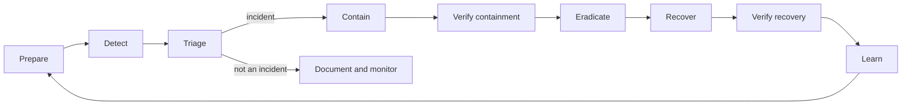

# Lesson 11.5 — Incident Response, Rollback, and Evidence

<a id="m11-l5"></a>

**Module 11 · Lesson 5 of 6 · 1 hour · LO-23, LO-30**

## Scenario

At window 24, three content detectors fire together: input shift, low confidence, and shadow-model disagreement. The on-call engineer has an alert, a dashboard, and no incident number yet. Within an hour the team must decide whether this is an attack, what to contain, whether to roll back, who to tell, and what to preserve.

The temptation is to roll back immediately. The previous checkpoint is one command away, and a rollback feels like progress. LAB-15 tests that assumption before acting on it. Replaying the captured attack batch through both checkpoints gives attack success 0.3507 on the current model and 0.3299 on the previous one. The rollback does not restore security. Recording that result is more valuable than performing the rollback and declaring victory.

This lesson turns an alert into an incident with a defensible timeline, a containment decision, and evidence that survives review.

## Objectives

By the end of this lesson you will be able to:

1. Distinguish an alert, an episode, and an incident, and assign severity with stated criteria.
2. Run a response lifecycle: detect, triage, contain, verify, eradicate, recover, and learn.
3. Evaluate a rollback as a hypothesis with a pre-defined success criterion.
4. Preserve evidence with integrity, access control, and minimal necessary data.
5. Write a postmortem with contributing factors, owners, due dates, and residual risk.
6. Communicate an incident without overstating what is known.

## 1. Alert, episode, incident

| Term | Definition | LAB-15 example |
|---|---|---|
| Alert | A threshold crossing in one window | Input shift in window 18 |
| Episode | Consecutive alerting windows with the same triage | EP-01, windows 18–23 |
| Incident | A confirmed event that requires response and a record | INC-001, the evasion episode |
| Postmortem | A review of what happened and what changes | The "learn" step |

An incident is a decision, not a threshold. Someone with authority says: this is real enough, important enough, and uncertain enough to manage formally. The decision should be recorded with the evidence that supported it.

### Severity

| Severity | Criteria | Response target |
|---|---|---|
| Critical | Confirmed compromise of credentials, model, or customer data; safety impact | Immediate containment; executive and legal notification |
| High | Confirmed model-targeted attack with measurable integrity impact | Contain within hours; incident commander assigned |
| Medium | Abuse without model compromise; policy violation | Contain within a day; owner assigned |
| Low | Drift or anomaly under review; no confirmed harm | Review in normal hours; document |

LAB-15 classifies the evasion episode as high, the burst as medium, and the drift as low. The criteria are explicit enough that two reviewers can reach the same decision from the same signals.

## 2. The response lifecycle



| Phase | Question | LAB-15 action |
|---|---|---|
| Prepare | Do we have detectors, roles, and a playbook? | Calibrated thresholds, named playbooks |
| Detect | What fired, where, and when? | Three content signals in windows 24–29 |
| Triage | Is this an incident, and how severe? | High; `INC-001` opened |
| Contain | How do we limit impact now? | Edge squeezing; no rollback; keep rate limits |
| Verify | Did containment actually work? | Replay attack batch; measure ASR |
| Eradicate | How do we remove the weakness? | Robustness review and retraining plan |
| Recover | How do we return to normal? | Remove squeezing; verify clean windows |
| Learn | What changes so this is caught earlier? | Add robustness gate; review thresholds |

The order is not a rigid waterfall. A containment may fail and send you back to triage. The value is that each phase has an output and an owner.

### Time bounds and owners

A playbook without owners and time bounds is a wish list. LO-23 asks for both. A production template:

| Step | Owner | Target |
|---|---|---|
| Acknowledge the alert | On-call engineer | 15 minutes |
| Assign incident commander | Engineering manager | 30 minutes |
| Decide incident severity | Incident commander | 30 minutes |
| Contain the affected route or client | Platform on-call | 1 hour |
| Preserve logs and snapshots | Security engineer | 2 hours |
| Notify affected owners | Incident commander | Per policy |
| Decide rollback | Incident commander plus ML owner | 2 hours |
| Verify recovery | ML owner | 24 hours |
| Postmortem draft | Incident commander | 5 business days |

LAB-15 is a solo exercise, so the same person plays every role. Write the roles anyway; the exercise is about the decision structure, not the headcount.

## 3. Containment options

| Option | Effect | Cost | When to use |
|---|---|---|---|
| Rate limit or block a client | Stops volume abuse | May affect a shared NAT or partner | Concentrated, attributable abuse |
| Require re-authentication | Invalidates stolen tokens | User friction | Credential theft suspected |
| Enable input squeezing | Lowers naive evasion success | Clean-accuracy loss; adaptive bypass | Temporary brake during an attack |
| Disable the endpoint | Stops all prediction traffic | Full service loss | Safety-critical harm or active data exfiltration |
| Roll back | Restores a previous version | Reintroduces old weaknesses; compatibility risk | The previous version is measurably less vulnerable |
| Isolate the service | Removes network access | Downstream failures | Compromise of the host or credentials |
| Increase monitoring | Improves evidence | No immediate protection | Early or uncertain signal |

LAB-15 enables squeezing and keeps rate limits unchanged because the attack is distributed. It does not disable the endpoint: the impact is integrity, not immediate safety, and availability has its own cost. That is a judgment, and the report states it.

### Squeezing as a temporary brake

The measured mitigation is real and limited:

| Metric | Before | After |
|---|---:|---:|
| Attack success rate | 0.3507 | 0.1979 |
| Clean accuracy | 0.9600 | 0.9433 |

Squeezing reduces attack success by about 15 percentage points and costs about 1.7 points of clean accuracy on this batch. It is not eradication. An adaptive attacker can approximate the quantizer, as LAB-11 shows. The correct status is "temporary mitigation, residual risk accepted for the duration, eradication pending."

## 4. Rollback is a hypothesis

A rollback is a change to the production system based on a belief: the previous version is safer. Treat it like any other claim and test it.

### Define success before acting

A useful criterion is explicit and measurable. LAB-15 uses:

```python
"rollback_restored": bool(previous_success < 0.5 * current_success)
```

The previous checkpoint must cut attack success by more than half to count as restored. That is a policy choice, not a universal threshold. The important part is that it is written down before the measurement.

### Measure on the same base set

The replay uses a captured FGSM batch of 300 rows, of which 288 were clean-correct on the deployed model. Attack success is computed on those 288 rows for both checkpoints. Comparing different rows, different ε, or different attack steps would confound the result.

| Metric | Current checkpoint | Previous checkpoint |
|---|---:|---:|
| Base size | 288 | 288 |
| Attack success | 0.3507 | 0.3299 |
| Restored? | — | No |

The previous checkpoint is slightly *better* on this batch, but not enough to meet the criterion, and the difference is small. Both models share the same linear weakness. A rollback would change the version label without changing the security property.

### What would make rollback valid?

- The previous checkpoint has a materially lower attack success on the same base set and budget.
- It does not reintroduce a known vulnerability or a dependency flaw.
- Its input and output contracts are compatible with current clients.
- Its artifact integrity and signature are verified.
- The rollback itself is reversible.
- The team records the decision and the evidence either way.

Rollback can be the right containment step. It is not automatically one. In LAB-15 the honest outcome is a rejected rollback with a recorded rationale, followed by a real fix: robustness evaluation and retraining.

### Rollback checklist

| Check | Question |
|---|---|
| Security | Is the old version less vulnerable under the same attack and budget? |
| Compatibility | Does it accept the current request schema and return the current output schema? |
| Data | Does it depend on features, tables, or artifacts that still exist? |
| Integrity | Is the old artifact hash and signature verified? |
| Observability | Will the old version emit the telemetry the monitor expects? |
| Reversibility | Can you roll forward again if the old version fails? |
| Communication | Do clients know which version is serving? |

## 5. Evidence

Evidence is what lets another person reconstruct the incident. It is not a copy of everything; it is the minimum needed to answer what happened, when, and with what effect.

LAB-15 writes five artifacts:

| Artifact | Contents |
|---|---|
| `metrics.json` | Thresholds, phase summaries, window diagnostics, episodes, rollback, mitigation, recovery |
| `logs/predictions.jsonl` | One record per request, including features and model outputs |
| `run.json` | Seed, window size, model versions, environment versions |
| `report.md` | Threat model, thresholds, phase table, triage, timeline, limitations |
| `manifest.json` | SHA-256 hashes of the other four files |

The manifest is the integrity layer. If a log is edited after the fact, the hash no longer matches. That does not prevent tampering by someone who can rewrite both the log and the manifest; it makes tampering visible to a verifier with an independent copy of the hash.

### Evidence handling rules

| Rule | Practice |
|---|---|
| Preserve | Copy before rotating or deleting logs; do not edit originals |
| Integrity | Hash files; store the manifest separately; record timestamps in UTC |
| Access | Restrict to the response team; log access |
| Minimize | Collect only what the investigation needs; avoid unrelated personal data |
| Retain | Follow policy and legal hold; do not delete on a whim |
| Chain of custody | Record who handled each artifact, when, and why |
| Privacy | Redact credentials and unnecessary personal data in shared copies |
| Reproducibility | Record seeds, versions, model hashes, and commands |

A log with raw features is useful for reproducing the detector, and it is also a privacy liability. The LAB-15 report says production logs should aggregate or redact. The incident response plan should say who may access the raw data, for how long, and under what authority.

### What not to do

- Do not edit the original log to remove a token; preserve it, restrict access, and rotate the credential.
- Do not delete a "noisy" client's records before the investigation.
- Do not publish raw features or customer identifiers in a postmortem.
- Do not claim "no data was accessed" when the evidence only supports "we have not found access."
- Do not close the incident before verifying recovery.

## 6. Recovery and closure

Recovery is a measurement, not a mood. LAB-15 sets recovery criteria before the incident:

- The attack traffic has stopped.
- The temporary control has been removed.
- Clean windows return to the calibrated confidence band.
- No recovery window alerts.

The measured result: 0 of 3 recovery windows alert, and mean confidence is 0.8926 against the 0.8232 threshold. That is evidence for this scenario. It does not prove the attacker is gone; it shows the observed traffic has returned to the reference band.

Closure requires:

1. Containment verified.
2. Root cause identified or explicitly unknown.
3. Corrective actions assigned with owners and dates.
4. Residual risk accepted by a named owner.
5. Evidence archived and access restricted.
6. Monitoring adjusted to catch the next occurrence.

## 7. The postmortem

A blameless postmortem describes systems and decisions, not character.

| Section | Content |
|---|---|
| Summary | What happened, impact, duration, severity |
| Timeline | Detection, triage, containment, recovery, with timestamps and sources |
| Signals | Which detectors fired, which did not, and why |
| Root cause | The technical and organizational conditions that allowed it |
| What worked | Controls and decisions that limited impact |
| What failed | Missing controls, slow steps, ambiguous ownership |
| Corrective actions | Action, owner, due date, verification |
| Residual risk | What remains and who accepts it |
| Evidence | Artifact locations and integrity references |

For LAB-15, a corrective action is already visible: add a robustness evaluation to the release gate so the next model is measured before deployment. A second is to review the confidence threshold against more calibration data. A third is to replace raw-feature logging with aggregates for routine monitoring.

### Communication

| Say | Do not say |
|---|---|
| "We detected three content signals in windows 24–29 and opened INC-001." | "We were hacked." |
| "Rollback was evaluated and rejected; both checkpoints share the weakness." | "Rollback fixed it." |
| "Squeezing reduced measured attack success to 0.1979 at a 1.7-point clean-accuracy cost." | "The attack is blocked." |
| "We have not found evidence of data access; the investigation continues." | "No data was accessed." |
| "Residual risk is accepted until retraining completes." | "The incident is fully resolved." |

Scoped statements survive review. Absolute statements do not.

## Common mistakes

| Mistake | Why it happens | Fix |
|---|---|---|
| Calling every alert an incident | It feels safer | Triage by signal family and severity |
| Rolling back without a criterion | Rollback feels decisive | Define success before measuring |
| Measuring rollback on different rows | Convenience | Use the same captured batch and base set |
| Treating a small ASR difference as a fix | The number moved | Compare against a stated threshold and uncertainty |
| Editing logs to remove secrets | Privacy concern | Restrict access, preserve originals, rotate the secret |
| Closing after the attack stops | Relief | Verify recovery and corrective actions |
| Writing a postmortem without owners or dates | It is a narrative | Assign actions with due dates |
| Overstating containment | Stakeholders want certainty | State what was measured and what was not |

## Troubleshooting

| Symptom | Likely cause | Fix |
|---|---|---|
| Incident number but no owner | Triage stopped at classification | Assign commander and action owners |
| Rollback "verified" with no numbers | The decision was assumed | Replay a captured batch and record ASR |
| Recovery still alerts | Temporary control still active | Remove squeezing; check reference distribution |
| Evidence missing | Logs rotated or overwritten | Preserve before rotation; hash and archive |
| Manifest mismatch | Artifacts regenerated after hashing | Freeze evidence; write manifest last |
| Postmortem becomes blame | The review focuses on people | Describe conditions and decisions |
| Customers learn from a third party | Communication skipped | Define notification ownership and timing |
| Same incident recurs | No corrective action | Assign, verify, and track the change |

## Check your understanding

1. What distinguishes an alert from an incident, and who makes the decision?
2. Why did LAB-15 reject the rollback, and what criterion was used?
3. What does the squeeze mitigation achieve, and what does it not achieve?
4. Name four properties of evidence that make it useful in a review.
5. Why is "no evidence of data access" more defensible than "no data was accessed"?
6. What must be true before an incident is closed?

Answers are discussed in the [answer key](quiz-answers.md) and the exercises.

## Summary

- An alert is a threshold crossing; an episode groups alerting windows; an incident is a confirmed event with an owner and a record.
- The response lifecycle is prepare, detect, triage, contain, verify, eradicate, recover, and learn. Each phase needs an output and an owner.
- LAB-15 opens one high-severity incident, INC-001, from three content signals in windows 24–29.
- Rollback is a hypothesis. LAB-15 rejects it: ASR 0.3507 current versus 0.3299 previous on the same 288-row base set, against a criterion requiring a reduction of more than half.
- Squeezing lowers ASR to 0.1979 but costs clean accuracy (0.9600 to 0.9433) and can be bypassed adaptively. It is a temporary brake, not a fix.
- Recovery is verified by measurement: 0 of 3 windows alert after the temporary control is removed.
- Evidence needs integrity, access control, minimization, retention, and a chain of custody.
- Postmortems assign corrective actions with owners and dates, and state residual risk explicitly.

## Next

Continue to [Lesson 11.6 — Secure configuration, secrets, and least privilege](lesson-6-secure-configuration-secrets-and-least-privilege.md), where the deployment around the service becomes the last layer of defense.
