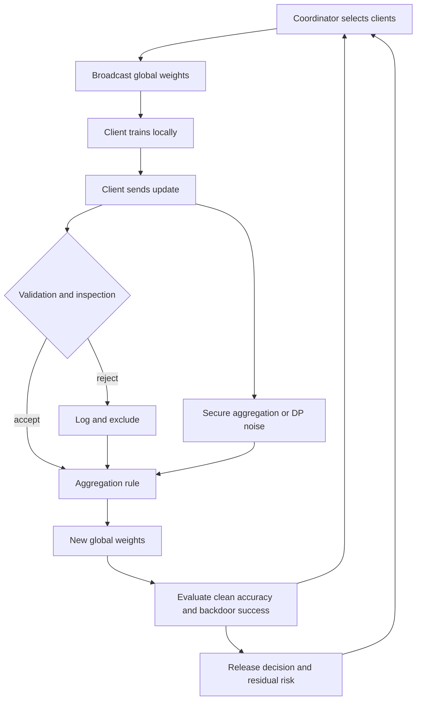

# Module 12 — Federated Learning Security and Distributed ML Threats

**Level 4 · Advanced and emerging · 14 hours · Module 05 and Module 07**

## Why this module exists

Federated learning promises to train on data that never leaves its owner. That promise changes the architecture, not the adversary. A federated system still has participants who can lie, a coordinator that can fail or misbehave, a communication channel that can be observed, and an aggregation rule that must decide what to believe. The data is distributed; the trust problem is not.

This module asks five questions about a federated deployment:

1. **Who is allowed to participate, and what does the coordinator learn?** Clients, rounds, local training, update transport, and the trust assumptions behind each.
2. **What can a malicious client do to the global model?** Data poisoning, update scaling, backdoors, and Sybil identities.
3. **What can aggregation protect against, and where does it fail?** Mean, trimmed mean, coordinate median, and Krum, with their assumptions and breakdown points.
4. **What else can the operator check?** Norm clipping, update inspection, provenance, monitoring, secure aggregation, and privacy accounting.
5. **How do you evaluate a defense honestly?** Equal rounds, clean accuracy against attack success, false positives, and residual risk.

LAB-16 makes the questions concrete. Eight clients hold a non-IID partition of the digits dataset. One client trains a backdoored local update and scales it six times. You compare the plain mean, a coordinate-wise trimmed mean, and norm clipping at the same number of rounds.

The module's thesis: **federated learning moves data and trust apart, but aggregation is not a security boundary; it is a statistical rule whose assumptions an attacker can violate.**

## Real-world motivation

Federated learning is used where data is regulated, commercially sensitive, or impractical to centralize: mobile keyboards, hospital consortia, bank fraud models, and industrial sensor fleets. The coordinating server often sees only model updates, which is presented as a privacy benefit. That benefit is real but bounded. Updates are derived from data, and derived values can leak. Membership inference and gradient inversion against shared updates are extensions of the attacks in Module 07, not a separate universe.

The security benefit is even more bounded. A malicious participant does not need to read anyone else's data to damage the model. It can submit an update that moves the global weights toward a target behavior, inflate its influence by scaling, or contribute many fake identities. The server's aggregation rule may average the damage rather than remove it.

The research literature is unambiguous about the pattern. FedAvg is robust to some natural heterogeneity and not to an adversary who knows the rule. Krum and trimmed mean have Byzantine-robustness guarantees under assumptions about the number of attackers, the data distribution, and the update geometry. Backdoor attacks violate those assumptions quietly because the malicious update also performs well on the main task. A defense that lowers average attack success can still leave a targeted backdoor intact.

That is why this module spends as much time on evaluation as on mechanisms. A defense demonstration that changes three things at once, or compares different numbers of rounds, does not tell you which change mattered.

## Measurable learning objectives

By the end of this module you will be able to:

1. **Diagram** a federated training round and state the trust assumptions of the client, coordinator, and channel (Bloom 2–3).
2. **Construct** a controlled malicious update and explain how scaling, data selection, and trigger design change its effect (Bloom 3–4).
3. **Compare** mean, trimmed mean, coordinate median, and Krum by assumption, cost, and failure mode (Bloom 4–5).
4. **Design** client validation, update inspection, monitoring, and privacy controls, and state what each does not protect (Bloom 5–6).
5. **Evaluate** distributed defenses with an equal-round protocol and report clean accuracy, attack success, and residual risk honestly (Bloom 5–6).

Objectives 1–5 assess LO-24. Objectives 4–5 also assess LO-19 and LO-28.

## Prerequisite checklist

| Skill | Check | If not |
|---|---|---|
| Explain poisoning and backdoors | You can distinguish label flipping from a trigger-based backdoor | M05, M06 |
| Explain membership inference | You can state what an attack observes and what it infers | M07 |
| Train a small classifier | You can fit a model and report accuracy on a held-out split | M02, LAB-01B |
| Read a gradient or an update | You can explain why an update is a direction in weight space | M02 Lesson 2 |
| Compute an average and a median | You can do both by hand for five numbers | M01 Lesson 2 |
| Write a reproducible experiment | You can fix a seed and compare configurations at equal budget | M01 Lesson 5 |
| State a threat model | You can name assets, capabilities, and boundaries | M03 Lesson 5 |

### Five-minute diagnostic

1. In FedAvg, what exactly does a client send to the server, and what does it receive back?
2. A client scales its update by 10. What changes in a plain weighted mean, and why might a norm clip help?
3. Name one assumption behind the trimmed-mean defense that a backdoor attacker can violate.
4. Does secure aggregation prevent a malicious client from poisoning the model? Why or why not?
5. Why is clean accuracy alone a misleading defense metric in a backdoor experiment?

If you can answer four or five, skim Lessons 1–2 and spend the time on Lessons 3–5 and LAB-16. If fewer than three, read in order.

## Module map

| Unit | Title | Time | What you produce |
|---|---|---:|---|
| [12.1](lesson-1-architecture-and-trust.md) | Federated architecture and trust assumptions | 2 h | A round diagram and a trust table |
| [12.2](lesson-2-malicious-clients-and-update-poisoning.md) | Malicious clients and update poisoning | 2 h | A controlled malicious-update design |
| [12.3](lesson-3-aggregation-and-its-limits.md) | Aggregation and its limits | 2 h | An aggregation comparison table |
| [12.4](lesson-4-validation-monitoring-and-privacy.md) | Client validation, monitoring, and privacy | 2 h | A layered control plan |
| [12.5](lesson-5-evaluating-distributed-defenses.md) | Evaluating distributed defenses | 1.5 h | An equal-round evaluation report |
| [LAB-16](../../labs/lab-16.md) | Federated learning attack and defense | 5 h | Simulation, metrics, report, manifest |
| [Knowledge check](quiz.md) | QZ-12, 10 items | 20 min | Score and explanations |
| [Exercises](exercises.md) | Four exercises, one deployment scenario | 45 min | Portfolio evidence |

Module effort is approximate: 8 hours of lessons, 5 hours of lab, and 1 hour of quiz and exercises.

## How the pieces fit

The feedback from evaluation to selection is a security decision. If a client is excluded, the next round's population changes. If the evaluation set is controlled by an attacker, the release decision is compromised. LAB-16 fixes the client set and the evaluation split so that the only moving part is the aggregation rule.

## The lab at a glance

| Dimension | LAB-16 |
|---|---|
| Data | Digits, 1,257 training rows, 8 non-IID clients, at most 4 classes per client |
| Model | Multiclass softmax regression trained with NumPy |
| Rounds | 12, with 8 local epochs per round and the same learning rate for every policy |
| Attack | One client adds triggered copies relabeled as class 0 and scales its update by 6 |
| Defenses | Coordinate-wise trimmed mean (trim 1 per side), update norm clipping at 2.0 |
| Headline | Benign clean 0.9000 / ASR 0.0021; malicious mean 0.7056 / 1.0000 |
| Defense result | Trimmed mean 0.8704 / 0.0000; clipping 0.8944 / 0.6276 |
| Negative result | Clipping limits influence but does not remove the backdoor direction |
| Residual risk | Sybil clients, adaptive attackers, secure aggregation does not stop poisoning |

Read the numbers as a comparison at equal rounds, not as a ranking of defenses in general. The trimmed mean removes this attack under these conditions; it is not a universal fix, and a different attacker or client distribution can defeat it.

## Common mistakes across the module

| Mistake | Symptom | Consequence |
|---|---|---|
| Treating the server as trusted by definition | "The coordinator is ours" | A compromised or curious server sees updates and can bias selection |
| Confusing privacy with security | "Updates are not data, so clients cannot attack" | Poisoning is missed entirely |
| Comparing defenses at different rounds | A defense looks better because it trained longer | The comparison measures budget, not robustness |
| Reporting only clean accuracy | Backdoored model looks healthy | A targeted failure ships |
| Assuming secure aggregation stops poisoning | The server cannot see individual updates | The aggregate is still poisoned |
| Ignoring client data heterogeneity | One client dominates the mean | Natural non-IID effects are mistaken for an attack |
| Using a global norm clip as a complete defense | Attack success falls but remains high | A false sense of safety (LAB-16: 0.6276 ASR) |
| Evaluating on attacker-controlled data | Attack success looks low | The evaluation itself is compromised |
| Ignoring Sybil identities | One attacker contributes many updates | Robust aggregation assumptions break |
| Calling a defense "Byzantine-robust" without its assumptions | The guarantee is quoted, not checked | The deployment exceeds the proven regime |

## Troubleshooting

| Symptom | Likely cause | Fix |
|---|---|---|
| Benign accuracy collapses across rounds | Local training restarts from random weights | Initialize each local model from the current global weights |
| One client has almost all classes | Partition rule is not non-IID or seed is wrong | Print per-client class counts |
| Attack success is 1.0 even for benign | Trigger appears in the test set without relabeling | Apply the trigger only to non-target test rows |
| Trimmed mean has no effect | Trim count is zero or aggregation is still the mean | Verify the trimmed count and compare to the mean |
| Clipping removes the attack completely | Clip threshold is tiny, so benign updates are also destroyed | Report clean accuracy alongside ASR |
| Results change between runs | Client sampling or initialization is unseeded | Fix the seed and record it in `run.json` |
| Round count differs between policies | Early stopping or different schedules | Use the same rounds and local epochs |
| Backdoor ASR is high but clean accuracy is normal | That is the expected backdoor signature | Do not use clean accuracy as the only release gate |

## Glossary

| Term | Definition |
|---|---|
| **Federated learning (FL)** | Training a shared model across participants who keep their data local |
| **Client** | A participant that trains locally and submits an update |
| **Coordinator (server)** | The component that selects clients, aggregates updates, and distributes the global model |
| **Round** | One broadcast–local-training–aggregate cycle |
| **Local update** | The difference between a client's trained weights and the received global weights, or the weights themselves |
| **FedAvg** | Federated averaging; a weighted mean of client updates, often weighted by sample count |
| **Non-IID** | Client data whose label or feature distribution differs from the global distribution |
| **Cross-device** | Many unreliable clients, each with little data, often mobile devices |
| **Cross-silo** | Few reliable organizations, each with substantial data |
| **Update poisoning** | Manipulating the submitted update rather than, or in addition to, local data |
| **Data poisoning** | Corrupting local training data to influence the global model |
| **Backdoor** | A trigger-conditioned behavior learned alongside the main task |
| **Attack success rate (ASR)** | The fraction of triggered inputs classified as the attacker's target |
| **Update scaling** | Multiplying an update to increase its influence on the aggregate |
| **Sybil client** | A fake identity that adds an additional adversarial contribution |
| **Byzantine client** | A client that may behave arbitrarily, including lying about its update |
| **Robust aggregation** | An aggregation rule designed to tolerate some Byzantine contributions |
| **Trimmed mean** | A coordinate-wise mean after removing extreme values from each tail |
| **Coordinate median** | The median of each weight coordinate across clients |
| **Krum** | A rule that selects the update closest to a majority of other updates |
| **Norm clipping** | Scaling an update whose norm exceeds a threshold |
| **Secure aggregation** | A protocol that lets the server compute a sum without seeing individual updates |
| **Differential privacy (DP)** | A formal guarantee that a release changes little when one record changes |
| **DP-FL** | Federated learning with differential privacy, often at the client or example level |
| **Breakdown point** | The fraction of adversarial contributions a rule can tolerate before failing |
| **Residual risk** | Risk that remains after controls, including risks the evaluation did not test |

## Summary and key takeaways

- Federated learning distributes data, not trust. Clients, coordinator, channel, and evaluation each carry assumptions.
- FedAvg is a weighted mean. A client that scales its update or contributes many identities gets more influence.
- A backdoor update can look good on the main task while installing a trigger. Clean accuracy alone will not detect it.
- Trimmed mean and coordinate median remove some extreme contributions under stated assumptions. They are not universal.
- Norm clipping limits influence but does not erase direction. LAB-16 still measures 0.6276 ASR under clipping.
- Secure aggregation hides individual updates from the server; it does not make a poisoned aggregate safe.
- DP-FL adds a privacy guarantee and noise, with a utility cost. It does not replace poisoning defenses.
- Evaluate at equal rounds, on a fixed evaluation set, with both clean accuracy and attack success.
- Report residual risks: Sybil identities, adaptive attackers, client validation errors, and evaluation compromise.

## Limitations and scope

- LAB-16 uses 1,257 rows of the digits dataset, eight clients, and twelve rounds. It is a controlled simulation, not a production federated deployment.
- The experiment has one malicious client. It does not model collusion, Sybil identities, client sampling, dropout, stragglers, or communication cost.
- The norm-clipping run still measures 0.6276 attack success. Clipping reduces influence; it does not remove a backdoor, and the threshold is a tuning choice that can also suppress benign updates.
- The robust-aggregation results depend on the stated attacker fraction and update geometry. An adaptive attacker who knows the rule can change the result.
- Secure aggregation and client-level DP are explained conceptually; LAB-16 does not implement either protocol.
- The evaluation reports clean accuracy and attack success on one fixed split. It does not cover per-class harm, client-level false positives, or runtime.

## References and further reading

All links checked on 2026-10-28.

| Reference | Use |
|---|---|
| [McMahan et al., *Communication-Efficient Learning of Deep Networks from Decentralized Data* (2017)](https://arxiv.org/abs/1602.05629) | FedAvg and the original federated setting |
| [Kairouz et al., *Advances and Open Problems in Federated Learning* (2021)](https://arxiv.org/abs/1912.04977) | Taxonomy of FL challenges, including security and privacy |
| [Bonawitz et al., *Practical Secure Aggregation for Privacy-Preserving Machine Learning* (2017)](https://doi.org/10.1145/3133956.3133982) | Secure aggregation protocol and its assumptions |
| [Blanchard et al., *Byzantine-Tolerant Machine Learning* (arXiv preprint, 2017; published as *Machine Learning with Adversaries: Byzantine Tolerant Gradient Descent*, NeurIPS 2017)](https://arxiv.org/abs/1703.02757) | Krum and Byzantine-robust aggregation |
| [Yin et al., *Byzantine-Robust Distributed Learning: Towards Optimal Statistical Rates* (2018)](https://arxiv.org/abs/1803.01498) | Trimmed mean and coordinate median |
| [Bagdasaryan et al., *How to Backdoor Federated Learning* (2020)](https://arxiv.org/abs/1807.00459) | Model-replacement and backdoor attacks in FL |
| [Bhagoji et al., *Analyzing Federated Learning through an Adversarial Lens* (2019)](https://arxiv.org/abs/1811.12470) | Stealthy targeted poisoning by a malicious client |
| [Fang et al., *Local Model Poisoning Attacks to Byzantine-Robust Federated Learning* (2020)](https://arxiv.org/abs/1911.11815) | Adaptive attacks against robust aggregation |
| [Tolpegin et al., *Data Poisoning Attacks Against Federated Learning Systems* (2020)](https://arxiv.org/abs/2007.08432) | Label-flipping attacks in FL |
| [Fung et al., *The Limitations of Federated Learning in Sybil Settings* (2020)](https://www.usenix.org/conference/raid2020/presentation/fung) | Sybil attacks and the limits of aggregation |
| [Geyer et al., *Differentially Private Federated Learning: A Client Level Perspective* (2017)](https://arxiv.org/abs/1712.07557) | Client-level DP and the privacy-utility trade-off |
| [NIST AI 100-2e2025](https://doi.org/10.6028/NIST.AI.100-2e2025) | Adversarial ML taxonomy and terminology |
| [MITRE ATLAS](https://atlas.mitre.org/) | Technique context for poisoning and evasion |
| [ISO/IEC 42001:2023](https://www.iso.org/standard/81230.html) | AI management-system context for governance evidence |

Read McMahan et al. before Lesson 1, Bagdasaryan et al. before Lesson 2, and Yin et al. before Lesson 3. Read Fang et al. before Lesson 5 to see why a defense that works against a naive attacker may fail against an adaptive one.

## Next step

Start with [Lesson 12.1 — Federated architecture and trust assumptions](lesson-1-architecture-and-trust.md). If you have completed M05 and M07, take the diagnostic and go directly to Lesson 2 and LAB-16.
