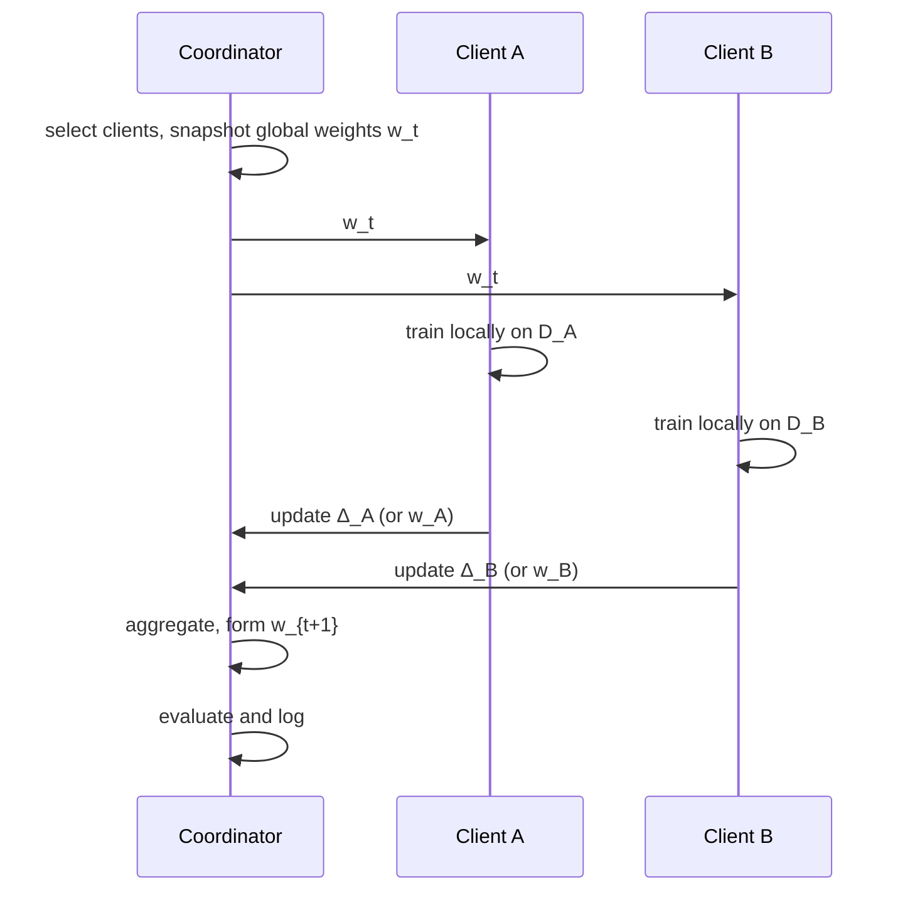

# Lesson 12.1 — Federated Architecture and Trust Assumptions

**Module 12 · Lesson 1 of 5 · 2 hours · LO-24**

## Scenario

A consortium of four hospitals wants a shared readmission model. Each hospital keeps its records on its own network. A coordinating server sends the current model to selected hospitals, receives their updates, averages them, and sends back the new model. The vendor calls this "privacy-preserving" and "secure by design."

Two questions are missing from the vendor's slide. The first is what the coordinator can infer from an update. The second is what a hospital can do to the shared model by submitting a crafted one. Neither is answered by the fact that raw records stay on site.

This lesson builds the round precisely, then separates the trust assumptions that the architecture makes from the ones the vendor assumes.

## Objectives

By the end of this lesson you will be able to:

1. Draw a federated round and name the message, state, and decision at each step.
2. Compute a FedAvg update by hand, including sample weighting and a scaled client.
3. Compare cross-device and cross-silo deployments by population, reliability, and threat.
4. State the trust assumptions of the client, coordinator, channel, and evaluator.
5. Map the main threats to the architectural component that enables them.
6. Explain what secure aggregation and differential privacy each protect, and what neither protects.

## 1. One round, precisely

A round has four decisions:

| Step | Decision | What can go wrong |
|---|---|---|
| Selection | Which clients participate? | Attacker controls selection or many identities |
| Broadcast | What exactly is sent? | Weights leak information; channel is observed |
| Local training | How is the update computed? | Data poisoned, code modified, update scaled |
| Aggregation | How are updates combined? | Rule assumes honesty it does not have |
| Evaluation | What is measured, on whose data? | Attacker-controlled evaluation hides the effect |

The global model is a shared state. Every accepted update changes it for every participant. That is the property that makes a small number of malicious clients disproportionately important.

## 2. FedAvg as a weighted mean

Let client \(k\) hold \(n_k\) examples and return an update

\[
\Delta_k = w_k^{\text{local}} - w_t.
\]

The server forms

\[
w_{t+1} = w_t + \sum_{k=1}^{K} \frac{n_k}{\sum_j n_j}\,\Delta_k.
\]

The weight \(n_k / \sum_j n_j\) is the client's share of the training data. It is also the client's influence on the aggregate. An attacker who can claim more examples, or simply scale its update, increases that influence.

### Worked example

Three clients receive \(w_t = (1.0,\,-2.0)\).

| Client | \(n_k\) | Update \(\Delta_k\) |
|---|---:|---|
| A | 100 | \((0.3,\,0.1)\) |
| B | 200 | \((-0.1,\,0.2)\) |
| C | 300 | \((0.5,\,-0.4)\) |

The weighted numerator is

\[
100(0.3,0.1) + 200(-0.1,0.2) + 300(0.5,-0.4)
= (30,-10) + (-20,40) + (150,-120)
= (160,-90).
\]

Dividing by 600 gives \(\bar{\Delta} = (0.2667,\,-0.15)\), so

\[
w_{t+1} = (1.2667,\,-2.15).
\]

Now suppose A is malicious and multiplies its update by 6, to \((1.8,\,0.6)\). Its contribution becomes \((180,\,60)\). The numerator becomes

\[
(180,60) + (-20,40) + (150,-120) = (310,-20),
\]

and the aggregate is \((0.5167,\,-0.0333)\). The first coordinate's movement nearly doubles, and the second coordinate moves in the opposite direction from the benign result. A single client with one sixth of the data changed the direction of the round.

This is the entire mechanism behind LAB-16's `ATTACK_SCALE = 6.0`. The attacker does not need to control the server. It needs to be selected and to submit a large enough update.

### Why not just use the mean of weights?

Averaging client weights and averaging updates are equivalent when every client starts from the same \(w_t\):

\[
\frac{1}{K}\sum_k w_k^{\text{local}} = w_t + \frac{1}{K}\sum_k \Delta_k.
\]

The update form is useful because it makes the size and direction of each client's contribution explicit, which is what clipping and inspection operate on.

## 3. Cross-device and cross-silo

| Dimension | Cross-device | Cross-silo |
|---|---|---|
| Participants | Millions of phones or edge devices | A few organizations |
| Data per client | Small, often one user | Large, institution-scale |
| Availability | Intermittent, battery and network constrained | Contractual, scheduled |
| Identity | Weak, easy to create many | Strong, legally accountable |
| Selection | Random sampling each round | Fixed or rotating membership |
| Dominant risk | Sybil identities, unreliable updates | Poisoning by a trusted partner, data heterogeneity |
| Privacy unit | User or device | Organization or patient |
| Typical defense | Anonymity, secure aggregation, DP | Contracts, audit, robust aggregation |

The same algorithm runs in both, but the threat model does not transfer. A cross-device deployment worries about an attacker creating a million identities; a cross-silo deployment worries about one partner whose data or incentives are adversarial. A defense tuned for one may be irrelevant to the other.

## 4. Trust assumptions

Write these down before choosing a defense.

| Component | Common assumption | If the assumption fails |
|---|---|---|
| Client data | Honest but heterogeneous | Poisoning, backdoors, label flipping |
| Client code | Runs the agreed training procedure | Arbitrary update, scaling, model replacement |
| Client identity | One identity per participant | Sybil clients multiply influence |
| Coordinator | Honest-but-curious at worst | Selective aggregation, biased selection, update inspection |
| Channel | Confidential and authenticated | Observation, modification, replay |
| Evaluation data | Held by the defender, representative | Attack success is hidden; release gate is fooled |
| Aggregation rule | Implemented as specified | The guarantee does not apply to the deployed code |

Three assumptions deserve emphasis.

**The coordinator is not automatically trusted.** It sees every update unless secure aggregation is used, and it chooses which clients participate. A curious coordinator can run inference attacks on updates. A malicious one can drop updates, weight them selectively, or show different models to different clients.

**A client can lie about more than its data.** It can scale its update, train on a different objective, submit a stale update, or copy another client's update. Validation that only checks the data declaration misses all of these.

**The evaluation set is part of the security boundary.** If the attacker can influence the test distribution or the reported metric, a backdoor can pass the release gate. LAB-16 fixes the evaluation split and the trigger definition so the comparison is meaningful.

## 5. What each party learns

| Party | Sees | Can infer | Cannot directly see |
|---|---|---|---|
| Client | Global weights, own data | Global model behavior | Other clients' data |
| Coordinator | Every update (without secure aggregation) | Data properties, participation patterns, possibly membership | Raw records |
| Other clients | Global weights | Aggregate behavior | Individual contributions |
| Channel observer | Messages, unless protected | Update values, timing, size | Raw records |
| Evaluator | Model and evaluation data | Clean and triggered behavior | Training data, unless it also holds it |

An update is a function of data. The function can be inverted or probed. Module 07 covered membership inference and extraction against a model; the same logic applies to updates, sometimes more sharply because an update is closer to the data than a final model is. Secure aggregation removes the coordinator's view of individual updates, but it does not remove the information from the aggregate, and it does not stop a malicious client from contributing a poisoned update.

## 6. Threats mapped to architecture

| Threat | Enabled by | First control | Residual risk |
|---|---|---|---|
| Label-flipping poisoning | Client controls local labels | Data validation, robust aggregation | Small poisoned fraction can persist |
| Backdoor | Client controls local training | Trigger-aware evaluation, update inspection | Trigger unknown to defender |
| Update scaling | Coordinator accepts unnormalized updates | Norm clipping, bounded influence | Direction survives clipping |
| Model replacement | Attacker update dominates the mean | Robust aggregation, anomaly detection | Attacker adapts to the rule |
| Sybil attack | Weak identity, many fake clients | Identity proof, participation limits | Compromised real identities |
| Free-riding | Client submits a poor or copied update | Validation against a reference | Hard to distinguish from heterogeneity |
| Update leakage | Coordinator sees individual updates | Secure aggregation, DP | Aggregate leakage remains |
| Selection bias | Coordinator chooses clients | Audited selection policy | Collusion with a client |

Notice that the first control for several rows is not an ML technique. Identity, participation limits, and audited selection are ordinary distributed-systems controls. Federated learning inherits them.

## 7. LAB-16's architecture

LAB-16 implements the smallest honest version of the round:

| Element | LAB-16 choice | Why |
|---|---|---|
| Clients | 8 | Enough for a trimmed mean with one outlier |
| Data | Digits, 1,257 training rows | Small enough for CPU and a short run |
| Partition | Each class split 70/30 between two clients | Non-IID without a client holding all classes |
| Local training | Full-batch softmax gradient descent, 8 epochs | Deterministic and easy to inspect |
| Aggregation | Sample-weighted FedAvg | The baseline rule from the literature |
| Rounds | 12 | Long enough for the backdoor to appear, short enough to run |
| Attack | One client, triggered copies relabeled 0, update ×6 | Controlled and measurable |
| Metrics | Clean accuracy and attack success rate | The pair that exposes a backdoor |

The partition gives each client at most four of the ten classes. That matters: a client with all classes would make the non-IID effect disappear, and a client with one class would make the clean-accuracy result depend on a single label. The lab prints the per-client class counts so you can verify the setup rather than trust the prose.

## Common mistakes

| Mistake | Why it happens | Fix |
|---|---|---|
| Saying "the data never leaves the device, so it is private" | The slogan is memorable | Updates are derived from data; analyze what they reveal |
| Treating FedAvg as a security control | It is the default algorithm | State what it assumes about clients |
| Forgetting sample weighting | The simple mean is easier | Weight by \(n_k\) or state that clients are equal |
| Assuming one client equals one participant | The code has no identity layer | Add identity and participation limits |
| Ignoring selection | The server chooses clients | Audit the selection policy and its randomness |
| Assuming the coordinator is trusted | It is operated by the defender | Separate honest-but-curious from malicious |
| Using a test set the attacker can influence | It is convenient | Hold out an evaluation set the attacker cannot touch |
| Comparing rounds with different client sets | The experiment evolved | Freeze the client set and round count |

## Troubleshooting

| Symptom | Likely cause | Fix |
|---|---|---|
| Weighted mean does not match a hand calculation | Updates and weights are misaligned | Pair each update with its \(n_k\) before summing |
| A scaled client has no effect | The server normalizes updates | Check the aggregation code, not the attacker |
| Non-IID partition looks IID | Class split ignores client index | Print the label histogram per client |
| Rounds diverge | Learning rate too high for full-batch training | Lower the rate or the local epochs |
| All clients have the same data | Partition seed is fixed to one split | Verify the partition function |
| Clean accuracy is high but one class fails | The backdoor target is the failing class | Report per-class accuracy and ASR |

## Check your understanding

1. In the worked example, by how much did the malicious client's influence on the first coordinate increase?
2. Why does averaging weights and averaging updates give the same result when all clients start from \(w_t\)?
3. Name two trust assumptions that differ between cross-device and cross-silo deployments.
4. What does secure aggregation hide, and what does it not prevent?
5. Why is the evaluation set part of the threat model?
6. LAB-16 gives each client at most four classes. What would change if one client held all ten?

Answers are discussed in the [answer key](quiz-answers.md) and the exercises.

## Summary

- A federated round is selection, broadcast, local training, aggregation, and evaluation. Each step is a security decision.
- FedAvg is a sample-weighted mean. Influence is proportional to weight, and scaling increases it without changing the data claim.
- Cross-device and cross-silo deployments share an algorithm but not a threat model.
- Clients, coordinator, channel, and evaluator each carry assumptions. Write them down.
- Secure aggregation hides individual updates; it does not stop poisoning, and the aggregate still leaks.
- LAB-16 fixes the client set, partition, rounds, and evaluation so that the aggregation rule is the only moving part.

## Next

Continue to [Lesson 12.2 — Malicious clients and update poisoning](lesson-2-malicious-clients-and-update-poisoning.md), where the attacker is given control of one client and the update becomes the weapon.
