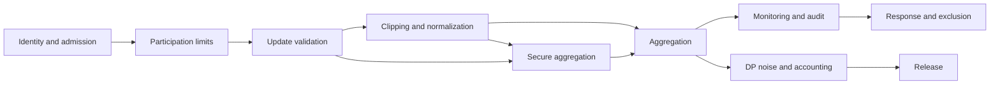

# Lesson 12.4 — Client Validation, Monitoring, and Privacy

**Module 12 · Lesson 4 of 5 · 2 hours · LO-24, LO-19**

## Scenario

The consortium deploys the trimmed mean and declares the poisoning problem solved. Three months later an audit finds that one member has been submitting updates from two identities for six rounds, another member's update norms are consistently ten times everyone else's, and the coordinator has been storing every raw update "for debugging." None of these is a novel ML attack. All of them are missing operational controls.

This lesson is about the controls around aggregation: who may participate, what they may submit, what the operator watches, and what the coordinator is allowed to see.

## Objectives

By the end of this lesson you will be able to:

1. Design client admission, identity, and participation controls for a federated deployment.
2. Apply update validation and clipping, and state what each does not detect.
3. Build a monitoring plan with per-round, per-client, and per-cohort signals.
4. Explain secure aggregation conceptually, including its threat model and limits.
5. Explain client-level differential privacy and how it composes across rounds.
6. Combine controls into a layered plan and state the residual risk.

## 1. The control map

The order matters. Identity and participation are decided before an update exists. Validation and clipping inspect the update. Secure aggregation changes what the server can see, and DP changes what the released model reveals. Monitoring observes the whole path.

## 2. Client validation

| Control | Question | Mechanism | Limit |
|---|---|---|---|
| Identity | Is this a real, unique participant? | Certificates, accounts, device attestation | Compromised real identity |
| Admission | Is this participant allowed in this cohort? | Contract, allowlist, reputation | Insider threat |
| Participation cap | How often may one identity contribute? | Per-round and per-window limits | Collusion across identities |
| Contribution bound | How much data may one client claim? | Cap declared sample count | Attacker lies within the cap |
| Code attestation | Is the agreed training code running? | Signed images, remote attestation | Compromised runtime below attestation |
| Data declaration | What data is claimed? | Schema, counts, provenance | False declaration |

The first two are ordinary distributed-systems controls. Federated learning does not remove the need for them; it makes them more important because the server cannot inspect the data.

A participation cap is especially valuable against Sybil attacks. If one organization can contribute at most one update per round and at most a fixed number of rounds per window, creating extra identities has a bounded benefit. The cap does not stop a compromised real participant, but it raises the cost of volume.

## 3. Update validation and clipping

Validation asks whether an update is admissible before aggregation.

| Check | Computation | Catches | Does not catch |
|---|---|---|---|
| Finite values | Reject NaN and infinity | Broken or hostile encodings | Finite crafted updates |
| Expected shape | Compare to model dimensions | Wrong model or protocol version | Correctly shaped poison |
| Norm bound | \(\|\Delta\|_2 \le C\) | Extreme scaling | Scaled update below \(C\) |
| Per-coordinate bound | \(|\Delta_j| \le c\) | Sparse extreme coordinates | Distributed small shifts |
| Cosine similarity | Compare to a reference or peer median | Isolated direction | Attacker inside the cluster |
| Reference loss | Evaluate on a held-out set | Degraded main task | Backdoor that preserves loss |
| Trigger scan | Apply known triggers | Known backdoors | Unknown triggers |
| Reproducibility | Ask for a proof or a sample of the computation | Some code deviations | Full verification is expensive |

### Clipping

For an update \(\Delta\) and threshold \(C\),

\[
\Delta' = \Delta \cdot \min\left(1, \frac{C}{\|\Delta\|_2}\right).
\]

Clipping bounds the magnitude. It does not bound the direction, and it does not remove a backdoor that is encoded in the direction.

LAB-16 uses \(C = 2.0\). The malicious update is scaled by 6, so clipping reduces its magnitude substantially. Clean accuracy stays at 0.8944, close to the benign 0.9000. But ASR is 0.6276. The backdoor direction survives the norm reduction, and the mean still moves toward it. A defender who monitored only accuracy would see a healthy model.

This is the lesson's central warning: **a control that improves one metric can leave the attack intact.**

### Validation is not verification

The server cannot recompute the client's training without the data. It can check properties of the submitted vector, compare it to peers, and evaluate its effect. Each check is a heuristic with a false-positive mode. A legitimate client with unusual data can look like an attacker; an attacker who mimics the benign cluster can look legitimate.

## 4. Monitoring

Monitoring turns the controls into evidence.

| Layer | Signal | Window | Response |
|---|---|---|---|
| Round | Mean update norm, norm distribution, aggregation time | One round | Alert on a spike or a sudden drop |
| Client | Norm, cosine to cohort median, reference loss, participation count | Rolling window | Scorecard, warning, exclusion |
| Cohort | Clean accuracy, per-class accuracy, trigger ASR, calibration | Each release | Block release if a gate fails |
| Privacy | Budget spent, noise scale, clipping fraction | Cumulative | Stop when the budget is exhausted |
| Operations | Selection randomness, dropout rate, failed validation | Per round | Investigate bias or outage |

Three design rules:

1. **Calibrate on a quiet period.** Thresholds derived from monitored traffic absorb the attack. This is the same rule as Module 11's detectors.
2. **Separate per-client signals from aggregate signals.** An attack can be invisible in the aggregate while one client's norm is extreme, and vice versa.
3. **Log metadata, not raw updates.** Raw updates are sensitive. Log norms, hashes, decisions, and reasons; keep raw updates only under a retention policy with access control.

### A client scorecard

| Field | Example | Use |
|---|---|---|
| `client_id` | `site-04` | Identity and accountability |
| `rounds_participated` | 12 | Participation cap |
| `mean_norm` | 0.84 | Drift and scaling |
| `cosine_to_median` | 0.91 | Isolation |
| `reference_loss` | 0.22 | Main-task quality |
| `trigger_asr` | 0.01 | Backdoor signal, if triggers are known |
| `validation_failures` | 1 | Reputation |
| `last_review` | 2026-10-20 | Governance |

A scorecard is not a verdict. It is a structured reason to look.

## 5. Secure aggregation

Secure aggregation lets the server compute the sum of client updates without seeing any individual update.

A simplified protocol:

1. The server and clients agree on a round and a set of participants.
2. Each pair of clients derives a shared random mask.
3. Client \(i\) adds the masks for clients with a higher index and subtracts the masks for clients with a lower index.
4. When the masked updates are summed, every pairwise mask cancels.
5. The server sees the sum; individual contributions are hidden.

The protocol must handle dropouts: if a client leaves after the masks are established, the remaining clients must reconstruct or remove its mask without revealing updates. Practical protocols use secret sharing for this. The details are cryptographic; the concept is enough for this course.

| Secure aggregation protects | Secure aggregation does not protect |
|---|---|
| Curious server learning individual updates | A malicious client poisoning the sum |
| Some inference attacks on updates | A colluding server and clients above the threshold |
| Update values in transit, combined with channel security | Leakage from the released model |
| | Correctness of the sum if clients lie |

Secure aggregation and poisoning defenses are orthogonal. One hides contributions; the other decides what to do with a bad aggregate. LAB-16 does not implement secure aggregation; its report states that the poisoning results would be unchanged if it did.

## 6. Differential privacy in federated learning

Differential privacy bounds how much the released model changes when one record or one client changes. Module 13 develops the mechanics. Here, the federated-specific choices are:

| Level | Unit of protection | Mechanism | Trade-off |
|---|---|---|---|
| Example-level DP | One training example | Per-example gradient clipping and noise (DP-SGD) | High noise for small local datasets |
| Client-level DP | One client's entire contribution | Clip the client update, add noise to the sum | Stronger privacy unit, more utility loss |
| Local DP | Each client's report | Randomize before sending | No trust in the server, very high noise |
| Central DP | The aggregate | Trusted server adds noise after aggregation | Requires trust in the server |

Client-level DP is the natural unit when a client is an organization or a person whose entire local dataset should be protected. The sensitivity of the sum is bounded by the client clipping norm \(C\). Adding noise scaled to \(C\) and the number of clients gives the guarantee.

Privacy budgets compose. If each round spends \(\varepsilon_r\), the total after \(T\) rounds is bounded by a composition theorem, often close to \(\sqrt{T}\) times a per-round term under advanced composition, or \(T\varepsilon\) under basic sequential composition. The exact accounting depends on the mechanism and the adjacency definition. A deployment must record the total, not just the per-round value.

The utility cost is real. LAB-17 shows the shape for a simple release: at \(\varepsilon = 0.02\) accuracy is 0.5233; at \(\varepsilon = 4.0\) it is 0.8167 against a non-private 0.8233. The federated version adds clipping error and composition across rounds on top of that.

Privacy does not stop poisoning. A client can poison within its privacy budget. The two controls address different harms.

## 7. A layered plan

| Threat | Control | Evidence | Residual risk |
|---|---|---|---|
| Sybil clients | Identity, admission, participation cap | Enrollment log, per-round counts | Compromised real identity |
| Update scaling | Norm clipping, per-coordinate bound | Norm distribution, clip rate | Direction survives (LAB-16: 0.6276 ASR) |
| Backdoor | Trigger-aware evaluation, reference loss | ASR on known triggers, per-class accuracy | Unknown trigger |
| Curious server | Secure aggregation | Protocol audit, threshold | Collusion above threshold |
| Model leakage | Client-level DP, budget accounting | Epsilon ledger, noise scale | Composition and utility loss |
| Free-riding | Reference loss, contribution checks | Scorecard | Legitimate heterogeneity |
| Evaluation compromise | Independent holdout, signed metrics | Hash and owner of evaluation set | Insider with access |

No row is "solved." Each has an evidence artifact and a residual risk.

## 8. Response

When a client is suspected:

1. **Freeze the round.** Do not aggregate an update under investigation.
2. **Preserve evidence.** Hash the update and the decision record; do not copy raw updates into general logs.
3. **Isolate, do not delete.** Excluding the client changes the population; record the change.
4. **Re-evaluate the current model** on the clean and triggered sets. A backdoor may already be installed.
5. **Roll back only with evidence.** Re-run the release gate on the previous checkpoint; do not assume the old model is clean.
6. **Rotate credentials and review identity.** A compromised client may still hold valid keys.
7. **Update the control and the detector.** An incident without a change repeats.

The response is the same discipline as Module 11's incident response, adapted to a distributed training pipeline.

## Common mistakes

| Mistake | Why it happens | Fix |
|---|---|---|
| Trusting declared sample counts | They are easy to send | Cap and audit them |
| Treating clipping as a poisoning defense | It lowers ASR in some runs | Report ASR and clean accuracy together |
| Assuming secure aggregation prevents poisoning | It hides contributions | Keep robust aggregation and monitoring |
| Logging raw updates | Debugging convenience | Log norms and hashes; restrict raw retention |
| Calibrating thresholds on monitored traffic | The attack becomes the baseline | Calibrate on a quiet period |
| Reporting a per-round epsilon as the total | Composition is inconvenient | Maintain a budget ledger |
| Excluding a client without recording it | The action seems local | Record population changes and re-evaluate |
| Rolling back without testing | The old version feels safer | Run the release gate on the old checkpoint |

## Troubleshooting

| Symptom | Likely cause | Fix |
|---|---|---|
| All updates are clipped | Threshold too low | Compare norm distribution to \(C\) |
| No updates are clipped | Threshold too high | Lower \(C\) and measure the accuracy cost |
| Secure aggregation sum is wrong | Dropout handling or mask agreement failed | Test with a dropout and a small client set |
| DP utility collapses | Noise too high or clipping too tight | Inspect the privacy-utility curve |
| Budget exhausted mid-training | Composition not planned | Set a total budget and a per-round allocation |
| Scorecard flags a benign client | Non-IID data produces an unusual update | Review with task metrics, not norm alone |

## Check your understanding

1. What does a participation cap protect against, and what does it not protect against?
2. Why does clipping leave a backdoor intact in LAB-16?
3. What does secure aggregation hide, and why is it not a poisoning defense?
4. Distinguish example-level, client-level, and local DP by the unit and the trust assumption.
5. Why must a privacy budget be tracked across rounds rather than per round?
6. Name three monitoring signals that would have caught the audit's findings in the scenario.

Answers are discussed in the [answer key](quiz-answers.md) and the exercises.

## Summary

- Admission, identity, and participation caps are prerequisites, not optional extras.
- Validate updates for finiteness, shape, norm, direction, reference loss, and known triggers.
- Clipping bounds magnitude, not direction. LAB-16 still measures 0.6276 ASR under clipping.
- Monitor per round, per client, and per cohort; calibrate on quiet traffic.
- Secure aggregation hides individual updates from the server and does not stop poisoning.
- Client-level DP clips and noises contributions; budgets compose across rounds.
- Layer controls, record evidence, and state the residual risk.

## Next

Continue to [Lesson 12.5 — Evaluating distributed defenses](lesson-5-evaluating-distributed-defenses.md), where the controls are turned into an equal-round evaluation and an honest report.
