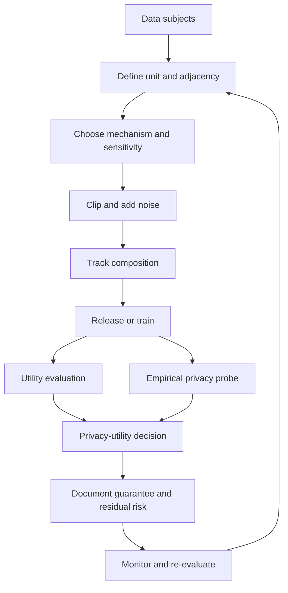

# Module 13 — Privacy-Preserving Machine Learning

**Level 4 · Advanced and emerging · 12 hours · Module 07 (Module 12 recommended)**

## Why this module exists

Module 07 showed that models leak. Membership inference, attribute inference, model inversion, and extraction all recover something about training data from a model or its outputs. This module turns that observation into engineering: if a release inevitably reveals something, how do you bound what it reveals, and how do you measure the cost?

The module asks four questions:

1. **What is the privacy harm, and against whom?** Membership, reconstruction, linkage, and attribute inference, with the auxiliary knowledge that makes them possible.
2. **What does a formal guarantee add?** Neighboring datasets, sensitivity, noise, epsilon, delta, and composition.
3. **How do you build a private release or a private training pipeline?** Laplace and Gaussian mechanisms, clipping, DP-SGD, secure aggregation, and secure computation.
4. **How do you evaluate the trade-off honestly?** Utility, empirical attack signal, budget accounting, and the limits of each.

LAB-17 makes the trade-off concrete with a small release. Two Gaussian classes, 1,000 release rows, and a nearest-centroid classifier. It compares a non-private baseline with Laplace-noised centroids at five epsilon values. Utility falls as epsilon falls. A distance-based membership test stays near chance across the sweep, and the lab is explicit that this is an empirical signal, not a proof of privacy.

The module's thesis: **privacy is a property of a release under a threat model, not a property of a dataset; differential privacy bounds the former, and an empirical attack measures only one attempt against it.**

## Real-world motivation

Organizations are asked to publish statistics, train shared models, and share synthetic data while protecting the people in the data. The naive responses fail in predictable ways.

Removing names does not anonymize. Quasi-identifiers such as age, postal code, and date of birth can uniquely identify a large fraction of a population. Sweeney's classic result showed that a large share of the U.S. population is unique on those three attributes. Narayanan and Shmatikov deanonymized a substantial part of the Netflix Prize dataset by linking it to public ratings. Aggregation with small counts leaks. Synthetic data generated by a model trained on private records can reproduce them.

Differential privacy (DP) is the main formal alternative. It does not promise that nothing leaks. It promises that the distribution of outputs changes by a bounded factor when one record changes. That bound composes across releases, survives post-processing, and can be audited. The cost is utility, and the accounting is easy to get wrong.

The engineering discipline is therefore as much about documentation as about noise: what unit is protected, which neighboring relation is used, what epsilon and delta were spent, how composition was computed, and what the release still reveals.

## Measurable learning objectives

By the end of this module you will be able to:

1. **Analyze** a release for membership, reconstruction, linkage, and attribute-inference risk under stated auxiliary knowledge (Bloom 3–4).
2. **Explain** epsilon-differential privacy, sensitivity, and the Laplace and Gaussian mechanisms (Bloom 2–3).
3. **Compute** sensitivity and noise scale for simple queries and track a privacy budget across compositions (Bloom 3).
4. **Compare** central, local, and distributed DP, DP-SGD, secure aggregation, and secure computation by trust assumption and cost (Bloom 4–5).
5. **Evaluate** a privacy-utility trade-off with utility metrics, an empirical attack, and an explicit statement of what the evaluation does not prove (Bloom 5–6).
6. **Document** a DP release so that its guarantee, assumptions, and residual leakage are auditable (Bloom 5–6).

Objectives 1–6 assess LO-19. Objectives 5–6 also assess LO-28.

## Prerequisite checklist

| Skill | Check | If not |
|---|---|---|
| Explain membership inference | You can state what the attacker observes and infers | M07 |
| Explain model inversion and extraction | You can distinguish reconstructing data from copying a model | M07 |
| Compute means and distances | You can compute a centroid and an L2 distance | M01, M02 |
| Read a probability | You can interpret an AUC near 0.5 | M02 Lesson 3 |
| Understand randomness | You can explain why a randomized mechanism has a distribution of outputs | M01 Lesson 5 |
| Work with a threat model | You can name attacker knowledge and harm | M03 Lesson 5 |
| Read a research abstract | You can separate a claim from its assumptions | M00 |

### Five-minute diagnostic

1. Why does removing names from a table not make it anonymous?
2. What is the sensitivity of a count query when one person can change the count by at most one?
3. A Laplace mechanism has sensitivity 2 and epsilon 0.5. What is the noise scale?
4. What does parallel composition allow that sequential composition does not?
5. A membership-inference AUC of 0.52 is reported after a DP release. Does that prove the release is private?
6. Name one thing differential privacy does not protect against.

If you can answer four or five, skim Lessons 1–2 and focus on Lessons 3–5 and LAB-17. If fewer than three, read in order.

## Module map

| Unit | Title | Time | What you produce |
|---|---|---:|---|
| [13.1](lesson-1-privacy-threat-models.md) | Privacy threat models and why anonymization fails | 2 h | A release threat model with auxiliary knowledge |
| [13.2](lesson-2-differential-privacy-first-principles.md) | Differential privacy from first principles | 2 h | A sensitivity and noise calculation |
| [13.3](lesson-3-composition-budgets-and-noisy-releases.md) | Composition, budgets, and noisy releases | 2 h | A privacy budget ledger |
| [13.4](lesson-4-private-training-and-secure-computation.md) | Private training and secure computation | 1.5 h | A trust and cost comparison |
| [13.5](lesson-5-privacy-utility-evaluation.md) | Privacy-utility evaluation and limitations | 1.5 h | A DP release statement and evaluation |
| [LAB-17](../../labs/lab-17.md) | Privacy budget and utility | 4 h | Epsilon sweep, membership signal, report, manifest |
| [Knowledge check](quiz.md) | QZ-13, 10 items | 20 min | Score and explanations |
| [Exercises](exercises.md) | Four exercises, one release scenario | 45 min | Portfolio evidence |

Module effort is approximate: 8 hours of lessons, 4 hours of lab, and 1 hour of quiz and exercises.

## How the pieces fit

The feedback loop matters. A release is not a one-time event. Releasing the same statistic monthly spends budget. Retraining on the same records spends budget again. The ledger is cumulative, and the documentation must reflect it.

## The lab at a glance

| Dimension | LAB-17 |
|---|---|
| Data | Two Gaussian classes, 4 features, 800 rows per class |
| Split | 500 release, 150 test, 150 nonmember per class |
| Release | Per-class clipped centroids with Laplace noise |
| Sensitivity | \(\Delta_1 = 2Bd/n = 2 \cdot 3 \cdot 4 / 500 = 0.048\) |
| Mechanism | Laplace, per-coordinate scale \(\Delta_1/\varepsilon\), \(\delta = 0\) |
| Composition | Parallel over disjoint class datasets, total epsilon equals per-class epsilon |
| Epsilons | 0.02, 0.1, 0.5, 1.0, 4.0 |
| Headline | Baseline accuracy 0.8233; at \(\varepsilon=0.02\), 0.5233; at \(\varepsilon=4.0\), 0.8167 |
| Privacy probe | Distance-based membership AUC 0.4903–0.5308, near chance |
| Negative result | Near-chance AUC does not prove privacy |
| Residual risk | Composition, side knowledge, stronger attacks, small release |

Read the accuracy column as a utility curve, not a ranking of mechanisms. Read the AUC column as one weak attack under one distance score, not as a privacy certificate.

## Common mistakes across the module

| Mistake | Symptom | Consequence |
|---|---|---|
| Equating anonymization with privacy | Names removed | Linkage re-identifies records |
| Treating epsilon as a probability | "Epsilon 0.1 means 10% risk" | The guarantee is misread |
| Forgetting sensitivity | Noise chosen by intuition | The guarantee is invalid |
| Ignoring composition | Each release looks cheap | The cumulative budget is spent |
| Using basic composition for parallel data | Budget overcounted | Unnecessary utility loss |
| Using parallel composition for overlapping data | Budget undercounted | Invalid privacy claim |
| Reporting an empirical AUC as proof | The attack failed | A stronger attack may succeed |
| Ignoring delta | "Delta is negligible" | A nonzero delta permits a small failure probability |
| Clipping without recording the bound | Reproducibility lost | Sensitivity cannot be recomputed |
| Calling synthetic data private | It looks unlike the data | Generative models can memorize |
| Training on the same data after release | The work is separate | Budget still composes |

## Troubleshooting

| Symptom | Likely cause | Fix |
|---|---|---|
| Sensitivity calculation does not match the code | Clipping bound or row count differs | Print \(B\), \(d\), and \(n\) from the code |
| Utility collapses at moderate epsilon | Noise scale too large | Check sensitivity and the composition choice |
| All releases have the same epsilon | Budget not allocated per release | Set a total and divide it |
| Membership AUC far from 0.5 | Attack is strong, or the release is not private | Investigate before claiming a guarantee |
| Membership AUC near 0.5 | Attack is weak, or data are easy | Do not conclude privacy from it |
| Delta is nonzero but unreported | Gaussian mechanism used | Report and justify delta |
| Synthetic data reproduces rows | Model memorized | Use DP training or stronger generative controls |
| Reproducing the run fails | Seed or library version changed | Record both in `run.json` |

## Limitations and scope

- LAB-17 releases Laplace-noised class centroids for two synthetic Gaussian classes and classifies with nearest centroids. It does not train a model with DP-SGD.
- The membership AUC near chance is one attack, at one sample size, against one release. It is an empirical signal, not a proof of privacy, and it does not rule out a stronger or better-tuned attack.
- The experiment makes one release with δ = 0. Composition is derived and documented, but the lab does not spend a budget across a sequence of releases.
- Sensitivity is computed for bounded features under a replacement adjacency. A different adjacency relation, an unbounded feature, or a different query changes the calculation.
- Secure aggregation, MPC, and homomorphic encryption are compared conceptually. The lab does not implement them, so their trust assumptions and costs are not measured.
- Utility is measured on synthetic data. The lab does not quantify real-world harm, legal obligations, or linkage with external data.

## Glossary

| Term | Definition |
|---|---|
| **Privacy harm** | An adverse outcome from information about a person revealed by a release |
| **Membership inference** | Inferring whether a record was in the training or release set |
| **Attribute inference** | Inferring a sensitive attribute from other released information |
| **Reconstruction** | Recovering properties of training data from a model or release |
| **Linkage** | Combining a release with auxiliary data to re-identify a person |
| **Quasi-identifier** | An attribute that is not unique alone but can identify in combination |
| **k-anonymity** | A property that each record is indistinguishable from at least \(k-1\) others |
| **Differential privacy (DP)** | A guarantee that a mechanism's output distribution changes by a bounded factor when one unit changes |
| **Neighboring datasets** | Two datasets that differ in one unit, under a stated definition |
| **Unit of privacy** | The entity protected by adjacency, such as one record or one client |
| **Sensitivity** | The maximum change in a query's output when one unit changes |
| **L1 sensitivity** | Sensitivity measured with the L1 norm |
| **Laplace mechanism** | Adding Laplace noise scaled to sensitivity divided by epsilon |
| **Gaussian mechanism** | Adding Gaussian noise for an \((\varepsilon,\delta)\) guarantee |
| **Epsilon (\(\varepsilon\))** | The privacy-loss parameter; smaller is stronger |
| **Delta (\(\delta\))** | The probability of a guarantee failure in approximate DP |
| **Composition** | Combining the privacy cost of multiple mechanisms |
| **Sequential composition** | Costs add (with advanced variants) when mechanisms share data |
| **Parallel composition** | Costs take the maximum when mechanisms use disjoint data |
| **Post-processing** | Processing a DP output without spending more budget |
| **Privacy budget** | The total epsilon and delta an organization allows for a use |
| **Clipping** | Bounding a value or gradient so sensitivity is finite |
| **DP-SGD** | Differentially private stochastic gradient descent |
| **Local DP** | Each client randomizes before sending to a server |
| **Central DP** | A trusted server adds noise to the aggregate |
| **Distributed DP** | Noise added across parties, often with secure aggregation |
| **Secure aggregation** | Computing a sum without revealing individual inputs |
| **Secure multiparty computation (MPC)** | Computing a function across parties without revealing inputs |
| **Homomorphic encryption (HE)** | Computing on encrypted data |
| **Trusted execution environment (TEE)** | Hardware-isolated computation with a remote-attestation trust assumption |
| **Synthetic data** | Data generated by a model rather than collected |
| **Empirical privacy** | Privacy evidence from attacks, as opposed to a formal guarantee |
| **Residual risk** | Harm that remains after the guarantee and controls |

## Summary and key takeaways

- Removing names, aggregating, or synthesizing does not make data private. Linkage and auxiliary knowledge defeat naive anonymization.
- DP bounds how much the output distribution changes when one unit changes. It is a property of a mechanism and a threat model, not of a file.
- Sensitivity is the bridge between the query and the noise. Clipping makes sensitivity finite.
- The Laplace mechanism gives pure epsilon-DP; the Gaussian mechanism gives approximate \((\varepsilon,\delta)\)-DP.
- Composition is cumulative. Parallel composition applies only to disjoint data.
- LAB-17: utility falls from 0.8233 at the non-private baseline to 0.5233 at \(\varepsilon=0.02\), recovering to 0.8167 at \(\varepsilon=4.0\).
- The distance-based membership AUC stays near 0.5 across the sweep. That is one weak signal, not proof of privacy.
- DP-SGD, secure aggregation, MPC, HE, and TEEs address different trust assumptions and costs.
- Document the unit, adjacency, mechanism, epsilon, delta, composition, clipping, and residual risk.

## References and further reading

All links checked on 2026-10-28.

| Reference | Use |
|---|---|
| [Dwork & Roth, *The Algorithmic Foundations of Differential Privacy* (2014)](https://doi.org/10.1561/0400000042) | The standard formal treatment |
| [Dwork, *Differential Privacy* (2006)](https://doi.org/10.1007/11681878_14) | Original definition and motivation |
| [Sweeney, *k-anonymity: A Model for Protecting Privacy* (2002)](https://doi.org/10.1142/S0218488502001648) | k-anonymity and its limits |
| [Sweeney, *Simple Demographics Often Identify People Uniquely* (2000)](https://dataprivacylab.org/projects/identifiability/paper1.pdf) | Quasi-identifier uniqueness |
| [Narayanan & Shmatikov, *Robust De-anonymization of Large Sparse Datasets* (2008)](https://doi.org/10.1109/SP.2008.33) | Netflix Prize linkage |
| [Shokri et al., *Membership Inference Attacks Against Machine Learning Models* (2017)](https://doi.org/10.1109/SP.2017.41) | Membership inference |
| [Fredrikson et al., *Model Inversion Attacks that Exploit Confidence Information* (2015)](https://doi.org/10.1145/2810103.2813677) | Reconstruction from confidence values |
| [Abadi et al., *Deep Learning with Differential Privacy* (2016)](https://doi.org/10.1145/2976749.2978318) | DP-SGD and privacy accounting |
| [McMahan et al., *Learning Differentially Private Recurrent Language Models* (ICLR 2018; arXiv preprint 2017)](https://arxiv.org/abs/1710.06963) | DP-SGD at scale and tight accounting in practice |
| [Bonawitz et al., *Practical Secure Aggregation for Privacy-Preserving Machine Learning* (2017)](https://doi.org/10.1145/3133956.3133982) | Secure aggregation |
| [NIST IR 8053, *De-Identification of Personal Information*](https://nvlpubs.nist.gov/nistpubs/ir/2015/NIST.IR.8053.pdf) | De-identification practice and limits |
| [NIST AI 100-2e2025](https://doi.org/10.6028/NIST.AI.100-2e2025) | Adversarial ML terminology, including privacy attacks |
| [ISO/IEC 42001:2023](https://www.iso.org/standard/81230.html) | AI management-system context for privacy evidence |

Read Dwork & Roth Chapters 2–3 before Lesson 2 and Chapter 3 before Lesson 3. Read Abadi et al. before Lesson 4. Read the NIST de-identification report before Lesson 1 if you want the policy context.

## Next step

Start with [Lesson 13.1 — Privacy threat models and why anonymization fails](lesson-1-privacy-threat-models.md). If you have completed M07, take the diagnostic and go directly to Lesson 2 and LAB-17.
