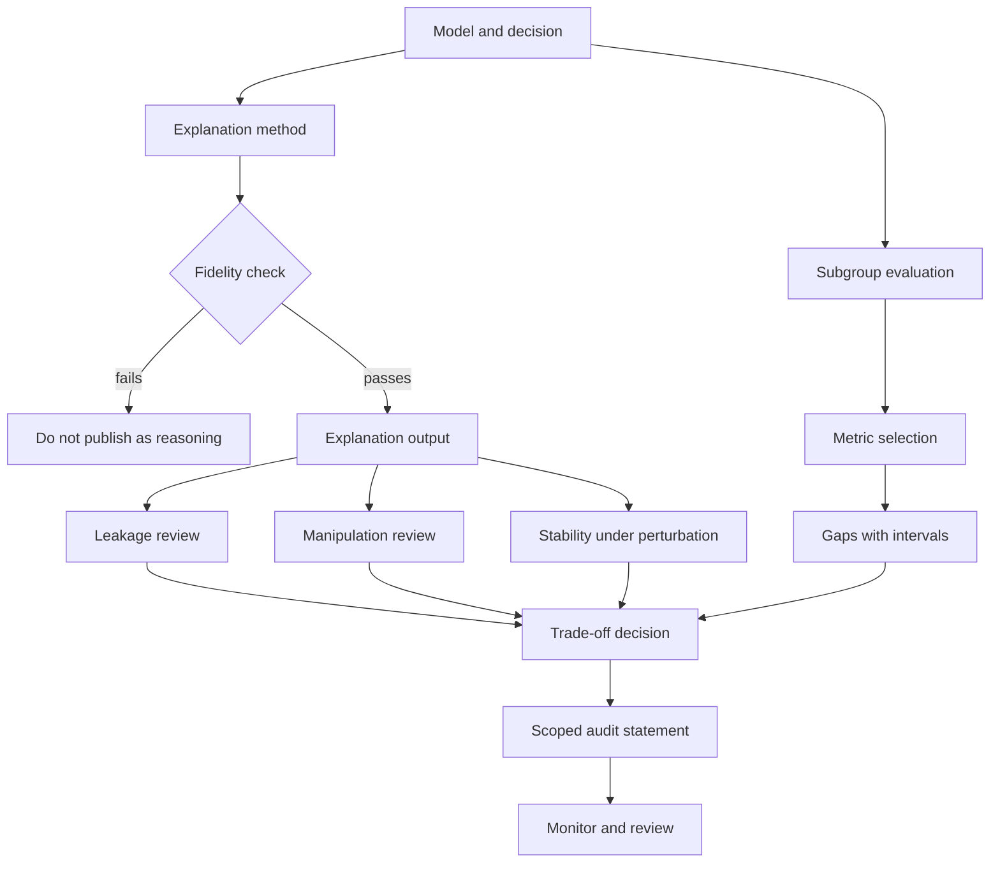

# Module 14 — Explainability, Fairness, and Security Trade-offs

**Level 4 · Advanced and emerging · 10 hours · Modules 02, 07, and 08**

## Why this module exists

An explanation is an output. It is produced by a system, consumed by a person, and trusted to describe why the system behaved as it did. That makes it a security surface as well as a usability feature. It can reveal more than intended, it can be wrong in ways that look convincing, and it can be steered by an attacker who controls the input.

Fairness has the same structure. A subgroup metric is a measurement, not a verdict. Two reasonable definitions of fairness can conflict, a small subgroup produces a wide interval, and a model that improves one gap can widen another. Deploying a model without subgroup evidence is a decision; so is deploying one with a single aggregate number that hides the subgroup.

This module treats explanations and fairness as **measurement problems with adversarial inputs**. The question is not "does the model explain itself?" but "what does this explanation support, what does it hide, and what happens to it when someone tries to break it?"

## Real-world motivation

Explanations are increasingly required. Regulatory frameworks ask for transparency about automated decisions; internal review boards ask why a denial, a flag, or a score occurred; customers ask which features drove a prediction. The demand is legitimate. The supply is often a post-hoc method that approximates a local decision boundary and is presented as if it were the model's reasoning.

Three failure modes recur:

1. **The explanation is unfaithful.** It looks plausible but does not reflect the computation. A saliency map can be visually convincing and nearly independent of the model's parameters.
2. **The explanation leaks.** Feature attributions, confidence values, and even the structure of an explanation API can reveal training data, model internals, or membership.
3. **The explanation is manipulated.** An attacker who knows the explanation method can change the input so the model's decision stays the same while the explanation points elsewhere. The person reading the explanation is now misled by a true statement about a crafted input.

Fairness adds a fourth: **the metric is gamed or misread**. A team reports demographic parity, which looks good, while equalized odds is poor; or reports a subgroup gap without an interval, which looks precise and is not.

## Measurable learning objectives

By the end of this module you will be able to:

1. **Compare** coefficient, gradient×input, occlusion, surrogate, and Shapley-style explanations by their assumptions, cost, and failure modes (Bloom 2–4).
2. **Evaluate** explanation fidelity and stability, and distinguish stability from faithfulness (Bloom 4–5).
3. **Identify** leakage and manipulation risks introduced by explanation outputs, and select controls appropriate to the exposure (Bloom 3–4).
4. **Compute and interpret** demographic parity, equalized odds, and calibration gaps with subgroup sample sizes and confidence intervals (Bloom 3–5).
5. **Assess** the trade-offs among accuracy, subgroup outcomes, explanation stability, privacy, and robustness, and report them with scope and residual risk (Bloom 5–6).

Objectives 1–3 assess LO-31; objectives 4–5 assess LO-32 and LO-28.

## Prerequisite checklist

| Skill | Check | If not |
|---|---|---|
| Train and evaluate a classifier | You can fit logistic regression and read a confusion matrix | M02 |
| Compute rates from counts | You can compute TPR and FPR by hand | M02 Lesson 2 |
| Read a confidence interval | You can say what a 95% interval does and does not mean | M01, M02 |
| Explain membership inference | You can describe why confidence outputs leak | M07 |
| Measure a perturbation effect | You can compare a metric before and after bounded noise | M04, M08 |
| Read a model card or audit | You can identify claims, evidence, and scope | M03, M10 |

### Five-minute diagnostic

1. A feature has a large coefficient in a logistic model. Does that mean it caused this prediction? Why or why not?
2. Two explanation methods disagree on the top feature for the same input. What are three possible reasons?
3. Name one way an explanation API can leak information that a prediction API does not.
4. A model has demographic parity gap 0.001 and equalized-odds gap 0.12. Can both be true? What does each measure?
5. A subgroup has 40 rows and a measured TPR gap of 0.15. Why is the number alone weak evidence?

If you can answer four or five, skim Lessons 1 and 2 and spend the time on Lessons 3–4 and LAB-18. If fewer than three, read the module in order.

## Module map

| Unit | Title | Time | What you produce |
|---|---|---:|---|
| [14.1](lesson-1-explanation-methods-and-assumptions.md) | Explanation methods and their assumptions | 1.5 h | A method-selection table with assumptions |
| [14.2](lesson-2-explanation-leakage-and-manipulation.md) | Explanation leakage and manipulation | 1.5 h | A threat model for an explanation endpoint |
| [14.3](lesson-3-fairness-metrics-and-subgroups.md) | Fairness metrics and subgroup evaluation | 1.5 h | A subgroup table with intervals |
| [14.4](lesson-4-security-trade-offs-and-audit-reporting.md) | Security trade-offs and audit reporting | 1 h | A scoped audit statement and decision record |
| [LAB-18](../../labs/lab-18.md) | Explanation stability and subgroup audit | 4 h | Baseline and reweighted comparison with stability evidence |
| [Knowledge check](quiz.md) | QZ-14, 10 items | 20 min | Score and explanations |
| [Exercises](exercises.md) | Four exercises, one audit scenario | 40 min | Portfolio evidence |

Module effort is approximate: 5.5 hours of lessons, 4 hours of lab, and 0.5 hours of quiz and exercises.

## How the pieces fit

The two review branches are not optional. An explanation that passes a fidelity check can still leak, and one that survives perturbation can still be manipulated by an attacker who optimizes against the method rather than adding noise.

## The lab at a glance

| Dimension | LAB-18 |
|---|---|
| Object | Logistic regression on 1,200 synthetic rows, six features, two groups |
| Models | Baseline versus group-reweighted |
| Main question | Do subgroup outcomes and explanation stability change when the model changes? |
| Evidence | Accuracy, subgroup TPR/FPR/selection rates, DP and EO gaps with bootstrap intervals, Spearman correlation, top-2 overlap, top-feature flip rate |
| Headline result | Equalized-odds gap falls from 0.1231 to 0.0930, accuracy falls from 0.7528 to 0.7389, stability is about 0.90 Spearman for both models |
| Negative result | The reweighting improves one gap and worsens the other; stable explanations are not shown to be faithful |

LAB-18 is deliberately small and linear so every number can be recomputed. The stability result is a property of this model, this noise level, and these 360 test rows. It is not a general claim that explanations are stable.

## Common mistakes across the module

| Mistake | Symptom | Consequence |
|---|---|---|
| Treating an explanation as the model's reasoning | A saliency map is shown to a decision-maker as fact | Unfaithful explanations are trusted |
| Choosing a method by visual appeal | The map "looks right" | Plausibility replaces fidelity |
| Reporting stability as faithfulness | Explanations barely change under noise | Stability is confused with correctness |
| Publishing explanations without a leakage review | Attributions reveal feature values or model internals | A new data-exposure channel |
| Assuming an attacker cannot target the explanation | The input is perturbed, the prediction stays | The explanation is manipulated, not the label |
| Reporting one fairness metric | DP looks good | EO or calibration gaps are hidden |
| Ignoring subgroup size | A gap is reported to four decimals | False precision from a small sample |
| Treating fairness as a property of the model alone | The same model is compared across populations | The metric depends on base rates and labels |
| Assuming fairness improves everything | Reweighting changes two gaps in opposite directions | The trade-off is not reported |
| Calling a stable model safe | Stability is measured under one noise model | Adaptive manipulation is untested |

## Troubleshooting

| Symptom | Likely cause | Fix |
|---|---|---|
| All coefficients look small | Features are on different scales | Standardize features before comparing coefficients |
| Occlusion attributions are all near zero | Baseline value is inside the data distribution | Choose a meaningful baseline and report it |
| Two methods disagree completely | One method is non-linear, or the baseline differs | Compare on the same baseline and report method assumptions |
| Stability is exactly 1.0 | The perturbation is too small to change anything | Report the noise scale and prediction-preservation rate |
| Stability is low but accuracy is fine | The model is sensitive near the decision boundary | Report flip rates conditioned on preserved predictions |
| DP gap near zero but EO gap large | Selection rates match while error rates differ | Report both, and calibration |
| Confidence interval is enormous | Small subgroup or rare outcome | Report counts, not only rates; pool or flag the group |
| Reweighting improves one gap and worsens another | The metrics conflict by construction | Report the trade-off and the chosen priority |
| Explanation API is exploited for extraction | The endpoint returns fine-grained attributions | Rate-limit, round, restrict, and log explanation calls |

## Limitations and scope

- LAB-18 uses logistic regression with six features. It compares gradient×input and occlusion only; it does not implement LIME or SHAP, and it does not test deep models.
- Stability is measured under bounded Gaussian input noise. That is not the same as an adaptive attacker who optimizes an explanation flip while holding the prediction fixed.
- The subgroup is a synthetic binary label, not a protected class. The test split has 360 rows, so the bootstrap intervals are wide and the point estimates are not precise.
- The lab reports demographic parity and equalized odds. It does not measure calibration, and it does not show that one metric is the right fairness definition for a deployment.
- The reweighted model's equalized-odds improvement comes with a small accuracy cost and a larger demographic-parity gap. The confidence intervals overlap, so this is a trade-off on one split, not a general law.
- No causal claim is supported: a coefficient or attribution describes the fitted model, not the effect of changing a real-world feature.

## Glossary

| Term | Definition |
|---|---|
| **Explanation** | An output intended to describe why a model produced a prediction |
| **Attribution** | A per-feature score assigned to an input |
| **Intrinsic explanation** | An explanation read directly from a model whose structure is interpretable |
| **Post-hoc explanation** | An explanation computed after training, often by approximating the model locally |
| **Faithfulness** | The degree to which an explanation reflects the model's actual computation |
| **Plausibility** | The degree to which an explanation looks reasonable to a person |
| **Saliency map** | A spatial attribution, often a gradient magnitude per pixel |
| **Gradient×input** | An attribution equal to the input value times the gradient at that input |
| **Occlusion** | An attribution computed by replacing a feature and measuring the output change |
| **Surrogate model** | A simple model fitted locally to approximate a complex model |
| **LIME** | Local Interpretable Model-agnostic Explanations; a surrogate-based method |
| **SHAP** | Shapley Additive exPlanations; an attribution method based on cooperative game theory |
| **Shapley value** | A fair division of a payoff among players under stated axioms |
| **Sanity check** | A test that an explanation changes when the model's parameters are randomized |
| **Explanation stability** | How much an explanation changes under a small input perturbation |
| **Explanation manipulation** | Crafting an input so the explanation misleads while the prediction is unchanged |
| **Model inversion** | Reconstructing representative training inputs from model outputs |
| **Membership inference** | Deciding whether a specific record was in the training set |
| **Demographic parity** | Equal selection rates across groups |
| **Equal opportunity** | Equal true-positive rates across groups |
| **Equalized odds** | Equal true-positive and false-positive rates across groups |
| **Calibration** | The degree to which predicted probabilities match observed frequencies |
| **Base rate** | The prevalence of the positive outcome in a group |
| **Subgroup** | A defined portion of the population, such as a demographic group |
| **Bootstrap interval** | A confidence interval produced by resampling the data |
| **Reweighting** | Training with per-example weights to change group influence |
| **Disparate impact** | A selection-rate disparity, often expressed as a ratio |
| **Fairness impossibility** | The result that some fairness definitions cannot all hold when base rates differ |
| **Residual risk** | Risk remaining after controls, including untested attack classes |
| **Scoped assurance** | A claim limited to a stated object, population, method, and evidence |

## Summary and key takeaways

- An explanation is an output with security properties. It can be unfaithful, leak information, or be manipulated.
- Coefficients, gradient×input, occlusion, surrogates, and Shapley-style methods answer different questions under different assumptions. None is the model's reasoning.
- Fidelity and plausibility are different. A convincing explanation can be nearly independent of the model.
- Stability is measurable and useful: LAB-18 finds Spearman about 0.90 and top-feature flip rates of 13.9–15% under Gaussian noise at sigma 0.25. Stability is not faithfulness, fairness, or security.
- Explanations add an output channel. Treat the endpoint as a data-exposure surface and review what it reveals.
- Fairness metrics conflict. LAB-18's reweighting lowers the equalized-odds gap from 0.1231 to 0.0930 while raising the demographic-parity gap from 0.0013 to 0.0125 and lowering accuracy from 0.7528 to 0.7389.
- Subgroup rates need counts and intervals. A gap to four decimals from a small group is false precision.
- Audit statements must name the model, population, metrics, intervals, and what remains untested.

## References and further reading

All links checked on 2026-10-28.

| Reference | Use |
|---|---|
| [Ribeiro, Singh & Guestrin, "Why Should I Trust You?" (KDD 2016)](https://doi.org/10.1145/2939672.2939778) | LIME and local surrogates |
| [Lundberg & Lee, "A Unified Approach to Interpreting Model Predictions" (NeurIPS 2017)](https://arxiv.org/abs/1705.07874) | SHAP and Shapley attributions |
| [Sundararajan, Taly & Yan, "Axiomatic Attribution for Deep Networks" (ICML 2017)](https://arxiv.org/abs/1703.01365) | Integrated gradients and axioms |
| [Adebayo et al., "Sanity Checks for Saliency Maps" (NeurIPS 2018)](https://arxiv.org/abs/1810.03292) | Model-randomization sanity checks |
| [Kindermans et al., "The (Un)reliability of Saliency Methods" (2017)](https://arxiv.org/abs/1711.00867) | Unreliability of common saliency methods |
| [Slack et al., "Fooling LIME and SHAP" (AIES 2020)](https://doi.org/10.1145/3375627.3375830) | Adversarial manipulation of post-hoc explanations |
| [Dombrowski et al., "Explanations can be Manipulated and Geometry is to Blame" (NeurIPS 2019)](https://arxiv.org/abs/1906.07983) | Manipulation of gradient-based explanations |
| [Fredrikson, Jha & Ristenpart, "Model Inversion Attacks" (CCS 2015)](https://doi.org/10.1145/2810103.2813677) | Reconstructing training inputs from outputs |
| [Shokri et al., "Membership Inference Attacks Against Machine Learning Models" (S&P 2017)](https://doi.org/10.1109/SP.2017.41) | Membership leakage from model outputs |
| [Hardt, Price & Srebro, "Equality of Opportunity in Supervised Learning" (NeurIPS 2016)](https://arxiv.org/abs/1610.02413) | Equalized odds and equal opportunity |
| [Chouldechova, "Fair Prediction with Disparate Impact" (2017)](https://doi.org/10.1089/big.2016.0047) | Incompatibility of fairness criteria under unequal base rates |
| [Kleinberg, Mullainathan & Raghavan, "Inherent Trade-Offs in the Fair Determination of Risk Scores" (2016)](https://arxiv.org/abs/1609.05807) | Impossibility results for calibration and balance |
| [Barocas, Hardt & Narayanan, *Fairness and Machine Learning*](https://fairmlbook.org/) | Fairness definitions and practice |
| [NIST AI Risk Management Framework](https://doi.org/10.6028/NIST.AI.100-1) | Risk framing for transparency and fairness |

Read the sanity-check and explanation-manipulation papers before LAB-18. Read Chouldechova and Kleinberg et al. before Lesson 3; the metrics in LAB-18 are easier to interpret once the trade-off is understood as structural, not a bug.

## Next step

Start with [Lesson 14.1 — Explanation methods and their assumptions](lesson-1-explanation-methods-and-assumptions.md).
