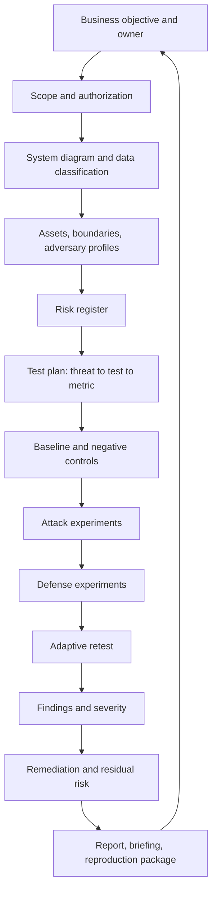

# Module 16 — End-to-End ML Security Assessment

**Level 5 · Applied ML security projects · 16 hours · Modules 02, 03, and 11, plus one attack and one defense lab**

## Why this module exists

Every previous module asked a bounded question. Can this input be perturbed? Does this poison rate move a decision? Does this defense survive an adaptive attack? Does this API leak membership? Those questions are necessary, and none of them is an assessment.

An assessment starts with a system, a business objective, and an owner who will act on the result. It ends with prioritized findings that are reproducible, severity-rated, mapped to controls, and honest about what was not tested. Between those points sits a chain that is easy to break: scope that silently expands, a threat model disconnected from the tests, a baseline measured on the wrong split, a metric without a denominator, a finding that cannot be reproduced, or a recommendation that costs more than the risk it removes.

This module teaches that chain. You will not learn a new attack family. You will learn to integrate the attacks and defenses you already have into one defensible assessment of a complete system, and to write the artifact a security review, an audit, or a thesis committee can actually evaluate.

## Real-world motivation

An ML system in production is not a model file. It is a data supply chain, a training pipeline, an artifact registry, a serving API, a monitoring stack, an on-call rotation, and a set of business decisions that depend on predictions. Each part has an owner and a trust boundary. Each can fail for security reasons that have nothing to do with the model's accuracy.

Assessment work fails in predictable ways:

- **Scope drift.** A review of a fraud model becomes a review of the whole bank, then stalls.
- **Threat model theater.** A long list of techniques is produced, but no test can fail because of it.
- **Baseline neglect.** Attack results are compared with a number from a different split, threshold, or model version.
- **Metric inflation.** "Attack success" is reported without a base set, a budget, or a false-positive cost.
- **Unreproducible findings.** The result depends on an unrecorded seed, a locally modified dataset, or a manual step.
- **Severity by vibes.** A theoretical attack is rated critical while a working data-quality defect is rated low.
- **Recommendation sprawl.** Fifty controls are proposed, none costed, none owned, none tested.

The discipline that prevents these failures is not exotic. It is scoping, traceability, measurement, and review. This module makes that discipline explicit and gives you a project in which to practice it.

## Measurable learning objectives

By the end of this module you will be able to:

1. **Scope** an ML security assessment: document the system, business objectives, data classification, assets, trust boundaries, authorization, and explicit non-goals (Bloom 3–4).
2. **Convert** a threat model into a prioritized test plan in which every test names its threat, budget, oracle, metric, and evidence (Bloom 4–5).
3. **Establish** reproducible baselines and controls, including negative and zero-effect tests, before running attack or defense experiments (Bloom 3–5).
4. **Produce** findings with calibrated severity, evidence links, mapped controls, residual risk, and a costed remediation sequence (Bloom 5–6).
5. **Communicate** the assessment in a technical report and a short briefing without overclaiming coverage (Bloom 5–6).

Objectives 1–2 and 5 assess LO-33; objective 3 supports LO-28; objective 4 supports LO-30.

## Prerequisite checklist

| Skill | Check | If not |
|---|---|---|
| Threat modeling | You can produce assets, boundaries, adversary profiles, and a scored register | M03 |
| Evaluation | You can state a baseline, denominator, threshold, and confidence interval | M02, LAB-01B |
| One attack family | You have run at least one attack with a stated budget and metric | M04–M07 |
| One defense evaluation | You have tested a defense against a static and an adaptive attempt | M08, LAB-11 |
| Serving or pipeline security | You can explain authentication, validation, artifact integrity, and monitoring | M10–M11 |
| Evidence hygiene | You can reproduce a result from a clean environment using a manifest | LAB-01 |

### Five-minute diagnostic

1. A stakeholder asks you to "check whether the fraud model is secure." Name three questions you must answer before agreeing to a scope.
2. Why is "we ran PGD and it failed" not a finding?
3. What is the difference between a threat-model entry and a test case?
4. A model's fraud recall is 0.81 in the assessment and 0.74 in production. Name two explanations that are not attacks.
5. Why should a severity rating include the cost of the control, not only the impact of the attack?

If you can answer four or five, skim Lessons 1 and 3 and focus on Lesson 2, Lesson 4, and the project. If fewer than three, read in order.

## Module map

| Unit | Title | Time | What you produce |
|---|---|---:|---|
| [16.1](lesson-1-scoping-and-system-documentation.md) | Scoping and system documentation | 1 h | A one-page scope, system diagram, asset and data inventory |
| [16.2](lesson-2-threat-model-to-test-plan.md) | From threat model to test plan | 1 h | A traceable test matrix with budgets, oracles, and stop conditions |
| [16.3](lesson-3-measurement-baselines-and-evidence.md) | Measurement, baselines, and evidence | 1 h | A baseline and evidence plan with negative controls |
| [16.4](lesson-4-findings-severity-and-remediation.md) | Findings, severity, remediation, and reporting | 1 h | A finding template and a costed remediation sequence |
| [Projects](../../projects/index.md) | One of PRJ-01 to PRJ-06 | 11 h | A complete integrated assessment artifact |
| [Knowledge check](quiz.md) | QZ-16, 10 items | 20 min | Score and explanations |
| [Exercises](exercises.md) | Four exercises, one assessment scenario | 40 min | Portfolio evidence |

Module effort is approximate: 4 hours of lessons, 11 hours of project work, and 1 hour of quiz and exercises.

## How the pieces fit

Four properties of this flow matter:

- **The business objective constrains the scope.** A model that ranks collections calls has a different risk appetite from one that blocks payments.
- **Every test traces to a register entry.** If a test cannot fail, it is not evidence; if a register entry has no test, it is an assumption.
- **Baselines precede attacks.** Otherwise you cannot distinguish an attack effect from a split, threshold, or version difference.
- **Remediation returns to the owner.** A finding without an owner, a cost, and a retest is advice, not an assessment.

## The six project options

You complete **one** project from the catalog. Each is a full assessment scenario with a fictional organization, a system, data classification, a threat model, staged tasks, required experiments, defensive measures, deliverables, and a rubric.

| ID | Organization and system | Core question | Reuses |
|---|---|---|---|
| [PRJ-01](../../projects/prj-01-fraud-detection.md) | Meridian Pay — card-not-present fraud scoring | Can data-quality faults and bounded feature changes move fraud decisions without breaking the dashboard? | LAB-03, LAB-05, LAB-12 |
| [PRJ-02](../../projects/prj-02-image-poisoning.md) | Aster Manufacturing — visual defect classification | Can a small poisoned or backdoored fraction survive a realistic data pipeline and a screening defense? | LAB-05, LAB-06, LAB-07, LAB-08 |
| [PRJ-03](../../projects/prj-03-prediction-api-privacy.md) | Helio Health — benefits triage API | What does the prediction interface leak under a fixed query budget, and what does output minimization cost? | LAB-09, LAB-10, LAB-17 |
| [PRJ-04](../../projects/prj-04-secure-pipeline.md) | Cobalt Models — training and artifact pipeline | Do validation, dependency, signing, and reproducibility controls actually fail closed? | LAB-12, LAB-13 |
| [PRJ-05](../../projects/prj-05-rag-agent.md) | Harbor — policy assistant with retrieval and tools | Does the application treat untrusted documents as data, and does the agent enforce authority in code? | LAB-19, LAB-20 |
| [PRJ-06](../../projects/prj-06-robustness-comparison.md) | Sentinel Vision — access-badge classifier | Which defense gives the best robustness per unit of clean accuracy, false positives, and runtime? | LAB-03, LAB-11 |

Every project is local and synthetic. None requires a GPU, a paid service, an API key, or a third-party target. The projects are scoped so the required experiments fit in 11 hours of project work after the lessons.

## The assessment workflow in one page

| Stage | Question | Evidence produced |
|---|---|---|
| 0. Authorize and scope | What system, whose decision, what is out of scope, who may test what? | Signed scope and authorized-use statement |
| 1. Document | How does the system work and where does data cross trust boundaries? | System diagram, data classification, asset inventory |
| 2. Model threats | Who would attack this, with what access, and what would they gain? | Adversary profiles, risk register, assumptions |
| 3. Plan tests | Which test would change our belief about each top risk? | Test matrix with budgets, oracles, metrics, stop conditions |
| 4. Measure | What is the baseline, and what is noise? | Baseline table, negative controls, environment record |
| 5. Attack and defend | What happens under bounded attack, and what does the control cost? | Experiment tables, adaptive retest, false positives |
| 6. Report | What should the owner do, in what order, and what remains? | Findings, severity, costed remediation, residual risk, briefing |

If a stage has no artifact, the assessment is incomplete regardless of how many experiments ran.

## Worked example — a compact assessment thread

!!! note "Illustrative, not measured"
    The numbers below are constructed to show the reasoning chain. They are not experimental results and must not be cited as evidence. Your project produces its own numbers.

**System.** Meridian Pay's `RiskGate` scores card-not-present transactions from 0 to 100 and blocks above 70. The business objective is to reduce fraud losses without increasing false declines above 2%.

**Scope.** One model version, one feature set, the batch scoring path, and the reviewer queue. Out of scope: the mobile app, the card network, and the merchant onboarding process.

**Top risk.** The register ranks "training data contains duplicated disputed transactions, inflating recall" above "attacker perturbs transaction amount." The first is a data-integrity risk with a plausible owner; the second requires an attacker who can choose feature values inside realistic bounds.

**Test plan.** T-01 removes near-duplicate transactions and recomputes recall. T-02 perturbs amount, hour, and velocity at three budgets and reports block-rate change at a fixed false-decline rate. Each test names its oracle: the same temporal holdout and the same threshold.

**Baseline.** On the frozen holdout, the model achieves recall 0.62 at a 2% false-decline rate. After deduplication, recall is 0.55 with a confidence interval that overlaps the baseline. The honest finding is that the original number was optimistic, not that the model was attacked.

**Attack finding.** Raising three features by one realistic step increases the block rate for the targeted merchant segment from 0.18 to 0.31 while the global block rate moves by 0.4 percentage points. The global dashboard would not flag it. Severity is driven by the segment's loss exposure and the absence of a segment-level monitor, not by the size of the global change.

**Remediation.** Add segment-level monitoring, cap velocity at the feature store, retrain with bounded perturbations, and add a duplicate check to the training gate. Each item has an owner, an estimated effort, and a retest. The residual risk is an adaptive attacker who stays inside the caps and spreads attempts across merchants.

The example shows the assessment's unit of work: a traceable chain from a business objective to a control and a retest. The attack is one link, not the whole product.

## Common mistakes across the module

| Mistake | Symptom | Consequence |
|---|---|---|
| Scoping by technique | "We will test evasion, poisoning, and extraction" | No system boundary, no owner, no decision |
| Copying a threat-model template | Twenty threats, none tied to this architecture | Tests cannot be prioritized |
| Testing without a baseline | Attack effect compared with a remembered number | Effect may be split or version noise |
| One seed, one split | A clean story with no uncertainty | Result may not reproduce |
| Attack success without a denominator | "The attack works" | No severity, no comparison |
| Defense tested only statically | A control that passes one script | False assurance |
| Severity without exposure | Every finding is high | Owner ignores the report |
| Recommendation without cost | A 40-item control list | Nothing is implemented |
| Report without reproduction | Screenshots and prose | Auditor cannot verify |
| Claiming coverage from a test set | "We tested injection" | Adaptive and untested variants remain |

## Troubleshooting

| Symptom | Likely cause | Fix |
|---|---|---|
| Scope keeps growing | No explicit non-goals | Write the out-of-scope list and get it acknowledged |
| Threat model is a technique list | Starting from attacks instead of assets | Rebuild from business decisions and data flows |
| Test plan is not executable | No oracle, budget, or stop condition | Add them; delete tests that cannot fail |
| Baseline differs from the lab | Different split, threshold, or seed | Freeze the protocol before experiments |
| Attack effect disappears on rerun | Unseeded sampling or threshold drift | Seed, version, and save the exact evaluation set |
| Defense looks perfect | Static attack only, or broken evaluation | Attempt an adaptive attack and check false positives |
| Findings are contested | Severity not tied to exposure and control cost | Use a stated severity rubric and show the inputs |
| Report is unreadable | Written for the model owner only | Add an executive summary with decisions and owners |
| Auditor cannot reproduce | Manual steps, missing manifest | Script the run and hash every artifact |
| Project overruns | Too many attack families | Cut to the two that address the top risks |

## Limitations and scope

- The projects use synthetic or bundled data. Results demonstrate assessment method, not the behavior of any production system.
- Each project covers a bounded set of attacks and controls. An adaptive attacker, a different deployment, or a different population can change the result.
- Severity scoring in the projects uses a simplified rubric. Real organizations add regulatory, contractual, safety, and reputational factors that the course does not quantify.
- Cost estimates are effort ranges, not budgets. They are included to force prioritization, not to model procurement.
- The projects reuse course labs. Reuse reduces setup time but also narrows the attack surface to what those labs implement.
- No project authorizes testing a third-party system, a real model endpoint, or real personal data.

## Glossary

| Term | Definition |
|---|---|
| **Assessment** | A structured evaluation of a system against a stated threat model, ending in findings and recommendations |
| **Scope** | The system, versions, environments, and activities included in an assessment, plus explicit exclusions |
| **Rules of engagement** | Written authorization, constraints, contacts, and stop conditions for testing |
| **Asset** | Something of value to the organization: data, model, service, decision, reputation, or availability |
| **Data classification** | A label such as public, internal, confidential, or restricted that determines handling controls |
| **Trust boundary** | A point where data or control crosses between components with different trust levels |
| **Threat model** | A structured description of assets, adversaries, capabilities, and attack paths |
| **Risk register** | A prioritized list of risks with likelihood, impact, owner, and treatment |
| **Test oracle** | The rule that decides whether a test passed or failed |
| **Baseline** | The reference measurement against which an attack or defense effect is compared |
| **Negative control** | A test expected to show no effect, used to detect measurement error |
| **Budget** | A constraint on the adversary or test, such as perturbation size, queries, or time |
| **Attack success rate** | The fraction of a defined base set on which an attack achieves its goal |
| **False positive** | A benign case incorrectly flagged by a control or detector |
| **Finding** | A documented security issue with evidence, impact, severity, and recommendation |
| **Severity** | A rating combining impact, likelihood, exposure, and existing controls |
| **Remediation** | A change that reduces a risk, with an owner, cost, and retest |
| **Residual risk** | Risk that remains after controls, including untested attack classes |
| **Coverage** | The portion of the threat model that a test or control actually addresses |
| **Adaptive attack** | An attack designed with knowledge of the defense |
| **Evidence manifest** | A record of artifacts and their hashes that supports reproducibility |
| **Reproduction package** | Code, data references, environment, seeds, and commands needed to recreate results |
| **Executive summary** | A short decision-oriented account of scope, findings, and recommended actions |
| **Technical report** | The detailed account of method, evidence, and limitations |
| **Briefing** | A short oral or recorded presentation of the assessment |
| **Assumption** | A statement accepted without proof that, if false, changes the conclusion |
| **Out of scope** | A system, attack, or environment deliberately excluded from the assessment |
| **Stop condition** | A predefined event that ends a test for safety, ethics, or resource reasons |
| **Traceability** | The ability to link a finding back to a threat, test, and piece of evidence |
| **Owner** | The person accountable for accepting or remediating a risk |

## Summary and key takeaways

- An assessment is a chain from a business objective to a prioritized, reproducible, costed recommendation. A technique is one link.
- Scope and authorization come first. Explicit non-goals prevent drift and protect the tester.
- A threat model becomes useful only when each top entry maps to a test that could fail and a control that could change the outcome.
- Baselines, negative controls, fixed splits, seeds, and saved evaluation sets are what make an attack effect interpretable.
- Report attack success with its base set, budget, denominator, and false-positive cost. Global metrics can hide segment-level harm.
- Severity combines impact, likelihood, exposure, and existing controls. Control cost belongs in prioritization.
- A finding without an owner, a retest, and a residual-risk statement is not finished.
- Every project is a local, synthetic assessment. It demonstrates method, not production security.

## References and further reading

All links checked on 2026-10-28.

| Reference | Use |
|---|---|
| [NIST SP 800-115, *Technical Guide to Information Security Testing and Assessment*](https://csrc.nist.gov/pubs/sp/800/115/final) | Test planning, execution, and reporting discipline |
| [NIST AI 100-2e2025](https://doi.org/10.6028/NIST.AI.100-2e2025) | Adversarial ML vocabulary and attack classes |
| [NIST AI Risk Management Framework 1.0](https://doi.org/10.6028/NIST.AI.100-1) | GOVERN, MAP, MEASURE, and MANAGE structure |
| [MITRE ATLAS](https://atlas.mitre.org/) | Technique mapping and case studies |
| [OWASP Web Security Testing Guide](https://owasp.org/www-project-web-security-testing-guide/) | Test-case structure and evidence practice for application surfaces |
| [ISO/IEC 42001:2023](https://www.iso.org/standard/81230.html) | Management-system context for assessment evidence |
| [NIST SP 800-61r3](https://csrc.nist.gov/pubs/sp/800/61/r3/final) | Incident-response interfaces when an assessment finds an active issue |
| [Pineau et al., *Improving Reproducibility in Machine Learning Research* (2020)](https://arxiv.org/abs/2003.12206) | Reproducibility checklist and reporting |
| [Kapoor & Narayanan, *Leakage and the Reproducibility Crisis in ML-based Science* (2022)](https://arxiv.org/abs/2207.07048) | How leakage and unreported choices inflate results |
| [Sculley et al., *Hidden Technical Debt in Machine Learning Systems* (2015)](https://papers.nips.cc/paper/5656-hidden-technical-debt-in-machine-learning-systems) | Why the system, not the model, is the assessment unit |

Read the NIST SP 800-115 planning and reporting chapters before Lesson 2. Read Kapoor and Narayanan before you write your limitations section; it is the clearest account of how credible-looking ML results fail to reproduce.

## Next step

Start with [Lesson 16.1 — Scoping and system documentation](lesson-1-scoping-and-system-documentation.md), then choose a project from the [project catalog](../../projects/index.md) before Lesson 16.2 so the test plan has a real system.
