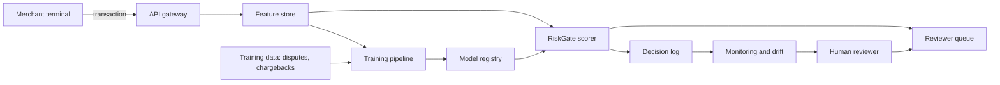

# Lesson 16.1 — Scoping and System Documentation

<a id="m16-l1"></a>

**Module 16 · Lesson 1 of 4 · 1 hour · LO-33**

## Scenario

A risk committee asks for "an independent review of the fraud model." The data science team sends a notebook, a metrics slide, and a model card. The security team starts testing evasion. Three weeks later, the committee asks why the review says nothing about the duplicate disputed transactions that the audit team found in the training data, or about the vendor feature that stopped updating in March.

The review was not wrong about evasion. It was answering a question nobody had agreed to. The scope was a model file; the risk lived in the system around it.

## Objectives

By the end of this lesson you will be able to:

1. Write a scope statement that names the system, versions, environments, decisions, and explicit non-goals.
2. Produce a system diagram that shows data, model, artifact, serving, monitoring, and human decision points.
3. Classify data and inventory assets with owners and impact if lost or corrupted.
4. State authorization, constraints, contacts, and stop conditions before any test.
5. Identify the business decision that the assessment must inform.

## 1. Start from the decision, not the model

An assessment exists to change or support a decision. That decision might be:

- approve a model for production;
- accept a vendor model into the registry;
- renew a contract with an ML vendor;
- certify a control for an audit;
- decide whether an incident requires disclosure;
- choose between two defense investments.

The decision determines the evidence. A production-approval decision needs residual risk and control evidence. A vendor decision needs provenance, licensing, and supply-chain evidence. An incident decision needs timeline, scope, and containment evidence.

Write the decision at the top of the scope:

```text
Decision: Approve RiskGate v4.2 for production at Meridian Pay.
Decision owner: Head of Financial Crime Operations.
Decision date: 2026-11-15.
Evidence needed: threat model, baseline, attack results at stated budgets,
control effectiveness, residual risk, and a remediation owner.
```

If no one can name the decision and the owner, the assessment is exploratory. That is allowed, but label it. Exploratory work has a different stopping rule and should not be presented as an approval.

## 2. The scope statement

A usable scope has eight fields.

| Field | Question | Example |
|---|---|---|
| System | What exactly is being assessed? | RiskGate v4.2 scoring service and its training pipeline |
| Components | Which data, model, artifact, serving, and monitoring parts are included? | Feature store snapshot, model artifact, batch scorer, reviewer queue |
| Versions | Which model, dataset, code, and dependency versions? | Model 4.2.1, dataset `txn-2026-09`, commit `a1b2c3d` |
| Environment | Where will testing occur? | Local replica on loopback with synthetic data |
| Decisions | What decision does this inform? | Production approval |
| Non-goals | What is explicitly excluded? | Mobile app, card network, merchant onboarding, real cardholder data |
| Constraints | What may not be done? | No production traffic, no real personal data, no destructive actions |
| Authority | Who authorized the work, and under what policy? | CISO memo, engagement letter, course authorized-use statement |

The non-goals are not an apology. They are a control against scope drift and a protection for the tester. "Out of scope: production credentials, real cardholder data, and the issuer's authorization network" tells a reader exactly where the assessment stops.

### Scope creep in practice

Scope creep rarely arrives as a request to expand. It arrives as small, reasonable additions:

- "While you are in there, can you check the mobile SDK?"
- "The vendor says their model is certified; can you confirm?"
- "Can you also test the old model that is still running for one merchant?"

Handle each with the same response: record it as a change request, state the additional evidence and time, and let the decision owner accept or defer it. Do not silently expand and do not silently ignore.

## 3. The system diagram

Draw the system at the level of trust boundaries, not at the level of classes. A useful diagram shows:

- external actors and their authority;
- data sources and how data enters;
- the training pipeline and artifact registry;
- the serving path and its callers;
- monitoring, logging, and human review;
- every place data crosses a boundary.



Annotate each arrow with the data classification and the control at the boundary. For example, the arrow from the merchant terminal carries internal transaction data and is authenticated at the gateway; the arrow from the reviewer queue carries restricted case notes and is authorized by role.

### Diagram review questions

1. Which component makes the decision that affects a person?
2. Where can an attacker influence data that later trains or configures the model?
3. Where does a human override the model, and is that override logged?
4. Which component holds credentials or keys?
5. Which path has no monitoring?
6. What happens if each arrow is delayed, replayed, or forged?

If the diagram cannot answer these, it is a block diagram, not a security diagram.

## 4. Data classification and asset inventory

Classify data by the harm that follows disclosure, modification, or loss. Use the organization's scheme if one exists; otherwise use four levels.

| Level | Meaning | Examples in this system | Minimum handling |
|---|---|---|---|
| Public | Safe to disclose | Published fee schedule | Integrity only |
| Internal | Not public; low harm | Aggregated merchant volume | Access control, retention |
| Confidential | Business or personal harm | Transaction features, model weights, thresholds | Encryption, least privilege, audit |
| Restricted | Severe harm or regulated | Case notes, suspected-fraud narratives, credentials | Strict need-to-know, enhanced logging, no local copies |

Then inventory the assets. An asset is not only data.

| Asset | Type | Owner | Harm if compromised | Classification |
|---|---|---|---|---|
| Transaction feature snapshot | Data | Data platform lead | Fraud loss, privacy harm | Confidential |
| RiskGate model artifact | Model | ML lead | Evasion, IP loss, silent behavior change | Confidential |
| Training labels (chargebacks) | Data | Financial crime ops | Poisoned decision boundary | Confidential |
| Decision thresholds | Configuration | Risk owner | Mass false declines or missed fraud | Confidential |
| Reviewer queue | Workflow | Operations manager | Queue manipulation, insider abuse | Restricted |
| Decision log | Evidence | Security operations | Lost audit trail, detection blind spot | Confidential |
| Signing key | Secret | Platform security | Forged model promotion | Restricted |
| Vendor feature feed | Third-party data | Vendor manager | Stale or manipulated features | Confidential |

The owner column matters. A risk with no owner is a risk nobody has accepted.

## 5. Authorization and rules of engagement

Before the first test, record:

- **Who authorized the work**, in what role, and with what scope.
- **What is permitted**: local replica, synthetic data, loopback only, bounded request counts.
- **What is forbidden**: production traffic, real personal data, destructive actions, third-party systems, social engineering.
- **Contacts**: technical owner, security owner, and an escalation contact.
- **Stop conditions**: unexpected access to real data, service instability, a finding that suggests active compromise, or exceeding the time box.
- **Evidence handling**: where artifacts are stored, who can access them, and when they are deleted.

For this course, the authorization is narrow by design. Every project uses local mock systems, synthetic or bundled data, and harmless tools. The authorized-use statement in the [student guide](../../student-guide.md#safety) is the baseline; the project brief adds project-specific constraints.

## 6. Worked example — scoping Meridian Pay

**Decision.** Approve `RiskGate v4.2` for production, owned by the Head of Financial Crime Operations.

**In scope.** The batch scorer, the feature snapshot used in training, the model artifact, the reviewer queue handoff, and the decision log. Version 4.2.1 and dataset `txn-2026-09`.

**Out of scope.** The mobile app, the card network, merchant onboarding, real cardholder data, and the issuer's fraud consortium feed.

**Assets.** Transaction features (confidential), model artifact (confidential), chargeback labels (confidential), thresholds (confidential), reviewer notes (restricted), decision log (confidential), signing key (restricted).

**Top decision-relevant questions.**

1. Does the reported recall survive deduplication and a temporal split?
2. Can a merchant shift decisions by changing only features it controls, within realistic bounds?
3. Are segment-level changes visible in monitoring?
4. Does the reviewer queue preserve the model's decision and the override reason?

Each question becomes a test in Lesson 16.2. The scope is now small enough to finish and large enough to matter.

## 7. Common mistakes

| Mistake | Consequence | Fix |
|---|---|---|
| Scoping the model file only | Pipeline and serving risks are missed | Scope the decision and its data flows |
| No versions | Results cannot be reproduced or compared | Pin model, data, code, and dependencies |
| Vague non-goals | Scope expands silently | List excluded systems and data explicitly |
| No decision owner | Findings have no audience | Name the decision and the accountable role |
| Data classified by guess | Controls are misapplied | Use the organization's scheme and the owner's input |
| Asset list contains only data | Keys, thresholds, and logs are ignored | Inventory data, models, configuration, secrets, and evidence |
| Authorization assumed | Legal and ethical exposure | Record written authorization and constraints |
| No stop conditions | Test continues after an incident signal | Define stop conditions before testing |

## 8. Check your understanding

1. Why does the decision, not the model, determine the evidence?
2. Name four fields of a scope statement and give an example of each.
3. What is the difference between an out-of-scope item and an assumption?
4. Why is a decision threshold an asset?
5. Which diagram question is most likely to reveal a training-time attack path?
6. What should you do when a stakeholder adds a "small" request mid-assessment?

## 9. What you keep

A one-page scope statement, a system diagram with classified data flows, an asset inventory with owners, and a signed rules-of-engagement record. These become the first section of your project report.

## 10. Next

Lesson 16.2 turns the scope and assets into a threat model and a test plan in which every test can fail.
