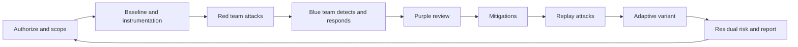

# Module 17 — ML Red-Team and Blue-Team Simulation

**Level 5 · Applied ML security projects · 14 hours · Modules 03, 11, and 16, plus one attack and one detection lab**

## Why this module exists

An assessment produces findings. A red-team exercise produces a contest. The difference is not aggression; it is feedback. In a red-team/blue-team simulation, one group tries to achieve an objective against a bounded system while another group tries to detect, contain, and recover. Both groups learn from the same timeline, and the organization learns whether its controls work when someone is actively trying to defeat them.

ML systems complicate the exercise because the "system" includes data, models, thresholds, and human review. A red team can attack the model, the data pipeline, the API, the monitoring, or the people. A blue team can monitor requests, predictions, data quality, artifacts, and reviewer behavior. A useful simulation picks a small number of paths, instruments them, and measures detection and response rather than only success or failure.

This module prepares you to run that exercise safely and to evaluate it honestly. The practical work is [RT-01](../../projects/rt-01-red-blue.md), a bounded exercise against a local mock scoring service built from the course labs.

## Real-world motivation

Red-team exercises fail in familiar ways:

- **No rules of engagement.** Testers improvise, exceed scope, or touch data they should not.
- **Attack-only reporting.** The red team lists successes, but nobody measures whether the blue team saw them.
- **Detection theater.** A detector is written after the attack and tuned on the same events, producing an impressive retrospective result.
- **No baseline traffic.** False positives are unknown, so a detector that fires on everything looks effective.
- **No containment test.** The playbook says "isolate the service," but nobody has tried it.
- **No adaptive retest.** A control blocks the scripted attack, and the exercise ends before anyone tries a variant.
- **No safe stop.** A test causes instability, and the team keeps going because the plan has no stop condition.

A simulation is a measurement instrument. It needs a protocol, a baseline, and a referee.

## Measurable learning objectives

By the end of this module you will be able to:

1. **Write** rules of engagement for a bounded ML red-team exercise, including authorization, scope, constraints, contacts, and stop conditions (Bloom 3–4).
2. **Plan and execute** a red-team sequence against a local mock system with explicit budgets and evidence capture (Bloom 3–5).
3. **Design and calibrate** blue-team detections using quiet baseline traffic, then measure detection, false positives, and time to respond (Bloom 5–6).
4. **Evaluate** mitigations by rerunning the same attacks and attempting an adaptive variant, reporting residual risk (Bloom 5–6).
5. **Synthesize** red and blue evidence into a purple-team report with severity, timeline, and recommendations (Bloom 5–6).

Objectives 1–2 assess LO-34; objective 3 supports LO-23; objectives 4–5 support LO-28 and LO-29.

## Prerequisite checklist

| Skill | Check | If not |
|---|---|---|
| Threat modeling | You can write adversary profiles and a risk register | M03, M16 |
| Evasion and extraction | You have run a bounded attack on a local model or API | M04, M07 |
| Serving controls | You can explain authentication, quotas, validation, and safe errors | M11, LAB-14 |
| Detection and response | You have calibrated a detector and tested a rollback | M11, LAB-15 |
| Evidence discipline | You can freeze a baseline and record a run | M16, LAB-01 |
| Safety rules | You can state what you are authorized to test | M00, student guide |

### Five-minute diagnostic

1. Why does a red-team exercise need a written scope even when the target is a local mock?
2. What is the difference between "the attack succeeded" and "the organization detected and contained it"?
3. Why is a detector tuned on the attack traffic not evidence of detection quality?
4. What is a stop condition, and name two for a local API exercise.
5. Why should the blue team see the attack log only after its baseline is measured?
6. What does an adaptive retest add that a fixed attack suite does not?

If you can answer four or five, skim Lessons 1 and 2 and focus on Lessons 3–4 and RT-01. If fewer than three, read in order.

## Module map

| Unit | Title | Time | What you produce |
|---|---|---:|---|
| [17.1](lesson-1-rules-of-engagement-and-threat-model.md) | Rules of engagement and the exercise threat model | 1 h | Signed RoE, scope, adversary profiles, stop conditions |
| [17.2](lesson-2-red-team-planning-and-execution.md) | Red-team planning and execution | 1 h | Attack sequence with budgets and evidence log |
| [17.3](lesson-3-blue-team-detection-and-response.md) | Blue-team detection and response | 1 h | Detection hypotheses, calibrated thresholds, response timeline |
| [17.4](lesson-4-purple-team-synthesis-and-adaptation.md) | Purple-team synthesis and adaptation | 1 h | Before/after table, adaptive retest, residual-risk report |
| [RT-01](../../projects/rt-01-red-blue.md) | Bounded red/blue exercise on a local mock service | 9 h | Full exercise package and report |
| [Knowledge check](quiz.md) | QZ-17, 10 items | 20 min | Score and explanations |
| [Exercises](exercises.md) | Four exercises, one exercise scenario | 40 min | Portfolio evidence |

Module effort is approximate: 4 hours of lessons, 9 hours of exercise work, and 1 hour of quiz and exercises.

## How the exercise fits together

The loop is deliberate. A mitigation that is not replayed against the same attacks is untested. An adaptive variant that is not attempted is an untested assumption.

## The exercise at a glance

| Dimension | RT-01 |
|---|---|
| Target | A loopback mock scoring API built from LAB-14, with synthetic records |
| Red objective | Obtain a decision or data the requester should not get, or degrade service within the budget |
| Blue objective | Detect, triage, and contain the activity without blocking benign traffic |
| Attack families | Authentication and authorization, request bounds, quota exhaustion, evasion, extraction-style querying |
| Budget | Fixed request counts, fixed feature bounds, fixed time window |
| Evidence | Request log, decision log, detector alerts, timeline, before/after table |
| Safety | Loopback only, synthetic data, no real credentials or destructive actions |
| Deliverable | RoE, attack log, detection calibration, incident timeline, mitigation comparison, report |

RT-01 is a simulation, not a penetration test. Its result is evidence about a mock system under a defined test set. It is not evidence that a production service is secure.

## Roles and separation

| Role | Responsibility | Must not do |
|---|---|---|
| Exercise lead | Owns the plan, scope, safety, and stop decision | Run attacks or tune detections |
| Red team | Executes bounded attacks and records evidence | Exceed budget, touch real data, hide failures |
| Blue team | Builds detections and responds using its own telemetry | See red-team plans before baseline calibration |
| Referee or auditor | Checks scope, evidence, and scoring | Change results after the fact |
| System owner | Accepts findings and remediation | Declare success without a retest |

In self-study, one person may play several roles. If so, separate them in time: write the blue-team baseline before reading the red-team plan, and do not tune detectors on the attack events. Record the separation in the report.

## Common mistakes across the module

| Mistake | Symptom | Consequence |
|---|---|---|
| Starting with attacks | No scope or authorization | Unsafe or irrelevant exercise |
| Red team sees detector thresholds | Attacks are tailored to evade them | Detection result is meaningless |
| Blue team sees attack plan | Detectors target known events | No generalization |
| No quiet baseline | False-positive rate unknown | Alert fatigue or fake success |
| Detection measured after the fact | All attacks "detected" | Retrospective fitting |
| No containment test | Playbook is prose | Response fails in practice |
| No adaptive retest | Control looks complete | Variant bypasses it |
| One combined score | Red and blue results blur | No learning for either team |
| No stop condition | Test continues after instability | Safety and evidence harm |
| Reporting only successes | Failures disappear | Organization repeats them |

## Troubleshooting

| Symptom | Likely cause | Fix |
|---|---|---|
| Exercise scope keeps expanding | No written non-goals | Freeze the RoE and log change requests |
| Blue team has no telemetry | Logging was not designed for detection | Add request, decision, and auth events before attacks |
| Detector fires on everything | Threshold not calibrated | Measure quiet traffic; set threshold at a stated false-positive budget |
| Detector misses everything | Features do not separate attack from benign | Add a signal or accept the gap |
| Attack succeeds but no alert | Detection hypothesis missing | Write the hypothesis before the attack |
| Response takes too long | No runbook or owner | Assign triage and containment steps with time bounds |
| Mitigation blocks benign users | Scope too broad | Measure false positives and narrow the control |
| Adaptive variant succeeds | Control is static | Report residual risk; propose layered control |
| Results not reproducible | Manual steps and unseeded data | Script the exercise and save the manifest |
| Report is a scoreboard | No timeline or decisions | Add narrative, severity, and lessons learned |

## Limitations and scope

- RT-01 uses a loopback mock service and synthetic records. It does not measure a real deployment, network, identity provider, or production traffic.
- The attack suite is bounded and scripted. An adaptive human attacker with different knowledge may find paths the exercise does not test.
- Detection quality is measured on a small quiet sample. The false-positive rate is an estimate, not a guarantee.
- Response is simulated; containment and rollback are local operations, not production incident response.
- The exercise does not test social engineering, physical access, supply-chain compromise, or insider threat.
- A clean result on RT-01 is evidence about the test set, not assurance that the system is secure.

## Glossary

| Term | Definition |
|---|---|
| **Red team** | The group attempting to achieve an adversarial objective against a bounded target |
| **Blue team** | The group defending, detecting, and responding |
| **Purple team** | A collaborative review that combines red and blue evidence to improve controls |
| **Rules of engagement (RoE)** | Written authorization, scope, constraints, contacts, and stop conditions |
| **Scope** | The systems, data, time window, and activities included in the exercise |
| **Non-goal** | An activity or system explicitly excluded |
| **Stop condition** | A predefined event that ends the exercise |
| **Budget** | A limit on requests, queries, perturbation, time, or access |
| **Baseline traffic** | Benign activity used to calibrate detectors and measure false positives |
| **Detection hypothesis** | A statement that a signal will distinguish attack from benign activity |
| **True positive** | An attack correctly detected |
| **False positive** | Benign activity incorrectly flagged |
| **False negative** | An attack not detected |
| **Precision** | Of the alerts raised, the fraction that are true positives |
| **Recall** | Of the attacks, the fraction detected |
| **Time to detect** | The interval between attack start and the first correct alert |
| **Time to contain** | The interval between detection and containment |
| **Containment** | Limiting the effect of an incident |
| **Eradication** | Removing the cause of an incident |
| **Recovery** | Restoring normal service and verifying it |
| **Rollback** | Reverting to a known-good model, configuration, or data version |
| **Evidence log** | A timestamped record of actions, observations, and artifacts |
| **Timeline** | A merged chronology of red actions, blue alerts, and responses |
| **Adaptive attack** | A variant designed after learning how the defense behaves |
| **Purple-team report** | A combined account of what was tested, what was seen, and what changed |
| **Residual risk** | Risk remaining after controls and after the tested variants |
| **Referee** | A role that checks scope, evidence, and scoring |
| **Exercise lead** | The role accountable for safety and stop decisions |
| **Kill chain** | A sequence of stages from reconnaissance to objective |
| **Indicator** | An observable sign of an attack or compromise |

## Summary and key takeaways

- A red-team exercise is a measurement instrument: scope, baseline, instrumentation, protocol, and evidence come before attacks.
- Rules of engagement are not bureaucracy. They define what may be tested, what must not, and when to stop.
- Separation between red and blue matters. If the blue team sees the attack plan, detection results do not generalize.
- Detection quality needs a quiet baseline, a stated false-positive budget, and a hypothesis written before the attack.
- Response is part of the measurement: time to detect, time to contain, and whether benign traffic survives.
- A mitigation is untested until the same attacks are replayed and an adaptive variant is attempted.
- Report red and blue results separately, then synthesize the timeline and residual risk.
- RT-01 is a local simulation. Its clean or messy result is evidence about the test set, not a production guarantee.

## References and further reading

All links checked on 2026-10-28.

| Reference | Use |
|---|---|
| [NIST SP 800-115, *Technical Guide to Information Security Testing and Assessment*](https://csrc.nist.gov/pubs/sp/800/115/final) | Planning, execution, and reporting of security tests |
| [NIST SP 800-61r3](https://csrc.nist.gov/pubs/sp/800/61/r3/final) | Incident-response lifecycle and evidence handling |
| [NIST Cybersecurity Framework 2.0](https://doi.org/10.6028/NIST.CSWP.29) | Govern, identify, protect, detect, respond, recover |
| [MITRE ATLAS](https://atlas.mitre.org/) | Adversary techniques for ML systems |
| [OWASP Web Security Testing Guide](https://owasp.org/www-project-web-security-testing-guide/) | Test-case structure for API and application surfaces |
| [NIST AI 100-2e2025](https://doi.org/10.6028/NIST.AI.100-2e2025) | Adversarial ML vocabulary |
| [Ganguli et al., *Red Teaming Language Models to Reduce Harms* (2022)](https://arxiv.org/abs/2209.07858) | Red-team methods, scaling, and limitations |
| [Brundage et al., *The Malicious Use of Artificial Intelligence* (2018)](https://arxiv.org/abs/1802.07228) | Threat framing and defensive priorities |
| [NIST AI Risk Management Framework 1.0](https://doi.org/10.6028/NIST.AI.100-1) | Risk treatment and governance context |

Read NIST SP 800-115 before Lesson 1 and the incident-response sections of SP 800-61r3 before Lesson 3. Read Ganguli et al. for what red-team exercises can and cannot establish.

## Next step

Start with [Lesson 17.1 — Rules of engagement and the exercise threat model](lesson-1-rules-of-engagement-and-threat-model.md), then read the [RT-01 brief](../../projects/rt-01-red-blue.md) before writing any attack code.
