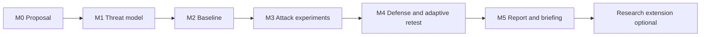

# Module 18 — Capstone Projects and Research Extensions

**Level 5 · Applied ML security projects · 4 hours of lessons · Capstone 40 hours · LO-33, LO-35**

## Why this module exists

A capstone is not a larger lab. A lab asks whether you can execute a technique under a stated protocol. A capstone asks whether you can decide what to test, design the measurement, execute it without supervision, and defend the conclusion to someone who disagrees.

That is a different skill, and it is the one employers and research supervisors actually evaluate. The lessons in this module cover the decisions a capstone forces: what to study, how to keep forty hours from becoming an unbounded literature review, how to present results honestly, and how to turn a finding into a research question.

The practical work is the [capstone](../../projects/capstone.md), chosen from CAP-A to CAP-F and usually grown from one of the six [project briefs](../../projects/index.md).

## Real-world motivation

Capstones fail in predictable ways:

- **Scope by ambition.** "I will study LLM security" produces a survey, not an assessment.
- **No baseline.** Week 8 arrives and there is no clean measurement to compare against.
- **Technique collecting.** Ten attacks are run; none is tied to a threat or a decision.
- **Orphan results.** A results directory with no table, no denominators, and no run record.
- **Reproducibility deferred.** "I will containerize it at the end." The end is a broken environment.
- **Overclaiming.** A single seed, one dataset, and a conclusion about "robustness."
- **A report that argues instead of reports.** The reader cannot find the method or the limitations.
- **Research as summary.** A literature review is presented as a contribution, with no measurement.

Each of these is preventable with a milestone plan, a reproducibility contract, and a results structure fixed before the experiments.

## Measurable learning objectives

By the end of this module you will be able to:

1. **Scope** a capstone that integrates threat modeling, attack, defense, and engineering within a stated budget (Bloom 4–5).
2. **Plan** six milestones with entry and exit criteria, evidence, and stop rules (Bloom 4).
3. **Produce** a reproducibility package that a clean checkout can rerun (Bloom 3–5).
4. **Present** results with denominators, baselines, uncertainty, and limitations, using tables and figures that answer a question (Bloom 4–5).
5. **Formulate** a researchable question from a capstone finding, with a contribution type, validity threats, and an ethics plan (Bloom 5–6).

Objectives 1–4 assess LO-33; objective 5 assesses LO-35; the capstone also carries LO-28, LO-29, and LO-30.

## Prerequisite checklist

| Skill | Check | If not |
|---|---|---|
| Integrated assessment | You have completed one PRJ brief or an equivalent | M16 and one project |
| Red/blue measurement | You can calibrate a detector and replay an attack | M17, RT-01 |
| Threat modeling | You can produce adversary profiles and a risk register | M03, M16 |
| Experimental method | You can run a controlled comparison with seeds and intervals | M02, M08 |
| Reproducibility | You have produced a manifest and rerun from a clean environment | LAB-01, M09 |
| Technical writing | You can write a 6-page report with tables and limitations | M16, student guide |

### Ten-minute diagnostic

1. What is the difference between a lab deliverable and a capstone deliverable?
2. Why is "evaluate LLM security" not a capstone question?
3. Name the six milestones and one exit criterion for each.
4. What belongs in a reproducibility package, and what must never be committed?
5. Why does a single-seed result support a weaker claim than a three-seed result, even when the number is the same?
6. What makes a research question falsifiable, and why is "explore" not a question?
7. What is the difference between a limitation and an excuse?
8. When should you cut scope, and what must a cut preserve?

If you can answer six or more, skim Lessons 18.1–18.2 and read 18.3–18.4 closely. If fewer than four, read in order before starting the capstone.

## Module map

| Unit | Title | Time | What you produce |
|---|---|---:|---|
| [18.1](lesson-1-choosing-and-scoping-a-capstone.md) | Choosing and scoping a capstone | 1 h | One-page proposal with scope, question, and feasibility check |
| [18.2](lesson-2-milestones-reproducibility-and-project-management.md) | Milestones, reproducibility, and project management | 1 h | Milestone plan, reproducibility contract, risk register |
| [18.3](lesson-3-results-visualization-and-limitations.md) | Results, visualization, and limitations | 1 h | Results tables, figure plan, limitations taxonomy |
| [18.4](lesson-4-from-project-to-research-question.md) | From project to research question | 1 h | Research-question canvas and contribution statement |
| [CAP](../../projects/capstone.md) | Capstone project | 40 h | Full assessment, report, briefing, reproducibility package |
| [Knowledge check](quiz.md) | QZ-18, 10 items | 20 min | Score and explanations |
| [Exercises](exercises.md) | Four exercises on one proposal | 40 min | Portfolio evidence |

## The capstone at a glance

| Dimension | Requirement |
|---|---|
| Options | CAP-A to CAP-F, mapped to the six project families |
| Effort | 40 hours, typically 6–10 weeks |
| System | Local, synthetic, or authorized public sandbox only |
| Deliverables | Proposal, weekly log, technical artifact, 8–12 page report, 10-minute briefing, reproducibility package |
| Assessment | Capstone rubric, every dimension at Proficient or above for completion |
| Ethics | Authorized-use statement, no third-party production targets, no personal data |
| Research route | Optional research extension (LO-35) with a research-question canvas |

## How projects become capstones

The six projects are assessment-sized (11 hours). A capstone extends one of them along a single axis.

| Project | Capstone option | Typical extension |
|---|---|---|
| [PRJ-01 fraud](../../projects/prj-01-fraud-detection.md) | CAP-A end-to-end assessment | Add a second decision segment, a monitoring control, and an adaptive evasion variant |
| [PRJ-02 image poisoning](../../projects/prj-02-image-poisoning.md) | CAP-A or CAP-B | Compare two defenses under an adaptive backdoor attempt with a poison-budget curve |
| [PRJ-03 prediction API](../../projects/prj-03-prediction-api-privacy.md) | CAP-C privacy study | Add a DP defense with accounting and a utility–privacy comparison |
| [PRJ-04 secure pipeline](../../projects/prj-04-secure-pipeline.md) | CAP-D supply chain | Add signing, promotion gates, and a failure-injection test of the gate |
| [PRJ-05 RAG agent](../../projects/prj-05-rag-agent.md) | CAP-E agent evaluation | Build a small test harness with adaptive indirect-injection variants and a containment test |
| [PRJ-06 robustness comparison](../../projects/prj-06-robustness-comparison.md) | CAP-B benchmark replication | Reproduce a published-style comparison, then attack the evaluation itself |

A capstone must add at least one of: a new adversary, a new measurement, a new control, or a replication with a methodological critique. Re-running the project with more seeds is not a capstone.

## The six milestones

| Milestone | Exit criterion | Evidence |
|---|---|---|
| M0 Proposal | Scope, question, and feasibility are written and frozen | `proposal.md` signed by self or supervisor |
| M1 Threat model | Assets, boundaries, adversary profiles, and 5+ risks are registered | `threat-model.md`, `risk-register.csv` |
| M2 Baseline | Clean measurement reproduces from a clean environment | `baseline/` with manifest and run record |
| M3 Attacks | At least three attacks, each with a budget and oracle | `experiments/`, results tables |
| M4 Defense | At least one defense replayed against the same attacks plus a variant | `defense/`, before/after matrix |
| M5 Report | Report, briefing, and package pass the reproducibility check | `report.pdf`, `briefing/`, `manifest.json` |

Each milestone is a gate, not a date. A missed exit criterion is a signal to cut scope, not to skip the gate.

## Common mistakes across the module

| Mistake | Symptom | Consequence |
|---|---|---|
| Topic instead of question | Proposal says "study X" | No falsifiable result |
| No feasibility check | Data or compute missing at week 2 | Rushed, invalid work |
| Baseline last | Attacks run against an unstable system | No comparison |
| Ten techniques, no threat | Results are a menu | No severity or recommendation |
| Reproducibility deferred | Environment breaks at the end | Claims cannot be checked |
| One seed | Clean-looking curve | Overconfident conclusion |
| Figures without denominators | Pretty plots | Reader cannot audit |
| Limitations as apology | "Time was short" | No validity analysis |
| Research as summary | Literature review, no measurement | No contribution |
| No stop rule | Work expands to fill the time | Incomplete deliverables |

## Troubleshooting

| Symptom | Likely cause | Fix |
|---|---|---|
| Scope keeps growing | No non-goals | Freeze the proposal; log change requests |
| Baseline will not reproduce | Unpinned environment or seed | Pin, hash, rerun from clean checkout |
| Attack results vary wildly | Too few seeds or unstable threshold | Fix the seed set; report intervals |
| Defense looks perfect | Test set leaked into tuning | Split and re-evaluate |
| Results section is unreadable | No claim-first structure | One claim per table; move detail to appendix |
| Report overruns | Method buried in narrative | Use the report template |
| Research question vague | No gap statement | Write what would change the conclusion |
| Supervisor meeting unproductive | No decision to make | Bring two options and a recommendation |

## Limitations and scope

- The capstone is assessed by rubric and self-review, not by external examination. It is evidence of capability, not accreditation.
- The research extension is guidance, not supervision. It does not replace ethics review, a supervisor, or institutional requirements.
- Projects use local mocks and synthetic data. Results do not transfer automatically to production systems.
- Forty hours is enough for a bounded assessment, not for a novel research program. The research route describes the next step, not a completed thesis.
- The course cannot verify claims made in a capstone without the artifact; the reproducibility package is the substitute.

## Glossary

| Term | Definition |
|---|---|
| **Capstone** | A 40-hour integrated assessment with a report, briefing, and reproducible artifact |
| **Milestone** | A gate with entry and exit criteria and required evidence |
| **Exit criterion** | The observable condition that closes a milestone |
| **Reproducibility package** | Environment, data hashes, seeds, scripts, manifest, and run instructions |
| **Manifest** | A file listing artifacts with hashes and versions |
| **Run record** | Metadata for one execution: command, seed, versions, time, outputs |
| **Baseline** | The clean measurement against which attack and defense results are compared |
| **Ablation** | Removing one component to estimate its contribution |
| **Adaptive attack** | A variant designed after learning how the defense behaves |
| **Threats to validity** | Construct, internal, external, and statistical reasons a conclusion may be wrong |
| **Construct validity** | Whether the metric measures the concept claimed |
| **Internal validity** | Whether the comparison is confounded |
| **External validity** | Whether the result generalizes beyond the test conditions |
| **Statistical validity** | Whether the uncertainty supports the claim |
| **Contribution type** | Replication, extension, negative result, benchmark, method, or measurement study |
| **Gap statement** | A specific claim about what existing work does not establish |
| **Pre-registration** | A plan fixed before data collection to limit post-hoc adjustment |
| **Artifact evaluation** | Review of whether a package reproduces the reported results |
| **Negative result** | A well-measured failure to find the predicted effect |
| **Residual risk** | Risk remaining after controls and tested variants |
| **Research question** | A falsifiable question with a stated population, intervention, and metric |
| **Scope cut** | A reduction that preserves the validity of the remaining claim |

## Summary and key takeaways

- A capstone is an assessment you design, not a lab you complete.
- Scope is a list of included and excluded things, plus a feasibility check.
- Six milestones with exit criteria prevent the two classic failures: no baseline and no reproducibility.
- The reproducibility package is part of the result, not an afterthought.
- Results are claims backed by tables with denominators, budgets, seeds, and intervals.
- Limitations are validity analysis, not apology.
- A research question names a gap, a contribution type, and what evidence would change the conclusion.
- Local mocks and synthetic data bound every claim. State the bound.

## References and further reading

All links checked on 2026-10-28.

| Reference | Use |
|---|---|
| [Pineau et al., *Improving Reproducibility in Machine Learning Research* (2020)](https://arxiv.org/abs/2003.12206) | Reproducibility checklist and reporting practice |
| [Kapoor & Narayanan, *Leakage and the Reproducibility Crisis in ML-based Science* (2022)](https://arxiv.org/abs/2207.07048) | Leakage, reproducibility failures, and model info sheets |
| [NIST AI 100-2e2025](https://doi.org/10.6028/NIST.AI.100-2e2025) | Adversarial ML vocabulary for the threat model |
| [NIST AI RMF 1.0](https://doi.org/10.6028/NIST.AI.100-1) | Risk framing and treatment |
| [MITRE ATLAS](https://atlas.mitre.org/) | Technique mapping for the assessment |
| [Ganguli et al., *Red Teaming Language Models to Reduce Harms* (2022)](https://arxiv.org/abs/2209.07858) | What red-team evidence can and cannot establish |
| [Brundage et al., *The Malicious Use of Artificial Intelligence* (2018)](https://arxiv.org/abs/1802.07228) | Threat framing and defensive priorities |
| [NIST SP 800-115](https://csrc.nist.gov/pubs/sp/800/115/final) | Test planning and reporting |
| [NIST SP 800-61r3](https://csrc.nist.gov/pubs/sp/800/61/r3/final) | Incident-response evidence handling |
| [OWASP GenAI LLM Top 10 2026](https://genai.owasp.org/resource/owasp-genai-llm-top-10-2026/) | Application risk categories for generative projects |

Read Pineau et al. before Lesson 18.2 and Kapoor & Narayanan before Lesson 18.3. Read the NIST and ATLAS entries when writing the threat model.

## Next step

Start with [Lesson 18.1 — Choosing and scoping a capstone](lesson-1-choosing-and-scoping-a-capstone.md), then read the [capstone brief](../../projects/capstone.md) and the [project catalog](../../projects/index.md) before committing to an option.
