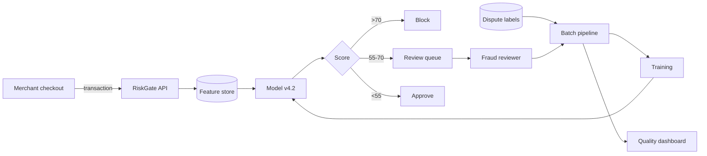

# PRJ-01 — Meridian Pay: Fraud Scoring Under Data-Quality Faults and Bounded Evasion

<a id="prj-01"></a>

**Level 5 project · 11 hours · LO-33 · Reuses LAB-03, LAB-05, LAB-12**

## The organization

Meridian Pay is a fictional mid-size payment processor. Its merchants accept card-not-present payments through a hosted checkout page. Every authorization request is scored by `RiskGate`, an internal service that returns a fraud score from 0 to 100; transactions above 70 are blocked, and transactions between 55 and 70 are queued for human review.

Meridian's fraud team owns the model. The platform team owns the API. The merchant support team owns the review queue. No single team owns the training data end to end, which is the organizational fact behind most of this project's risks.

## Background and business objectives

Card-not-present fraud costs Meridian about 0.8% of processed volume. The model is the primary control. The business objectives, in priority order:

1. Reduce fraud losses without raising the false-decline rate above 2%.
2. Keep the manual review queue below 4,000 items per day.
3. Preserve merchant trust: a decline that cannot be explained is a support ticket and sometimes a lost merchant.
4. Produce an audit trail that satisfies the acquirer's annual review.

The security question follows from objective 1 and 3: can the decision be moved without the dashboard noticing, and can the reported model quality be an artifact of the data pipeline?

## System architecture



| Component | Role | Version in the project |
|---|---|---|
| Checkout | Sends transaction features | n/a (mock client) |
| `RiskGate` API | Validates, scores, returns decision | local mock, v4.2 |
| Feature store | Serves amount, hour, velocity, merchant history | snapshot `fs-2026-10` |
| Model | Gradient-boosted classifier | scikit-learn, threshold 70 |
| Review queue | Human decisions and overrides | mock console |
| Batch pipeline | Joins transactions, disputes, and overrides | Python scripts |
| Quality dashboard | Global fraud and decline rates | daily aggregation |

## Data classification and assets

| Data | Classification | Why |
|---|---|---|
| Cardholder name, PAN token, email | Restricted | Personal and payment data; must not appear in the project |
| Transaction amount, hour, merchant category | Confidential | Commercially sensitive; enables evasion if exposed |
| Dispute labels and reviewer overrides | Confidential | Labels drive training; overrides reveal reviewer behavior |
| Model artifact and hyperparameters | Confidential | IP; extraction target |
| Thresholds and segment rules | Restricted | Directly enable evasion |
| Published fee schedule | Public | No sensitivity |

**Assets:** the block/approve decision; the dispute labels; the feature store; the model artifact; reviewer override records; the audit log; merchant relationships.

## Trust boundaries

| Boundary | Crossing | Trust change |
|---|---|---|
| B1 Merchant → API | Untrusted transaction fields | From unknown merchant to authenticated request |
| B2 API → feature store | Internal lookup | From request data to trusted history |
| B3 Batch pipeline → training | Dispute and override data | From operational data to training labels |
| B4 Reviewer → override | Human decision | From model decision to human authority |
| B5 Vendor feed → feature store | External enrichment | From third party to internal feature |
| B6 Registry → API | Model artifact | From build system to serving |

Each boundary is a place where a test can fail. The project focuses on B1, B3, and B4.

## Threat model

### Adversary profiles

```text
ADV-01 — Merchant-side evader
Goal: Integrity — avoid a block for transactions in a controlled merchant segment.
Knowledge: Public checkout behavior; approximate threshold from trial declines;
           no weights, training data, or reviewer queue access.
Capability: Choose amount, hour, and velocity within values observed in the
           last 90 days; control a merchant account.
Access: Public scoring path through checkout.
Budget: ≤ 3 feature changes per transaction; values within the 1st–99th
           percentile; 2,000 attempts; no new merchant identities.
Success: Segment block rate < 0.10 at global false-decline ≤ 0.02.
Out of scope: Model extraction, credential theft, insider access.
```

```text
ADV-02 — Data contributor
Goal: Integrity — cause the model to learn a relationship that inflates
      measured recall or suppresses blocks for a target pattern.
Knowledge: The ingestion path and label schema are documented internally.
Capability: Introduce up to 2% duplicate or mislabeled dispute records.
Access: Batch ingestion; no direct model access.
Budget: 2% of records; one manipulation strategy.
Success: Reported recall improves by ≥ 0.05 without a real change in
      fraud capture, or block rate for the target pattern falls by ≥ 30%.
Out of scope: Code changes, artifact replacement.
```

### Risk register (starter)

| ID | Risk | Asset | Likelihood | Impact | Disposition |
|---|---|---|---:|---:|---|
| R-01 | Duplicate disputes inflate recall | Labels | 4 | 4 | Test |
| R-02 | Segment feature shifting avoids block | Decision | 3 | 4 | Test |
| R-03 | Reviewer overrides are not logged | Audit trail | 2 | 3 | Test |
| R-04 | Stale vendor feature degrades decisions | Feature store | 3 | 3 | Monitor |
| R-05 | Model artifact replaced in registry | Model | 2 | 5 | Verify |
| R-06 | Global dashboard hides segment drift | Monitoring | 4 | 3 | Test |

Score the register with the Module 16 anchors, add at least three risks, and record a disposition for every entry.

## What you are given

| Asset | Source | Use |
|---|---|---|
| Synthetic transaction generator | Adapt LAB-05 or LAB-12 generator | 20,000 records with labels and timestamps |
| Scoring model | LAB-03 baseline training script | Gradient boosting, threshold 70 |
| Evasion harness | LAB-03 / LAB-04 | Bounded feature perturbation |
| Data validation checks | LAB-12 | Duplicates, schema, label defects |
| Mock API | LAB-14 | Request logging and auth |
| Dashboard mock | New, 30 lines | Global vs segment aggregation |

No real payment data is used. Do not download a fraud dataset; generate one.

## Constraints and safety

- Local machine only; bind services to `127.0.0.1`.
- Synthetic records only; no PANs, names, emails, or real merchant identifiers.
- No third-party targets, no network egress, no credential reuse.
- Perturbations stay inside the stated percentile bounds.
- The project is an assessment of a mock; results do not transfer automatically to Meridian's production system, which does not exist.

## Staged investigation

### Stage 0 — Scope and authorization (1 hour)

**Tasks**

1. Write the scope: one model version, one feature set, the batch scoring path, and the reviewer queue.
2. List non-goals: mobile app, card network, merchant onboarding, production data.
3. Write an authorized-use statement and a stop-condition table.

**Output:** `scope.md`, `authorization.md`.

### Stage 1 — Document the system and data (1.5 hours)

**Tasks**

1. Draw the architecture with trust boundaries B1–B6.
2. Build the data inventory with classification and owner.
3. Identify the decision, the labels, and the audit evidence.
4. Write three questions the business would ask about this system.

**Output:** `system.md`, `data-inventory.csv`.

### Stage 2 — Threat model and test plan (1.5 hours)

**Tasks**

1. Complete ADV-01 and ADV-02; add one insider profile if it changes a test.
2. Score at least eight risks with anchors; record dispositions.
3. Convert the top five into test cases with hypothesis, procedure, budget, oracle, metric, and evidence.
4. Write a stop condition for each test.

**Output:** `threat-model.md`, `risk-register.csv`, `test-plan.csv`.

### Stage 3 — Baseline and data-quality audit (3 hours)

**Tasks**

1. Freeze a temporal holdout; hash it; record the environment and seed.
2. Measure recall, false-decline rate, and queue volume at threshold 70.
3. Run the duplicate audit: find near-duplicate disputes across the train/test boundary; quantify the effect on recall.
4. Run a label-noise sensitivity check at 1%, 3%, and 5% flipped labels.
5. Run a negative control: rescore the holdout with zero perturbation and confirm identical decisions.

**Output:** `baseline/`, `audit/duplicates.csv`, `audit/label-noise.csv`, `run.json`.

### Stage 4 — Bounded evasion and monitoring gap (3 hours)

**Tasks**

1. Select a target merchant segment and freeze its evaluation subset.
2. Perturb up to three merchant-controlled features at three budgets (small, medium, large) within observed percentiles.
3. Report segment block rate, global block rate, and false-decline rate for each budget.
4. Compute what the global dashboard would show; compare with the segment view.
5. Attempt one adaptive variant: change the perturbation direction after observing the first result, within the same budget.

**Output:** `experiments/evasion.csv`, `experiments/monitoring-gap.md`, figures, run records.

### Stage 5 — Defenses, residual risk, and report (2 hours)

**Tasks**

1. Implement or specify two defenses: a duplicate/quality gate on the training pipeline, and a segment-level monitor with an alert threshold.
2. Optionally evaluate feature caps or perturbation-augmented retraining if time permits; do not claim an unrun defense.
3. Measure each defense's effect and cost: false declines, queue volume, analyst load.
4. Write findings with severity using the four-dimension rubric.
5. Write the residual-risk statement and a costed remediation order.
6. Produce the report (8–10 pages) and a 10-minute briefing outline.

**Output:** `defense/`, `findings/`, `report.md`, `briefing.md`, `manifest.json`.

## Required experiments

| ID | Hypothesis | Budget | Oracle | Evidence |
|---|---|---|---|---|
| E-01 | Duplicate disputes inflate recall by ≥ 0.03 | Full training set | Recall change after dedup exceeds the baseline interval | `audit/duplicates.csv` |
| E-02 | 3% label noise reduces recall by ≥ 0.05 | 3 noise seeds | Recall change beyond interval | `audit/label-noise.csv` |
| E-03 | A segment can reach block rate < 0.10 within bounds | 2,000 attempts, 3 features | Segment rate < 0.10 at global false-decline ≤ 0.02 | `experiments/evasion.csv` |
| E-04 | The global dashboard does not flag the segment shift | Same run as E-03 | Global change < 1 point while segment change ≥ 0.10 | `experiments/monitoring-gap.md` |
| E-05 | A segment monitor detects the shift within one day | 14 days of synthetic traffic | Alert fires before loss exceeds the stated threshold | `defense/monitor.csv` |

An experiment that cannot fail is not acceptable. If E-03 fails, report the failure at budget and do not raise the budget silently.

## Defensive measures

| Control | Type | What it should do | Cost to measure |
|---|---|---|---|
| Duplicate/near-duplicate gate | Preventive | Reject or merge duplicate disputes before training | Training rows lost; recall effect |
| Label-quality sampling | Detective | Flag suspicious label patterns | Analyst hours |
| Segment-level monitor | Detective | Alert on segment block-rate drift | False alerts per week |
| Feature velocity cap | Preventive | Limit unrealistic feature jumps | False declines |
| Perturbation-augmented retraining | Preventive | Reduce sensitivity to bounded changes | Clean accuracy; training time |
| Override audit log | Detective | Record actor, reason, and decision | Storage; reviewer friction |

Implement at least one preventive and one detective control. Evaluate the control against the same attacks, then attempt one adaptive variant.

## Deliverables and acceptance criteria

| Deliverable | Acceptance criterion |
|---|---|
| `scope.md` + `authorization.md` | System, decision, data, non-goals, and stop conditions are explicit |
| `system.md` + `data-inventory.csv` | Every asset has a classification and an owner; boundaries B1–B6 are mapped |
| `threat-model.md` + `risk-register.csv` | ≥ 8 risks with anchors and dispositions; every test traces to a risk |
| `test-plan.csv` | ≥ 5 tests with budget, oracle, metric, and evidence |
| `baseline/` + `run.json` | Reproducible from a clean checkout; holdout hashed |
| `audit/` | Duplicate and label-noise results with denominators |
| `experiments/` | Evasion results at three budgets; segment vs global comparison |
| `defense/` | ≥ 1 preventive + 1 detective control evaluated on the same attacks |
| `findings/` + `report.md` | Severity, evidence, owner, cost, retest for each finding |
| `manifest.json` | Hashes for data, split, model, and results |
| Briefing | 10 minutes; one slide per finding; residual risk stated |

A project that runs every experiment but cannot reproduce the headline number is incomplete. A project with a negative attack result and a correct measurement is complete.

## Rubric (100 points)

| Dimension | Weight | Exemplary evidence in this project |
|---|---:|---|
| Scope, system, and data | 10 | Scope is enumerable; all six boundaries mapped; data classification is correct and complete |
| Threat model | 15 | Adversary budgets are testable; risk scores use published anchors; every test traces to a risk; rejections recorded |
| Baseline and experimental design | 15 | Holdout frozen and hashed; zero-perturbation control; three budgets; seeds and intervals reported |
| Attack and analysis correctness | 20 | Evasion is within bounds; segment and global rates use correct denominators; adaptive variant attempted; no overclaim |
| Defense design and evaluation | 15 | One preventive and one detective control; replay plus variant; false-decline and queue costs measured |
| Reproducibility and evidence | 10 | Clean-checkout reproduction; run records; manifest matches artifacts; no manual result edits |
| Risk communication | 10 | Findings have severity, owner, cost, and retest; remediation ordered; briefing is decision-oriented |
| Ethics, safety, and limitations | 5 | Synthetic data only; local binding; limitations and residual risk stated with numbers |

Project-specific deductions: a claim without a denominator (−5); a defense declared successful after one static test (−5); a segment result reported without the global rate (−3); a baseline that cannot be rerun (−10).

## Reflection questions

1. Which finding would change a business decision, and which is interesting but not actionable?
2. Did the data-quality audit or the evasion experiment carry more risk? How did you decide?
3. What did the global dashboard hide, and why is that a monitoring design problem rather than a model problem?
4. Which defense cost the most in false declines, and was the trade-off worth it?
5. What would an adaptive attacker do next, and what evidence would you need to test it?
6. If the attack failed at budget, what does that bound, and what does it not establish?

## Extensions

- **Capstone (CAP-A):** add a second segment, a real-time monitor, and a cost model for remediation; extend to a full end-to-end assessment.
- **Research question:** does deduplication change reported recall in published fraud-detection studies, and by how much? A replication with a leakage audit is an MPhil-sized measurement study.
- **Engineering:** move the duplicate gate into the pipeline with a fail-closed policy and test a poisoned batch.
- **Governance:** write the model info sheet that would have caught the label defect before deployment.

## Safety and ethics

Synthetic transactions only. Do not use a real issuer, processor, merchant, or card dataset. Do not test against a live payment endpoint. The project is an assessment of a local mock; its findings are evidence about the mock and the method, not about any real payment system.

## Time box

Eleven hours across five stages. If a stage exceeds 150% of its allocation, stop, record the partial result, and cut a later experiment rather than the baseline or the report. A complete assessment with three experiments and an honest limitation is better than an incomplete one with six.
