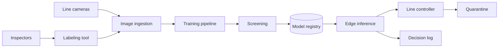

# PRJ-02 — Aster Manufacturing: Poisoning and Backdoors in a Visual Defect Pipeline

<a id="prj-02"></a>

**Level 5 project · 11 hours · LO-33 · Reuses LAB-05, LAB-06, LAB-07, LAB-08**

## The organization

Aster Manufacturing is a fictional supplier of automotive sensors. Its plant in Pune runs three assembly lines. At the end of each line, a camera photographs every part and a classifier labels it `pass` or `defect`. Defective parts are diverted to a quarantine bin; passing parts continue to packing.

The model was trained on images labeled by line inspectors. Inspectors are measured on throughput, and the labeling tool accepts batches from a shared drive. A systems integrator maintains the training pipeline; Aster owns the labels and the line.

## Background and business objectives

A defect that escapes reaches a customer and can trigger a recall. A false reject scraps a good part and slows the line. The business objectives:

1. Keep defect escape rate below 0.5%.
2. Keep false-reject rate below 3%.
3. Sustain 1,200 parts per hour per line.
4. Preserve traceability from a shipped lot back to the images and model version that passed it.

The security question is whether a small contaminated fraction of labels or images can create a behavior that survives retraining and inspection, and whether the pipeline's screening can catch it at a reasonable cost.

## System architecture



| Component | Role | Project version |
|---|---|---|
| Cameras | Capture 8×8 grayscale patches (synthetic proxy) | generator |
| Ingestion | Validates size, format, and batch metadata | Python |
| Labeling tool | Inspector labels; accepts batch uploads | mock CLI |
| Pipeline | Trains a small CNN or scikit-learn classifier | CPU |
| Screening | Reference-set and activation checks | simplified |
| Registry | Stores artifact and metadata | local files |
| Edge inference | Scores parts at line speed | local process |
| Line controller | Diverts defects | mock |

The project uses 8×8 grayscale images derived from scikit-learn's digits dataset with synthetic part backgrounds. This keeps the work CPU-only and avoids real factory imagery.

## Data classification and assets

| Data | Classification | Why |
|---|---|---|
| Production images | Confidential | Reveal process, throughput, and defects |
| Inspector labels | Confidential | Drive training; manipulation target |
| Model artifact | Confidential | IP and safety control |
| Trigger or screening signatures | Restricted | Directly enable bypass |
| Camera calibration | Internal | Operational |
| Customer defect specifications | Restricted | Contractual and safety-relevant |
| Shipping lots | Internal | Traceability |

**Assets:** the pass/defect decision; label integrity; the model artifact; the screening configuration; the decision log; the traceability record; customer safety.

## Trust boundaries

| Boundary | Crossing | Trust change |
|---|---|---|
| B1 Camera → ingestion | Image bytes | Physical process to digital input |
| B2 Inspector → labeling tool | Human label | Human judgment to training signal |
| B3 Shared drive → pipeline | Batch upload | Unverified files to training data |
| B4 Pipeline → registry | Model artifact | Build output to deployable artifact |
| B5 Registry → edge | Artifact | Central to plant floor |
| B6 Edge → line controller | Decision | Model output to physical action |

B2 and B3 are the project's focus. B6 is where a model error becomes a physical outcome.

## Threat model

### Adversary profiles

```text
ADV-01 — Data contributor
Goal: Integrity — cause the model to pass triggered defective parts while
      maintaining clean accuracy.
Knowledge: Labeling tool, image format, and batch upload path are known;
           no access to the model, screening, or edge device.
Capability: Contribute up to 5% of training images with labels; choose a
           trigger pattern from the allowed set.
Access: Shared drive and labeling tool.
Budget: 5% of training records; one trigger pattern; no code changes.
Success: Attack success rate ≥ 0.80 on triggered defect images at clean
           accuracy within 2 points of baseline.
Out of scope: Physical access to the camera, registry compromise, code
           execution on the pipeline.
```

```text
ADV-02 — Label-quality adversary
Goal: Integrity — increase false rejects for a target part family.
Knowledge: Label schema and inspector workflow.
Capability: Mislabel up to 3% of images in one part family.
Access: Labeling tool.
Budget: 3% of one family; one strategy.
Success: False-reject rate for the family rises by ≥ 10 points at stable
           overall accuracy.
Out of scope: Model access, trigger injection.
```

### Risk register (starter)

| ID | Risk | Asset | Likelihood | Impact | Disposition |
|---|---|---|---:|---:|---|
| R-01 | 5% poisoned images create a backdoor | Decision | 3 | 5 | Test |
| R-02 | Trigger survives screening | Screening | 3 | 4 | Test |
| R-03 | Label noise raises false rejects | Decision | 3 | 3 | Test |
| R-04 | Screening rejects clean models | Availability | 3 | 2 | Measure |
| R-05 | Artifact swapped between registry and edge | Model | 2 | 5 | Verify |
| R-06 | Retraining removes the backdoor | Decision | 3 | 3 | Test |

Add at least two risks (camera drift, batch replay, insider) and score all with anchors.

## What you are given

| Asset | Source | Use |
|---|---|---|
| Synthetic image generator | LAB-08 generator, adapted | Defect/pass images with backgrounds |
| Poisoning harness | LAB-05 / LAB-06 | Label flips and targeted injection |
| Backdoor harness | LAB-07 / LAB-08 | Trigger patch and ASR measurement |
| Screening prototype | LAB-08 reference-set check | Detection rate and false positives |
| Pipeline | LAB-12 validation patterns | Schema and hash gates |
| Registry mock | LAB-13 | Artifact metadata and signing |

No real plant images, customer data, or production endpoints are used.

## Constraints and safety

- Local CPU only; images are synthetic.
- Do not create or distribute a malicious model artifact outside the exercise directory. Train locally, keep artifacts local, and delete them at the end if not needed for the portfolio.
- Do not target a real camera, PLC, robot, or plant network.
- Poison rates stay at or below 5%; training runs stay within the time box.
- Results describe the mock pipeline, not Aster's (nonexistent) production line.

## Staged investigation

### Stage 0 — Scope and authorization (1 hour)

1. Scope one line, one model version, one image class pair, and the labeling path.
2. Exclude physical access, PLC/network attacks, and customer data.
3. Write the authorized-use statement and stop conditions.

**Output:** `scope.md`, `authorization.md`.

### Stage 1 — Document the system and data (1.5 hours)

1. Draw the architecture and boundaries B1–B6.
2. Inventory data, labels, artifacts, and owners.
3. Describe the inspector incentive and the batch-upload path.
4. State where traceability could break.

**Output:** `system.md`, `data-inventory.csv`.

### Stage 2 — Threat model and test plan (1.5 hours)

1. Complete ADV-01 and ADV-02; add an insider if it changes a test.
2. Score ≥ 8 risks; record dispositions.
3. Write ≥ 5 test cases with budgets and oracles.
4. Define a stop condition for training runs that exceed the compute budget.

**Output:** `threat-model.md`, `risk-register.csv`, `test-plan.csv`.

### Stage 3 — Poisoning and backdoor experiments (3 hours)

1. Freeze a clean evaluation set and hash it.
2. Measure clean accuracy and false-reject rate on the baseline model.
3. Run a label-flip curve at 1%, 3%, and 5% for the target family.
4. Inject a trigger at 1%, 3%, and 5%; measure clean accuracy and ASR at each rate.
5. Run a negative control: same pipeline with zero poisoned records; confirm ASR near zero.

**Output:** `experiments/poison-curve.csv`, `experiments/backdoor.csv`, `run.json`.

### Stage 4 — Screening, adaptive trigger, and defense (3 hours)

1. Implement or adapt a reference-set screening check; measure detection rate and false positives on clean models.
2. Attempt one adaptive trigger: lower opacity, different corner, or smaller patch, within the same poison budget.
3. Evaluate one mitigation: screening gate, clean fine-tuning, or input preprocessing. Report ASR before and after, clean accuracy, and cost.
4. Test whether retraining on clean data removes the behavior.

**Output:** `defense/screening.csv`, `defense/adaptive.md`, `defense/retrain.csv`.

### Stage 5 — Residual risk and report (1 hour)

1. Write findings with severity and evidence.
2. State residual risk for the adaptive trigger and the untested physical path.
3. Write a costed remediation order.
4. Produce the report and briefing outline.

**Output:** `findings/`, `report.md`, `briefing.md`, `manifest.json`.

## Required experiments

| ID | Hypothesis | Budget | Oracle | Evidence |
|---|---|---|---|---|
| E-01 | 5% label flips raise family false rejects by ≥ 10 points | 3 seeds | Change beyond baseline interval | `poison-curve.csv` |
| E-02 | 5% trigger injection yields ASR ≥ 0.80 | 3 poison rates | ASR ≥ 0.80 with clean accuracy within 2 points | `backdoor.csv` |
| E-03 | Screening detects the poisoned models at ≥ 0.70 with ≤ 5% false positives | 10 clean + 10 poisoned models | Detection and FP rates | `screening.csv` |
| E-04 | An adaptive trigger evades screening | One variant | ASR ≥ 0.60 after screening | `adaptive.md` |
| E-05 | Clean fine-tuning reduces ASR below 0.20 | One run | ASR < 0.20 at clean accuracy within 1 point | `retrain.csv` |

## Defensive measures

| Control | Type | What it should do | Cost to measure |
|---|---|---|---|
| Reference-set screening | Detective | Flag models with anomalous trigger response | False positives; screening time |
| Activation/representation check | Detective | Detect clustered trigger representations | Compute; threshold |
| Label provenance and sampling | Preventive | Limit unverified batch uploads; audit labels | Inspector time |
| Input preprocessing | Preventive | Reduce trigger effectiveness | Clean accuracy; latency |
| Clean fine-tuning | Corrective | Remove learned trigger behavior | Data; compute; residual ASR |
| Artifact signing and hash check | Preventive | Prevent model swap | Key management |

Implement at least one detective and one corrective control. Do not claim a control works if it was only tested on the same model used to design it.

## Deliverables and acceptance criteria

| Deliverable | Acceptance criterion |
|---|---|
| `scope.md`, `authorization.md` | One line, one model, one path; exclusions explicit |
| `system.md`, `data-inventory.csv` | Boundaries and owners complete |
| `threat-model.md`, `risk-register.csv` | ≥ 8 risks; ≥ 5 tests; dispositions recorded |
| Baseline | Clean accuracy and false-reject rate reproducible; eval set hashed |
| Poison and backdoor results | Curves at three rates; negative control; ASR defined with a denominator |
| Screening results | Detection rate and false-positive rate on clean models |
| Adaptive trigger | Attempted and reported, success or failure |
| Mitigation | Before/after ASR, clean accuracy, cost |
| Report and briefing | Severity, residual risk, remediation order, reproduction |

A project that demonstrates a backdoor but never tests a defense is incomplete. A project whose defense fails but is measured correctly is complete.

## Rubric (100 points)

| Dimension | Weight | Exemplary evidence in this project |
|---|---:|---|
| Scope, system, and data | 10 | One line and one class pair; labeling path and owner mapped; no scope creep into physical access |
| Threat model | 15 | Poison and trigger budgets are explicit; risks include screening false positives; tests trace to risks |
| Baseline and experimental design | 15 | Clean baseline with seeds; zero-poison control; three poison rates; fixed eval set |
| Attack and analysis correctness | 20 | ASR and clean accuracy reported together; trigger defined; adaptive variant attempted; no cherry-picked seed |
| Defense design and evaluation | 15 | Screening evaluated on models it did not design against; adaptive trigger tested; cost measured |
| Reproducibility and evidence | 10 | Training and eval scripts; run records; manifest; artifacts local |
| Risk communication | 10 | Findings state physical consequence, severity, owner, and retest |
| Ethics, safety, and limitations | 5 | Synthetic images; no malicious artifact distribution; limits of the mock stated |

Deductions: ASR reported without clean accuracy (−5); screening tested only on the poisoned model it was tuned on (−5); no negative control (−5); claiming a backdoor "removed" after one fine-tune without an adaptive attempt (−3).

## Reflection questions

1. Which is more dangerous for Aster: a backdoor that passes defects, or label noise that scraps good parts? Justify with the business objectives.
2. Did screening catch the backdoor for the right reason, or because it was trained on the same trigger?
3. What does clean fine-tuning remove, and what might it leave behind?
4. How would an attacker with knowledge of the screening adapt, and what budget would that require?
5. What evidence would you need before trusting the pipeline on a second production line?
6. If the trigger failed at 1%, what does that bound?

## Extensions

- **Capstone (CAP-A or CAP-B):** compare two screening methods under an adaptive trigger and a poison-budget curve, then critique the evaluation.
- **Research question:** do backdoor defenses that perform well on benchmark triggers generalize to low-opacity, spatially distributed triggers at a fixed poison budget?
- **Engineering:** add label provenance and batch signing to the ingestion path; test a replayed batch.
- **Governance:** write the model acceptance record a customer auditor would require.

## Safety and ethics

Synthetic images only. No real factory, camera, PLC, or customer data. Do not distribute poisoned model files; keep them inside the exercise directory and delete them when finished. The scenario is fictional; the safety consequence in the narrative is a reason to measure carefully, not a license to touch physical systems.

## Time box

Eleven hours. If training runs exceed the budget, reduce image count or epochs and record the change; do not skip the negative control or the adaptive trigger. A smaller experiment with a control is more valuable than a larger one without.
