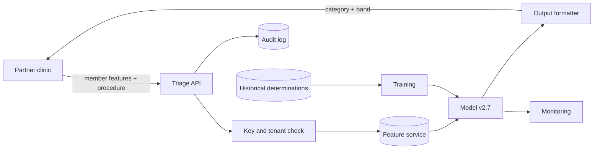

# PRJ-03 — Helio Health: Privacy and Extraction Risk in a Benefits Triage API

<a id="prj-03"></a>

**Level 5 project · 11 hours · LO-33 · Reuses LAB-09, LAB-10, LAB-17**

## The organization

Helio Health is a fictional health benefits administrator. Partner clinics use Helio's `Triage` API to check whether a proposed procedure is likely to be covered as standard, expedited, or sent to manual review. The API returns a category and a confidence band; it does not return the underlying score.

The model is trained on historical benefit determinations. Clinics have API keys with a contractual query limit. Helio's privacy office has approved the API on the condition that it does not expose member-level information beyond the triage category.

## Background and business objectives

Manual review is expensive and slow. The business objectives:

1. Reduce manual review volume by 20% without increasing incorrect determinations.
2. Return a triage response in under 300 ms at the 95th percentile.
3. Keep member data confidential and within the contractual purpose.
4. Preserve an audit trail for regulators and partner disputes.

The security question is what the prediction interface reveals about the model and the training members under a fixed query budget, and what output minimization costs in triage utility.

## System architecture



| Component | Role | Project version |
|---|---|---|
| Clinic client | Sends synthetic member features | mock |
| Triage API | Auth, validation, scoring, response | local, `127.0.0.1:8060` |
| Feature service | Joins plan and utilization features | local snapshot |
| Model | Gradient-boosted classifier, 3 classes | scikit-learn |
| Output formatter | Category + confidence band | configurable |
| Audit log | Request metadata and decision | JSONL |
| Training pipeline | Trains on historical determinations | Python |

## Data classification and assets

| Data | Classification | Why |
|---|---|---|
| Member identifiers | Restricted | Direct identifier; excluded from the project |
| Diagnosis and procedure codes | Restricted | Health information |
| Plan and utilization features | Confidential | Commercially and personally sensitive |
| Determination labels | Confidential | Training signal |
| Model and thresholds | Confidential | Extraction target |
| API keys | Restricted | Access control |
| Audit logs | Confidential | Contain behavior and metadata |
| Public coverage policy | Public | No sensitivity |

**Assets:** the triage decision; member privacy; the model; API credentials; the audit log; partner trust; regulatory standing.

## Trust boundaries

| Boundary | Crossing | Trust change |
|---|---|---|
| B1 Clinic → API | Member features and procedure | Authenticated partner to internal service |
| B2 API → feature service | Member key | Request context to stored history |
| B3 Model → formatter | Score and class | Internal score to disclosed output |
| B4 API → audit log | Request metadata | Operational data to retained evidence |
| B5 Training → model | Historical determinations | Historical data to deployed behavior |
| B6 Partner → bulk export | Aggregated reports | Internal analytics to external disclosure |

B1 and B3 carry the project's privacy question. B4 is where a privacy control can become a privacy liability.

## Threat model

### Adversary profiles

```text
ADV-01 — Partner developer
Goal: Confidentiality — recover the decision function or infer whether a
      specific synthetic member was in training, within the query quota.
Knowledge: API schema, own tenant, public policy; no weights or training data.
Capability: Submit up to 1,500 queries; vary features; hold one key.
Access: Triage API through a partner key.
Budget: 1,500 queries; 7 days; one tenant.
Success: Surrogate agreement ≥ 0.90 on a 500-record holdout, or membership
      inference TPR ≥ 0.20 at 1% FPR.
Out of scope: Credential theft, insider access, network attacks.
```

```text
ADV-02 — Insider analyst
Goal: Confidentiality — link a member to a sensitive attribute or training
      membership using aggregate reports and logs.
Knowledge: Report definitions, log schema, and member key format.
Capability: Request reports and read logs; no model access.
Access: Analytics console and audit log.
Budget: 20 report requests; no code changes.
Success: Attribute inference accuracy ≥ 0.70 on a target subgroup, or
      membership inference above the base rate with a stated interval.
Out of scope: Database credentials, exfiltration of raw records.
```

### Risk register (starter)

| ID | Risk | Asset | Likelihood | Impact | Disposition |
|---|---|---|---:|---:|---|
| R-01 | Surrogate extraction reaches high agreement | Model | 4 | 4 | Test |
| R-02 | Membership inference above chance at low FPR | Member privacy | 3 | 5 | Test |
| R-03 | Confidence band leaks more than the category | Output | 4 | 3 | Test |
| R-04 | Audit logs retain sensitive features | Logs | 3 | 4 | Test |
| R-05 | Per-key quota bypassed with a second key | Access | 3 | 3 | Test |
| R-06 | Aggregate report enables small-cell inference | Reports | 3 | 4 | Test |

Add at least two risks (model inversion, tenant mix-up) and score all entries.

## What you are given

| Asset | Source | Use |
|---|---|---|
| Synthetic member generator | LAB-10 / LAB-17 patterns | 4,000 members with labels |
| Prediction API | LAB-09 / LAB-14 | Query budget and logging |
| Extraction harness | LAB-09 | Surrogate training and agreement |
| Membership harness | LAB-10 | Shadow models and low-FPR metrics |
| DP release utility | LAB-17 | Laplace mechanism for aggregate release |
| Output formatter | LAB-14 | Category and band configuration |

All records are synthetic. No protected health information, real member, or real clinic is involved.

## Constraints and safety

- Local loopback only; synthetic data only.
- No real health information, identifiers, or partner credentials.
- Do not attempt to re-identify any record; the dataset has no real people.
- Query budgets are enforced by the client and the server.
- Privacy results are about this synthetic dataset and model; they are not a compliance certification.

## Staged investigation

### Stage 0 — Scope and authorization (1 hour)

1. Scope one model, one API, one tenant, and one output format.
2. Exclude production, real member data, and network attacks.
3. Write the authorized-use statement and privacy handling rules.

**Output:** `scope.md`, `authorization.md`, `data-handling.md`.

### Stage 1 — Document the system and data (1.5 hours)

1. Draw the architecture and boundaries B1–B6.
2. Classify every data item; identify what the API returns and what it logs.
3. State the contractual purpose and the minimization principle.
4. List three questions the privacy office would ask.

**Output:** `system.md`, `data-inventory.csv`, `privacy-questions.md`.

### Stage 2 — Threat model and test plan (1.5 hours)

1. Complete ADV-01 and ADV-02.
2. Score ≥ 8 risks; record dispositions.
3. Write ≥ 5 tests with budgets, oracles, and metrics.
4. Define what counts as a privacy harm in this mock.

**Output:** `threat-model.md`, `risk-register.csv`, `test-plan.csv`.

### Stage 3 — Baseline, extraction, and membership (3 hours)

1. Freeze the evaluation set and holdout; hash them.
2. Measure baseline triage accuracy and the class distribution.
3. Run extraction at 100, 500, and 1,500 queries; report surrogate agreement with intervals.
4. Run membership inference with shadow models; report TPR at 1% FPR and the base rate.
5. Run a negative control: random labels should produce agreement near the majority-class rate.

**Output:** `experiments/extraction.csv`, `experiments/mia.csv`, `run.json`.

### Stage 4 — Output minimization and defenses (3 hours)

1. Compare three output formats: exact score, five-band score, category only.
2. Measure utility (triage agreement), extraction agreement, and MIA TPR for each.
3. Add a per-tenant quota and a query-diversity monitor; test a second-key variant.
4. If time permits, apply a Laplace mechanism to one aggregate release and report utility versus ε; do not claim DP for the model itself.
5. Measure the effect of redacting features from logs.

**Output:** `defense/output-formats.csv`, `defense/quota.md`, `defense/dp-release.md` (optional).

### Stage 5 — Residual risk and report (1 hour)

1. Write findings with severity and evidence.
2. State residual privacy risk with the adversary and budget.
3. Recommend an output format and a monitoring control, with costs.
4. Produce the report and briefing outline.

**Output:** `findings/`, `report.md`, `briefing.md`, `manifest.json`.

## Required experiments

| ID | Hypothesis | Budget | Oracle | Evidence |
|---|---|---|---|---|
| E-01 | 1,500 queries yield surrogate agreement ≥ 0.90 | 1,500 queries | Agreement ≥ 0.90 on 500 holdout | `extraction.csv` |
| E-02 | Membership inference exceeds chance at 1% FPR | 8 shadow models | TPR ≥ 0.20 at 1% FPR | `mia.csv` |
| E-03 | Five-band output reduces extraction vs exact score | Same query budget | Agreement drop ≥ 0.10 | `output-formats.csv` |
| E-04 | Category-only output reduces MIA TPR | Same shadow setup | TPR drop with utility cost stated | `output-formats.csv` |
| E-05 | A second key bypasses the per-key quota | 2 keys, 2× quota | Aggregate queries > quota | `quota.md` |

A negative result (e.g., MIA at chance) is acceptable if the measurement has power and the budget is stated.

## Defensive measures

| Control | Type | What it should do | Cost to measure |
|---|---|---|---|
| Category-only output | Preventive | Remove score and band detail | Triage utility; clinic workflow |
| Coarse confidence bands | Preventive | Reduce information per query | Utility; extraction agreement |
| Per-tenant cumulative quota | Preventive | Limit total queries, not just rate | Partner friction |
| Query-diversity monitor | Detective | Flag extraction-like patterns | False alerts |
| Log minimization | Preventive | Remove sensitive features from logs | Investigation capability |
| DP aggregate release | Preventive | Bound disclosure from reports | Utility; ε accounting |

At least one output control and one monitoring control must be evaluated. The DP release is optional and, if included, must be described as a mechanism for a specific release, not as a guarantee for the model.

## Deliverables and acceptance criteria

| Deliverable | Acceptance criterion |
|---|---|
| Scope and data handling | Purpose, data classes, and exclusions explicit |
| System and inventory | Boundaries and data flows complete |
| Threat model and register | ≥ 8 risks; ≥ 5 tests; privacy harms defined |
| Baseline | Accuracy and class distribution reproducible |
| Extraction curve | Three query budgets; agreement with intervals; negative control |
| MIA results | TPR at 1% FPR with base rate and shadow-model design |
| Output comparison | Utility and leakage for three formats in one table |
| Quota test | Second-key variant attempted |
| Report | Severity, residual privacy risk, recommendation with cost |

A privacy project that reports only attack success, with no utility cost, is incomplete. A project that measures a null result honestly is complete.

## Rubric (100 points)

| Dimension | Weight | Exemplary evidence in this project |
|---|---:|---|
| Scope, system, and data | 10 | Purpose and minimization stated; all data classified; no identifier use |
| Threat model | 15 | Attackers have query budgets; privacy harms are defined; tests trace to risks |
| Baseline and experimental design | 15 | Frozen holdout; three query budgets; negative control; shadow-model design stated |
| Attack and analysis correctness | 20 | Agreement and TPR use correct denominators; low-FPR metric; no re-identification |
| Defense design and evaluation | 15 | Output formats compared on utility and leakage; quota variant tested; costs measured |
| Reproducibility and evidence | 10 | Synthetic generator seed; run records; manifest; query logs |
| Risk communication | 10 | Findings explain member harm, not only model leakage; recommendation is costed |
| Ethics, safety, and limitations | 5 | Synthetic data; no real PHI; limits of privacy claims stated |

Deductions: "membership inference works" without a base rate or FPR (−5); utility omitted from an output-minimization claim (−5); DP claimed without a mechanism and accounting (−5); any attempt to identify a real person (automatic fail).

## Reflection questions

1. Which output format would you ship, and which stakeholder bears its cost?
2. Is high surrogate agreement a privacy harm, an IP harm, or both? Does the answer change the control?
3. Why does a low-FPR membership metric matter more than overall accuracy?
4. What does the audit log need to retain for accountability, and what should it never retain?
5. If membership inference is at chance, what does that bound, and what does it not prove?
6. How would a partner with two keys and patience change your quota recommendation?

## Extensions

- **Capstone (CAP-C):** add a DP-trained model or a formal DP release with accounting and a utility–privacy curve.
- **Research question:** at a fixed query budget, how much does output granularity trade against extraction fidelity across model families?
- **Engineering:** implement tenant-level cumulative quotas and a query-diversity detector; test adaptive pacing.
- **Governance:** write the API privacy impact assessment that would accompany a launch.

## Safety and ethics

Synthetic records only. No real protected health information, member, clinic, or API key. Do not attempt re-identification. The project assesses a mock; a real deployment requires legal, privacy, and security review that this exercise does not provide.

## Time box

Eleven hours. If shadow-model training is slow, reduce the number of shadows and record the change; do not drop the base rate or the low-FPR metric. If DP is attempted, time-box it to one hour and report it as a partial result if incomplete.
