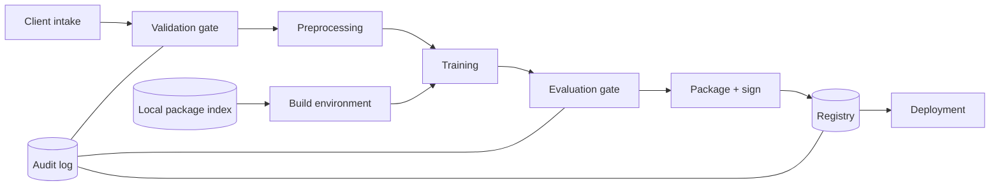

# PRJ-04 — Cobalt Models: A Secure Training and Artifact Pipeline

<a id="prj-04"></a>

**Level 5 project · 11 hours · LO-33 · Reuses LAB-12, LAB-13**

## The organization

Cobalt Models is a fictional boutique ML vendor. It builds custom prediction models for clients in logistics, insurance, and retail. Each engagement produces a dataset, a training pipeline, an evaluated model artifact, and a delivery package. Clients audit the package before accepting it.

Cobalt's engineering team maintains `Forge`, a pipeline that ingests client data, validates it, trains a model, evaluates it, signs the artifact, and publishes it to an internal registry. Two contractors and four engineers can promote artifacts. The signing key is stored on a build machine.

## Background and business objectives

Cobalt's value is reproducible, auditable delivery. The business objectives:

1. Every delivered model reproduces from the client's data and the recorded environment.
2. No artifact reaches a client without a passing evaluation and a valid signature.
3. A failed gate blocks promotion, even under deadline pressure.
4. An auditor can trace a deployed model to its data, code, config, and approver.

The security question is whether the pipeline's controls fail closed: when data, dependencies, or artifacts are wrong, does promotion stop, or does the pipeline continue and produce a plausible-looking result?

## System architecture



| Component | Role | Project version |
|---|---|---|
| Intake | Receives dataset and data dictionary | local directory |
| Validation gate | Schema, ranges, duplicates, label checks | Python |
| Preprocessing | Deterministic transforms | scikit-learn pipeline |
| Training | Fits model with recorded seed | Python |
| Evaluation gate | Metric thresholds and slice checks | Python |
| Packaging | Bundles artifact, config, and metadata | Python |
| Signing | HMAC over the package manifest | local key file |
| Registry | Stores signed packages by version | local directory |
| Deployment | Loads a package after verification | local process |
| Local package index | Stands in for a dependency feed | directory of wheels |

The project uses synthetic client data and a local package index so it runs offline.

## Data classification and assets

| Data | Classification | Why |
|---|---|---|
| Client training data | Confidential (client-owned) | Contractual; may contain personal data in reality |
| Data dictionary and schema | Confidential | Reveals client operations |
| Model artifact | Confidential | IP and client asset |
| Signing key | Restricted | Controls artifact acceptance |
| Build environment and lockfile | Internal | Integrity of the build |
| Audit log | Confidential | Evidence and accountability |
| Delivery report | Confidential | Client-facing claims |

**Assets:** the trained artifact; the signing key; the validation and evaluation gates; the audit log; the client's trust; the reproducibility record.

## Trust boundaries

| Boundary | Crossing | Trust change |
|---|---|---|
| B1 Client → intake | Dataset and dictionary | External data to internal pipeline |
| B2 Package index → build | Dependency code | External code to build environment |
| B3 Training → packaging | Artifact and metrics | Computation to deliverable |
| B4 Packaging → registry | Signed package | Build output to accepted artifact |
| B5 Registry → deployment | Artifact | Internal store to running service |
| B6 Engineer → promotion | Approval | Human action to release authority |

B1, B2, B4, and B6 are the project's focus.

## Threat model

### Adversary profiles

```text
ADV-01 — Compromised data supplier
Goal: Integrity — cause a model to pass evaluation with a manipulated
      dataset or schema.
Knowledge: Data dictionary and delivery format are shared with the client.
Capability: Modify up to 2% of rows; change one column's distribution;
            rename or reorder columns.
Access: Client intake path.
Budget: 2% of rows; one manipulation; no code access.
Success: A manipulated dataset passes validation and evaluation, and the
      delivered model differs from the clean baseline on a target slice.
Out of scope: Code execution, registry access.
```

```text
ADV-02 — Supply-chain or insider adversary
Goal: Integrity — get an unsigned or altered artifact accepted, or make a
      build depend on an unapproved package.
Knowledge: Pipeline layout, registry paths, and promotion process.
Capability: Place a package in the local index; alter an artifact after
            build; attempt promotion without approval.
Access: Build environment and registry directory; no signing key.
Budget: One altered artifact; one unapproved package; one promotion attempt.
Success: Deployment loads an artifact whose signature or hash does not
      match the approved build, or a build succeeds with an unapproved
      dependency.
Out of scope: Theft of the signing key from the host; network attacks.
```

### Risk register (starter)

| ID | Risk | Asset | Likelihood | Impact | Disposition |
|---|---|---|---:|---:|---|
| R-01 | Schema drift passes validation | Data | 3 | 4 | Test |
| R-02 | Duplicate rows inflate evaluation | Evaluation | 4 | 3 | Test |
| R-03 | Unapproved dependency enters build | Build | 3 | 4 | Test |
| R-04 | Artifact altered after signing | Artifact | 2 | 5 | Test |
| R-05 | Promotion without approval | Release | 3 | 4 | Test |
| R-06 | Build not reproducible across machines | Delivery | 4 | 3 | Test |
| R-07 | Evaluation gate skipped under deadline | Release | 3 | 5 | Test |

Add at least two risks (key handling, audit tampering) and score all entries.

## What you are given

| Asset | Source | Use |
|---|---|---|
| Dataset generator | LAB-12 | Clean and manipulated batches |
| Validation checks | LAB-12 | Schema, range, duplicate, label rules |
| Supply-chain inspector | LAB-13 | Static pickle inspection, hashes, signing |
| Local package index | New | Approved and unapproved wheels |
| Registry mock | LAB-13 | Signed packages and metadata |
| Evaluation harness | LAB-05 / LAB-11 | Metric thresholds and slice checks |

No real client data, package feed, signing key, or deployment is used. The local index contains benign packages only.

## Constraints and safety

- Local machine only; offline.
- Do not create, distribute, or execute a malicious model file. Use a benign pickle for static inspection and a deliberately altered hash for the tamper test.
- The signing key is a local file created for the exercise; do not reuse a real key.
- Do not connect to a public package index.
- The project tests a mock pipeline; it is not a certification of Cobalt's (nonexistent) production system.

## Staged investigation

### Stage 0 — Scope and authorization (1 hour)

1. Scope one client engagement, one model, and the promotion path.
2. Exclude client production, the package ecosystem, and host compromise.
3. Write the authorized-use statement and stop rules.

**Output:** `scope.md`, `authorization.md`.

### Stage 1 — Document the pipeline and data (1.5 hours)

1. Draw the architecture and boundaries B1–B6.
2. Inventory data, artifacts, keys, and owners.
3. Describe the promotion authority and the audit record.
4. List three ways the pipeline could produce a plausible but invalid delivery.

**Output:** `system.md`, `data-inventory.csv`, `promotion.md`.

### Stage 2 — Threat model and test plan (1.5 hours)

1. Complete ADV-01 and ADV-02.
2. Score ≥ 8 risks with anchors.
3. Write ≥ 6 gate tests: input, expected block, evidence.
4. Define a stop condition for any test that would require a real key or real data.

**Output:** `threat-model.md`, `risk-register.csv`, `test-plan.csv`.

### Stage 3 — Build the pipeline and gates (3 hours)

1. Implement validation: schema, types, ranges, duplicates, label distribution, and a dataset hash.
2. Implement deterministic training: fixed seed, pinned environment, config hash.
3. Implement the evaluation gate: minimum metric, slice check, and a fail-closed policy.
4. Implement packaging and HMAC signing over a manifest.
5. Implement deployment verification: hash, signature, and version allowlist.

**Output:** `pipeline/`, `gates/`, `configs/`, first signed package.

### Stage 4 — Failure injection, reproducibility, and rollback (3 hours)

1. Run eight failure injections: schema drift, 2% manipulated rows, duplicate rows, unapproved dependency, altered artifact, unsigned artifact, promotion without approval, evaluation skip.
2. Record for each: did the gate block, what was the error, and was the block fail-closed?
3. Run a clean build twice in fresh environments; compare hashes and metrics.
4. Test rollback to the previous signed package and time it.
5. Measure false rejects: a good package should pass every gate.

**Output:** `tests/injection.csv`, `tests/reproducibility.md`, `tests/rollback.md`.

### Stage 5 — Residual risk and report (1 hour)

1. Write findings with severity and evidence.
2. State residual risk for key compromise and for a gate bypass.
3. Recommend an order of fixes with cost.
4. Produce the report, SBOM, and briefing outline.

**Output:** `findings/`, `report.md`, `sbom.json`, `briefing.md`, `manifest.json`.

## Required experiments

| ID | Hypothesis | Manipulation | Oracle | Evidence |
|---|---|---|---|---|
| E-01 | Schema validation blocks renamed/reordered columns | Rename one column | Build refuses; no artifact | `injection.csv` |
| E-02 | Duplicate detection catches copied rows | Duplicate 2% across split | Gate blocks or deduplicates; evaluation unaffected | `injection.csv` |
| E-03 | Dependency allowlist blocks an unapproved package | Add a local wheel not on the list | Build fails before training | `injection.csv` |
| E-04 | Signature verification rejects an altered artifact | Flip one byte in the package | Deployment refuses | `injection.csv` |
| E-05 | Promotion requires an approval record | Promote without approval | Registry rejects | `injection.csv` |
| E-06 | Clean build reproduces bit-for-bit or metric-for-metric | Two fresh environments | Same hashes or metrics within stated tolerance | `reproducibility.md` |
| E-07 | Rollback restores the previous package | Deploy bad version, roll back | Service returns to previous verified version | `rollback.md` |

A gate that blocks by crashing the pipeline without a clear reason is not fail-closed; it is fail-opaque. Record the difference.

## Defensive measures

| Control | Type | What it should do | Cost to measure |
|---|---|---|---|
| Schema and range validation | Preventive | Reject malformed or out-of-range data | False rejects; maintenance |
| Dataset hash and manifest | Detective | Detect changes after intake | Storage; update friction |
| Lockfile and local allowlist | Preventive | Prevent unapproved dependencies | Build time; update process |
| SBOM | Detective/audit | Record components and versions | Maintenance |
| HMAC signing | Preventive | Bind artifact to builder and version | Key management |
| Fail-closed promotion gate | Preventive | Stop release on any failed check | Deadline pressure |
| Deterministic build | Detective | Make reproduction possible | Compute; environment work |
| Rollback runbook | Corrective | Restore a known-good package | Test time |

At least five controls must be implemented and exercised. A control that exists but is never tested in the failure-injection matrix counts as unverified.

## Deliverables and acceptance criteria

| Deliverable | Acceptance criterion |
|---|---|
| Scope and authorization | Engagement, model, and promotion path explicit |
| System and inventory | Boundaries, keys, owners, and audit path mapped |
| Threat model and register | ≥ 8 risks; ≥ 6 gate tests; dispositions |
| Pipeline and gates | Runs end to end on clean data; produces a signed package |
| Failure-injection matrix | 8 scenarios, each with block/no-block and reason |
| Reproducibility | Two fresh builds agree within stated tolerance |
| Rollback | Tested and timed; previous version restored |
| SBOM and manifest | Components and hashes match the package |
| Report | Findings, residual risk, costed order, reproduction |

A pipeline that passes all gates on clean data but has never been tested with bad data is unverified. A gate that fails open in one scenario is a finding even if the other seven pass.

## Rubric (100 points)

| Dimension | Weight | Exemplary evidence in this project |
|---|---:|---|
| Scope, system, and data | 10 | Engagement and promotion path bounded; keys and owners mapped |
| Threat model | 15 | Supplier and insider profiles have budgets; risks include deadline pressure; tests trace to risks |
| Baseline and experimental design | 15 | Clean build baseline; eight injections; false-reject check; two-environment reproduction |
| Attack and analysis correctness | 20 | Each injection isolates one failure; block reason recorded; no conflating crash with control |
| Defense design and evaluation | 15 | Five controls implemented and exercised; costs measured; fail-closed behavior demonstrated |
| Reproducibility and evidence | 10 | Pinned environment; hashes; two fresh builds; SBOM; manifest |
| Risk communication | 10 | Findings state release impact, severity, owner, and retest; order is costed |
| Ethics, safety, and limitations | 5 | No malicious file distribution; local key; mock limits stated |

Deductions: a gate that blocks by exception without a reason (−3); no false-reject check (−3); signing tested only by verifying a good package (−3); claims of reproducibility from the same environment (−5); any real key or client data (automatic fail).

## Reflection questions

1. Which gate is most likely to be bypassed under deadline pressure, and what design change would make bypass harder?
2. Is a crash a fail-closed control? What evidence would distinguish the two?
3. What does bit-for-bit reproducibility require that metric-level reproducibility does not?
4. If the signing key is on the build host, what does the signature actually prove?
5. Which control would you remove first if maintenance cost were the constraint, and what risk would return?
6. What would an auditor ask that your manifest cannot answer?

## Extensions

- **Capstone (CAP-D):** add a second environment, key rotation, and a policy engine; test a compromised build host scenario.
- **Research question:** how often do ML pipeline gates fail open in practice, and what design patterns correlate with fail-closed behavior?
- **Engineering:** integrate the SBOM with a dependency scanner and a provenance attestation.
- **Governance:** write the client acceptance checklist and the change-control policy for promotion.

## Safety and ethics

Synthetic data and benign packages only. Do not create or distribute a malicious pickle, do not connect to a public index, and do not use a real signing key. The exercise tests a local mock; it does not certify any real pipeline.

## Time box

Eleven hours. If the pipeline takes longer, cut the number of gates to five and keep the injection matrix; do not cut the reproducibility or rollback test. A verified five-gate pipeline is a stronger artifact than an unverified nine-gate one.
