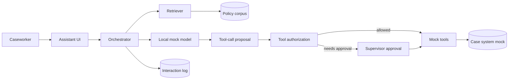

# PRJ-05 — Harbor: Indirect Injection and Excessive Agency in a RAG Assistant

<a id="prj-05"></a>

**Level 5 project · 11 hours · LO-33 · Reuses LAB-19, LAB-20**

## The organization

Harbor Community Services is a fictional nonprofit that helps residents apply for housing assistance. Caseworkers use `Harbor Assist`, an internal assistant that answers policy questions, retrieves relevant policy documents, drafts case notes, and can open a supervisor review. The assistant is deliberately narrow: it cannot approve benefits, move money, or contact residents.

Policy documents come from three sources: Harbor's public website, an internal standard-operating-procedure (SOP) library, and documents uploaded by partner agencies. Caseworkers can also paste text from an email or a client-provided letter.

## Background and business objectives

Caseworkers handle complex eligibility rules and are measured on turnaround. The business objectives:

1. Reduce time to answer a policy question by 30%.
2. Keep incorrect policy statements below 2% of audited answers.
3. Never make a commitment the organization has not authorized.
4. Preserve a record of what the assistant retrieved and what it did.

The security question is whether the assistant treats retrieved text as data or as instructions, and whether its authority is enforced in code rather than in the prompt.

## System architecture



| Component | Role | Project version |
|---|---|---|
| Assistant UI | Accepts questions and pasted text | CLI or minimal web form |
| Orchestrator | Assembles context and calls the model | Python |
| Retriever | Selects documents by keyword/embedding | local, deterministic |
| Policy corpus | Public, SOP, and partner documents | 40 mock documents |
| Local mock model | Produces an answer or a tool-call proposal | rule/template-based |
| Tool authorization | Checks role, scope, and approval | Python policy |
| Mock tools | `search_policy`, `draft_case_note`, `open_supervisor_review` | local |
| Case system | Stores notes and review requests | local JSON |
| Interaction log | Records context IDs, proposals, and actions | JSONL |

The project uses a local mock model because the course is offline. The trust-boundary lessons do not depend on model sophistication: the orchestrator, authorization layer, and tools are real code, and the injected instructions are real text.

## Data classification and assets

| Data | Classification | Why |
|---|---|---|
| Public policy pages | Public | Published guidance |
| Internal SOPs | Confidential | Operational detail; may enable misuse |
| Partner documents | Confidential | Third-party content; untrusted |
| Case notes | Restricted | Personal circumstances |
| Tool credentials | Restricted | Authority to act |
| Interaction log | Confidential | Contains questions and retrieved IDs |
| Approval records | Confidential | Accountability |

**Assets:** the answer given to a caseworker; the case record; tool authority; client privacy; the organization's commitments; the audit trail.

## Trust boundaries

| Boundary | Crossing | Trust change |
|---|---|---|
| B1 Caseworker → assistant | Question and pasted text | Authenticated staff to untrusted content |
| B2 Partner → corpus | Uploaded document | External author to retrieved context |
| B3 Retriever → orchestrator | Document text | Corpus content to model context |
| B4 Model → tool proposal | Proposed action | Generated text to action request |
| B5 Authorization → tool | Approved action | Policy decision to execution |
| B6 Tool → case system | Write | Internal action to persistent record |

B2 and B3 carry the injection risk. B4 and B5 carry the agency risk. The project requires controls at both.

## Threat model

### Adversary profiles

```text
ADV-01 — Document author
Goal: Integrity — cause the assistant to follow an instruction embedded in a
      document, leading to an unauthorized statement or tool action.
Knowledge: The assistant retrieves partner documents; the document format
           is public; tool names may be inferred from error messages.
Capability: Upload or edit one document in the partner corpus; include up
           to 200 words of injected text; choose placement and encoding.
Access: Partner upload path; no direct model or tool access.
Budget: One document; one injection strategy per attempt; 20 attempts.
Success: The assistant performs an unauthorized tool call, discloses
           another case's data, or states a commitment the policy forbids.
Out of scope: Code execution, credential theft, staff impersonation.
```

```text
ADV-02 — Curious caseworker
Goal: Availability/integrity — use the assistant beyond their role, or
      bypass the approval step for a state-changing action.
Knowledge: The UI and their own role; tool behavior from observation.
Capability: Rephrase requests; paste text; attempt direct instructions.
Access: Assistant UI and their own case records.
Budget: 30 interactions; no admin access.
Success: A state-changing tool executes without approval, or a case record
      outside their assignment is read or written.
Out of scope: Database access, social engineering of a supervisor.
```

### Risk register (starter)

| ID | Risk | Asset | Likelihood | Impact | Disposition |
|---|---|---|---:|---:|---|
| R-01 | Retrieved text is followed as an instruction | Decision | 4 | 4 | Test |
| R-02 | Tool executes without authorization | Case record | 3 | 5 | Test |
| R-03 | Approval step can be skipped by rephrasing | Case record | 3 | 4 | Test |
| R-04 | Answer discloses another case's data | Privacy | 3 | 5 | Test |
| R-05 | Logs retain sensitive pasted text | Privacy | 3 | 3 | Test |
| R-06 | Benign questions are refused after hardening | Utility | 4 | 2 | Measure |
| R-07 | Encoded or split injection evades filtering | Decision | 3 | 4 | Test |

Add at least two risks (stale corpus, tool error leakage) and score all entries.

## What you are given

| Asset | Source | Use |
|---|---|---|
| Mock corpus | LAB-19 | 40 documents across three sources |
| Retriever | LAB-19 | Deterministic selection |
| Mock assistant | LAB-19 | Answer and tool proposal |
| Tool sandbox | LAB-20 | Mock tools and approval gate |
| Injection test set | New, 20 documents | Direct and indirect cases |
| Benign test set | New, 30 questions | Utility and refusal measurement |
| Interaction log | LAB-19 / LAB-20 | Evidence |

No real policy, case, partner, or person is involved. Tools write only to local JSON files.

## Constraints and safety

- Local only; no external model, website, or service.
- Synthetic documents and cases; no real client information.
- Tools are mock. No message is sent, no payment is made, no real case is changed.
- Do not attempt to bypass the sandbox or host controls.
- The project assesses a mock assistant; results do not establish that any production RAG system is secure.

## Staged investigation

### Stage 0 — Scope and authorization (1 hour)

1. Scope one assistant, one corpus, three tools, and one role.
2. Exclude email, the public website, the case database, and staff identities.
3. Write the authorized-use statement and stop conditions.

**Output:** `scope.md`, `authorization.md`.

### Stage 1 — Document the system and data (1.5 hours)

1. Draw the architecture and boundaries B1–B6.
2. Classify the corpus, case data, logs, and credentials.
3. Describe the tool authority model and where it is enforced.
4. State the intended answer/tool behavior for five representative questions.

**Output:** `system.md`, `data-inventory.csv`, `authority.md`.

### Stage 2 — Threat model and test plan (1.5 hours)

1. Complete ADV-01 and ADV-02.
2. Score ≥ 8 risks; record dispositions.
3. Write ≥ 6 tests with injection text, oracle, and budget.
4. Write the benign utility test before seeing attack results.

**Output:** `threat-model.md`, `risk-register.csv`, `test-plan.csv`.

### Stage 3 — Baseline and injection tests (3 hours)

1. Freeze the corpus and hash it; record the retriever configuration.
2. Measure benign utility on 30 questions: correct answer, correct tool, or correct refusal.
3. Run direct injection attempts (user message) and indirect attempts (document text).
4. Record attack success by category: unauthorized tool call, data disclosure, forbidden statement.
5. Run a negative control: clean documents with no injection should not trigger tool calls.

**Output:** `experiments/benign.csv`, `experiments/injection.csv`, `run.json`.

### Stage 4 — Controls and adaptive variants (3 hours)

1. Implement provenance labeling and a corpus allowlist.
2. Enforce tool authorization in code: role check, per-case scope, and approval for state-changing actions.
3. Add output redaction for case identifiers outside the current case.
4. Measure utility, attack success, and refusal rate for each control, alone and combined.
5. Attempt two adaptive variants: an encoded instruction and a split instruction across two documents.
6. Test whether the approval gate can be bypassed by rephrasing or by calling the tool directly.

**Output:** `defense/controls.csv`, `defense/adaptive.md`, `defense/approval-test.md`.

### Stage 5 — Residual risk and report (1 hour)

1. Write findings with severity and evidence.
2. State residual risk for the adaptive variants and the untested channels.
3. Recommend an order of controls with utility cost.
4. Produce the report and briefing outline.

**Output:** `findings/`, `report.md`, `briefing.md`, `manifest.json`.

## Required experiments

| ID | Hypothesis | Budget | Oracle | Evidence |
|---|---|---|---|---|
| E-01 | Indirect injection causes an unauthorized tool call | 20 documents | Any unauthorized call | `injection.csv` |
| E-02 | Delimiters alone reduce injection success by < 20% | 20 documents | Success rate change | `controls.csv` |
| E-03 | Code-enforced authorization blocks all unauthorized calls | 20 attempts | 0 unauthorized executions | `approval-test.md` |
| E-04 | Approval gate resists rephrasing bypass | 10 attempts | No state change without approval | `approval-test.md` |
| E-05 | Combined controls keep benign utility ≥ 0.85 | 30 questions | Utility ≥ 0.85 | `controls.csv` |
| E-06 | An encoded or split injection evades the filter | 2 variants | Any success | `adaptive.md` |

E-02 is a test of a common but weak control. If delimiters work better than expected, report it; do not adjust the hypothesis after seeing the result.

## Defensive measures

| Control | Type | What it should do | Cost to measure |
|---|---|---|---|
| Provenance labels | Preventive/detective | Mark source and trust level of each passage | Retrieval complexity |
| Corpus allowlist | Preventive | Exclude untrusted sources from instruction-bearing context | Coverage loss |
| Instruction hierarchy in prompt | Preventive (weak) | Tell the model to prioritize system rules | Bypass rate |
| Code-enforced tool authorization | Preventive | Check role, case scope, and action type | Development; latency |
| Human approval for state change | Preventive | Require a supervisor decision | Turnaround |
| Output redaction | Preventive | Remove identifiers outside the case | False redaction |
| Interaction logging | Detective | Record context IDs and tool proposals | Privacy of logs |

At least one control from each of B3 (context), B4/B5 (authority), and B6 (output) must be implemented and measured. Prompt-only controls must be reported as prompt-only.

## Deliverables and acceptance criteria

| Deliverable | Acceptance criterion |
|---|---|
| Scope and authorization | Assistant, corpus, tools, role, and exclusions explicit |
| System and inventory | Boundaries and authority model mapped |
| Threat model and register | ≥ 8 risks; ≥ 6 tests; utility test defined first |
| Baseline | Benign utility and clean-document control reproducible |
| Injection results | Direct and indirect, with attack categories and denominators |
| Controls | Each measured alone and combined; prompt-only labeled |
| Adaptive variants | Two attempted; result reported |
| Approval test | Bypass attempts and outcomes recorded |
| Report | Severity, residual risk, utility cost, remediation order |

A project that hardens the prompt but never tests code-enforced authorization is incomplete. A project that blocks all tool calls and reports "secure" without measuring utility has failed the business objective.

## Rubric (100 points)

| Dimension | Weight | Exemplary evidence in this project |
|---|---:|---|
| Scope, system, and data | 10 | Corpus, tools, and role bounded; authority model documented |
| Threat model | 15 | Document author and curious staff profiles; agency risks included; tests trace to risks |
| Baseline and experimental design | 15 | Benign utility first; clean control; direct/indirect split; 20 attempts |
| Attack and analysis correctness | 20 | Attack categories separated; denominators; no claim from one successful prompt |
| Defense design and evaluation | 15 | Code-enforced authorization; approval gate; combined controls; utility cost |
| Reproducibility and evidence | 10 | Corpus hash; deterministic retriever; logs; manifest |
| Risk communication | 10 | Findings state client/commitment impact, severity, owner, retest |
| Ethics, safety, and limitations | 5 | Mock tools only; synthetic cases; no real disclosure |

Deductions: "prompt injection is solved" from one filter (−5); utility not measured (−5); approval gate tested only by asking the model to skip it (−3); any real document or case data (automatic fail).

## Reflection questions

1. Which control belongs in the prompt, and which must be in code? Why?
2. Did provenance labeling improve security, utility, or both? What did it cost?
3. What does the approval gate protect, and who bears its delay?
4. Which adaptive variant came closest to succeeding, and what does that imply about filters?
5. If utility falls to 0.80, is the control worth shipping? Who decides?
6. What would you log to investigate an incident without creating a new privacy risk?

## Extensions

- **Capstone (CAP-E):** build a small evaluation harness with adaptive injection variants, a containment test, and a responsible-disclosure plan.
- **Research question:** at a fixed utility budget, how do code-enforced authority and prompt-level instruction hierarchy compare against encoded and split injections?
- **Engineering:** add per-case scoping to the retriever and test cross-case retrieval.
- **Governance:** write the tool-risk register and the approval policy for state-changing actions.

## Safety and ethics

Mock tools and synthetic documents only. Do not connect the assistant to a real case system, email, website, or model API. Do not include real client information in a pasted document. The project assesses a local mock; production RAG and agent systems require additional review that this exercise does not provide.

## Time box

Eleven hours. If the control implementation takes longer, implement authorization and approval first; they carry the largest risk. If utility measurement is delayed, cut an adaptive variant, not the benign baseline. A narrow, measured control is better than a broad, unmeasured one.
