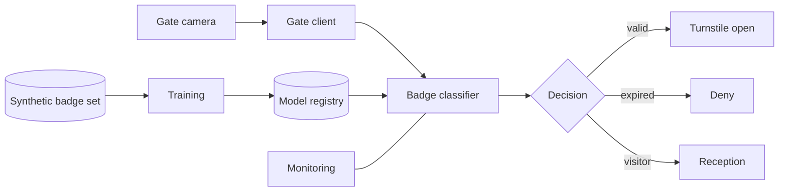

# PRJ-06 — Sentinel Vision: A Comparative Evaluation of Robustness Defenses

<a id="prj-06"></a>

**Level 5 project · 11 hours · LO-33 · Reuses LAB-03, LAB-11**

## The organization

Sentinel Vision is a fictional access-control vendor. Its `GateReader` camera reads a printed staff badge and a classifier returns `valid`, `expired`, or `visitor`. The gate controller opens the turnstile for `valid`, denies `expired`, and routes `visitor` to reception.

Badge images in this project are synthetic renders of colored shapes and text. No faces, fingerprints, or real badge photographs are used, and the classifier makes no biometric decision.

## Background and business objectives

A false accept lets an expired badge through. A false reject delays staff and creates a queue. The business objectives:

1. False-accept rate below 0.5% at the operating threshold.
2. False-reject rate below 2%.
3. Gate decision within 300 ms at the 95th percentile.
4. A defense that can run on the existing gate hardware, without a GPU.

The security question is not "is the model robust?" It is "which defense gives the best trade-off among attack success, clean accuracy, false accepts, and runtime, under a stated budget and an adaptive attacker?"

## System architecture



| Component | Role | Project version |
|---|---|---|
| Camera | Captures a badge image | synthetic generator |
| Gate client | Sends image, enforces timeout | Python |
| Classifier | 3-class image classifier | scikit-learn / small CNN (CPU) |
| Decision | Maps class and threshold to action | config |
| Registry | Stores artifact and version | local |
| Monitoring | Logs decisions and latency | JSONL |
| Training | Trains candidate defenses | Python |

## Data classification and assets

| Data | Classification | Why |
|---|---|---|
| Badge templates | Confidential | Physical security design |
| Synthetic badge images | Internal | Test data; no personal information |
| Classifier and weights | Confidential | Security control and IP |
| Thresholds | Restricted | Directly enable bypass |
| Decision logs | Confidential | Access patterns |
| Gate configuration | Restricted | Physical security |

**Assets:** the accept/deny decision; the model; the threshold; the gate controller; the decision log; staff safety.

## Trust boundaries

| Boundary | Crossing | Trust change |
|---|---|---|
| B1 Badge → camera | Printed image | Physical object to digital image |
| B2 Camera → gate client | Image bytes | Capture to processing |
| B3 Client → classifier | Preprocessed image | Untrusted input to model |
| B4 Classifier → controller | Decision | Model output to physical action |
| B5 Registry → client | Artifact | Build to gate |
| B6 Monitoring → review | Logs | Operational data to investigation |

B1 and B3 carry the evasion question. B4 is where a model error becomes access.

## Threat model

### Adversary profiles

```text
ADV-01 — Badge presenter
Goal: Integrity — obtain a `valid` decision for an expired badge, or cause
      a `visitor` routing for a badge that should be denied.
Knowledge: Badge appearance and the gate's behavior; no weights or
           thresholds; can observe accept/deny.
Capability: Modify the printed badge within a bounded visual budget
            (digital analogue of print variation: ±ε per pixel, 8/255).
Access: The gate camera and their own badge.
Budget: ε ∈ {2, 4, 8}/255; 20 attempts per budget; one badge template.
Success: Attack success rate ≥ 0.50 at the operating false-accept rate.
Out of scope: Camera hardware access, controller network, social engineering.
```

```text
ADV-02 — Adaptive attacker
Goal: Integrity — defeat the deployed defense after observing its behavior.
Knowledge: The defense type is known (e.g., adversarial training); the
           attacker can query the gate and observe decisions.
Capability: Adaptive PGD or transfer attack within the same ε budget.
Access: Gate camera; no model access.
Budget: Same ε; 40 attempts; one adaptive strategy.
Success: ASR ≥ 0.30 against the recommended defense at the operating point.
Out of scope: Physical access to the model host, side channels.
```

### Risk register (starter)

| ID | Risk | Asset | Likelihood | Impact | Disposition |
|---|---|---|---:|---:|---|
| R-01 | Bounded perturbation flips expired to valid | Decision | 4 | 5 | Test |
| R-02 | Defense reduces clean accuracy below the false-reject target | Availability | 4 | 3 | Measure |
| R-03 | Defense exceeds the 300 ms budget | Availability | 3 | 3 | Measure |
| R-04 | Adaptive attack defeats the defense | Decision | 3 | 5 | Test |
| R-05 | False-accept calibration changes after defense | Decision | 3 | 4 | Test |
| R-06 | Threshold tuned on the test set | Evaluation | 3 | 4 | Test |

Add at least two risks (artifact swap, camera drift) and score all entries.

## What you are given

| Asset | Source | Use |
|---|---|---|
| Synthetic badge generator | New / LAB-08-style | 3 classes, 28×28 grayscale |
| Baseline classifier | LAB-03-style training | Clean model |
| Evasion harness | LAB-03 / LAB-04 | PGD and transfer attacks |
| Defense implementations | LAB-11 | Squeezing, adversarial training, combined |
| Threshold calibration | LAB-11 | False-accept/false-reject trade-off |
| Latency harness | New | p50/p95 measurement |

No real badge, face, employee, or gate is used. All images are generated.

## Constraints and safety

- CPU only; synthetic images; loopback services.
- No real access-control system, camera, or badge.
- Perturbation stays within the stated ε; no physical badge printing.
- Do not claim a defense is "robust"; report curves at budgets.
- The project compares defenses on a mock; it does not certify Sentinel's (nonexistent) product.

## Staged investigation

### Stage 0 — Scope and authorization (1 hour)

1. Scope one classifier, one badge class pair, and three ε budgets.
2. Exclude physical printing, camera hardware, and the controller network.
3. Write the authorized-use statement and stop conditions.

**Output:** `scope.md`, `authorization.md`.

### Stage 1 — Document the system and evaluation (1.5 hours)

1. Draw the architecture and boundaries B1–B6.
2. Classify data and assets.
3. Define the operating point: threshold, false-accept target, false-reject limit, latency budget.
4. State the claim you will test and the claim you will not test.

**Output:** `system.md`, `operating-point.md`.

### Stage 2 — Threat model and test plan (1.5 hours)

1. Complete ADV-01 and ADV-02.
2. Score ≥ 8 risks with anchors.
3. Write the comparison matrix: defenses × budgets × seeds.
4. Define the oracle for "best" before running: which dimensions and weights.

**Output:** `threat-model.md`, `risk-register.csv`, `test-plan.csv`.

### Stage 3 — Baseline, defenses, and cost (3.5 hours)

1. Freeze the evaluation set and hash it.
2. Train the baseline and calibrate the threshold to the false-accept target.
3. Train three defenses: input squeezing, adversarial training, and combined.
4. Evaluate clean accuracy and false-accept/false-reject rates for each at the calibrated threshold.
5. Measure training time and inference latency (p50/p95) for each.

**Output:** `results/clean.csv`, `results/cost.csv`, `run.json`.

### Stage 4 — Attack comparison and adaptive retest (2.5 hours)

1. Run PGD at ε = 2, 4, 8 for each defense, three seeds.
2. Run a transfer attack from the undefended model to each defense.
3. Run an adaptive PGD against the best static defense, at matched compute.
4. Build the comparison table and one figure; compute intervals.
5. Recommend a defense using the pre-declared weights, and state the trade-off.

**Output:** `results/attack.csv`, `results/adaptive.csv`, `results/comparison.md`, figure.

### Stage 5 — Report and briefing (1 hour)

1. Write findings and the residual-risk statement.
2. State the cost of the recommendation in accuracy, false accepts, and latency.
3. Produce the report and a 10-minute briefing outline.

**Output:** `findings/`, `report.md`, `briefing.md`, `manifest.json`.

## Required experiments

| ID | Hypothesis | Budget | Oracle | Evidence |
|---|---|---|---|---|
| E-01 | Baseline ASR ≥ 0.50 at ε = 4/255 | 3 seeds | ASR ≥ 0.50 at operating point | `attack.csv` |
| E-02 | Adversarial training reduces ASR by ≥ 0.20 at ε = 4 | 3 seeds | Difference beyond interval | `attack.csv` |
| E-03 | The defense's clean accuracy stays within 3 points | 3 seeds | Clean drop ≤ 3 points | `clean.csv` |
| E-04 | The defense meets the 300 ms p95 budget | 1,000 requests | p95 ≤ 300 ms | `cost.csv` |
| E-05 | Adaptive PGD recovers ≥ 0.30 ASR against the best defense | 40 attempts | ASR ≥ 0.30 | `adaptive.csv` |
| E-06 | Transfer attack changes the ranking of defenses | 3 seeds | Ranking change | `attack.csv` |

The oracle for "best defense" must be declared before E-05; otherwise the recommendation is post-hoc.

## Defensive measures

| Defense | Mechanism | Expected benefit | Expected cost |
|---|---|---|---|
| Input squeezing | Reduce bit depth / median filter | Removes small perturbations | Clean accuracy; latency |
| Adversarial training | Train on PGD examples | Raises ASR under static attack | Training time; clean accuracy |
| Combined | Squeezing + adversarial training | Layered | Both costs; possible gradient masking |
| Randomized smoothing (optional) | Noise + majority vote | Certified radius for a classifier | Many inference passes; latency |

Implement at least three and evaluate all at the same operating point. Report any defense that only works because gradients are masked; a transfer attack is the minimum check.

## Deliverables and acceptance criteria

| Deliverable | Acceptance criterion |
|---|---|
| Scope and operating point | ε, threshold, FA/FR targets, latency budget explicit |
| System and inventory | Boundaries and assets mapped |
| Threat model and register | ≥ 8 risks; adaptive profile; tests trace to risks |
| Clean and cost results | All defenses at the same threshold; intervals; latency |
| Attack results | 3 defenses × 3 budgets × 3 seeds; ASR with denominators |
| Adaptive result | Attempted against the best defense; result reported |
| Comparison | One table and one figure; pre-declared weighting |
| Recommendation | Defense, trade-off, residual risk, and cost |
| Report | Reproducible; limitations stated |

A comparison that reports only ASR is incomplete. A comparison that omits false accepts, latency, or adaptive attack is not a security evaluation.

## Rubric (100 points)

| Dimension | Weight | Exemplary evidence in this project |
|---|---:|---|
| Scope, system, and data | 10 | One classifier, one class pair, three budgets; operating point defined |
| Threat model | 15 | Presenter and adaptive profiles; risks include availability; oracle pre-declared |
| Baseline and experimental design | 15 | Frozen set; calibrated threshold; 3×3×3 matrix; seeds and intervals |
| Attack and analysis correctness | 20 | ASR at fixed operating point; transfer and adaptive; no cherry-picked seed |
| Defense design and evaluation | 15 | Three defenses; clean/FA/FR/latency costs; masking considered |
| Reproducibility and evidence | 10 | Configs, seeds, run records, manifest; clean-checkout |
| Risk communication | 10 | Recommendation states trade-off and residual risk, not just "best" |
| Ethics, safety, and limitations | 5 | Synthetic badges; no physical access; limits of the mock stated |

Deductions: defenses compared at different thresholds (−5); adaptive attack omitted (−5); "robust" claimed from one budget (−5); latency omitted (−3); best-seed selection (−3).

## Reflection questions

1. Which defense would you recommend, and which stakeholder pays its cost?
2. Did the adaptive attack change the ranking? What does that imply about static benchmarks?
3. Is a defense that reduces ASR by masking gradients useful? Under what conditions?
4. How does the false-accept target constrain the choice of threshold and defense?
5. What would you need to test before a physical deployment, and what can this mock not tell you?
6. If all defenses fail at ε = 8, what is the honest recommendation?

## Extensions

- **Capstone (CAP-B):** reproduce a published robustness comparison, then critique its evaluation and add an adaptive condition.
- **Research question:** at a fixed false-accept rate and latency budget, how do robustness rankings change under adaptive attacks across model families?
- **Engineering:** add randomized smoothing and measure the certified radius versus latency.
- **Governance:** write the acceptance test a physical security team would require before deployment.

## Safety and ethics

Synthetic badge images only. No faces, biometrics, real badges, cameras, or gates. Do not print adversarial badges or test a physical access system. The project evaluates a mock classifier; a real deployment requires hardware, environmental, and physical-security testing that this exercise does not cover.

## Time box

Eleven hours. If training is slow, reduce image count or seeds and record the change; do not drop the adaptive attack or the cost table. A three-defense comparison with an adaptive condition is the minimum useful result.
