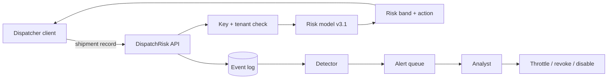

# RT-01 — Bounded Red/Blue Exercise on a Local Dispatch-Risk Service

**Level 5 exercise · 9 hours · LO-34 · Uses LAB-14 and LAB-15 patterns**

## The organization

Pinewood Logistics is a fictional freight broker. Its dispatch desk uses `DispatchRisk`, a local mock service that scores a shipment for delay and damage risk. Dispatchers receive a risk band and a recommended action: `release`, `hold`, or `inspect`. The service is a training mock, not a production system, and every record is synthetic.

The security team wants to know whether its controls detect and contain misuse while dispatchers continue to work. That is the purpose of RT-01: not to find the most vulnerabilities, but to measure detection and response against a bounded adversary.

## Objectives

| Team | Objective |
|---|---|
| Red | Obtain a decision or data the requester should not get, or degrade service within the budget |
| Blue | Detect, triage, contain, and recover without blocking benign dispatchers |
| Purple | Merge the evidence, test mitigations, and state residual risk |

Success is measured separately for each objective. A red success does not cancel a blue success, and a blue detection does not erase the effect of a successful attack.

## System under test

| Component | Detail |
|---|---|
| Target | `http://127.0.0.1:8090` |
| Routes | `POST /risk`, `GET /health`, `POST /admin/rollback` |
| Data | Synthetic shipments from `make_shipments.py`, seed 21 |
| Identities | Six dispatcher keys (`d-01`…`d-06`), one admin key (`a-01`) |
| Quota | 120 decisions per minute per key |
| Model | Gradient-boosted classifier, version 3.1, threshold 0.55 |
| Telemetry | Request, auth, decision, admin, model events; banded features |
| Admin action | Reload the model from a local directory; mock only |

## Scope and non-goals

| In scope | Out of scope |
|---|---|
| The three routes on loopback | Any other host or port |
| Synthetic shipments, seed 21 | Real shipment, customer, or employee data |
| Request, auth, and feature manipulation within bounds | Host filesystem, OS, interpreter, network stack |
| One or two dispatcher keys; admin key for the auth test | Key theft, social engineering, physical access |
| Load up to 20 concurrent requests | Denial of service beyond the cap |
| Local logs and detector | The vendor's or any third-party system |

## Roles and separation

| Role | Responsibility | Constraint |
|---|---|---|
| Exercise lead | Scope, safety, stop/resume | Does not run attacks or tune detectors |
| Red team | Execute A-01…A-07, log evidence | Stays within budget and scope |
| Blue team | Build detections, calibrate, respond | Does not see the red plan before the baseline is frozen |
| Referee | Check evidence and scoring | Does not change results |
| System owner | Accept findings and remediation | Does not declare success without a retest |

In self-study, separate the roles in time: freeze the blue plan before reading the red plan, and record the separation in the report. See [Lesson 17.1](../modules/m17-red-team-blue-team/lesson-1-rules-of-engagement-and-threat-model.md).

## Budgets

| Budget | Limit | Counted by |
|---|---|---|
| Requests | 2,000 | Client counter |
| Time | 4 hours of attack execution | Session clock |
| Perturbation | 3 features per record, 1st–99th percentile | Script validation |
| Concurrency | 20 in flight | Semaphore |
| Keys | 2 dispatcher keys + 1 admin key | Pre-issued |

The budget is part of the result. Report the requests used per test, not only the total.

## Exercise risk register

| ID | Risk | Control |
|---|---|---|
| X-01 | Traffic leaves loopback | Base URL hard-coded; preflight host check |
| X-02 | Load destabilizes the workstation | Concurrency cap; watchdog |
| X-03 | Real data in the synthetic set | Generator only; checksum; no downloads |
| X-04 | Blue sees the red plan | Separate sessions; frozen baseline |
| X-05 | Detector tuned on test attacks | Hold-out split; freeze before scoring |
| X-06 | Scope creep to another route | Change log; lead approval |
| X-07 | Results not reproducible | Scripts, seeds, manifest, replay command |

## Staged work plan (9 hours)

### Stage 0 — Rules of engagement and threat model (1 hour)

1. Write the eight-section RoE: authorization, target, non-goals, constraints, data handling, roles, communications, stop conditions.
2. Write RD-01 (external dispatcher) and RD-02 (insider with two keys).
3. Score the exercise risks X-01…X-07 and the target risks R-01…R-06.
4. Freeze the stop-condition table and name the stop authority.

**Output:** `roe.md`, `scope.md`, `threat-model.md`, `risk-register.csv`.

### Stage 1 — Baseline and instrumentation (1.5 hours)

1. Start the service; confirm `/health`; confirm the host is `127.0.0.1`.
2. Generate 2,000 benign requests over four hours of simulated time: 20 keys, 4 tenants, realistic feature mix, 6% hold rate.
3. Hash the baseline and the evaluation set.
4. Verify that request, auth, decision, and admin events carry a shared `request_id`.
5. Freeze the blue-team detection plan and thresholds before opening the red plan.

**Output:** `baseline/`, `telemetry-schema.md`, `blue-plan.md` (frozen), `run.json`.

### Stage 2 — Red-team execution (2 hours)

Run the seven attacks from [Lesson 17.2](../modules/m17-red-team-blue-team/lesson-2-red-team-planning-and-execution.md):

| ID | Attack | Budget | Oracle |
|---|---|---|---|
| A-01 | Authentication enforcement | 20 requests | All invalid keys rejected |
| A-02 | Tenant isolation | 40 requests | No cross-tenant decision |
| A-03 | Input validation | 60 requests | 4xx, no internal detail |
| A-04 | Quota enforcement | 400 requests | ≤ 120 decisions/min/key, 429s |
| A-05 | Evasion within feature bounds | 900 requests | Segment hold rate < 0.10 at global false-hold ≤ 0.02 |
| A-06 | Extraction-style querying | 500 queries | Surrogate agreement ≥ 0.90 |
| A-07 | Admin action authorization | 30 requests | Only `a-01` succeeds; action logged |

For each: record requests, responses, result, budget used, and one replay command. Mark inconclusive tests as inconclusive at budget.

**Output:** `red/requests/`, `red/responses/`, `red/results.csv`, `red/replay.sh`, `red/negative.md`.

### Stage 3 — Blue-team detection and response (2 hours)

1. Score the quiet baseline against D-01…D-07; compute FP rate per rule.
2. Choose thresholds at ≤ 0.5% FP per rule; freeze them.
3. Score the held-out attack events; compute recall, precision at an assumed prevalence, TTD, and TTC.
4. Execute the response runbook for at least two detections: triage, contain, recover, verify.
5. Replay a slice of benign traffic after containment and confirm dispatchers are not blocked.

**Output:** `blue/calibration.csv`, `blue/alerts.jsonl`, `blue/timeline.md`, `blue/response.md`.

### Stage 4 — Purple synthesis, mitigation, and adaptive variant (1.5 hours)

1. Merge red and blue events into one timeline with UTC timestamps and request IDs.
2. Build the before/after matrix with versions.
3. Implement two mitigations: tenant-level cumulative quota and faster containment for D-05 (or two you can justify).
4. Replay the same attacks; record outcomes, detection, containment, and benign cost.
5. Declare and run one adaptive variant (e.g., two keys, slow ramp, header tenant).
6. Write the residual-risk statement.

**Output:** `purple/timeline.md`, `purple/matrix.csv`, `purple/mitigations.md`, `purple/adaptive.md`, `purple/residual.md`.

### Stage 5 — Report and briefing (1 hour)

1. Write the purple-team report (8–10 pages) with separate red and blue sections.
2. Prepare a 10-minute briefing: three findings, one timeline, one recommendation.
3. Run the clean-checkout reproduction of the headline result.
4. Record limitations: baseline size, missing telemetry, untested families.

**Output:** `report.md`, `briefing.md`, `manifest.json`.

## Required measurements

| Metric | Definition | Minimum |
|---|---|---|
| Attack success | Oracle satisfied, per attack | All seven attacks reported |
| Detection recall | Detected attacks / attacks in held-out test set | With denominator and split |
| Detection FP rate | Benign alerts / benign requests, per rule | At the chosen threshold |
| Precision | TP / (TP + FP) at stated prevalence | Prevalence stated |
| TTD | First attack request → first correct alert | Per detected attack |
| TTC | First correct alert → effect stopped | Per contained attack |
| Benign cost | Blocked or delayed benign requests after containment | Measured |
| Residual risk | Effect remaining under controls and variant | Numbers and adversary |

## Deliverables and acceptance criteria

| Deliverable | Acceptance criterion |
|---|---|
| `roe.md` | Eight sections complete; stop authority named |
| `threat-model.md` | Two adversary profiles with budgets; ≥ 6 target risks |
| `baseline/` | 2,000 benign requests; hashed; one command regenerates |
| `blue-plan.md` | Frozen before red execution; timestamped |
| `red/` | Seven attacks, budgets used, replay, negative results |
| `blue/` | Calibration, alerts, response timeline, benign replay |
| `purple/` | Merged timeline, matrix, two mitigations, adaptive variant, residual risk |
| `report.md` | Separate red/blue sections, synthesis, limitations, reproduction |
| `manifest.json` | Hashes for baseline, results, and report artifacts |

A result without a frozen baseline is not a measurement. A detection without a benign FP estimate is not a detection quality claim.

## Rubric (100 points)

| Dimension | Weight | Exemplary evidence |
|---|---:|---|
| RoE and scope | 10 | Eight sections; enumerable in/out lists; stop authority; separation recorded |
| Threat model | 15 | Testable adversary profiles; exercise and target risks; every test traced |
| Red execution and evidence | 20 | Seven attacks; budgets counted; replay; negative and inconclusive results |
| Blue detection and response | 20 | Quiet baseline; calibrated thresholds; recall/FP/TTD/TTC; containment verified |
| Mitigation and adaptive retest | 15 | Two mitigations; replay; declared variant; residual risk with numbers |
| Reproducibility | 10 | Scripts, seeds, manifest, clean-checkout headline result |
| Communication | 5 | Report separates red/blue; briefing is decision-oriented |
| Safety and ethics | 5 | Loopback only; synthetic data; no real credentials; stop conditions honored |

Deductions: no benign baseline (−10); detector tuned on test attacks without disclosure (−10); containment not followed by benign replay (−5); adaptive variant omitted (−5); scope exceeded (automatic fail).

## Reflection questions

1. Which attack succeeded, and which control should have stopped it?
2. Did the blue team detect the attack or only the noise around it? What is the evidence?
3. Which mitigation generalized to its variant, and which did not?
4. What did containment cost legitimate dispatchers?
5. Where did the merged timeline show a gap that neither team's report contained?
6. What would you test next if you had another 2,000 requests?

## Extensions

- **Capstone (CAP-A or CAP-E):** extend the exercise to a full assessment or an agentic test harness with adaptive variants.
- **Research question:** how does detection recall change when the attacker knows the detection window and paces below it?
- **Engineering:** add tenant-level cumulative quotas and automatic containment with a rollback test.
- **Governance:** write the exercise report as an audit artifact and map findings to NIST CSF functions.

## Safety and ethics

Loopback only. Synthetic records only. No real credentials, personal data, or third-party systems. Tools are mock; no message is sent and no real action is taken. The exercise measures a mock service under a defined test set; it is not a penetration test and does not certify any production system.

## Time box

Nine hours. If the red stage exceeds its budget, stop at 150%, record partial results, and keep the blue and purple stages. A complete measurement of five attacks with detection and response is more valuable than an incomplete attempt at ten.
