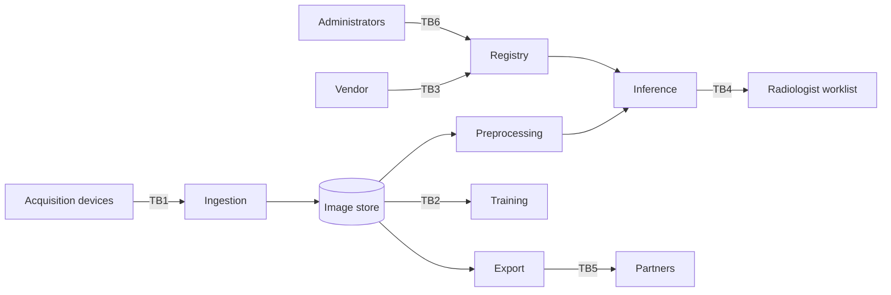

# LAB-02 Threat Model Report

Replace the prompts. Keep the headings; the checker looks for them.

## System and scope

- What the system does and the decision it influences.
- In scope / out of scope.
- Why it is decision support, not an autonomous diagnosis.

## Data-flow diagram



Replace this starter diagram with your own; keep the `TB` labels.

## Assets

TODO table of at least six assets.

## Trust boundaries

TODO table of at least five boundaries and their controls.

## Attack surfaces

TODO table of at least eight surfaces and who can reach each one.

## Adversary model

TODO table of actors, goals, knowledge, capability, and assumed limits.

## Threat register

TODO table of at least nine accepted threats and one rejected threat.

## Attack trees

TODO three trees with at least three steps each.

## Mitigations and residual risk

TODO preventive, detective, and corrective controls plus residual ratings.

## Framework crosswalk

TODO NIST AI RMF functions, OWASP ML entries, and the OWASP LLM decision.

## Assumptions and rejected threats

TODO assumptions and the rejected threat with its reopening condition.

## Reproduction

```bash
python check_threat_model.py --model threat-model.yaml --report report.md
```
