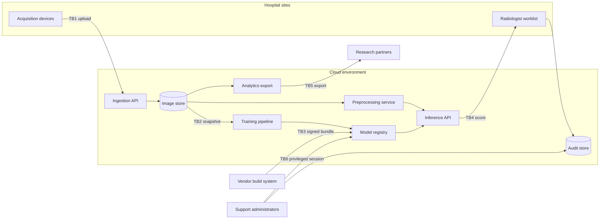

# MediScan Triage Assistant — Threat Model

**Scenario:** fictional hospital-network radiology triage system. **Method:** assets, trust boundaries, attack surfaces, adversary capabilities, NIST AI 100-2e2025 goals, MITRE ATLAS mappings, and a scored risk register.

## System and scope

MediScan scores chest X-ray studies as routine, urgent, or critical and places them on a radiologist worklist. Images arrive from six hospital sites, are normalized by a preprocessing service, scored by a vendor-supplied vision model, and reviewed by a radiologist. Radiologist overrides feed a monthly retraining job. An analytics team exports de-identified data to research partners.

In scope: acquisition upload, cloud ingestion, preprocessing, training, the model registry, inference, the worklist, audit logging, and analytics export. Out of scope: the hospital EHR, billing, radiologist credentialing, and any report-generation LLM. The system is a **decision-support** tool; a radiologist remains responsible for the final read, but the queue order influences which study is seen first.

The scenario is fictional. It contains no real patient data, no vendor names, and no production endpoints.

## Data-flow diagram



Trust boundaries are numbered TB1–TB6 and match the YAML model.

## Assets

| ID | Asset | Why it matters | CIA | Sensitivity |
|---|---|---|---|---|
| A1 | Patient images and metadata | Protected health information; re-identification and diagnosis exposure | C, I | High |
| A2 | Model weights and architecture | Core IP; tampering changes clinical decisions | C, I | High |
| A3 | Training data and override labels | Controls future model behavior; privacy exposure | C, I | High |
| A4 | Triage service availability | Clinicians depend on it during every shift | A | High |
| A5 | Audit logs and override records | Safety review and incident reconstruction | I, A | Medium |
| A6 | Registry and deployment credentials | Whoever holds them controls production | C, I | High |
| A7 | Vendor update channel | The only path for new model versions | I | High |

## Trust boundaries

| ID | Boundary | Between | Primary controls |
|---|---|---|---|
| TB1 | Hospital network to cloud ingestion | Acquisition devices, ingestion API | Mutual TLS, per-site credentials, DICOM validation |
| TB2 | Ingestion to training | Object store, training environment | Separate accounts, read-only snapshots, egress deny |
| TB3 | Vendor to registry | Vendor build system, private registry | Artifact signing, staged promotion, human approval |
| TB4 | Inference to clinical worklist | Inference API, worklist clients | OIDC, per-user sessions, TLS |
| TB5 | Analytics to partners | Analytics environment, external storage | De-identification, data-use agreement, export review |
| TB6 | Privileged support to production | Vendor and hospital admins, consoles | Just-in-time access, session recording, separation of duties |

## Attack surfaces

| ID | Surface | Boundary | Entry point | Who can reach it |
|---|---|---|---|---|
| AS1 | DICOM ingestion API | TB1 | HTTPS upload | Compromised site account or hospital insider |
| AS2 | Preprocessing container | TB2 | Build dependencies | Supply-chain attacker |
| AS3 | Training pipeline and label store | TB2 | Override import | Credentialed informatics employee |
| AS4 | Model registry and CI/CD | TB3 | Artifact promotion | Compromised vendor account |
| AS5 | Inference REST API | TB4 | JSON scoring endpoint | Authenticated worklist client |
| AS6 | Clinician worklist and accounts | TB4 | Web login, priority change | External attacker with leaked credentials |
| AS7 | Analytics export job | TB5 | Scheduled export | Analyst with export permission |
| AS8 | Vendor update package | TB3 | Signed model bundle | Compromised vendor build system |
| AS9 | Support and administration console | TB6 | Admin sessions | Insider or stolen privileged session |
| AS10 | Telemetry and audit store | TB6 | Log ingestion and retention | Log administrator |

## Adversary model

| Actor | Goal | Knowledge | Capability | Assumed limit |
|---|---|---|---|---|
| External attacker with an upload account | Evade triage, disrupt care | Black-box scoring API | Submit images, observe scores | No weights, no registry access |
| Credentialed insider | Bias the model, hide activity | Label schema, logging pipeline | Edit labels or logs | No direct model weights |
| Compromised vendor | Insert a backdoor | Build and signing path | Publish a signed artifact | Cannot read patient images directly |
| Competitor or broker | Steal model functionality | Input format, output vector | High-volume queries | No source code |
| Supply-chain attacker | Exfiltrate data or gain execution | Public dependency graph | Code execution in a container | Limited to build/runtime permissions |
| Criminal group | Extort or disrupt | Public login page | Ransomware, flooding | No clinical credentials |
| Researcher or partner | Infer sensitive attributes | Model outputs plus auxiliary data | Repeated queries, exports | Bound by data-use agreement |

The model assumes a motivated attacker with ordinary resources. It does not assume a nation-state adversary with physical access to the cloud provider.

## Threat register

Severity is `impact × likelihood`, banded 1–4 low, 5–9 medium, 10–16 high, 17–25 critical. The full field-level register is in `solution.yaml`; this table is the readable summary.

| ID | Threat | Status | NIST goal | Class | Stage | L×I | Severity | Residual |
|---|---|---|---|---|---|---|---|---|
| T1 | Adversarial image downgrades an urgent finding | Accepted | Integrity | Evasion | Serving | 4×5 | Critical | Medium |
| T2 | Insider flips override labels | Accepted | Integrity | Poisoning | Training | 3×5 | High | Medium |
| T3 | Compromised vendor update inserts a backdoor | Accepted | Integrity | Backdoor | Artifact | 3×5 | High | Medium |
| T4 | Competitor extracts the model via the API | Accepted | Abuse | Extraction | Serving | 3×4 | High | Medium |
| T5 | Membership inference exposes training membership | Accepted | Privacy | Membership inference | Serving | 3×4 | High | Medium |
| T6 | Ransomware or flooding takes triage offline | Accepted | Availability | Denial of service | Serving | 2×5 | High | Medium |
| T7 | Malicious dependency exfiltrates images | Accepted | Privacy | Data exfiltration | Artifact | 2×5 | High | Low |
| T8 | Analyst exports more data than allowed | Accepted | Privacy | Data exfiltration | Monitoring | 3×4 | High | Medium |
| T9 | Credential stuffing changes a priority | Accepted | Integrity | Credential abuse | Serving | 3×4 | High | Medium |
| T10 | Administrator alters audit records | Accepted | Integrity | Log tampering | Monitoring | 2×3 | Medium | Low |
| T11 | Decommissioned workstation leaks images | Rejected | Privacy | Data exfiltration | Artifact | 1×4 | Low | Low |
| T12 | Compromised site account injects poisoned studies | Accepted | Integrity | Poisoning | Data collection | 2×4 | Medium | Low |

**Top five by score, with patient-safety tie-break:**

1. **T1 (20, critical)** — adversarial evasion directly delays care.
2. **T2 (15, high)** — label poisoning persists across retraining cycles.
3. **T3 (15, high)** — a backdoor bypasses clean validation and affects every site.
4. **T5 (12, high)** — membership inference exposes a diagnosis.
5. **T9 (12, high)** — a priority change is immediate and hard to notice.

T4 and T8 also score 12; they rank below T5 and T9 because their primary harm is financial or regulatory rather than direct patient harm. This tie-break is an assumption, not a fact.

## Attack trees

**AT1 — Cause a critical finding to be triaged as routine.** Obtain an upload account or device (T1) → craft a perturbation that survives normalization (T1) → observe the returned priority and iterate (T1) → keep the score below the critical threshold and avoid manual review (T9). The cheapest branch is a compromised device; the most reliable branch is an insider who can also change the queue.

**AT2 — Suppress one finding across the fleet.** Inject mislabeled studies at ingestion (T12) → flip override labels before retraining (T2) → deliver a trojaned vendor update (T3) → confirm the effect on a canary study (T1). Each step is independent; an attacker needs only one to succeed.

**AT3 — Exfiltrate patient images in bulk.** Compromise a preprocessing dependency (T7) → or use an authorized analytics export (T8) → hide the activity by altering audit records (T10) → link exported records to individuals (T5). This tree combines a technical path and a policy path; the policy path is cheaper.

## Mitigations and residual risk

| Threat | Preventive | Detective | Corrective | Residual |
|---|---|---|---|---|
| T1 | Randomized smoothing or purification for critical decisions; ensemble escalation; mandatory review of critical studies | Per-device urgent-rate baseline; canary studies each shift | Roll back model, quarantine device, re-read studies | Medium: purification is not certified and review capacity is finite |
| T2 | Dual approval for label changes; signed provenance; canary holdout | Weekly label-drift report; override reconciliation | Restore trusted snapshot, retrain, review affected patients | Medium: a patient insider can still poison slowly |
| T3 | Two independent signatures; reproducible builds; shadow rollout | Behavioral diff on canary set; trigger scan | Revoke artifact, rotate keys, roll back | Medium: a compromised build system may forge both signatures |
| T5 | Differential privacy for retraining; output rounding; small-group suppression | Quarterly shadow-model audit | Retrain with stronger privacy, restrict exports | Medium: utility loss limits the privacy budget |
| T9 | MFA; per-user accounts; re-authentication for priority changes | Failed-login and impossible-travel alerts | Reset credentials, review changes | Medium: session theft after MFA remains possible |

Supporting controls for the remaining threats: egress deny and hash-pinned dependencies (T7), k-anonymity and export review (T8), write-once audit storage and separation of duties (T10), per-source upload credentials and duplicate detection (T12), rate limits and a second region (T6), and coarse API outputs with quotas (T4).

No control list is complete. Each residual rating is a judgment that must be revisited when the system, the vendor, or the threat landscape changes.

## Framework crosswalk

**NIST AI RMF.**

| Function | What this model does |
|---|---|
| GOVERN | Assigns label-provenance, vendor-signing, and export-approval duties to named roles. |
| MAP | Records assets, trust boundaries, surfaces, and clinical impact before choosing controls. |
| MEASURE | Converts each detection hypothesis into a metric with a baseline and an alert threshold. |
| MANAGE | Tracks residual risk, rollback plans, and downtime procedures in the register. |

**OWASP ML Top 10.** ML01 (input manipulation) → T1; ML02 (data poisoning) → T2, T12; ML04 (membership inference) → T5; ML05 (model theft) → T4; ML06 (supply chain) → T3, T7; ML09 (output integrity) → T1, T9.

**OWASP LLM Top 10.** Not applicable to this release: MediScan is a vision classifier with no natural-language prompt path. If a report-generation assistant is added, the crosswalk must be repeated.

**Where the frameworks disagree.** NIST AI 100-2e2025 treats model extraction as abuse of functionality; OWASP ML calls it model theft; the business calls it IP loss. The register records the NIST goal and adds a taxonomy note rather than forcing one label. MITRE ATLAS covers evasion, poisoning, backdoor, and extraction but has no technique for log tampering or export overreach, so those rows have no ATLAS mapping.

## Assumptions and rejected threats

- The radiologist remains the final decision-maker; a triage score is not an autonomous diagnosis.
- Preprocessing is deterministic and does not purify inputs. If purification is added, T1 must be re-scored.
- The vendor controls its build system. If the hospital builds the model itself, TB3 changes.
- Overrides are used for retraining. If they are not, T2 loses its path.
- The API returns a probability vector. If it returns only a label, T4 becomes harder but not impossible.
- Logs are writable by administrators. If write-once storage is deployed, T10 drops to low.

**T11 (decommissioned workstation leaks cached images) is rejected.** Full-disk encryption, no local image cache, and a logged destruction process make the path implausible under the stated assumptions. It is retained with a low residual rating and a detection check so that it reopens automatically if any assumption changes.

## Reproduction

From `labs/lab-02-threat-model/`:

```bash
python -m pip install -r requirements.txt
python check_threat_model.py --model solution.yaml --report solution-report.md
python check_threat_model.py --model threat-model.yaml --report report.md
```

The checker validates structure, references, coverage, severity arithmetic, attack trees, and framework mappings. It does not judge whether the reasoning is correct. Use `docs/labs/lab-02.md` for the rubric.
